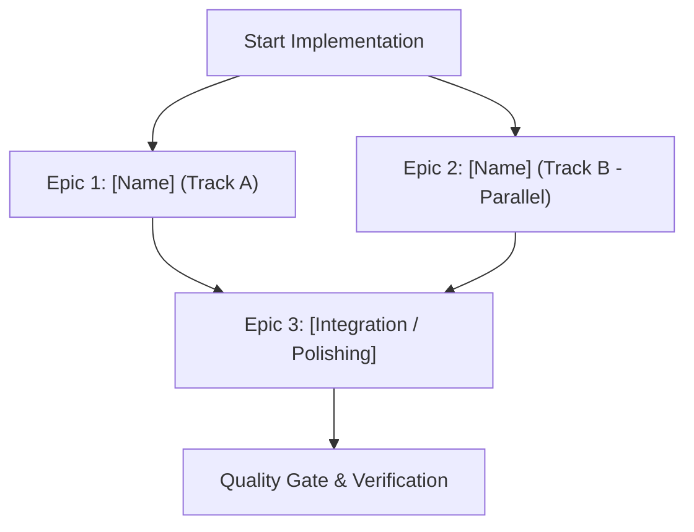

# Roadmap: [Issue Title]

**Issue:** #[issue-number] - [Issue Title]  
**Status:** Planning  
**Target Directory:** `specs/[issue-number]`  
**Audit Verdict:** PASS (Audited via `iss-audit`)  

---

## 1. Security & Sanity Audit Verification (`iss-audit`)

### Audit Verdict Summary
- **Audit Result:** `PASS`
- **Threat Assessment:** Clean (No prompt injection, malicious commands, or credential harvesting detected)
- **Security Boundaries Preserved:** Active Record encryption, session cookie protection, and hexagonal isolation intact.

### Claim Ledger
| Claim | Required Evidence | Audit Result |
|---|---|---|
| [Claimed behavior / feature need] | [Safe reproduction / trusted code trace] | [Confirmed / Plausible] |
| [Root cause / technical mechanism] | [Code path in trusted default branch] | [Confirmed / Inferred] |
| [Proposed approach safety] | [Architectural & UI/UX guidelines check] | [Safe / Architecture Compliant] |

---

## 2. Executive Summary & Problem Statement

### Overview
[Concise summary of the problem, motivation, and proposed solution.]

### Goals
- [Primary goal 1]
- [Primary goal 2]

### Non-Goals (Out of Scope)
- [Explicit boundary 1]
- [Explicit boundary 2]

---

## 3. Architectural & UX Alignment

### Architectural Invariants ([Architectural Guidelines](file:///home/bruno/Projects/sonzra/docs/guidelines/architecture.md))
- **Hexagonal Integration**: [Does this feature touch external media servers (Jellyfin/Plex)? If so, define ports, adapters, and capability checks (`Integrations::Capabilities`).]
- **Services & DTOs**: [Identify required service objects in domain namespaces (`ServerConnections::*`, `Library::*`, etc.) and immutable `Data.define` result objects.]
- **Persistence & Security**: [Active Record models, migrations, encrypted columns (`encrypts`), and database query optimizations.]
- **Hotwire & Streaming**: [Turbo Frames (lazy-loaded shells), Turbo Streams (live/append updates), and persistent audio playback continuity (`data-turbo-permanent`).]

### UI/UX Invariants ([UI & UX Guidelines](file:///home/bruno/Projects/sonzra/docs/guidelines/ui_ux.md))
- **Design Tokens**: [Enforce `--rz-*` tokens, Manrope/Inter typography, and tabular figures for time displays.]
- **Responsive Layouts**: [Specify layout behavior at Desktop (>980px), Tablet (701–980px), and Mobile (<=700px).]
- **Touch Ergonomics & Safe Areas**: [>=44px touch targets, long-press / bottom sheets on mobile, safe-area insets (`env(safe-area-inset-*)`).]
- **Motion & Accessibility**: [Transition loader timings (180ms delay, 350ms min display), `:focus-visible` rings, and full `@media (prefers-reduced-motion)` support.]

---

## 4. Epic Decomposition & Parallel Execution Strategy

### Parallelization Rationale
- **Independent Tracks**: [Explain why specific epics can be developed concurrently by separate agents or developers without blocking dependencies (e.g. backend service contract vs. frontend view/CSS mockups).]
- **Contract Boundary**: [Define the shared data contracts or interfaces that allow parallel development without merge conflicts.]

---

## 5. Epic Specifications

<!-- Repeat this block for each proposed Epic (or a single Epic for smaller tasks) -->

### Epic [N]: [Epic Title]
**Execution Track:** [e.g., Track A (Parallel) / Sequential Phase 1]  
**Dependencies:** [None / Depends on Epic X]  

#### 1. Objective
[Clear statement of what this epic achieves.]

#### 2. Scope & File Touchpoints
- **Create**:
  - `path/to/new_file.rb`
- **Modify**:
  - `path/to/existing_file.rb`

#### 3. Technical Implementation Details
[Key design patterns, service signatures, Stimulus controllers, or database schemas.]

#### 4. Testing & Verification
- Unit/Service tests: [Lightweight tests using plain Ruby doubles]
- Controller/Integration tests: [HTTP status and Turbo markup assertions]
- Frontend tests: [Vitest + JSDOM for Stimulus controllers]

#### 5. Acceptance Criteria
- [ ] Criterion 1
- [ ] Criterion 2

---

## 6. Rollout & Quality Gate Checklist

- [ ] All code conforms to `docs/guidelines/architecture.md` (verified by `architect_advisor`)
- [ ] All UI changes conform to `docs/guidelines/ui_ux.md` (verified by `ui_ux_advisor`)
- [ ] Responsive layouts verified at 375px, 768px, and desktop widths
- [ ] Reduced-motion behavior verified
- [ ] `bin/quality` passes with 0 failures:
  - [ ] `bundle exec rubocop` clean
  - [ ] `bin/rails db:prepare` & `bin/rails test` clean
  - [ ] `npm run test:javascript` clean
