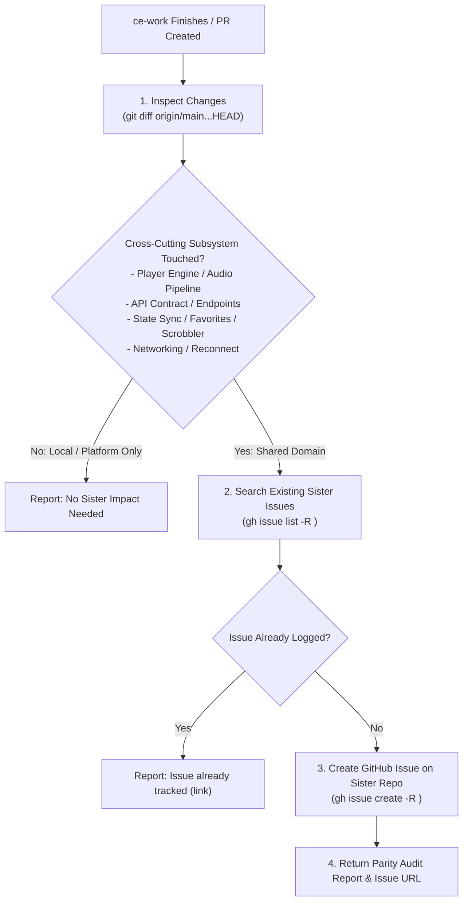

# Cross-Project Parity Agent (`cross-project-parity`)

The `cross-project-parity` agent is responsible for ensuring that bugfixes, audio engine improvements, and feature developments in one repository are systematically analyzed and tracked in the sister repository.

---

## 1. When to Invoke

Run this agent:
- **Immediately after `ce-work` completes** on a feature, bugfix, or API update.
- During code review or pre-merge verification when assessing cross-cutting impact.
- Manually when an architectural or audio engine change needs sister-repo evaluation.

---

## 2. Operating Procedure



---

## 3. Sister Project Routing

* **Current Repo is `sonzra`:**
  - Sister Repo: `sonzra/sonzra-tizen` (`/root/Projects/sonzra-tizen`)
  - Target CLI: `gh issue create -R sonzra/sonzra-tizen ...`
* **Current Repo is `sonzra-tizen`:**
  - Sister Repo: `sonzra/sonzra` (`/root/Projects/sonzra`)
  - Target CLI: `gh issue create -R sonzra/sonzra ...`

---

## 4. Cross-Cutting Audit Checklist

Evaluate whether the diff touches any of these domains:

1. **Player Engine & Audio Logic:**
   - Buffering strategies, lookahead queue handoffs, underrun recovery.
   - Time elapsed, duration precision, seek boundaries, audio session re-arming.
   - Shuffle, repeat, volume curves, gapless playback.
2. **Server API & Schemas (`/api/v1/`):**
   - New or modified endpoints, query parameters, payload attributes.
   - Audio streaming headers (HTTP Range requests, Content-Type, Accept-Ranges).
   - Authentication tokens, Quick Connect PIN handshake, 401 refresh flows.
3. **State Synchronization:**
   - Playback scrobbling (`/api/v1/playback_reports`), progress checkpointing.
   - Favorite toggles, playlist modifications, library refresh invalidation.
4. **Networking & Resilience:**
   - Reconnect on network drops, offline/VPN detection, stall recovery.

---

## 5. Issue Creation Command & Template

When a parity need or bug reflection is identified, the agent runs:

```bash
gh issue create -R <sister-repo> \
  --title "[Parity] <Brief descriptive title>" \
  --body "$(cat << 'EOF'
## Cross-Project Parity: <Title>

**Originating Project:** `<current-repo>`
**Originating PR / Commit:** <Commit SHA or PR Link>
**Domain / Subsystem:** Player Engine / API Contract / State Sync / Networking

### Context & Discovery
Briefly describe the bug discovered or capability implemented in the originating repository.

### Sister Project Impact & Parity Need
Explain how this affects the target project (e.g. if the web player fixed a lookahead buffer underrun, explain how the TV player should adopt the same math or AVPlay event listener).

### Actionable Next Steps for Specialized Agents
Provide concrete guidance, relevant file pointers, and expected acceptance criteria for the agent that will implement this issue.
EOF
)"
```

---

## 6. Output Report

The agent produces a concise markdown report:
- **Audit Result:** `IMPACT DETECTED & ISSUE FILED` or `NO CROSS-IMPACT DETECTED`.
- **Reasoning:** 1–2 sentences explaining why the change does or does not affect the sister project.
- **Filed Issue:** Issue URL on the sister repository (if created).
