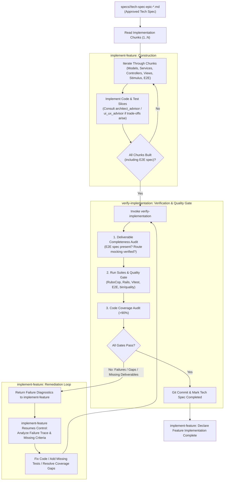

# Feature Implementation Skill (`implement-feature`)

The `implement-feature` skill focuses on **feature construction**. It takes an approved Technical Specification (`specs/<issue-number>/tech-spec-epic-<epic-number>-<slug>.md`) and implements the required changes chunk-by-chunk, consulting the architectural and UI/UX advisors as needed during coding.

Verification (linting, test suite execution, coverage verification, quality gates, and git committing) is handled by the downstream [`verify-implementation`](file:///home/bruno/Projects/sonzra/.agents/skills/verify-implementation/SKILL.md) skill.

---

## 1. Execution Workflow

---

## 2. Ingestion & Pre-Flight Checks

Before writing code:
1. **Read the Technical Specification**:
   - Locate `specs/<issue-number>/tech-spec-epic-<epic-number>-<slug>.md`.
   - Ensure the technical specification status is `Approved - Ready to Build`.
   - Review the component sequence diagrams and chunk breakdowns.
2. **Review Canonical Guidelines**:
   - [Architectural Guidelines](file:///home/bruno/Projects/sonzra/docs/guidelines/architecture.md)
   - [UI & UX Guidelines](file:///home/bruno/Projects/sonzra/docs/guidelines/ui_ux.md)
   - [Engineering Principles](file:///home/bruno/Projects/sonzra/docs/ENGINEERING.md)

---

## 3. Chunk-by-Chunk Implementation

Iterate sequentially through each implementation chunk defined in Section 4 of the technical specification:

### Chunk Categories & Responsibilities:

1. **Data Models & Persistence (Chunk 1)**:
   - Generate and run database migrations if needed (`bin/rails db:migrate`).
   - Define Active Record models with validations, associations, and database scopes.
   - Ensure credentials use Active Record Encryption: `encrypts :username, :password, :access_token`.
   - Keep models skinny—business workflows must not be placed in model callbacks.
   - Write accompanying model tests in `test/models/`.

2. **Integration Adapters & Domain Services (Chunk 2)**:
   - If calling upstream media servers (Jellyfin/Plex), route calls through [`Integrations::Client.for(server_connection)`](file:///home/bruno/Projects/sonzra/app/services/integrations/client.rb#L3-L9). Never make direct external HTTP calls.
   - Check provider capability support via `client.supports?(...)`.
   - Implement single-purpose domain service objects in appropriate namespaces (`ServerConnections::*`, `Library::*`, `Playback::*`).
   - Use constructor dependency injection (`initialize(server_connection, client: nil)`).
   - Return immutable `Data.define` result objects (`*ResultData`) with a `#success?` predicate.
   - Write accompanying service tests in `test/services/` using plain Ruby test doubles (`Object.new` with singleton methods).

3. **Controllers & Routing (Chunk 3)**:
   - Declare RESTful routes in `config/routes.rb`.
   - Keep controllers thin: sanitize parameters, delegate immediately to services, negotiate formats (`format.html`, `format.turbo_stream`).
   - Write accompanying controller integration tests in `test/controllers/`.

4. **Views, Stimulus & UI Components (Chunk 4)**:
   - Server-rendered HTML partials with Hotwire conventions.
   - **Preserve Persistent Playback**: Ensure `#player`, `#player-queue`, and `#player-feedback` maintain `data-turbo-permanent`.
   - Apply `--rz-*` CSS design tokens (`--rz-primary`, `--rz-background`, `--rz-line`, etc.).
   - Enforce 44px minimum touch targets on mobile and include safe-area insets (`env(safe-area-inset-top)` / `env(safe-area-inset-bottom)`).
   - Use tabular numbers for duration timers: `font-variant-numeric: tabular-nums`.
   - Implement lightweight Stimulus controllers; extract complex business/storage logic into pure JS classes.
   - Write accompanying Stimulus tests in `test/javascript/` using Vitest and JSDOM.

5. **End-to-End Playwright Tests (Chunk 5 - Mandatory for UI Epics)**:
   - Create `test/e2e/<feature>.spec.js` mapping all PRD Observable Acceptance Criteria.
   - **Strict Route Mocking**: Intercept backend and media server routes with `page.route` via test helpers (`test/e2e/support/helpers.js`). Never connect to a live Jellyfin or media server instance.
   - Verify complete user journeys on both desktop and mobile viewports.

---

## 4. Advisor Consultation During Implementation

When unforeseen ambiguities or trade-offs occur while coding:
- **Call [`architect_advisor`](file:///home/bruno/Projects/sonzra/.agents/skills/architect-advisor/SKILL.md)**:
  - If boundary isolation, Active Record encryption, caching strategy, or service object structures are unclear.
  - To verify whether a collaborator pattern preserves hexagonal boundaries.
- **Call [`ui_ux_advisor`](file:///home/bruno/Projects/sonzra/.agents/skills/ui-ux-advisor/SKILL.md)**:
  - If responsive layout behavior, touch ergonomics, motion transitions, or dialog/sheet placement need clarification.
  - To ensure styling conforms to the "quiet listening room" aesthetic and `--rz-*` tokens.

---

## 5. Verification Dependency & Remediation Loop

`implement-feature` is **strictly dependent** on `verify-implementation` and must never declare itself complete without a successful verification run.

### The Verification Loop:
1. **Trigger Verification:** Once all chunks (including Chunk 5: E2E Playwright tests) have been constructed, `implement-feature` triggers the `verify-implementation` procedure.
2. **Handle Verification Failures:** If `verify-implementation` fails at any gate:
   - **Missing Deliverables:** (e.g. `test/e2e/<feature>.spec.js` was omitted or lacks required user journey scenarios)
   - **Test Failures:** (Rails, Vitest, or Playwright assertions failed)
   - **Lint Offenses:** (RuboCop offenses detected)
   - **Coverage Gaps:** (New code has <90% test coverage or untested error branches)
   
   👉 **`implement-feature` immediately takes control back**, parses the failure diagnostics, patches the application or test code, and re-invokes `verify-implementation`.
3. **Termination Condition:** The loop only terminates when `verify-implementation` reports:
   - Deliverables audit passed.
   - All tests green across all viewports.
   - Coverage >90%.
   - `bin/quality` passed.
   - Changes committed to git.
4. Only when `verify-implementation` completes successfully with a commit does `implement-feature` declare the feature implementation complete.
