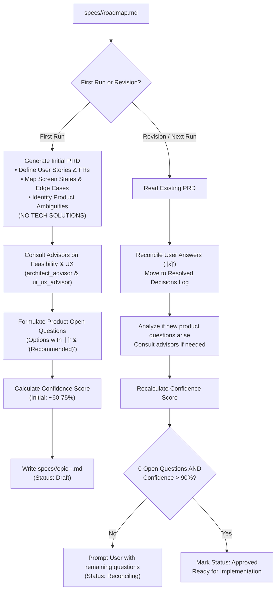

# Product Specifications Skill (`product-specs`)

The `product-specs` skill takes an epic from a feature roadmap (`specs/<issue-number>/roadmap.md`) and produces a comprehensive Product Requirement Document (PRD) located in the same directory (`specs/<issue-number>/epic-<number>-<slug>.md`). It orchestrates an iterative reconciliation loop with the user, resolving product and UX questions until implementation confidence exceeds 90%.

---

## 1. Golden Rule: Strictly Product Focus (No Tech Solutions)

> [!IMPORTANT]
> **A PRD defines WHAT to build and WHY, NEVER the technical HOW.**
> - **DO Focus On:** User personas, user journeys, functional requirements, business rules, edge cases, interaction states (empty, loading, active, error), accessibility, and product constraints.
> - **DO NOT Propose Tech Solutions:** Strictly exclude code snippets, class or module names, method signatures, file paths, database schemas, table migrations, SQL queries, Stimulus controller code, or backend service architectures. Technical design belongs in engineering roadmaps, not in product specifications.

---

## 2. Skill Workflow & Modes



---

## 3. Artifact Naming & Placement

All generated PRD specifications must be placed in the **exact same directory** as the roadmap:
```text
specs/
└── <issue-number>/
    ├── roadmap.md
    ├── epic-1-sleep-timer-rules.md
    └── epic-2-sleep-timer-ui.md
```

Naming convention:
`specs/<issue-number>/epic-<epic-number>-<slug>.md`

---

## 4. Initial Generation Workflow (First Run)

When running for an epic that does not yet have a specification document:

1. **Ingest Scope from Roadmap**: Read `specs/<issue-number>/roadmap.md` to identify the epic's high-level objectives and user goals.
2. **Draft PRD Sections** using [resources/prd-template.md](./resources/prd-template.md):
   - **Problem Statement & User Persona**: Who is the listener, what is their situation, and what pain point is addressed?
   - **User Journey**: Step-by-step narrative of how the user discovers, configures, and experiences the feature.
   - **Functional Requirements (`FR-1`, `FR-2`, etc.)**: Explicit, testable statements of behavior and capability.
   - **Edge Cases & Failure Handling**: What happens during network disconnects, track transitions, app minimizes, or manual interruptions?
   - **UX & Screen States**: Describe the visual behavior of Inactive, Active, Expired, and Error states.
   - **Product Constraints**: E.g., audio playback must remain uninterrupted across page navigation; touch targets must be comfortable (>=44px).
3. **Identify Ambiguities & Consult Advisors for Product Guidance**:
   - Consult **`architect_advisor`** strictly for **feasibility, constraints, and operational implications** (e.g. cross-device state feasibility, latency expectations), NOT for implementation code or class names.
   - Consult **`ui_ux_advisor`** for **ergonomics, usability, and listening room atmosphere**.
4. **Formulate Product Open Questions with Selectable Options**:
   Every open question **must** address a **product decision, UX behavior, or functional scope choice**—never technical mechanics:
   - Starts with context explaining the product trade-off.
   - Summarizes advisor perspectives on usability and feasibility.
   - Lists selectable options where **each option starts with `[ ]`** (empty markdown checkbox) so the user can easily select one by marking `[x]`.
   - Exactly one option is prefixed with `(Recommended)` based on advisor guidance.
   
   *Compliant Example (Product Decision):*
   ```markdown
   ### Question 1: Timer Expiry Playback Behavior
   **Context:** When the sleep timer reaches zero, should music stop immediately, fade out gently, or allow the active song to finish?
   **Advisor Consultation:**
   - **Architect Advisor (Feasibility):** All three options are feasible; immediate stop is simplest, while fade-out requires gradual audio reduction.
   - **UI/UX Advisor (Ergonomics):** A gentle 3-second fade-out provides a significantly softer listening room experience without abruptly startling the user.

   **Select one option below:**
   - [ ] (Recommended) 3-second gentle volume fade-out before pausing playback.
   - [ ] Immediate pause without volume reduction.
   - [ ] Allow the currently playing track to finish completely before pausing.
   ```

   *Prohibited Example (DO NOT DO - Technical Solution):*
   > "Should we store timer state in a Redis key or in an Active Record session record?" *(FORBIDDEN - this is a technical design choice, not a product requirement)*.

5. **Compute Initial Confidence Score**:
   - Assess clarity across Domain (25%), Functional Requirements (25%), UX Expectations (25%), and Open Questions (25%).
   - Initial score typically sits between **60% and 75%** while open questions remain.
6. **Save Initial Document**: Write the file with status `Draft (Awaiting User Decisions)`.

---

## 5. Reconciliation & Iteration Workflow (Subsequent Runs)

When running the skill again on an existing epic specification:

1. **Scan User Inputs**:
   - Read the existing `specs/<issue-number>/epic-<number>-<slug>.md`.
   - Inspect the **Open Questions** section for user marks:
     - Checked options: `- [x]`
     - Written comments or custom notes under questions.
2. **Reconcile Answered Questions**:
   - Move each answered question from **Open Questions** to the **Resolved Decisions Log**.
   - Record the resolution date, selected option, rationale, and resulting requirement update.
   - Update the Functional Requirements or UX sections in the PRD to incorporate the finalized decision.
3. **Analyze Secondary Questions**:
   - Determine if the user's decision introduces any follow-up product questions or unaddressed edge cases.
   - If new questions arise, format them with `[ ]` options and a `(Recommended)` indicator.
4. **Recalculate Confidence Score**:
   - Domain & User Journey Clarity (0–25%)
   - Functional Requirements & Edge Cases (0–25%)
   - UX Behavior & Ergonomic Expectations (0–25%)
   - Open Questions Resolution (0–25%): Full 25% only when 0 open questions remain.
5. **Evaluate Termination Conditions**:
   - **Condition 1:** Are there **0 open questions** remaining?
   - **Condition 2:** Is the **Confidence Score > 90%** (e.g. 95%–100%)?

   - **If NOT satisfied**: Keep Status as `Reconciling (Questions Remaining)` and present the active questions to the user.
   - **If satisfied (0 questions AND >90% confidence)**: Transition Status to `Approved (Ready for Implementation)` and output a readiness confirmation.

---

## 6. Confidence Score Calculation Matrix

The confidence score is a deterministic evaluation out of 100%:

| Dimension | Max Points | Evaluation Criteria |
|---|:---:|---|
| **Domain & User Journey** | 25% | Clear user persona, problem statement, user journeys mapped, and explicit non-goals. |
| **Functional Requirements** | 25% | Numbered, unambiguous functional requirements (`FR-X`) covering all normal and edge-case behaviors. |
| **UX & Ergonomics** | 25% | Screen states (idle, active, completion, error), responsive behaviors, accessibility, and product constraints defined. |
| **Questions Cleared** | 25% | 25% if 0 open questions; deducted proportionally (-10% per unresolved question). |

**Total Confidence Score = Sum of dimensions.** Implementation only starts when `Score > 90%` and `Open Questions = 0`.
