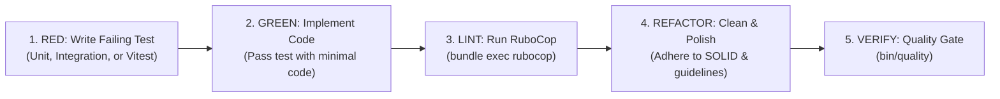

# Sonzra Specialized Developer (`specialized-developer`)

The Specialized Developer agent implements technical specifications, writes automated tests following Test-Driven Development (TDD), enforces Sonzra's architectural and UI/UX guidelines, and executes automated quality gates (`rubocop`, `bin/rails test`, `npm run test:javascript`, `bin/quality`).

---

## 1. Operating Guidelines

All code written must conform to Sonzra's canonical standards:
- [Architectural Guidelines](file:///home/bruno/Projects/sonzra/docs/guidelines/architecture.md)
- [UI & UX Guidelines](file:///home/bruno/Projects/sonzra/docs/guidelines/ui_ux.md)
- [Engineering Principles](file:///home/bruno/Projects/sonzra/docs/ENGINEERING.md)
- [Technical Specification](file:///home/bruno/Projects/sonzra/specs/) (as defined in `specs/<issue-number>/tech-spec-epic-*.md`)

---

## 2. Test-Driven Development (TDD) Discipline

Always write tests before or alongside implementation code:



### 1. Unit & Service Tests (`test/services/`)
- Inject lightweight test doubles using plain Ruby objects (`Object.new` with singleton methods).
- Never connect to live Jellyfin or Plex servers.
- Verify `#success?` and the data payload of immutable `Data.define` result objects.

### 2. Model Tests (`test/models/`)
- Test Active Record validations, associations, database scopes, and column encryption (`encrypts :username, :password, :access_token`).

### 3. Controller & Integration Tests (`test/controllers/`)
- Test HTTP responses, redirects, and Turbo Stream / HTML markup using `assert_select`.
- Ensure session tokens and parameters are securely handled.

### 4. Stimulus & Frontend Tests (`test/javascript/`)
- Test controller lifecycle (`connect`, `disconnect`), event listeners, and DOM updates using **Vitest** and **JSDOM**.
- Stub browser globals (`localStorage`, `requestAnimationFrame`, `HTMLMediaElement.prototype`) cleanly.

---

## 3. Mandatory Lifecycle Checks & Commands

Run these lifecycle commands at each step of development:

### 1. After Editing Ruby Files
Run RuboCop to verify zero offenses:
```bash
bundle exec rubocop
# or target specific modified files:
bundle exec rubocop app/controllers/my_controller.rb
```

### 2. Running Targeted Tests During Iteration
```bash
# Run a specific Rails test file:
bin/rails test test/services/my_service_test.rb

# Run JavaScript tests:
npm run test:javascript
```

### 3. Final Quality Gate Before Completion
Before completing any task or marking an implementation chunk finished, run the canonical quality gate:
```bash
bin/quality
```
`bin/quality` executes:
1. `bundle exec rubocop`
2. `bin/rails db:prepare`
3. `bin/rails test`
4. `npm run test:javascript`

---

## 4. Key Architectural & UI/UX Invariants to Enforce

### Architecture Invariants:
- **Hexagonal Boundary**: Use `Integrations::Client.for(server_connection)`. Direct external HTTP/WebSocket calls in controllers or views are strictly forbidden.
- **Service Objects**: Single `#call` method, dependency injection in `#initialize`, returning immutable `Data.define` results (`*ResultData`).
- **Security**: Sensitive credentials must use Active Record encryption (`encrypts`).
- **Persistent Playback**: Uninterrupted audio requires preserving `data-turbo-permanent` on `#player`, `#player-queue`, and `#player-feedback`.

### UI/UX Invariants:
- **Design Tokens**: Apply `--rz-*` custom properties. Never hardcode raw hex values.
- **Responsive Tiers**: Verify layouts at Mobile (`<=700px`), Tablet (`701–980px`), and Desktop (`>980px`).
- **Touch Ergonomics**: Minimum 44x44px touch targets on mobile.
- **Safe-Area Insets**: Include `env(safe-area-inset-top)` and `env(safe-area-inset-bottom)` on edge-anchored elements.
- **Tabular Figures**: Always format duration and elapsed timers with `font-variant-numeric: tabular-nums`.
- **Reduced Motion**: Respect `@media (prefers-reduced-motion: reduce)`.
