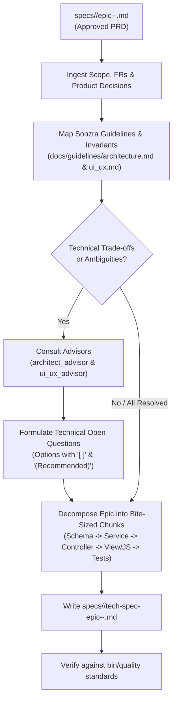

# Technical Specifications Skill (`tech-specs`)

The `tech-specs` skill bridges product requirements and code implementation. It ingests an approved Product Requirement Document (PRD) generated by [`product-specs`](file:///home/bruno/Projects/sonzra/.agents/skills/product-specs/SKILL.md) and produces an actionable, highly detailed Technical Specification located at `specs/<issue-number>/tech-spec-epic-<epic-number>-<slug>.md`.

---

## 1. Skill Purpose & Scope

Where the PRD strictly defines **what** to build and **why**, `tech-specs` defines the **exact technical how**:
- **System Topology & Interaction Flows**: Sequence diagrams, data flows, and component interactions.
- **Implementation Slices (Chunking)**: Decomposing the epic into small, bite-sized, independently testable chunks.
- **Code Specifications & Signatures**: Exact file touchpoints, schema migrations, immutable `Data.define` DTOs, service method signatures, Stimulus controllers, and CSS token applications.
- **Advisor-Guided Technical Decisions**: When technical trade-offs arise, consult the [`architect_advisor`](file:///home/bruno/Projects/sonzra/.agents/skills/architect-advisor/SKILL.md) and [`ui_ux_advisor`](file:///home/bruno/Projects/sonzra/.agents/skills/ui-ux-advisor/SKILL.md) to formulate structured questions with selectable `[ ]` options and a `(Recommended)` choice.

---

## 2. Artifact Placement & Naming

All technical specifications are stored alongside the roadmap and PRD in the issue directory:
```text
specs/
└── <issue-number>/
    ├── roadmap.md
    ├── epic-1-sleep-timer-rules.md          (PRD)
    └── tech-spec-epic-1-sleep-timer-rules.md (Tech Spec)
```

Naming convention:
`specs/<issue-number>/tech-spec-epic-<epic-number>-<slug>.md`

---

## 3. Workflow & Step-by-Step Procedure



### Step 1: Ingest Context & Requirements
1. Read the approved PRD at `specs/<issue-number>/epic-<epic-number>-<slug>.md`.
2. Review the overarching roadmap at `specs/<issue-number>/roadmap.md`.
3. Extract all Functional Requirements (`FR-1`, `FR-2`), edge cases, screen states, and product constraints.

### Step 2: Map Architectural & UI/UX Invariants
Align the technical plan with Sonzra's standards:
1. **[Architectural Guidelines](file:///home/bruno/Projects/sonzra/docs/guidelines/architecture.md)**:
   - **Hexagonal Boundary**: Use `Integrations::Client.for(server_connection)`. Direct external calls in controllers/views are prohibited. Check capabilities via `Integrations::Capabilities`.
   - **Service Objects**: Organize in domain namespaces (`ServerConnections::*`, `Library::*`, `Playback::*`). Expose `#call`. Inject dependencies in `#initialize`. Return immutable `Data.define` results with `#success?`.
   - **Active Record**: Thin models, encrypted credentials (`encrypts :username, :password, :access_token`), clear aggregate separation (`MediaServer` vs `ServerConnection`).
   - **Hotwire**: Maintain `data-turbo-permanent` on `#player`, `#player-queue`, and `#player-feedback`.
2. **[UI & UX Guidelines](file:///home/bruno/Projects/sonzra/docs/guidelines/ui_ux.md)**:
   - **Design Tokens**: Enforce `--rz-*` custom properties (e.g. `--rz-primary`, `--rz-background`, `--rz-line`).
   - **Ergonomics & Touch**: Minimum 44x44px touch targets on mobile, safe areas (`env(safe-area-inset-*)`).
   - **Timers**: Tabular numbers (`font-variant-numeric: tabular-nums`).
   - **Reduced Motion**: Respect `@media (prefers-reduced-motion: reduce)`.

### Step 3: Formulate Technical Decisions (Advisor Consultation)
When architectural or frontend technical trade-offs exist (e.g. client-side timer vs server-synced timer, live polling vs Action Cable, popover positioning):
1. Consult **`architect_advisor`** (SOLID, hexagonal isolation, Active Record impact, testability).
2. Consult **`ui_ux_advisor`** (DOM rendering speed, touch responsiveness, transition smoothness).
3. Formulate the technical question with selectable options:
   - Every option **must start with `[ ]`** (empty checkbox) for easy user selection.
   - Exactly one option **must be marked as `(Recommended)`**.

*Example:*
```markdown
### Tech Decision 1: Sleep Timer Countdown Management
**Context & Technical Trade-offs:** Should the sleep timer countdown run entirely in the browser (Stimulus client timer) or be persisted to the server via periodic polling?
**Advisor Consultation:**
- **Architect Advisor:** A client-side Stimulus timer avoids unnecessary server writes and background job churn, while honoring the persistent player DOM lifecycle.
- **UI/UX Advisor:** A client-side timer provides millisecond-accurate UI updates and zero network latency.

**Select one option below:**
- [ ] (Recommended) Client-side Stimulus countdown anchored in the persistent player controller.
- [ ] Server-side background job with Turbo Stream broadcasts.
- [ ] LocalStorage-synced worker timer.
```

### Step 4: Decompose Epic into Bite-Sized Chunks
Break the epic down into 3–5 sequential, test-driven slices so an engineer or subagent can implement them reliably:
- **Chunk 1: Data Model & Schema (if needed)**: Migrations, Active Record models, validations, encryption, model tests.
- **Chunk 2: Upstream Integration & Domain Service**: Adapter methods, domain service object, immutable `Data.define` result DTO, service unit tests using test doubles.
- **Chunk 3: Routing, Controller & Turbo Streams**: RESTful routes, thin controller actions, parameter sanitization, Turbo Stream responses, controller integration tests.
- **Chunk 4: Views, Stimulus & Styling**: ERB partials, Stimulus controller, `--rz-*` CSS styles, responsive safe-area insets, Vitest controller tests.
- **Chunk 5: End-to-End Verification & Quality Gate**: Full test suite execution, RuboCop check, responsive viewport check (375px & desktop), `bin/quality`.

### Step 5: Generate Technical Specification Document
Populate the document using the canonical template at [resources/tech-spec-template.md](./resources/tech-spec-template.md) and save to `specs/<issue-number>/tech-spec-epic-<epic-number>-<slug>.md`.

---

## 4. Reconciliation & Updates (Subsequent Runs)

When technical decisions are made or updated:
1. Scan the technical specification for checked options (`- [x]`).
2. Move answered questions to the **Resolved Technical Decisions Log**.
3. Refine the affected chunk specifications and code signatures to reflect the resolved approach.
4. If no open technical questions remain, transition status to `Approved - Ready to Build`.
