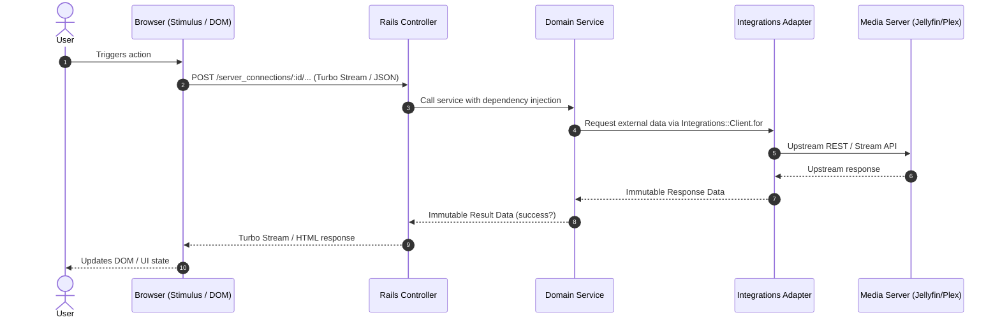
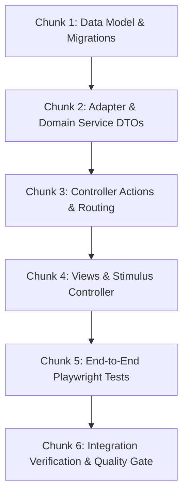

# Technical Specification: [Epic / Task Name]

**Issue:** #[issue-number]  
**PRD Reference:** `specs/[issue-number]/epic-[epic-number]-[slug].md`  
**Roadmap Reference:** `specs/[issue-number]/roadmap.md`  
**Status:** [Draft (Open Technical Questions) / Approved - Ready to Build]  
**Target Output File:** `specs/[issue-number]/tech-spec-epic-[epic-number]-[slug].md`  
**Last Updated:** [YYYY-MM-DD]  

---

## 1. Technical Architecture & Component Interaction

### System Topology & Interaction Flow
[High-level overview of how backend services, adapters, controllers, views, and Stimulus interact.]



### Architectural Invariant Mapping ([Architectural Guidelines](file:///home/bruno/Projects/sonzra/docs/guidelines/architecture.md))
- **Hexagonal Boundary:** [Resolved via `Integrations::Client.for(server_connection)`. Direct external calls forbidden.]
- **Service Objects & DTOs:** [Service organized under domain namespace returning immutable `Data.define` result with `#success?`.]
- **Active Record & Security:** [Sensitive columns encrypted via `encrypts`. Skinny models, no business rules in models.]
- **Hotwire & Streaming:** [Persistent audio player preserved (`data-turbo-permanent`). Turbo Streams for DOM updates.]
- **UI/UX Tokens & Ergonomics:** [CSS variables `--rz-*`, 44px touch targets, tabular numbers `font-variant-numeric: tabular-nums`.]

---

## 2. Technical Decisions & Open Questions

<!--
When technical trade-offs arise, consult architect_advisor and ui_ux_advisor.
Each option MUST start with `[ ]` so the user can easily select one by marking `[x]`.
One option MUST be marked as (Recommended).
-->

### Tech Decision 1: [Short Title of Technical Decision]
**Context & Technical Trade-offs:** [Why is this choice needed? What are the architectural, performance, or maintenance trade-offs?]  
**Advisor Consultation:**
- **Architect Advisor:** [Architectural perspective, SOLID/hexagonal alignment, testing implications]
- **UI/UX Advisor:** [Frontend responsiveness, mobile ergonomics, motion implications]

**Select one option below:**
- [ ] (Recommended) [Option text detailing the recommended technical approach]
- [ ] [Alternative technical approach A]
- [ ] [Alternative technical approach B]

---

## 3. Resolved Technical Decisions Log

<!--
When an open technical question is resolved by the user, record it here.
-->

### Decision 1: [Technical Decision Title]
- **Resolved Date:** [YYYY-MM-DD]
- **Selected Option:** [User's choice]
- **Rationale:** [Why this approach was chosen and how it adheres to Sonzra guidelines]
- **Impact on Architecture:** [Specific classes, DTOs, or schema affected]

---

## 4. Implementation Chunking (Bite-Sized Slices)

To make implementation seamless, test-driven, and manageable, this epic is decomposed into discrete, testable slices.



---

### Chunk 1: [Data Model / Schema / Migrations]
**Goal:** [What this chunk establishes.]  
**Files to Touch:**
- Create: `db/migrate/YYYYMMDDHHMMSS_name.rb`, `app/models/new_model.rb`, `test/models/new_model_test.rb`
- Modify: `app/models/existing_model.rb`

#### Implementation Steps:
1. **Migration / Schema:**
   ```ruby
   # Example schema change or migration definition
   ```
2. **Model Definition & Invariants:**
   - Associations, validations, scopes.
   - Column encryption if holding credentials (`encrypts :username, :password, :access_token`).
3. **Testing Strategy:**
   - Model unit tests validating validations, encryption, and associations.

---

### Chunk 2: [Integration Adapter & Domain Service]
**Goal:** [Encapsulate domain workflow and upstream integration.]  
**Files to Touch:**
- Create: `app/services/namespace/service_name.rb`, `app/services/namespace/service_result_data.rb`, `test/services/namespace/service_name_test.rb`
- Modify: `app/services/integrations/jellyfin/client.rb` (if upstream adapter method needed)

#### Implementation Steps:
1. **Immutable Result DTO:**
   ```ruby
   module Namespace
     ServiceNameResultData = Data.define(:payload, :message) do
       def success?
         message.nil?
       end
     end
   end
   ```
2. **Domain Service Implementation:**
   - Single `#call` method.
   - Constructor dependency injection (`initialize(server_connection, client: nil)`).
   - Adapter calls mediated via `Integrations::Client.for(server_connection)`.
3. **Testing Strategy:**
   - Service unit tests using plain Ruby doubles (`Object.new` with singleton methods). Zero external network calls.

---

### Chunk 3: [Controller Actions, Routing & Turbo Stream Endpoints]
**Goal:** [Expose HTTP interface and format negotiation.]  
**Files to Touch:**
- Create/Modify: `app/controllers/resource_controller.rb`, `config/routes.rb`, `test/controllers/resource_controller_test.rb`

#### Implementation Steps:
1. **Route Declaration:**
   ```ruby
   # config/routes.rb
   ```
2. **Thin Controller Action:**
   - Parameter sanitization, service delegation, format negotiation (`format.html`, `format.turbo_stream`).
3. **Testing Strategy:**
   - Integration tests checking response codes, session tokens, and Turbo Stream markup assertions.

---

### Chunk 4: [Views, Stimulus Controllers & Styling]
**Goal:** [Deliver user-facing UI and responsive client interactions.]  
**Files to Touch:**
- Create/Modify: `app/views/path/_partial.html.erb`, `app/javascript/controllers/name_controller.js`, `app/assets/stylesheets/redesign.css`, `test/javascript/name_controller.test.js`

#### Implementation Steps:
1. **Server-Rendered Markup:**
   - Enforce `data-turbo-permanent` where persistent playback state lives.
   - Use Lucide icons via `lucide_icon "name"`.
2. **Stimulus Controller Design:**
   - Lightweight DOM lifecycle bindings. Extract non-DOM logic into standalone modules.
3. **Styling & Tokens:**
   - Apply `--rz-*` tokens, 44px minimum touch targets, safe-area insets (`env(safe-area-inset-*)`).
4. **Testing Strategy:**
   - Vitest + JSDOM tests in `test/javascript/` verifying controller event dispatching and DOM updates.

---

### Chunk 5: [End-to-End Playwright Tests (test/e2e/<feature>.spec.js)]
> [!IMPORTANT]
> Mandatory for any epic introducing or modifying user-facing UI journeys.
**Goal:** [Verify full user journey end-to-end in real browser environments using mocked backend responses.]  
**Files to Touch:**
- Create: `test/e2e/<feature>.spec.js`
- Modify: `test/e2e/support/helpers.js` (if new mock routes/fixtures needed)

#### Implementation Steps:
1. **Mocking & Isolation Strategy:**
   - Intercept media server and backend routes using `page.route` via `test/e2e/support/helpers.js`.
   - Never allow network calls to connect to an external or live Jellyfin/Plex server.
2. **E2E Scenarios (Derived from PRD Observable Acceptance Criteria):**
   - Scenario 1: [Primary user journey / happy path on desktop & mobile]
   - Scenario 2: [Dialog, modal, or drawer interactions, form submissions, state updates]
   - Scenario 3: [Edge case, cancellation, or error handling]
3. **Execution Commands:**
   - `npm run test:e2e -- test/e2e/<feature>.spec.js`
   - `npm run test:e2e -- --project="Mobile Chrome" test/e2e/<feature>.spec.js`

---

### Chunk 6: [Integration Verification & Quality Gate]
**Goal:** [Verify the complete flow and pass all automated quality checks.]  
**Verification Steps:**
- [ ] Run full test suite: `bin/rails test`
- [ ] Run JavaScript test suite: `npm run test:javascript`
- [ ] Run Playwright E2E suite: `npm run test:e2e`
- [ ] Run Ruby linter: `bundle exec rubocop`
- [ ] Verify `bin/quality` passes with 0 failures
- [ ] Verify responsive layouts at 375px mobile and desktop viewports
- [ ] Verify reduced-motion behavior under `prefers-reduced-motion: reduce`
