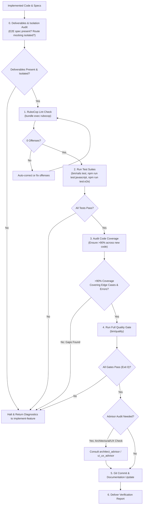

# Feature Verification Skill (`verify-implementation`)

The `verify-implementation` skill owns the **entire verification, testing, code coverage auditing, linting, quality gating, and committing lifecycle** after feature implementation has completed. It can be run independently or invoked as the verification gate for [`implement-feature`](file:///home/bruno/Projects/sonzra/.agents/skills/implement-feature/SKILL.md).

> [!IMPORTANT]
> **Calling Contract & Failure Policy:**
> - **Fail Fast:** If any gate fails (deliverables missing, lint offenses, test failures, coverage gaps), `verify-implementation` produces structured failure diagnostics (error traces, uncovered lines, missing files) and halts. When called by `implement-feature`, it yields back so `implement-feature` can remediate and re-invoke.
> - **Zero Tolerance:** No commit or spec completion occurs until all gates pass with 100% green status.

---

## 1. Execution Workflow



---

## 2. Ingestion & Pre-Flight Checks

1. **Inspect Modified Files**:
   ```bash
   git status
   git diff --stat
   ```
2. **Read Technical Specification & Roadmap**:
   - Locate `specs/<issue-number>/tech-spec-epic-<epic-number>-<slug>.md` and `specs/<issue-number>/roadmap.md`.
   - Identify all files touched in each chunk and expected acceptance criteria.

---

## 3. Step-by-Step Verification Procedure

### Step 0: Deliverable Completeness & Mocking Isolation Audit (Pre-Flight)
Before executing test commands, verify that all deliverables specified in `specs/<issue-number>/tech-spec-epic-*.md` were actually created:
1. **E2E Deliverable Check (UI Epics)**:
   - If the epic touches user-facing UI or user journeys, verify that a corresponding `test/e2e/<feature>.spec.js` exists and is non-empty.
   - If missing, fail immediately:
     > `Verification Failed: Tech spec requires test/e2e/<feature>.spec.js, but file was not found.`
2. **E2E Mocking Isolation Audit**:
   - Inspect the E2E test file to confirm it intercepts requests using `page.route` via test helpers (`test/e2e/support/helpers.js`).
   - Connecting to a live Jellyfin or media server instance is strictly forbidden.
3. **Unit / Integration Deliverable Check**:
   - Confirm all model, service, controller, and Stimulus test files specified in Chunks 1–4 are present.

### Step 1: RuboCop Lint Verification
Run the RuboCop suite to verify compliance with `rubocop-rails-omakase`:
```bash
bundle exec rubocop
```
- **Requirement:** 0 offenses detected.
- If offenses exist, run safe autocorrect (`bundle exec rubocop -a`) or manually adjust code formatting and rerun until 0 offenses remain.

### Step 2: Automated Test Execution
Run backend, frontend, and browser test suites:
```bash
# 1. Rails Test Suite
bin/rails test

# 2. JavaScript / Vitest Suite
npm run test:javascript

# 3. Playwright End-to-End Suite
npm run test:e2e
```
- **Requirement:** 100% of tests must pass with 0 errors and 0 failures across all desktop and mobile targets.
- Verify that newly added E2E tests in `test/e2e/<feature>.spec.js` run and pass.
- If any test fails, inspect the failure trace, correct the defect, and rerun until green.

### Step 3: Code Coverage Audit (>90% Requirement)
Audit all new and modified code files to ensure test coverage exceeds **90%**:
- **Happy Paths**: Are expected inputs and standard successful workflows covered?
- **Failure Paths & Errors**: Are external adapter exceptions (e.g. `Integrations::Jellyfin::Client::AuthenticationError`, `ConnectionError`) tested and properly handled?
- **Edge Cases**: Are nil parameters, blank inputs, and empty collections tested?
- **Active Record Validations**: Are all model validations and encryption attributes tested in `test/models/`?
- **Stimulus DOM & Events**: Are all UI event listeners, active/paused states, and DOM updates tested in `test/javascript/`?

**Action on Gaps:** If any branch, error path, or edge case is missing test coverage, write the necessary test cases immediately before proceeding to the quality gate.

### Step 4: Canonical Quality Gate (`bin/quality`)
Execute the project's canonical verification script:
```bash
bin/quality
```
`bin/quality` verifies:
1. `bundle exec rubocop`
2. `bin/rails db:prepare`
3. `bin/rails test`
4. `npm run test:javascript`
5. `npm run test:e2e`

**Requirement:** The script must exit with status `0`.

---

## 4. Advisor Regression Audit (Optional / High-Impact Changes)

If the implementation touched core architectural boundaries or major responsive layouts, run an advisor check:
- **Architectural Audit**: Consult [`architect_advisor`](file:///home/bruno/Projects/sonzra/.agents/skills/architect-advisor/SKILL.md) to verify that hexagonal boundaries, `Data.define` DTO contracts, Active Record encryption, and persistent player continuity (`data-turbo-permanent`) remain intact.
- **UI/UX Audit**: Consult [`ui_ux_advisor`](file:///home/bruno/Projects/sonzra/.agents/skills/ui-ux-advisor/SKILL.md) to verify that 44px touch targets, `--rz-*` tokens, safe-area insets, and reduced-motion states were not regressed.

---

## 5. Git Commit & Documentation Updates

Once all tests pass, coverage exceeds 90%, and `bin/quality` is clean:

1. **Stage Changes**:
   ```bash
   git add app/ config/ db/ lib/ test/ specs/
   ```
2. **Create Conventional Commit**:
   Commit the finalized work referencing the issue and epic:
   ```bash
   git commit -m "feat(epic-<epic-number>): implement <epic title>

   - Implemented <key capability 1>
   - Implemented <key capability 2>
   - Verified >90% test coverage across new services, models, and controllers
   - Verified 0 RuboCop lint offenses and bin/quality pass
   - Resolves #<issue-number>"
   ```
3. **Update Specification Status**:
   - In `specs/<issue-number>/tech-spec-epic-<epic-number>-<slug>.md`, update status to:  
     `Status: Completed & Verified`
   - In `specs/<issue-number>/roadmap.md`, check off the completed epic in the roadmap checklist.

---

## 6. Verification Report

Deliver a final verification report containing:
1. **Quality Status**: `PASSED & COMMITTED`.
2. **Deliverables Audit**: Confirmation that all promised test suites (including `test/e2e/<feature>.spec.js` with route mocking) exist and passed.
3. **Lint Summary**: RuboCop offense count (0).
4. **Test Results**: Total Rails tests and assertions run, total Vitest tests run, total Playwright tests run.
5. **Coverage Audit**: Confirmation that code coverage exceeds 90% across new code with edge cases verified.
6. **Quality Gate**: Confirmation that `bin/quality` completed with exit code 0.
7. **Git Commit**: Commit hash and commit message.
