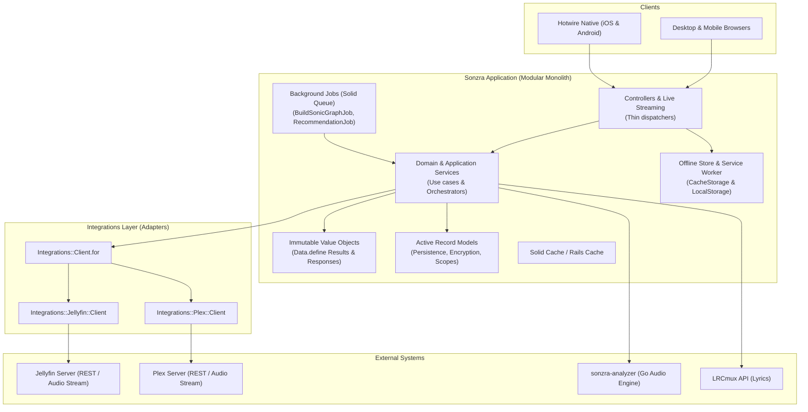

# Sonzra Architectural Guidelines

This document outlines the architectural patterns, design principles, and engineering conventions governing the Sonzra codebase. All contributors and automated agents must adhere to these guidelines when designing, implementing, and refactoring features.

---

## 1. Architectural Vision & Core Principles

Sonzra is an open-source, self-hosted audio streaming client for media servers (Jellyfin, Plex), built as a **modular monolith** on modern Ruby on Rails and Hotwire.

### Key Tenets

1. **Client, Not a Server:** Sonzra is not a media storage or transcoding server. It is a dedicated audio playback and discovery client. Upstream media servers (Jellyfin, Plex) remain the authoritative sources of audio streams and library catalogs.
2. **Server-Rendered & Hotwire-First:** The user interface relies on server-rendered HTML, Turbo Frames, Turbo Streams, and scoped Stimulus controllers. No SPA frameworks (React, Vue) are permitted.
3. **Hotwire Native Readiness:** Every screen, interaction, and component must function seamlessly on mobile viewports and be directly compatible with Hotwire Native (iOS and Android).
4. **Hexagonal Boundaries for External Systems:** Upstream APIs, background analyzers, and filesystem boundaries must be decoupled from core application logic using ports, adapters, and immutable data transfer objects.
5. **Lean & Conventional:** Embrace Rails conventions first. Prefer standard Ruby objects (POROs) and immutable value objects (`Data.define`) over third-party dependencies or convoluted abstractions.

---

## 2. System Architecture & Topology



---

## 3. Layering & Module Responsibilities

The codebase follows a clear separation of concerns across four primary layers:

| Layer | Location | Primary Responsibilities |
|---|---|---|
| **Presentation** | `app/controllers/`, `app/views/`, `app/javascript/` | Handles HTTP requests, negotiates formats (HTML, Turbo Stream, JSON), manages session authentication, renders UI components, and binds client-side DOM events via Stimulus. |
| **Application Services** | `app/services/` | Encapsulates single-purpose workflows and use cases (e.g., fetching home content, building similarity graphs, filtering hidden artists). Mediates between integrations and models. |
| **Integrations & Adapters** | `app/services/integrations/` | Implements provider-specific adapters (Jellyfin, Plex, external APIs). Normalizes external payloads into internal domain structures. Handles upstream network calls and authentication handshakes. |
| **Domain & Persistence** | `app/models/`, `lib/` | Active Record entities, data validation, encryption, scopes, and pure-domain utilities (e.g., audio metadata reading, LRC formatting). |

---

## 4. Hexagonal Integration Pattern (Ports & Adapters)

Whenever Sonzra interacts with external systems (media servers, audio analyzers, external lyrics APIs), the code must follow the Hexagonal Architecture pattern.

### 1. Adapter Factory & Dynamic Resolution

Domain and application code must never instantiate provider classes directly. All client access is mediated through `Integrations::Client.for(server_connection)`:

```ruby
# app/services/integrations/client.rb
module Integrations
  class Client
    def self.for(server_connection, **options)
      case server_connection.provider.to_sym
      when :jellyfin then Jellyfin::Client.new(**server_connection.client_options(**options))
      when :plex     then Plex::Client.new(**server_connection.client_options(**options))
      else raise ArgumentError, "Unsupported media provider: #{server_connection.provider}"
      end
    end
  end
end
```

### 2. Capability System

Not all upstream media providers support identical features (e.g., letter-based alphabetical rails or acoustic sonic graphs). Capabilities are explicitly declared and queried via `Integrations::Capabilities` and `Integrations::CapabilitySupport`:

```ruby
# Capability declaration on adapter
module Integrations
  module Jellyfin
    class Client
      CAPABILITIES = [ Integrations::Capabilities::LETTER_FILTERING, Integrations::Capabilities::SONIC_GRAPH ].freeze
      include Integrations::CapabilitySupport
      ...
    end
  end
end

# Capability querying in controllers or services
if client.supports?(Integrations::Capabilities::SONIC_GRAPH)
  # Execute feature-specific logic
end
```

### 3. Error Translation

Adapters catch raw network and parsing errors, re-raising them as standardized provider errors (e.g., `Integrations::Jellyfin::Client::AuthenticationError`, `ConnectionError`). Services rescue these and wrap them into structured result objects.

---

## 5. Application Services & Use Case Design

Use service objects strictly for discrete application workflows or orchestrations—never as dumping grounds for disparate logic.

### 1. Service Object Contract

Each service must:
- Live under a cohesive namespace matching its aggregate or domain concept (`ServerConnections::*`, `SonicGraph::*`, `HiddenArtists::*`, `Library::*`).
- Accept collaborators and target entities in `#initialize`.
- Support dependency injection for external clients (defaulting to the factory).
- Expose a single `#call` public entrypoint.
- Return an immutable Result Object.

```ruby
# Example: app/services/server_connections/fetch_home_content.rb
module ServerConnections
  class FetchHomeContent
    def initialize(server_connection, client: nil)
      @server_connection = server_connection
      @client = client
    end

    def call
      response = client.home_content
      FetchHomeContentResultData.new(content: response.content, access_token: response.access_token, message: nil)
    rescue Integrations::Jellyfin::Client::AuthenticationError
      FetchHomeContentResultData.new(content: nil, access_token: nil, message: "The saved server credentials were rejected.")
    rescue Integrations::Jellyfin::Client::ConnectionError => error
      FetchHomeContentResultData.new(content: nil, access_token: nil, message: error.message)
    end

    private

    def client
      @client ||= Integrations::Client.for(@server_connection)
    end
  end
end
```

### 2. Immutable Value Objects via `Data.define`

Internal DTOs, API responses, and service results are defined using Ruby's immutable `Data.define`:

```ruby
# app/services/server_connections/fetch_home_content_result_data.rb
module ServerConnections
  FetchHomeContentResultData = Data.define(:content, :access_token, :message) do
    def success?
      message.nil?
    end
  end
end
```

**Benefits:**
- Value equality by default.
- Immutability prevents side effects across execution boundaries.
- Clean and consistent `#success?` predicate contract.

---

## 6. Persistence & Active Record Guidelines

### 1. Thin Models & Clear Boundaries

- Active Record models are responsible for validations, associations, database scopes, and attribute lifecycle hooks.
- Complex business workflows must be delegated to service objects.

### 2. Credential Security & Encryption at Rest

Sensitive user and server credentials (such as media server passwords and access tokens) must be encrypted at rest using Rails Active Record Encryption:

```ruby
# app/models/server_connection.rb
class ServerConnection < ApplicationRecord
  encrypts :username, :password, :access_token
  ...
end
```

### 3. Server Configuration vs. User Credentials

To prevent credential leaks and duplicated server configurations, server metadata is split into two distinct models:
- **`MediaServer`**: Global server definition (`name`, `provider`, `base_url`). Normalized and validated.
- **`ServerConnection`**: User-specific connection aggregate holding credentials (`username`, `password`, `access_token`) and user-scoped data (`listening_events`, `hidden_artists`).
- `ServerConnection` forwards `name`, `provider`, and `base_url` to `MediaServer` to preserve a clean external API while storing server settings exclusively on `MediaServer`.

### 4. High-Performance SQL & Window Functions

When operating on large local datasets (e.g., sonic graphs with thousands of nodes and tens of thousands of similarity edges), avoid loading large Active Record collections into memory. Leverage targeted SQL queries with window functions:

```ruby
# SQLite window function for partitioned nearest-neighbor extraction
TrackSimilarity
  .select("from_item_id, to_item_id, distance")
  .from("(SELECT from_item_id, to_item_id, distance, ROW_NUMBER() OVER (PARTITION BY from_item_id ORDER BY distance ASC) as rank FROM track_similarities WHERE server_connection_id = #{connection.id})")
  .where("rank <= ?", limit)
```

---

## 7. Hotwire & Frontend Architecture

Sonzra adheres strictly to a server-rendered, Hotwire-first design philosophy.

### 1. Persistent Audio Playback via `data-turbo-permanent`

In a standard multi-page application, page navigation interrupts audio playback. Sonzra solves this without client-side SPA routing:
- The persistent player shell (`#player`), queue panel (`#player-queue`), and feedback alerts (`#player-feedback`) are marked with `data-turbo-permanent`.
- The root `<html data-controller="player">` controller hosts the persistent audio state and listener callbacks across page visits.
- Turbo navigations update page contents (`<main>`) while preserving the running `<audio>` element and playback state.

### 2. Deferred Content Loading with Turbo Frames

Slow or remote-dependent content (such as upstream media server dashboards) must not block the initial page render:
- Render an immediate loading skeleton shell containing `<turbo-frame id="home_content" src="/home/content" loading="lazy">`.
- The browser paints the interface instantly and asynchronously requests the frame content.

### 3. Progressive Infinite Scrolling via Turbo Streams

Library grids use Turbo Streams for paginated infinite scrolling:
- Controllers respond to `format.turbo_stream`.
- Use `turbo_stream.append("library-grid", ...)` to append new items.
- Use `turbo_stream.replace("library-scroll-state", ...)` to update pagination sentinels.

### 4. Focused Stimulus Controllers

- Stimulus controllers must remain small, focused, and decoupled.
- Non-DOM logic (such as IndexedDB caching, audio queue management, or offline synchronization) must be extracted into standalone JavaScript modules (e.g., `OfflineMediaStore`).

---

## 8. Caching Strategy

Sonzra employs a multi-tiered caching pattern:

1. **Session-Level Access Tokens:** Upstream session tokens are retained in `session[:server_access_tokens]` per server connection to minimize repetitive authentication round-trips.
2. **Composite Cache Keys:** Dynamic calculations (such as library tab counts or sonic map payloads) use composite cache keys combining connection and user version timestamps:
   ```ruby
   cache_key = [ "library-tab-counts", server_connection.cache_key_with_version, user.cache_key_with_version ]
   Rails.cache.fetch(cache_key, expires_in: 5.minutes) { ... }
   ```
3. **HTTP Streaming Proxy:** The audio playback proxy (`PlaybackController`) streams binary audio chunks directly from upstream via `ActionController::Live` with `Range` header support, bypassing intermediate buffering in memory.

---

## 9. Background Processing

- Background tasks use Active Job (`SolidQueue`).
- Jobs (`BuildSonicGraphJob`, `GenerateRecommendationsJob`) act solely as dispatchers: they load the required entities and delegate immediate execution to domain service objects (`SonicGraph::Builder`, `RecommendationGenerator`).
- Long-running jobs must process items in batches (`BATCH_SIZE = 50`) and provide structured logging.

---

## 10. Testing Patterns & Quality Standards

Every feature or bugfix must be accompanied by automated tests. Follow the "narrowest useful test" principle:

### 1. Test Layering

- **Unit / Service Tests (`test/services/`):** Test domain workflows in complete isolation. Inject lightweight test doubles using plain Ruby objects (`Object.new` with singleton methods) or controlled data structs. **Never hit live external media servers in tests.**
- **Model Tests (`test/models/`):** Test validations, associations, database encryption, and model scopes.
- **Controller / Integration Tests (`test/controllers/`):** Test HTTP responses, redirects, session persistence, and HTML/Turbo markup via `assert_select`.
- **JavaScript Tests (`test/javascript/`):** Test Stimulus controller behaviour, event handling, and client storage using **Vitest** and **JSDOM**.
- **End-to-End Tests (`test/e2e/`):** Test critical user journeys, full-stack Hotwire transitions, mobile responsiveness (375px), and audio player persistence (`data-turbo-permanent`) using **Playwright** (`npm run test:e2e`).

### 2. Quality Gate

All changes must pass the quality suite prior to merging:
```bash
bin/quality
```
`bin/quality` verifies:
1. `bundle exec rubocop` (linting via `rubocop-rails-omakase`)
2. `bin/rails db:prepare`
3. `bin/rails test` (Minitest suite)
4. `npm run test:javascript` (Vitest suite)
5. `npm run test:e2e` (Playwright E2E suite)

---

## 11. Architectural Checklist & Anti-Patterns

### Recommended Patterns (DO)
- **DO** use `Integrations::Client.for` whenever communicating with external media servers.
- **DO** define new service results and DTOs using `Data.define`.
- **DO** inject dependencies in service initializers to enable frictionless unit testing.
- **DO** use `data-turbo-permanent` for state that must outlive page transitions.
- **DO** check provider capabilities (`supports?(:capability)`) before executing provider-specific logic.
- **DO** test responsive layouts at 375px viewport width and desktop.

### Anti-Patterns (AVOID)
- **DO NOT** make direct `Net::HTTP` or upstream API calls inside controllers or views.
- **DO NOT** add React, Vue, or client-side routing libraries.
- **DO NOT** mock HTTP requests when simple dependency injection of a collaborator object is possible.
- **DO NOT** store unencrypted external server credentials in the database.
- **DO NOT** place heavy domain rules or external API processing directly in Active Record models.
- **DO NOT** block main page renders for slow upstream queries; use lazy Turbo Frames instead.
