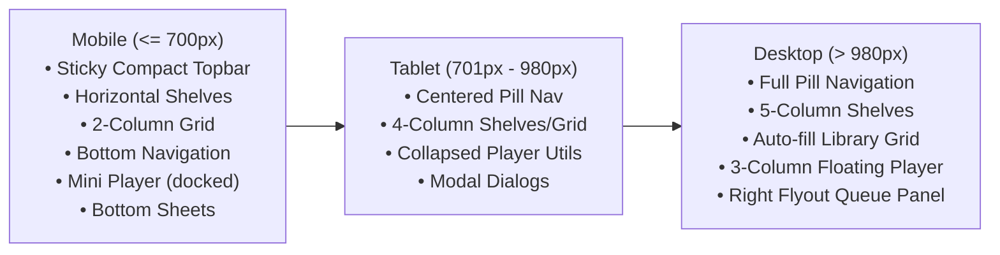

# Sonzra UI & UX Guidelines

This document establishes the user interface (UI) and user experience (UX) design standards, visual hierarchy, interaction models, and responsive patterns for the Sonzra project. All contributors, designers, and automated agents must adhere to these guidelines when designing and building user-facing features.

---

## 1. Design Vision & Philosophy

Sonzra is conceived as a **quiet, premium listening room** rather than a utilitarian administrative dashboard or generic web media player.

### Core Tenets

1. **Media-First Hierarchy:** Album covers, artist portraits, and track typography lead the visual hierarchy. Interface chrome, containers, and borders yield visual prominence to media assets.
2. **Progressive Disclosure:** Secondary actions (favorite, add to playlist, download, options) remain hidden until relevant—surfacing on hover, keyboard focus, long-press, or within context sheets.
3. **Uninterrupted, Persistent Context:** Page navigation must never interrupt audio playback. The player, playback queue, and dynamic playback state remain persistently anchored across transitions.
4. **One Unified, Mobile-First System:** Mobile is not an afterthought or an awkward compression of desktop. Mobile layouts use bottom navigation, horizontal swipeable shelves, compact mini-players, and bottom sheets.
5. **Motion Explains State:** Animations provide immediate feedback regarding loading, navigation, and playback. Decorative motion without clear feedback intent is strictly avoided.
6. **Canonical Source of Truth:** The **Redesign** interface (enabled via `ui_variant: "redesign"` and styled in [`app/assets/stylesheets/redesign.css`](file:///home/bruno/Projects/sonzra/app/assets/stylesheets/redesign.css)) represents the definitive design standard for all new screens and components.

---

## 2. Design Tokens & Visual Foundations

The visual system is built on a dark, high-contrast, atmospheric theme with custom CSS variables scoped under `.redesign`:

### 1. Color Palette

```css
.redesign {
  --rz-primary: #7a5af8;       /* Primary brand purple */
  --rz-primary-light: #9b82ff; /* Highlights, focus rings, active badges */
  --rz-primary-dark: #5c3fd6;  /* Gradients, pressed button states */
  --rz-accent: #43d7c6;        /* Connected state, equalizer bars, live cues */
  --rz-background: #09090f;    /* Deep space black canvas */
  --rz-surface: #12121c;       /* Cards, topbar glass, secondary panels */
  --rz-raised: #191927;        /* Elevated dialogs, sheets, card art fallback */
  --rz-hover: #232334;         /* Hover state for interactive items */
  --rz-text: #f6f6fa;          /* Primary high-contrast text */
  --rz-muted: #9694a6;         /* Secondary labels, durations, artists */
  --rz-line: rgb(255 255 255 / 9%); /* Subtle border hairline */
  --rz-radius: 18px;           /* Standard container radius */
}
```

| Token | Value | Primary Role |
|---|---|---|
| `--rz-primary` | `#7A5AF8` | Primary button backgrounds, active tab indicators, major brand accents |
| `--rz-primary-light` | `#9B82FF` | Focus visible outlines, section kickers, highlighted icons |
| `--rz-primary-dark` | `#5C3FD6` | Gradient stops for primary buttons and hero cards |
| `--rz-accent` | `#43D7C6` | Active server indicator, playback equalizer bars, connection online pill |
| `--rz-background` | `#09090F` | Main application background (enhanced with subtle radial purple/cyan glows) |
| `--rz-surface` | `#12121C` | Topbars, list items, navigation containers |
| `--rz-raised` | `#191927` | Popovers, bottom sheets, modal dialogs, album art placeholders |
| `--rz-hover` | `#232334` | Hovered rows, selected playlist items |
| `--rz-text` | `#F6F6FA` | Primary typography, headlines, active links |
| `--rz-muted` | `#9694A6` | Artist subtitles, release years, track elapsed/remaining times |
| `--rz-line` | `rgba(255,255,255,.09)` | Standard border for cards, buttons, dividers, and sheets |
| Danger / Error | `#FF4568` | Delete actions, connection failure states, error badges |

### 2. Typography

- **Font Family:** `Manrope`, falling back to `Inter`, `ui-sans-serif`, `system-ui`, `sans-serif`.
- **Typographic Scale & Styling:**
  - **Eyebrow / Kicker:** `font-size: 10px; font-weight: 800; letter-spacing: .14em; text-transform: uppercase; color: var(--rz-primary-light);`
  - **Hero Title:** `font-size: clamp(38px, 5vw, 62px); letter-spacing: -.055em; line-height: 1; font-weight: 800;`
  - **Section Heading:** `font-size: 25px; letter-spacing: -.04em; font-weight: 800;`
  - **Card Title:** `font-size: 13px; font-weight: 700; color: var(--rz-text);` (single-line ellipsis truncation).
  - **Metadata & Subtitles:** `font-size: 11px; color: var(--rz-muted);`
  - **Numeric & Time Display:** Must use tabular figures (`font-variant-numeric: tabular-nums`) to prevent layout jitter as track timers advance.

### 3. Spacing & Elevation Scale

- **Base Grid:** 4px grid. Standard spacing intervals: `4px`, `8px`, `12px`, `16px`, `24px`, `32px`, `48px`, `64px`.
- **Border Radius Hierarchy:**
  - Standard containers & cards: `18px` (`--rz-radius`) or `16px` (`.listen-card__art`).
  - Buttons & Form Inputs: `12px`.
  - Floating Dialogs & Bottom Sheets: `22px` to `24px`.
  - Pills, Nav Badges & Avatar Marks: `999px` (fully rounded).
- **Surface Elevation:** Prefer 1px hairline borders (`var(--rz-line)`) over heavy flat shadows. Reserve deep blurred drop shadows (`box-shadow: 0 16px 60px rgb(0 0 0 / 55%)`) for floating elements: persistent player, queue sheet, command palette, and modal dialogs.

---

## 3. Brand Identity & Dynamic Logo

The Sonzra mark is an **S** formed from dynamic waveform bars ([`public/brand/sonzra-mark.svg`](file:///home/bruno/Projects/sonzra/public/brand/sonzra-mark.svg)).

The logo mark is an active indicator of system and playback state, controlled via [`LogoController`](file:///home/bruno/Projects/sonzra/app/javascript/controllers/logo_controller.js):

| State | Visual Treatment | Meaning |
|---|---|---|
| `idle` | Static master mark | Player stopped or library idle |
| `playing` | Gentle pulse or reactive audio levels | Track currently streaming |
| `loading` | Sequential bar sweep or orbital rotation | Initializing audio or awaiting remote frame |
| `buffering` | Intermittent bar pulse | Network stream buffer underflow |
| `connecting` | Cyan-biased glow (`--rz-accent`) | Establishing media server connection |
| `paused` | Muted opacity / frozen motion | Playback paused |
| `error` | Red-biased glow (`#FF4568`) | Playback stream or authentication failure |
| `offline` | Flatter, desaturated waveform | Application running in offline mode |

---

## 4. Layout Architecture & Responsive Breakpoints

Sonzra employs three responsive tiers:



### 1. Viewport Rules

- **Safe-Area Inset Enforcement:** All edge-anchored components (top navigation, persistent player, bottom navigation, dialog sheets) **must** incorporate `env(safe-area-inset-top)` and `env(safe-area-inset-bottom)`.
  ```css
  .redesign {
    padding: calc(62px + env(safe-area-inset-top)) 0 calc(143px + env(safe-area-inset-bottom));
  }
  ```
- **Viewport Height Units:** Use dynamic viewport height (`100dvh`) with `100vh` fallback for reliable mobile browser chrome handling.
- **Maximum Content Width:** Main container widths are capped at `min(100%, 1440px)` for library browsing and `min(100%, 1060px)` for settings/detail pages.

---

## 5. Core UI Component Specifications

### 1. Persistent Player (`.listen-player`)

The persistent player is rendered in [`app/views/shared/_player.html.erb`](file:///home/bruno/Projects/sonzra/app/views/shared/_player.html.erb) and powered by [`PlayerController`](file:///home/bruno/Projects/sonzra/app/javascript/controllers/player_controller.js).

- **Desktop Layout:**
  - 3-column floating glass card (`minmax(0, 1fr) minmax(360px, 1.1fr) minmax(0, 1fr)`).
  - Left column: Album art (58x58px), track title, artist name, and favorite heart toggle.
  - Center column: Transport controls (previous, play/pause, next, repeat, radio) + timeline range slider with elapsed/total times.
  - Right column: Favorite toggle, lyrics button, queue toggle, and volume slider.
- **Mobile Layout:**
  - Compact docked bar (`height: 67px`) pinned immediately above bottom navigation.
  - Shows 48x48px artwork, truncated track title & artist, play/pause button, skip forward button, and thin 2px progress bar along the bottom edge.
  - Tapping the track identity triggers the full Queue / Now Playing sheet.

### 2. Media Cards (`.listen-card`)

Rendered in [`app/views/shared/_media_grid.html.erb`](file:///home/bruno/Projects/sonzra/app/views/shared/_media_grid.html.erb) and shelves:
- **Aspect Ratio:** Strictly 1:1 square artwork.
- **Image Treatment:** Rounded corners (`16px`), cover fit, subtle inner border (`box-shadow: inset 0 0 0 1px rgb(255 255 255 / 10%)`).
- **Missing Artwork Fallback:** Must display the stylized radial gradient fallback containing the Sonzra mark ([`.listen-card__fallback`](file:///home/bruno/Projects/sonzra/app/assets/stylesheets/redesign.css#L51)).
- **Hover / Focus Elevation:** Cards lift by `-3px` with an expanded shadow. The circular play button fades in and translates upwards (`opacity: 1; transform: none`).
- **Options Toggle:** Circular 3-dots icon button (`.listen-card__options-toggle`) anchored at top-right.

### 3. Media Shelves (`.listen-shelf`)

Rendered in [`app/views/shared/_media_shelf.html.erb`](file:///home/bruno/Projects/sonzra/app/views/shared/_media_shelf.html.erb):
- **Desktop:** 5-column grid (`repeat(5, minmax(0, 1fr))`).
- **Tablet:** 4-column grid (`repeat(4, minmax(0, 1fr))`).
- **Mobile:** Horizontal swipeable carousel with card width of `142px`, `13px` gap, `scroll-snap-type: x proximity`, hidden scrollbar, and 17px padding gutter matching screen edges.

### 4. Card Options & Context Sheets

Managed via [`CardOptionsController`](file:///home/bruno/Projects/sonzra/app/javascript/controllers/card_options_controller.js):
- **Desktop:** Positioned as a floating popover anchored near the trigger button using CSS custom variables (`--menu-top`, `--menu-left`).
- **Mobile:** Rendered as a sliding bottom sheet with dark backdrop blur.
- **Gesture Support:** Supports a **550ms long-press** touch gesture on mobile cards to open options directly without requiring pinpoint tapping on the options button.
- **Actions Provided:** Play next, Add to queue, Favorite / Unfavorite, Add to playlist, Download offline, Hide artist, Reset resume point.

### 5. Search & Command Palette (`.redesign-search-dialog`)

Rendered in [`app/views/shared/_redesign_navigation.html.erb`](file:///home/bruno/Projects/sonzra/app/views/shared/_redesign_navigation.html.erb) and managed by [`LibrarySearchController`](file:///home/bruno/Projects/sonzra/app/javascript/controllers/library_search_controller.js):
- **Shortcut:** Accessible via `⌘K` on macOS or `Ctrl+K` on Windows/Linux, or clicking the search icon button.
- Native HTML `<dialog>` element with backdrop blur.
- Instant access to quick destination shortcuts (Albums, Artists, Your Mixes).

---

## 6. Motion & Animation Standards

Animations exist solely to provide feedback and contextual continuity.

### 1. Motion Specifications

| Interaction | Properties | Duration | Easing |
|---|---|---|---|
| **Page Entry** | `opacity: 0 -> 1`, `translateY: 12px -> 0` | `520ms` | `cubic-bezier(.2, .8, .2, 1)` |
| **Card Staggered Reveal** | `opacity: 0 -> 1`, `translateY: 10px -> 0`, `scale: .985 -> 1` | `400ms` (70ms–320ms stagger) | `cubic-bezier(.2, .8, .2, 1)` |
| **Card Play Button Hover** | `opacity: 0 -> 1`, `translateY: 7px -> 0` | `220ms` | `cubic-bezier(.2, .8, .2, 1)` |
| **Queue Slide-In (Desktop)** | `opacity: 0 -> 1`, `translateX: 104% -> 0` | `320ms` | `cubic-bezier(.2, .8, .2, 1)` |
| **Queue Slide-Up (Mobile)** | `translateY: 104% -> 0` | `320ms` | `cubic-bezier(.2, .8, .2, 1)` |
| **Dialog Backdrop Fade** | `background-color: transparent -> rgb(0 0 0 / 68%)` | `220ms` | `ease` |

### 2. Full-Page Turbo Transition Screen

Rendered in [`app/views/shared/_transition.html.erb`](file:///home/bruno/Projects/sonzra/app/views/shared/_transition.html.erb) and orchestrated by [`TransitionController`](file:///home/bruno/Projects/sonzra/app/javascript/controllers/transition_controller.js):
- **Visuals:** Features the Sonzra mark, an orbital cyan tracking satellite, a gentle breathing glow, and a sliding progress line.
- **180ms Debounce Delay:** Never flash the loader for fast or cached Turbo navigations that complete under 180ms.
- **350ms Minimum Display:** Once shown, the transition screen remains visible for at least 350ms to prevent visual jitter.
- **Contextual Copy:** Replaces status message based on destination URL:
  - `"Opening album"` for album views.
  - `"Opening your library"` for library grids.
  - `"Finding new sounds"` for mixes and sonic map.
  - `"Connecting to your server"` for server switching.

### 3. Reduced Motion Requirements

Respect user operating system settings unconditionally:

```css
@media (prefers-reduced-motion: reduce) {
  *, *::before, *::after {
    animation-duration: 0.01ms !important;
    animation-iteration-count: 1 !important;
    transition-duration: 0.01ms !important;
    scroll-behavior: auto !important;
  }
  .redesign-transition__mark,
  .redesign-transition__orbit i,
  .listen-player__playing-mark i {
    animation: none !important;
  }
}
```

---

## 7. Hotwire Native & Touch Ergonomics

Sonzra targets web browsers and Hotwire Native mobile applications concurrently:

1. **Strict 44px Touch Target Rule:** Every interactive control (icon buttons, tab links, queue items, timeline handles) must provide at least a `44x44px` clickable/tappable bounding area, even if the visible glyph or text is smaller.
2. **No Hover Dependency:** Critical functionality must never depend on hover. Every action revealed on desktop hover must have a touch equivalent (e.g. mobile bottom sheets or explicit card buttons).
3. **Scroll Restoration:** Native scroll position must be preserved when navigating back from media details to library grids.
4. **No Custom Client Routers:** Rely strictly on Turbo visits. Do not invent custom hash or client routing patterns that clash with native bridge navigators.

---

## 8. Accessibility (a11y) & Ergonomics

1. **Visible Focus Indicators:** Never remove focus outlines. All interactive controls use high-contrast focus rings:
   ```css
   :focus-visible {
     outline: 2px solid var(--rz-primary-light);
     outline-offset: 3px;
   }
   ```
2. **Screen Reader Semantics:**
   - Icon-only buttons must supply clear, contextual `aria-label`s (e.g. `aria-label="Add to favourites"`, `aria-label="Previous track"`).
   - Icons must have `aria-hidden="true"`.
   - Modals and sheets must utilize standard `<dialog>` semantics with focus traps, `Escape` key listeners, and focus restoration to the opening button.
3. **Live Regions:** Dynamic status changes (e.g. "Track added to queue", "Downloaded for offline playback") must announce via ARIA live regions:
   ```html
   <p id="player-feedback" role="status" aria-live="polite" hidden></p>
   ```

---

## 9. UI & UX Checklist

### Recommended Patterns (DO)
- **DO** use the `--rz-*` color and spacing tokens for all layout styling.
- **DO** verify designs at `375px` mobile width, `768px` tablet width, and `1440px` desktop width.
- **DO** support `data-turbo-permanent` so playback never pauses on navigation.
- **DO** include safe-area insets (`env(safe-area-inset-*)`) on all fixed or sticky elements.
- **DO** provide immediate visual feedback (e.g., active states, spinner or transition screen) on async requests.
- **DO** truncate long titles with ellipsis and specify `title` attributes for tooltips.

### Anti-Patterns (AVOID)
- **DO NOT** hardcode hex colors; always reference `--rz-*` design tokens.
- **DO NOT** use horizontal scrolling on the entire page or cut off long titles without truncation.
- **DO NOT** design clickable buttons smaller than 44px on mobile viewports.
- **DO NOT** introduce decorative animations that cannot be disabled under `prefers-reduced-motion`.
- **DO NOT** build desktop-only popovers; provide matching mobile bottom sheets.
- **DO NOT** cause flashes of unstyled content or un-debounced loading spinners for fast page loads.
