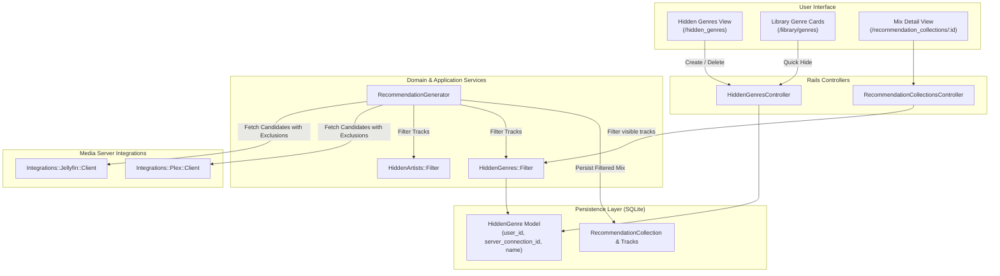

# Exclude Hidden Genres from Mixes and Discovery

## Goal Capsule

- **Objective:** Prevent unwanted genres from dominating personalized mixes and appearing in discovery queues by allowing users to hide genres per server connection.
- **Means:** Introduce an Active Record `HiddenGenre` model, a `HiddenGenres::Filter` domain filtering service, fallback selection for `best_of_genre` in `RecommendationGenerator`, exclusion in `RecommendationCollectionsController#visible_tracks`, and Hotwire-driven settings and library UI actions.
- **Product Authority:** Covers user-configured genre exclusion across daily/weekly mixes (*Best of <Genre>*, *Friday Rediscovery*, *Top of the Month*, *All-Time Heavy Rotation*) and instant radio queues. Direct library browsing via the All Genres directory (`/library/genres`) remains browseable with visual indications and unhide options.
- **Stop Conditions:** Complete when users can hide/unhide genres from settings and library views, mix generation bypasses hidden genres without empty mix failures, and all automated unit, integration, and UI tests pass with clean `bin/quality`.

## Product Contract

*Product Contract preservation: Product Contract initialized via ce-plan-bootstrap from GitHub Issue #7.*

### Summary

Sonzra's personalized discovery engine generates daily and weekly listening sessions based on user listening history. However, users who play specific genres for secondary or utilitarian contexts (such as sleep ambience, children's stories, or seasonal holiday tracks) find those genres dominating their *Best of <Genre>* mixes and surfacing unexpectedly in general rotation. This feature extends Sonzra's existing artist exclusion architecture to support excluding entire musical genres per server connection, keeping personalized mixes relevant to the user's primary listening preferences.

### Problem Frame

Sonzra currently provides artist-level exclusion through `HiddenArtist` and `HiddenArtists::Filter`, but lacks any mechanism to exclude genres. When a user listens heavily to a specific genre for temporary or utilitarian reasons, `RecommendationGenerator` selects that genre as their top listening category for the daily `best_of_genre` mix. Additionally, candidate tracks in discovery mixes (*Friday Rediscovery*, *Top of the Month*, *All-Time Heavy Rotation*, and instant radio) can include tracks tagged with genres the user does not want in their music discovery flow.

### Key Decisions

- **KD1: Mirror `HiddenArtist` data model and scoping.** *(session-settled: user-directed — chosen over monolithic exclusion JSON/settings table)* Persist hidden genres in a dedicated `hidden_genres` table scoped by `user_id`, `server_connection_id`, and `name`. Governs R1, R2.
- **KD2: Dual impact on mix generation.** *(session-settled: user-directed — chosen over mix-only or queue-only exclusion)* Hiding a genre prevents dedicated *Best of <Genre>* creation for that genre and actively excludes individual tracks carrying that genre tag from all other mix strategies and radio tracks. Governs R3, R4, R5.
- **KD3: Case-insensitive name matching.** *(session-settled: user-directed — chosen over strict provider ID matching)* Unlike artists with stable upstream GUIDs, genres across Jellyfin and Plex are string-based taxonomy tags; filtering normalizes genre strings case-insensitively. Governs R3, R4.
- **KD4: Dynamic filtering on rendered mixes.** *(session-settled: user-directed — chosen over deleting or regenerating historical records)* Existing generated mixes dynamically filter out tracks matching newly hidden genres when loaded via `RecommendationCollectionsController#visible_tracks`. Governs R6.
- **KD5: Settings management page plus library quick-actions.** *(session-settled: user-directed — chosen over settings-only entry point)* Provide a `/hidden_genres` management screen under settings matching `/hidden_artists`, and expose "Hide genre" actions in library genre cards and options sheets. Governs R7, R8, R9.
- **KD6: Hotwire Turbo Stream DOM removals and additions.** *(session-settled: user-directed)* Both `HiddenGenresController#destroy` and `#create` respond to `format.turbo_stream`, removing items instantly on unhide/hide with `turbo_stream.remove` and gracefully handling empty state switches without full page reloads. Governs R10.
- **KD7: Async Dashboard card removal without media provider refetch.** *(session-settled: user-directed)* Hiding a genre from the dashboard options menu or explore tiles operates purely asynchronously via JSON/Turbo Stream, removing the targeted mix card or genre tile from the DOM immediately and showing feedback toast via `playerController#showFeedback`, completely eliminating full dashboard reloads and duplicate calls to media providers. Governs R11.
- **KD8: Redesign Design System fidelity.** *(session-settled: user-directed)* All views and components adapt to Sonzra's modern redesign tokens (`var(--rz-line)`, `var(--rz-raised)`, `var(--rz-accent)`), utilizing `.form-page.form-page--compact` on `/hidden_genres`, seamless card hover behavior, and tailored card options positioning on `.redesign-mix-card`. Governs R12.

### Requirements

**Persistence & Scoping**

- R1. The system must persist hidden genres in a `hidden_genres` table with foreign keys to `users` and `server_connections`, a required `name` string, and a unique composite index on `[:user_id, :server_connection_id, :name]`.
- R2. The `HiddenGenre` Active Record model must validate presence and uniqueness of `name` scoped to `user_id` and `server_connection_id`, with automatic whitespace stripping.

**Domain Filtering & Mix Generation**

- R3. A domain service `HiddenGenres::Filter` must filter collections of media items and tracks, rejecting any item whose `Genres` or `GenreItems` list contains a case-insensitive match with the user's hidden genres for that server connection.
- R4. In `RecommendationGenerator`, candidate tracks for all mix strategies (`friday_rediscovery`, `top_of_month`, `all_time_top`, `more_from_artist`) must be filtered through `HiddenGenres::Filter`.
- R5. For the `best_of_genre` mix strategy, the top-played genre selection must exclude any hidden genre and automatically select the user's next most-played eligible genre. If no eligible genre has listening history, the generator must fall back to the standard random discovery mix.
- R6. `RecommendationCollectionsController#visible_tracks` must filter stored `recommendation_tracks` against the user's hidden genres, matching both the track's stored `genre` attribute and live item tags.

**User Interface & Interaction**

- R7. The application must provide a `/hidden_genres` utility page displaying all hidden genres grouped by server connection with an "Unhide" button, an empty state when none are hidden, and a simple form to hide a genre by name.
- R8. Navigation sidebars and redesign drawer navigation must include a "Hidden genres" link with the Lucide `tag` or `eye-off` icon under the settings section.
- R9. Library genre cards and detail sheets must offer a quick-action button to hide the genre, issuing an asynchronous Turbo Stream/JSON request that updates the UI immediately.
- R10. `HiddenGenresController#destroy` and `#create` must support `format.turbo_stream` for Hotwire-driven asynchronous updates: `destroy` removes the targeted card with `turbo_stream.remove` and updates the empty state if none remain; `create` appends new cards or removes hidden tiles without full page reloads.
- R11. Hiding a genre from the dashboard must never cause a full-page reload or re-query media providers: `card_options_controller#hideGenre` removes the mix card from the DOM with smooth transition and displays toast feedback, while dashboard genre tiles remove their DOM nodes via Turbo Streams.
- R12. All hidden genres views and controls must comply with Sonzra's redesign layout system when `redesign_enabled?` is active, utilizing `.form-page.form-page--compact`, glassmorphic cards, and redesign CSS variables (`--rz-line`, `--rz-raised`, `--rz-accent`).

### Key Flows

- **F1: Managing Hidden Genres in Settings:** User navigates to Settings > "Hidden genres" (`/hidden_genres`), sees their hidden genres for the active connection, and can unhide any genre with an instantaneous Turbo Stream update.
- **F2: Hiding a Genre from Library:** User browsing `/library/genres` taps options on an unwanted genre, selects "Hide genre", and receives immediate feedback while the genre is added to `hidden_genres`.
- **F3: Daily Mix Generation with Exclusions:** `RecommendationGenerator.ensure_all` runs for a user whose #1 listened genre is "Holiday"; the generator skips "Holiday", selects their #2 genre "Post-Rock", creates the "Best of Post-Rock" mix, and strips any holiday-tagged tracks from the "Friday Rediscovery" mix.

### Scope Boundaries

- **In-Scope:**
  - `HiddenGenre` model, migrations, and user/server connection associations.
  - `HiddenGenres::Filter` service.
  - Integration into `RecommendationGenerator` for candidate filtering and `best_of_genre` fallback.
  - Integration into `RecommendationCollectionsController#visible_tracks`.
  - Integration into `ServerConnections::FetchRadioTracks`.
  - `HiddenGenresController` (`index`, `create`, `destroy`).
  - Views for `/hidden_genres` and navigation link updates.
  - "Hide genre" action in `card_options_controller.js` and genre directory view.
- **Out of Scope:**
  - Upstream genre modification: Sonzra will never alter or write genre metadata back to Jellyfin or Plex servers.
  - Offline store database sync for genres: offline audio files preserve existing metadata; playback queues are filtered prior to offline caching.
  - Sub-genre hierarchical inference (e.g. hiding "Rock" does not automatically hide "Indie Rock" unless both share the tag or both are hidden).

---

## Planning Contract

### Key Technical Decisions

- **KTD1: Dedicated `HiddenGenre` model rather than polymorphism on `HiddenArtist`.** *(session-settled: user-directed — preserves explicit foreign keys, query simplicity, and matches existing aggregate pattern in `docs/guidelines/architecture.md`).*
- **KTD2: Pass `excluded_genres` to integration client adapters.** `Integrations::Jellyfin::Client#recommendation_tracks` and `Integrations::Plex::Client#recommendation_tracks` accept optional `excluded_genres:` array for `best_of_genre` tallying so that the media server query filters upstream before returning large candidate payloads.
- **KTD3: `HiddenGenres::Filter` takes `(user, server_connection)` and exposes `#items(items)` and `#hidden?(item)`.** Adheres strictly to the pattern established in [`HiddenArtists::Filter`](file:///root/Projects/sonzra/app/services/hidden_artists/filter.rb).
- **KTD4: Case-insensitive normalized matching via `Set`.** Downcases all stored hidden genre names into a `Set` for $O(1)$ membership checks against items.
- **KTD5: Turbo Stream responses on destroy and create.** Enables instant DOM removal and addition without full-page reloads, adhering to Sonzra's Hotwire-first guidelines.

### High-Level Technical Design



### Assumptions

- `item["Genres"]` in normalized item hashes is an Array of strings, or absent/nil.
- In `recommendation_tracks`, the `genre` column already exists as a string.
- Upstream media servers handle case-insensitive genre searches or can be filtered client-side during candidate tallying.

### Sequencing & Dependencies

1. **U1 (Database & Model):** Must be completed first to establish schema and model contracts.
2. **U2 (Domain Filter):** Implements `HiddenGenres::Filter` test-first.
3. **U3 (Recommendation Generator):** Integrates filtering into `RecommendationGenerator` and client adapters.
4. **U4 (Mix Presentation & Radio):** Connects filter to `RecommendationCollectionsController` and `FetchRadioTracks`.
5. **U5 (Management UI):** Creates controller, views, routes, and navigation links.
6. **U6 (Context Actions):** Adds Stimulus actions and card options for hiding genres directly from library views.

---

## Implementation Units

### U1. Database Migration & HiddenGenre Model

- **Goal:** Create the `hidden_genres` table and the `HiddenGenre` Active Record model with associations on `User` and `ServerConnection`.
- **Files:**
  - `db/migrate/YYYYMMDDHHMMSS_create_hidden_genres.rb`
  - `app/models/hidden_genre.rb`
  - `app/models/user.rb`
  - `app/models/server_connection.rb`
  - `test/models/hidden_genre_test.rb`
- **Requirements Covered:** R1, R2.
- **Key Decisions:** KTD1.
- **Test Scenarios:**
  - Validates presence of `name`.
  - Strips leading and trailing whitespace from `name` before validation.
  - Enforces uniqueness of `name` scoped to `[user_id, server_connection_id]` (case-insensitively).
  - Cascade-deletes when the owning `User` or `ServerConnection` is destroyed.

### U2. Domain Filtering Service (HiddenGenres::Filter)

- **Goal:** Build `HiddenGenres::Filter` to evaluate and reject items matching hidden genres.
- **Files:**
  - `app/services/hidden_genres/filter.rb`
  - `test/services/hidden_genres/filter_test.rb`
- **Requirements Covered:** R3.
- **Key Decisions:** KTD3, KTD4.
- **Test Scenarios:**
  - Returns all items unchanged when user has no hidden genres.
  - Filters out tracks where `item["Genres"]` includes a hidden genre (case-insensitive, e.g. "Electronic" matches "electronic").
  - Filters out items where `item["GenreItems"]` contains a matching name.
  - Handles items with `nil` or empty genres gracefully.
  - Operates correctly when `user` is nil (no filtering performed).

### U3. Recommendation Generator & Client Adapter Filtering

- **Goal:** Integrate genre exclusions into `RecommendationGenerator` and update `best_of_genre` candidate selection in Jellyfin and Plex adapters.
- **Files:**
  - `app/services/recommendation_generator.rb`
  - `app/services/integrations/jellyfin/client.rb`
  - `app/services/integrations/plex/client.rb`
  - `test/services/recommendation_generator_test.rb`
- **Requirements Covered:** R4, R5.
- **Key Decisions:** KTD2, KD2.
- **Test Scenarios:**
  - In `RecommendationGenerator#candidates`: passes hidden genre names as `excluded_genres` to `client.recommendation_tracks`.
  - When the user's top-played genre is hidden, `best_of_genre` selects the next most-played unhidden genre.
  - If all played genres are hidden, `best_of_genre` falls back to unplayed or random tracks rather than raising an error.
  - All candidate tracks across `friday_rediscovery`, `all_time_top`, and `top_of_month` are filtered through `HiddenGenres::Filter`.

### U4. Visible Track Filtering in Mixes and Radio

- **Goal:** Filter out hidden genres when rendering existing recommendation collections and generating radio tracks.
- **Files:**
  - `app/controllers/recommendation_collections_controller.rb`
  - `app/services/server_connections/fetch_radio_tracks.rb`
  - `test/controllers/recommendation_collections_controller_test.rb`
  - `test/services/server_connections/fetch_radio_tracks_test.rb`
- **Requirements Covered:** R6.
- **Key Decisions:** KD4.
- **Test Scenarios:**
  - `RecommendationCollectionsController#show` rejects tracks whose `genre` matches a newly hidden genre.
  - JSON representation of recommendation tracks omits tracks with hidden genres.
  - `ServerConnections::FetchRadioTracks` filters returned instant mix tracks through `HiddenGenres::Filter`.

### U5. Management UI: HiddenGenresController & Views

- **Goal:** Provide the `/hidden_genres` index, create, and destroy actions with navigation links.
- **Files:**
  - `config/routes.rb`
  - `app/controllers/hidden_genres_controller.rb`
  - `app/views/hidden_genres/index.html.erb`
  - `app/views/shared/_navigation.html.erb`
  - `app/views/shared/_redesign_navigation.html.erb`
  - `test/controllers/hidden_genres_controller_test.rb`
- **Requirements Covered:** R7, R8.
- **Key Decisions:** KD5, KTD5.
- **Test Scenarios:**
  - `GET /hidden_genres`: renders list of hidden genres and empty state when none exist.
  - `POST /hidden_genres`: creates a hidden genre and redirects back or responds with Turbo Stream/JSON.
  - `DELETE /hidden_genres/:id`: deletes the hidden genre and redirects back with notice.
  - Navigation links render "Hidden genres" with appropriate Lucide icon and accessible labels.

### U6. Contextual Hiding & Library Integration

- **Goal:** Allow hiding genres directly from the library genre index and media card options.
- **Files:**
  - `app/views/library/genres.html.erb`
  - `app/views/shared/_card_options.html.erb`
  - `app/views/shared/_card_options_sheet.html.erb`
  - `app/javascript/controllers/card_options_controller.js`
  - `test/javascript/card_options_controller.test.js`
- **Requirements Covered:** R9.
- **Key Decisions:** KD5.
- **Test Scenarios:**
  - Each genre card or options trigger provides data attributes for `hideGenreUrl`, `genreName`, and `serverConnectionId`.
  - Triggering `hideGenre` from `card_options_controller` posts to `/hidden_genres` with CSRF headers.
  - UI provides immediate feedback or updates the card upon successful hide.

### U7. Hotwire Turbo Stream Asynchronous Unhide and Create

- **Goal:** Implement Turbo Stream responses in `HiddenGenresController#destroy` and `#create` to remove/add elements instantly on the client without full-page reloads.
- **Files:**
  - `app/controllers/hidden_genres_controller.rb`
  - `app/views/hidden_genres/destroy.turbo_stream.erb`
  - `app/views/hidden_genres/create.turbo_stream.erb`
  - `app/views/hidden_genres/_hidden_genre.html.erb`
  - `app/views/hidden_genres/index.html.erb`
  - `test/controllers/hidden_genres_controller_test.rb`
- **Requirements Covered:** R10.
- **Key Decisions:** KD6.
- **Test Scenarios:**
  - `DELETE /hidden_genres/:id` with Turbo Stream format removes `dom_id(genre)` from `#hidden_genres_list`.
  - When the last hidden genre is destroyed, Turbo Stream renders the `.empty-state` replacement into `#hidden_genres_container`.
  - `POST /hidden_genres` with Turbo Stream format appends the new genre card into `#hidden_genres_list`, clears the input field, and dismisses any empty state.

### U8. Async Dashboard Hiding & Media Provider Isolation

- **Goal:** Eliminate full-page reloads and redundant media provider calls when hiding genres from dashboard mix cards and genre explorer tiles.
- **Files:**
  - `app/javascript/controllers/card_options_controller.js`
  - `app/views/home/_library_content.html.erb`
  - `app/views/home/_redesign_library_content.html.erb`
  - `app/controllers/hidden_genres_controller.rb`
  - `test/javascript/card_options_controller.test.js`
  - `test/controllers/hidden_genres_controller_test.rb`
- **Requirements Covered:** R11.
- **Key Decisions:** KD7.
- **Test Scenarios:**
  - `card_options_controller#hideGenre` removes `activeCard` smoothly from the DOM and does not invoke `Turbo.visit`.
  - `card_options_controller#hideGenre` invokes `playerController#showFeedback` with `Hidden [Genre] from mixes`.
  - Quick-hide buttons on the dashboard explore grid submit via Turbo Stream and remove the targeted `.genre-tile-item` without refreshing `home_content` or querying upstream media servers.

### U9. Redesign Layout Design System Compliance

- **Goal:** Align `/hidden_genres` settings view and dashboard genre/mix controls with Sonzra's modern redesign layout system.
- **Files:**
  - `app/views/hidden_genres/index.html.erb`
  - `app/assets/stylesheets/redesign.css`
  - `app/assets/stylesheets/settings.css`
  - `app/assets/stylesheets/genre_links.css`
  - `app/views/shared/_recommendation_shelf.html.erb`
  - `test/controllers/hidden_genres_controller_test.rb`
- **Requirements Covered:** R12.
- **Key Decisions:** KD8.
- **Test Scenarios:**
  - `/hidden_genres` uses `.form-page.form-page--compact` structure and redesign tokens (`--rz-line`, `--rz-raised`, `--rz-accent`) when `redesign_enabled?` is true.
  - Form card hover state does not trigger jarring translateY shifts meant for clickable connection cards.
  - Mix card options toggle on `.redesign-mix-card` is positioned cleanly with appropriate z-index and `>=44px` touch targets.
  - Dashboard explore grid tiles and quick-hide buttons seamlessly respect redesign spacing, 86px tile height, and visual hierarchy.

---

## Verification Contract

### Automated Test Suite

- **Rails Model & Service Tests:**
  ```bash
  bin/rails test test/models/hidden_genre_test.rb test/services/hidden_genres/filter_test.rb test/services/recommendation_generator_test.rb
  ```
- **Controller Integration Tests:**
  ```bash
  bin/rails test test/controllers/hidden_genres_controller_test.rb test/controllers/recommendation_collections_controller_test.rb
  ```
- **JavaScript & Stimulus Tests:**
  ```bash
  npm run test:javascript
  ```
- **Full Verification & Quality Gates:**
  ```bash
  bin/rails test
  bin/quality
  ```

---

## Definition of Done

- [ ] All 9 Implementation Units (U1-U9) are complete with passing tests.
- [ ] Database schema is updated and migrations run cleanly with `bin/rails db:migrate`.
- [ ] No regression in existing `HiddenArtist` or recommendation tests.
- [ ] Mobile touch targets for all unhide and hide buttons satisfy >=44px guidelines.
- [ ] Code passes RuboCop linting without disables (`bin/quality`).
