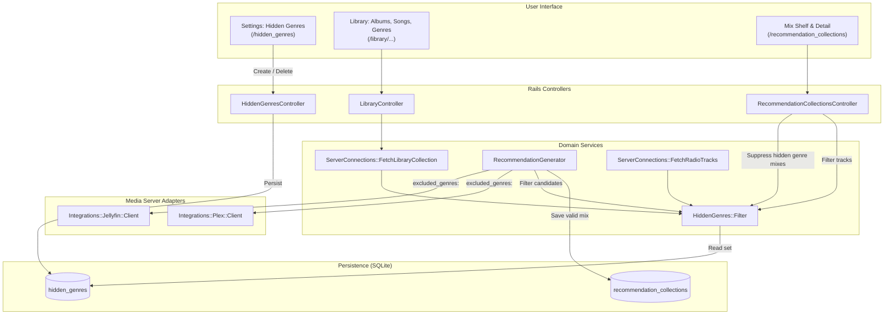
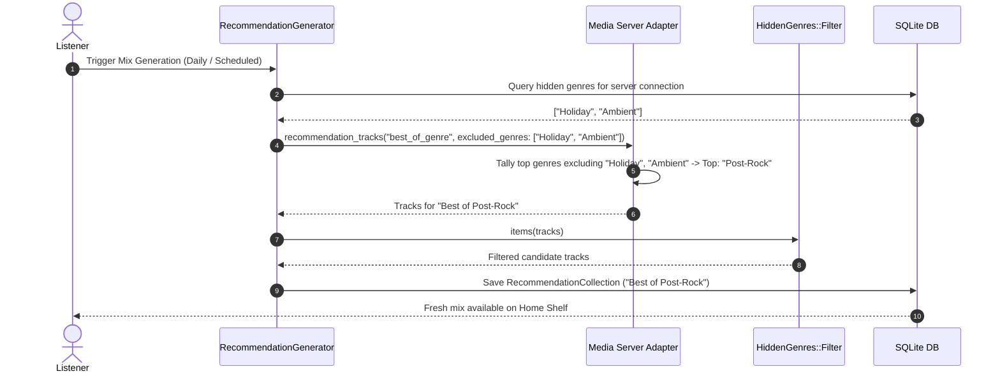

# Exclude Hidden Genres from Mixes and Library Browsing

## Goal Capsule

- **Objective:** Eliminate unwanted musical genres across personalized mixes, discovery queues, and library browsing so listeners maintain an intentional listening catalog.
- **Means:** Connection-scoped genre hiding that suppresses dedicated genre mixes, filters multi-genre tracks and albums across all discovery algorithms, removes items from library browsing, and provides both settings and contextual management controls.
- **Product Authority:** Covers user-configured genre exclusion across daily/weekly mixes (*Best of <Genre>*, *Friday Rediscovery*, *Top of the Month*, *All-Time Heavy Rotation*), instant radio queues, and library browsing (Albums, Songs, Genres). External media server metadata remains immutable.
- **Open Blockers:** None.

## Product Contract

*Product Contract preservation: Product Contract unchanged.*

### Summary

Listeners whose media libraries contain utilitarian or seasonal music (such as holiday albums, sleep ambience, or children's audio) have those genres dominate personalized mixes like *Best of <Genre>* and surface across general library browsing. This feature provides comprehensive genre exclusion per server connection, mirroring Sonzra's existing Hidden Artists pattern. Hiding a genre excludes it everywhere: from daily mixes, instant radio, and general recommendation shelves, as well as from library albums, songs, and the All Genres directory. Previously generated mixes dedicated to a newly hidden genre are automatically suppressed from shelves. Users can hide genres directly from library cards and options sheets, or add and restore them via a dedicated Settings page.

### Problem Frame

Sonzra's personalized discovery engine generates daily and weekly listening sessions based on overall listening history. When a user listens heavily to a specific genre for secondary or non-focused reasons (such as bedtime white noise or family holiday music), that genre becomes their top played category, causing daily *Best of <Genre>* mixes to feature it exclusively and general discovery shelves to frequently pull tracks from it. Furthermore, browsing library collections exposes albums and tracks the listener prefers to keep sequestered.

### Key Decisions

- **KD1: Full-surface exclusion across mixes, discovery, and library browsing.** *(session-settled: user-directed — chosen over mixes-only exclusion: maintains architectural consistency with Hidden Artists)*. Governs R1, R2, R3, R4.
- **KD2: Strict multi-genre tag exclusion.** *(session-settled: user-directed — chosen over primary-genre-only exclusion: guarantees tracks tagged with unwanted genres are fully excluded even when paired with acceptable genres)*. Governs R3, R4.
- **KD3: Automatic suppression of pre-existing dedicated mixes.** *(session-settled: user-directed — chosen over empty mix cards or immediate auto-regeneration: avoids showing empty or invalid mix shelves without unexpected regeneration churn)*. Governs R5.
- **KD4: Dual-entry management UI.** *(session-settled: user-directed — chosen over settings-only or contextual-only: gives listeners immediate contextual actions alongside dedicated settings management)*. Governs R6, R7.
- **KD5: Next most-played genre fallback.** *(session-settled: user-approved — chosen over failing the daily mix run: ensures listeners still get a fresh Best of Genre mix even when their top genre is hidden)*. Governs R8.

### Requirements

**Scoping & Filtering Coverage**

- R1. Hidden genres must be scoped per user and server connection, keeping exclusions independent across multiple Jellyfin or Plex servers.
- R2. Hiding a genre must exclude matching items from all library browsing endpoints, including Albums, Songs, and the All Genres directory (`/library/genres`).
- R3. Candidate tracks for all mix generation strategies (*Friday Rediscovery*, *Top of the Month*, *All-Time Heavy Rotation*, *More from Artist*) and instant radio queues must exclude any track carrying a hidden genre tag.
- R4. If a track or album is tagged with multiple genres, matching any hidden genre tag must exclude the item completely.

**Mix Generation & Shelf Behavior**

- R5. If a previously generated mix collection's primary genre is hidden (such as an existing *Best of Holiday* collection), the entire mix collection must be automatically suppressed from recommendation shelves and mix index views.
- R6. For the daily *Best of <Genre>* mix strategy, the generator must skip any hidden genre and select the user's next most-played eligible genre. If no eligible genre has listening history, it must fall back to standard library discovery.

**User Interface & Controls**

- R7. The application must provide a dedicated Settings screen (`/hidden_genres`) listing all hidden genres with unhide buttons and a manual input to hide a genre by name.
- R8. Library genre cards, album options sheets, and detail headers must provide a contextual "Hide genre" action that applies the exclusion immediately via Hotwire.
- R9. Navigation drawers and settings menus must include direct links to the "Hidden genres" management view.

### Key Flows

- **F1: Contextual Hiding from Library:** A listener browsing the All Genres directory or viewing an album options sheet selects "Hide genre". The genre is immediately added to their exclusions, the UI updates via Turbo Stream, and matching albums disappear from their library view.
- **F2: Managing Exclusions in Settings:** A listener opens Settings > Hidden Genres, reviews all currently hidden genres for their active connection, and can either unhide an item or manually type a genre name to exclude it upfront.
- **F3: Daily Mix Generation with Fallback:** The automated daily mix run executes for a listener whose most-played genre this month is "Ambient" (which is hidden). The generator identifies "Ambient" as hidden, bypasses it, and compiles the *Best of Post-Rock* mix based on their next most-played unhidden genre.

### Scope Boundaries

- **In Scope:**
  - Active Record persistence for hidden genres scoped by user and server connection.
  - Multi-tag genre filtering across library browsing (albums, songs, genres).
  - Multi-tag genre filtering across mix candidate generation and radio queues.
  - Mix shelf suppression for collections dedicated to hidden genres.
  - Next most-played genre fallback for *Best of <Genre>*.
  - Settings management view with manual add and unhide controls.
  - Contextual "Hide genre" action on genre cards and media options sheets.
- **Out of Scope:**
  - Upstream metadata mutation: Sonzra will never alter genre tags on the media server itself.
  - Sub-genre taxonomy hierarchy (e.g. hiding "Rock" will not automatically infer hiding "Indie Rock" unless "Indie Rock" is also hidden or both share the tag).
  - Deleting downloaded offline audio tracks already present on device storage.

### Success Criteria

- A listener hiding a genre sees all tracks and albums tagged with that genre disappear from library browsing and search results.
- No daily or weekly mix includes tracks tagged with any hidden genre.
- When a user's most-played genre is hidden, *Best of <Genre>* seamlessly generates for their next favorite genre without failing or generating an empty mix.
- An existing *Best of <Genre>* collection whose genre is newly hidden disappears from the user's "Your Mixes" shelf without requiring a manual database purge.
- Unhiding a genre in Settings immediately restores it to library browsing and makes it eligible for future mix generations.

---

## Planning Contract

### Key Technical Decisions

- **KTD1: Dedicated `HiddenGenre` Active Record Model.** *(session-settled: user-directed per KD1)* Persist hidden genres in a separate `hidden_genres` table (`user_id`, `server_connection_id`, `name`) with an indexed unique composite constraint on `[:user_id, :server_connection_id, :name]`, mirroring the `HiddenArtist` structure.
- **KTD2: Case-Insensitive String Set Matching in `HiddenGenres::Filter`.** Implement `HiddenGenres::Filter` taking `(user, server_connection)`. On initialization, load and downcase hidden genre names into a `Set` for $O(1)$ membership lookup against `item["Genres"]` and `item["GenreItems"]`.
- **KTD3: Hexagonal Integration Query Filtering.** Pass `excluded_genres:` array to `Integrations::Jellyfin::Client#recommendation_tracks` and `Integrations::Plex::Client#recommendation_tracks` to bypass hidden genres when tallying top played tracks for `best_of_genre`, preventing massive unneeded payloads over the wire.
- **KTD4: Full-Surface Library Browsing Integration.** Wire `HiddenGenres::Filter` into `ServerConnections::FetchLibraryCollection` for `:albums`, `:songs`, and `:genres` collections so hidden items are omitted during general browsing per R2.
- **KTD5: Dynamic Mix Suppression via Controller Scope.** In `RecommendationCollectionsController#index`, filter loaded collections to reject any `best_of_genre` collection whose title matches a currently hidden genre. In `RecommendationCollectionsController#visible_tracks`, filter out individual tracks with hidden genres.
- **KTD6: Hotwire Turbo Stream UI with Accessible Touch Targets.** Implement `HiddenGenresController` with Turbo Stream responses for instantaneous element removal and addition, ensuring buttons satisfy the >=44px mobile touch target guideline.

### High-Level Technical Design





### Assumptions

- Item hashes returned by Jellyfin and Plex adapters contain genre strings under `"Genres"` (e.g. `["Rock", "Soundtrack"]`) and optionally `"GenreItems"` with `{"Name" => "..."}`.
- SQLite composite indexing on `[:user_id, :server_connection_id, :name]` efficiently handles unique constraints and retrieval per connection.
- `recommendation_tracks` records already have a `genre` column which can be matched against `HiddenGenres::Filter` when viewing saved collections.

### Sequencing & Dependencies

1. **U1:** Schema migration and `HiddenGenre` model setup.
2. **U2:** `HiddenGenres::Filter` service implementation.
3. **U3:** Integration adapter updates for Jellyfin and Plex.
4. **U4:** `RecommendationGenerator` candidate filtering and fallback logic.
5. **U5:** `FetchLibraryCollection` integration for full-surface library browsing exclusion.
6. **U6:** `RecommendationCollectionsController` mix suppression and track filtering.
7. **U7:** UI implementation: `HiddenGenresController`, views, navigation links, and Stimulus card options.

---

## Implementation Units

### U1. Database Migration & HiddenGenre Model

- **Goal:** Create the `hidden_genres` table and the `HiddenGenre` Active Record model with associations on `User` and `ServerConnection`.
- **Files:**
  - `db/migrate/YYYYMMDDHHMMSS_create_hidden_genres.rb`
  - `app/models/hidden_genre.rb`
  - `app/models/user.rb`
  - `app/models/server_connection.rb`
  - `test/models/hidden_genre_test.rb`
- **Requirements Covered:** R1.
- **Key Decisions:** KTD1.
- **Test Scenarios:**
  - Validates presence of `name`.
  - Normalizes `name` by stripping leading and trailing whitespace before validation.
  - Enforces case-insensitive uniqueness of `name` scoped to `[user_id, server_connection_id]`.
  - Cascades destruction when the associated `User` or `ServerConnection` is deleted.

### U2. Domain Filtering Service (HiddenGenres::Filter)

- **Goal:** Create `HiddenGenres::Filter` to evaluate and filter collections of media items and tracks based on genre tags.
- **Files:**
  - `app/services/hidden_genres/filter.rb`
  - `test/services/hidden_genres/filter_test.rb`
- **Requirements Covered:** R3, R4.
- **Key Decisions:** KTD2.
- **Test Scenarios:**
  - Returns items unchanged when user is nil or has no hidden genres.
  - Rejects items where any value in `item["Genres"]` matches a hidden genre case-insensitively.
  - Rejects items where any object in `item["GenreItems"]` has a matching name.
  - Handles items with nil, missing, or empty genre arrays without error.
  - Correctly excludes multi-genre items when only one genre is hidden (e.g. `["Pop", "Holiday"]` where only "Holiday" is hidden).

### U3. Media Server Client Adapters & Candidate Filtering

- **Goal:** Update Jellyfin and Plex adapters to accept an `excluded_genres:` parameter in `recommendation_tracks` for `best_of_genre` tallying.
- **Files:**
  - `app/services/integrations/jellyfin/client.rb`
  - `app/services/integrations/plex/client.rb`
  - `test/services/integrations/jellyfin/client_test.rb`
  - `test/services/integrations/plex/client_test.rb`
- **Requirements Covered:** R6.
- **Key Decisions:** KTD3.
- **Test Scenarios:**
  - In Jellyfin client: when tallying top played tracks for `best_of_genre`, genres present in `excluded_genres` (case-insensitive) are ignored.
  - In Plex client: when calculating top genres from popular tracks, excluded genres are stripped prior to selecting the maximum tally.
  - When all played genres are in `excluded_genres`, adapters fall back to general/random library tracks.

### U4. RecommendationGenerator Fallback & Mix Candidate Exclusion

- **Goal:** Integrate `HiddenGenres::Filter` and `excluded_genres` into `RecommendationGenerator` across all mix strategies.
- **Files:**
  - `app/services/recommendation_generator.rb`
  - `test/services/recommendation_generator_test.rb`
- **Requirements Covered:** R3, R4, R6.
- **Key Decisions:** KTD3, KD5.
- **Test Scenarios:**
  - `RecommendationGenerator#candidates` passes user's hidden genre names to `client.recommendation_tracks`.
  - Mix candidate tracks for `friday_rediscovery`, `all_time_top`, and `top_of_month` are filtered through `HiddenGenres::Filter`.
  - When the listener's #1 played genre is hidden, `best_of_genre` generates a mix for their #2 played genre.
  - If all played tracks have hidden genres, mix generation falls back to library discovery without throwing an error.

### U5. Library Browsing Exclusion (FetchLibraryCollection)

- **Goal:** Ensure hidden genres are excluded from general library browsing endpoints (Albums, Songs, and All Genres).
- **Files:**
  - `app/services/server_connections/fetch_library_collection.rb`
  - `test/services/server_connections/fetch_library_collection_test.rb`
- **Requirements Covered:** R2.
- **Key Decisions:** KTD4, KD1.
- **Test Scenarios:**
  - In `FetchLibraryCollection#call` for `:albums`: filters returned album items with `HiddenGenres::Filter`.
  - In `FetchLibraryCollection#call` for `:songs`: filters returned track items with `HiddenGenres::Filter`.
  - In `FetchLibraryCollection#call` for `:genres`: removes hidden genres from the returned genre list.

### U6. Mix Presentation & Shelf Suppression

- **Goal:** Dynamically suppress mixes dedicated to hidden genres and filter tracks in existing mix collections and radio queues.
- **Files:**
  - `app/controllers/recommendation_collections_controller.rb`
  - `app/services/server_connections/fetch_radio_tracks.rb`
  - `test/controllers/recommendation_collections_controller_test.rb`
  - `test/services/server_connections/fetch_radio_tracks_test.rb`
- **Requirements Covered:** R3, R5.
- **Key Decisions:** KTD5, KD3.
- **Test Scenarios:**
  - `RecommendationCollectionsController#index` excludes `best_of_genre` collections whose genre is currently hidden.
  - `RecommendationCollectionsController#show` filters out tracks whose `genre` matches a newly hidden genre.
  - `RecommendationCollectionsController#show` JSON format omits hidden genre tracks.
  - `ServerConnections::FetchRadioTracks` excludes tracks matching hidden genres.

### U7. Settings Management UI & Contextual Actions

- **Goal:** Provide `/hidden_genres` management view, navigation links, and contextual hide actions in library views.
- **Files:**
  - `config/routes.rb`
  - `app/controllers/hidden_genres_controller.rb`
  - `app/views/hidden_genres/index.html.erb`
  - `app/views/library/genres.html.erb`
  - `app/views/shared/_card_options.html.erb`
  - `app/views/shared/_card_options_sheet.html.erb`
  - `app/views/shared/_navigation.html.erb`
  - `app/views/shared/_redesign_navigation.html.erb`
  - `app/javascript/controllers/card_options_controller.js`
  - `test/controllers/hidden_genres_controller_test.rb`
  - `test/javascript/card_options_controller.test.js`
- **Requirements Covered:** R7, R8, R9.
- **Key Decisions:** KTD6, KD4.
- **Test Scenarios:**
  - `GET /hidden_genres`: renders list of hidden genres and empty state when none exist.
  - `POST /hidden_genres`: adds hidden genre, redirects or renders Turbo Stream, and enforces connection scope.
  - `DELETE /hidden_genres/:id`: unhides genre and updates UI via Turbo Stream.
  - Contextual action: clicking "Hide genre" on a genre card or options sheet sends POST to `/hidden_genres`.
  - Navigation links include "Hidden genres" with accessible Lucide icon.
  - All interactive buttons meet >=44px mobile touch target size.

---

## Verification Contract

### Automated Test Suite

- **Rails Model & Service Tests:**
  ```bash
  bin/rails test test/models/hidden_genre_test.rb test/services/hidden_genres/filter_test.rb test/services/recommendation_generator_test.rb test/services/server_connections/fetch_library_collection_test.rb test/services/server_connections/fetch_radio_tracks_test.rb
  ```
- **Controller Integration Tests:**
  ```bash
  bin/rails test test/controllers/hidden_genres_controller_test.rb test/controllers/recommendation_collections_controller_test.rb
  ```
- **JavaScript & Stimulus Tests:**
  ```bash
  npm test test/javascript/card_options_controller.test.js
  ```
- **Full Verification & Quality Gates:**
  ```bash
  bin/rails test
  bin/quality
  ```

---

## Definition of Done

- [ ] All 7 Implementation Units (U1-U7) are fully implemented with unit and integration tests.
- [ ] Database migration runs cleanly with `bin/rails db:migrate` and rolls back cleanly with `bin/rails db:rollback`.
- [ ] Existing `HiddenArtist` tests and recommendation tests pass without regression.
- [ ] Touch targets on all newly added hide/unhide buttons satisfy >=44px guidelines.
- [ ] Code strictly passes `bin/quality` (RuboCop, ERB lint, security checks) without disable comments.
