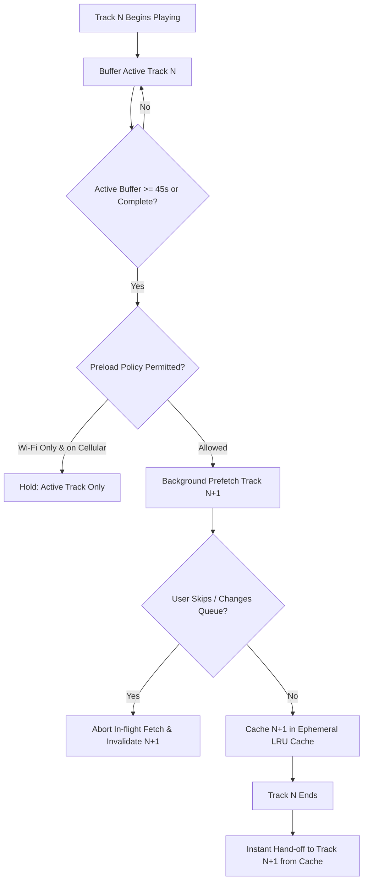
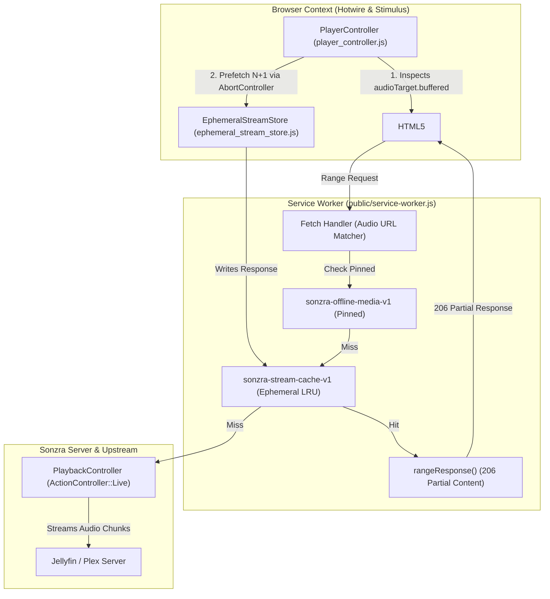
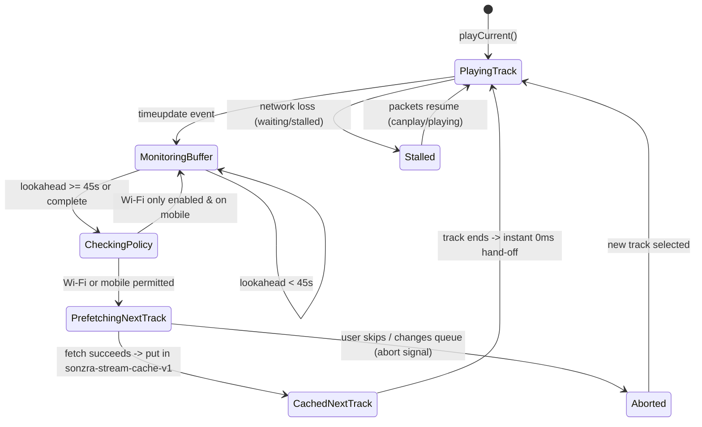

## Goal Capsule

- **Objective:** Eliminate mid-track audio stalls and track-transition gaps during mobile and VPN playback by ensuring continuous buffer depth and seamless upcoming track availability.
- **Means:** Aggressively buffer the active track 45–60 seconds ahead into an ephemeral rolling LRU cache, and opportunistically pre-cache track N+1 once the active track achieves a safe buffer margin (KTD1, KTD3).
- **Authority:** User-directed mobile streaming resilience requirements for Sonzra.
- **Execution Profile:** `execution: code`
- **Delivery:** Single pull request.
- **Open Blockers:** None.

---

<!-- ce-plan-preservation: Product Contract unchanged -->

## Product Contract

### Summary

Sonzra will implement an active stream buffering and opportunistic next-track preloading engine. It buffers 45–60 seconds ahead on the currently playing track and prefetches track N+1 into a size-bounded (~200MB) rolling LRU cache, governed by a configurable Wi-Fi-only data preference.

### Problem Frame

Listeners using Sonzra on mobile devices over cellular networks or through VPN tunnels regularly encounter audio dropouts, momentary pauses, and stuttered playback. When walking between cellular towers or through transient dead zones, the browser's default HTML5 `<audio>` pipeline exhausts its minimal internal buffer, causing the media element to stall until packets trickle in.

Furthermore, Sonzra currently triggers playback requests for upcoming songs only after the preceding track finishes or when the user explicitly clicks next. Entering a dead zone near a track boundary causes an abrupt silence and playback failure, breaking playback continuity on personal media libraries.

### Key Decisions

- **Comprehensive Stream Resilience** `(session-settled: user-directed — chosen over active-track-only and next-track-only: eliminates both mid-song buffer starvation and dead-zone song transitions)`. Governs R1, R4.
- **Active Track Network Priority** `(session-settled: user-directed — chosen over immediate concurrent prefetch or end-of-track-only: ensures current song never starves its own buffer to fetch upcoming audio)`. Governs R2, R4, R5.
- **Configurable Cellular Preload Preference** `(session-settled: user-directed — chosen over unconditional caching or Wi-Fi-only restriction: defaults to preloading everywhere while providing a data-saver toggle)`. Governs R8, R9.
- **Rolling Ephemeral LRU Cache** `(session-settled: user-directed — chosen over session-only memory cache or extended playback history: bounds device storage to ~200MB and isolates streaming from pinned offline media)`. Governs R6, R7.

### Visualizations

### Actors

- A1. **Listener:** Streams self-hosted music on mobile browsers or PWAs across cellular, Wi-Fi, and VPN connections.
- A2. **Audio Controller:** Manages queue navigation, HTML5 audio playback state, buffer thresholds, and prefetch scheduling.
- A3. **Ephemeral Stream Cache:** Manages temporary audio chunks with LRU eviction in client storage.
- A4. **Media Proxy Endpoint:** Sonzra backend (`PlaybackController`) proxying upstream Jellyfin/Plex audio streams with Range support.

### Requirements

#### Active Track Buffering

- R1. The player controller must maintain an active lookahead audio buffer of at least 45–60 seconds ahead of the current playback position during streaming.
- R2. Active track audio buffering must have absolute network priority over any prefetching operations.
- R3. In the event of temporary connection loss, the player must display a transient buffering/reconnecting state on transport controls instead of immediately throwing a fatal playback error.

#### Next-Track Preloading

- R4. When the active track reaches a safe lookahead buffer margin (≥45 seconds or fully buffered) and a succeeding track exists in the queue, Sonzra must initiate background preloading of track N+1.
- R5. Background preloading of track N+1 must abort immediately if the user skips tracks, scrubs past track boundaries, or alters the active queue.

#### Ephemeral Cache & Storage Lifecycle

- R6. Streamed chunks and pre-fetched audio must be stored in a dedicated ephemeral cache (`sonzra-stream-cache-v1`) separate from the persistent offline media cache (`sonzra-offline-media-v1`).
- R7. The ephemeral stream cache must enforce a strict size and count limit (sliding window of previous, current, and next track, capped at ~200MB) using Least Recently Used (LRU) automatic eviction.

#### Network & User Preferences

- R8. Sonzra must provide a user preference toggle (`preload_on_wifi_only` / "Preload Next Track on Wi-Fi Only") in Player Preferences, defaulting to allowing preloading on both cellular and Wi-Fi.
- R9. When `preload_on_wifi_only` is enabled and the client detects a cellular/metered connection, track N+1 preloading must be suppressed while active track buffering remains operational.

#### Playback Reporting & Telemetry Integrity

- R10. Playback reports (`/playback_reports`), listening history events, and server scrobbling must strictly trigger only when a track begins audible playback by the user, never during background prefetching or buffering.

### Key Flows

- F1. **Seamless Track Transition via Prefetched Cache**
  - **Trigger:** Current track N reaches its natural conclusion while track N+1 has finished preloading.
  - **Actors:** A1, A2, A3
  - **Steps:** Player controller advances queue index to N+1; audio source resolves instantly from the ephemeral stream cache without network round-trips; playback starts with zero audible latency.
  - **Covers:** R4, R6, R10

- F2. **Interrupted Queue Navigation**
  - **Trigger:** Listener skips track N+1 or selects a different playlist item while preloading of N+1 is in-flight.
  - **Actors:** A1, A2, A3
  - **Steps:** Player controller aborts the active fetch request for N+1; evicts partial unneeded chunks from ephemeral cache; sets the selected item as active; prioritizes buffering the newly selected track.
  - **Covers:** R2, R5, R6, R7

- F3. **Transient Connection Dropout on Street / VPN**
  - **Trigger:** Device enters a dead zone or undergoes cellular-to-Wi-Fi handoff while track N is playing.
  - **Actors:** A1, A2
  - **Steps:** Player consumes already-buffered lookahead data (up to 60s) with zero interruption; if buffer runs dry before connection returns, player displays a soft buffering state; playback resumes automatically as soon as packets flow.
  - **Covers:** R1, R2, R3

### Acceptance Examples

- AE1. **Buffer Priority Safeguard:**
  - **Given:** Listener is streaming track N on a weak 3G/VPN connection.
  - **When:** Track N has only 15 seconds of lookahead buffer accumulated.
  - **Then:** Preloading for track N+1 remains suspended until track N buffer surpasses 45 seconds or completes.
  - **Covers:** R2, R4

- AE2. **User Skip Cache Invalidation:**
  - **Given:** Track N is playing and track N+1 is currently 50% downloaded in background prefetch.
  - **When:** Listener taps "Next" twice to skip to track N+2.
  - **Then:** The network fetch for track N+1 is aborted immediately, and network resources refocus entirely on buffering track N+2.
  - **Covers:** R2, R5

- AE3. **Cellular Data Saver Enforcement:**
  - **Given:** Listener enables "Preload Next Track on Wi-Fi Only" in Player Preferences and walks on the street via cellular data.
  - **When:** Track N buffers 60 seconds ahead.
  - **Then:** The player controller does not prefetch track N+1; upon track N completion, track N+1 begins normal streaming.
  - **Covers:** R8, R9

### Success Criteria

- Mid-stream stalls reduced to zero for transient connection drops lasting under 45 seconds.
- Track boundary gap time for preloaded sequential songs is sub-100ms (perceptually instantaneous).
- Cellular data usage adheres to user preferences without unwanted background prefetching when restricted.
- Ephemeral stream storage never exceeds 200MB on client devices.

### Scope Boundaries

#### Deferred for later

- Adaptive bitrate/transcoding negotiation during bandwidth degradation (relies on upstream Jellyfin/Plex transcoding engine).
- Multi-track queue preloading beyond track N+1 (unnecessary bandwidth consumption for unpredictable skip habits).
- Peer-to-peer or local mesh audio prefetching between LAN devices.

#### Outside this product's identity

- Heavy client-side audio rendering engines (retaining Sonzra's lean, single Hotwire and Rails architecture).
- Commercial streaming service caching (Spotify/Apple Music DRM streams).
- Automatic bulk offline library synchronization (governed exclusively by Sonzra's explicit Offline Downloads feature).

### Dependencies / Assumptions

- Upstream media servers (Jellyfin and Plex) support standard HTTP Range requests for partial content responses.
- Browser environment supports the Cache API (`window.caches`) and `AbortController`.
- `navigator.connection` is used where supported to detect cellular/metered connections, falling back to user preference toggles when unavailable.

### Sources / Research

- `app/javascript/controllers/player_controller.js`: Active transport management and HTML5 audio element lifecycle.
- `app/controllers/playback_controller.rb`: Live streaming proxy utilizing `ActionController::Live` and HTTP Range headers.
- `public/service-worker.js`: Offline media interception and cache-storage retrieval.
- `docs/guidelines/architecture.md`: Modular monolith standards, persistent audio via `data-turbo-permanent`, and lean Stimulus controllers.
- `STRATEGY.md`: "Resilient Offline Playback Engine" track prioritizing stream stability across unstable network connections.

---

## Planning Contract

### Key Technical Decisions

- KTD1. **Dedicated Ephemeral Cache Store in Cache API** `(session-settled: user-directed — chosen over session-only memory cache or extended history: bounds device storage to ~200MB and isolates streaming from pinned offline media)`. Encapsulated in `app/javascript/ephemeral_stream_store.js` managing the `sonzra-stream-cache-v1` cache bucket with an LRU index tracking access timestamps and byte sizes. Governs R6, R7.
- KTD2. **Service Worker Dual-Cache Range Interception** `(user-approved — chosen over custom in-memory blob streaming: leverages existing rangeResponse logic in public/service-worker.js without breaking standard HTML5 audio elements)`. Extends the `offlineCopyOrNetwork` handler in `public/service-worker.js` to inspect `sonzra-offline-media-v1` first, then `sonzra-stream-cache-v1`, serving 206 Partial Content responses via the existing `rangeResponse(...)` helper before falling back to network fetch. Governs R6, R7.
- KTD3. **Lookahead Monitoring and Abortable Prefetch in Stimulus Controller** `(user-approved — chosen over timer-based polling or Web Audio API: listens to standard timeupdate/progress events on HTML5 audio, utilizing AbortController for clean skip cancellation)`. `PlayerController` queries `audioTarget.buffered` on each timeupdate to calculate lookahead seconds (`buffered.end - currentTime`). When lookahead reaches ≥45s and track N+1 is present, background prefetch starts with an active `AbortController` instance. Governs R1, R2, R4, R5.
- KTD4. **Session-Backed Player Preference with Layout Injection** `(session-settled: user-directed — chosen over unconditional caching or Wi-Fi-only restriction: defaults to allowing preloading everywhere while providing a data-saver toggle)`. Stored in `session[:player_preferences]["preload_on_wifi_only"]` via `PlayerPreferencesController#update`, exposed on `<html>` via `data-player-preload-on-wifi-only-value`, and evaluated alongside `navigator.connection?.saveData` or cellular `effectiveType`. Governs R8, R9.
- KTD5. **Non-Fatal Reconnecting Transport State** `(user-approved — chosen over immediate fatal error or silent stall: provides clear listener feedback during transient network dips while keeping player loop intact)`. `PlayerController` intercepts `waiting` and `stalled` events without triggering `schedulePlaybackRecovery(0)` immediately. It sets an inline `is-reconnecting` CSS state on the play button, clearing upon `canplay` or `playing`. Governs R3, R10.

### High-Level Technical Design

### System-Wide Impact

- **Browser Storage Quota:** `EphemeralStreamStore` enforces a hard ~200MB ceiling and automatic LRU purging (keeping at most previous, current, and upcoming track), preventing quota exhaustion.
- **Offline Download Isolation:** Pinned downloads (`sonzra-offline-media-v1`) are completely insulated from ephemeral stream caches. Offline shell and catalog actions remain untouched.
- **Turbo-Permanent Resilience:** The persistent player element (`#player`) retains its state across all Turbo visits, ensuring prefetch operations continue uninterrupted during in-app navigation.
- **Telemetry Integrity:** Pre-caching fetches do not trigger `/playback_reports` or server listening logs; telemetry remains exclusively bound to audible playback events on `audioTarget`.

---

## Implementation Units

### U1. Ephemeral Stream Store & Service Worker Dual-Cache Interception

- **Goal:** Implement the size-bounded, rolling LRU CacheStorage store (`sonzra-stream-cache-v1`) and update `public/service-worker.js` to serve range requests from it when available.
- **Requirements:** R6, R7
- **Dependencies:** None
- **Files:**
  - `app/javascript/ephemeral_stream_store.js`
  - `public/service-worker.js`
  - `test/javascript/ephemeral_stream_store.test.js`
- **Approach:**
  1. Create `EphemeralStreamStore` class with `put(source, response)`, `get(source)`, `has(source)`, and `evictOldest()`.
  2. Implement an LRU index in `localStorage` under `sonzra:stream-cache-index` storing `{ source, size, accessedAt }`.
  3. Enforce a 200MB (`200 * 1024 * 1024` bytes) storage budget and maximum 3 tracks: when adding a new track, calculate total size and evict oldest unpinned stream items until within quota.
  4. In `public/service-worker.js`, declare `EPHEMERAL_STREAM_CACHE = "sonzra-stream-cache-v1"`.
  5. In `offlineCopyOrNetwork(request)`: check `OFFLINE_MEDIA_CACHE` first; if match, return `rangeResponse(request, offlineCopy)`; check `EPHEMERAL_STREAM_CACHE` second; if match, return `rangeResponse(request, streamCopy)`; otherwise fall back to `fetch(request)`.
- **Test Scenarios:**
  - Storing a response in `EphemeralStreamStore` successfully saves into CacheStorage and records LRU entry.
  - Adding tracks beyond 200MB or 3 tracks triggers LRU eviction of the oldest entry while preserving the latest.
  - Service worker `offlineCopyOrNetwork` returns 206 Partial Content when request URL exists in `sonzra-stream-cache-v1`.
  - Service worker falls back to network fetch when request URL is absent from both offline and ephemeral caches.
- **Verification:** Unit tests pass with `npm test -- test/javascript/ephemeral_stream_store.test.js`.

---

### U2. Player Preferences & Layout Integration for Data Saver / Wi-Fi Only Preload

- **Goal:** Add `preload_on_wifi_only` preference support to `PlayerPreferencesController`, persist in user session, inject into layout data attributes, and surface toggle in queue/account controls.
- **Requirements:** R8, R9
- **Dependencies:** None
- **Files:**
  - `app/controllers/player_preferences_controller.rb`
  - `app/views/layouts/application.html.erb`
  - `app/views/shared/_player_queue.html.erb`
  - `test/controllers/player_preferences_controller_test.rb`
- **Approach:**
  1. Update `PlayerPreferencesController#update` to accept and sanitize `params[:preload_on_wifi_only]`, saving boolean into `session[:player_preferences]["preload_on_wifi_only"]`.
  2. Update `app/views/layouts/application.html.erb` to render `data-player-preload-on-wifi-only-value="<%= session.dig(:player_preferences, "preload_on_wifi_only") == true %>"` on `<html data-controller="player">`.
  3. In `app/views/shared/_player_queue.html.erb`, add a toggle control in the queue utility controls bar allowing listeners to toggle "Wi-Fi Only Preload" on/off.
  4. Write controller test verifying update, session persistence, and default values.
- **Test Scenarios:**
  - `PATCH /player_preferences` with `{ preload_on_wifi_only: true }` sets session preference to `true`.
  - Layout renders `data-player-preload-on-wifi-only-value="false"` by default when unconfigured.
  - Layout renders `data-player-preload-on-wifi-only-value="true"` when session preference is set.
- **Verification:** Controller tests pass with `bin/rails test test/controllers/player_preferences_controller_test.rb`.

---

### U3. Active Track Lookahead Buffer Monitoring & Reconnecting Transport State

- **Goal:** Enable `PlayerController` to monitor `audioTarget.buffered` on timeupdate, detect lookahead depth (45–60s), and handle network dropouts with a non-fatal soft-buffering UI state.
- **Requirements:** R1, R2, R3, R10
- **Dependencies:** U1
- **Files:**
  - `app/javascript/controllers/player_controller.js`
  - `test/javascript/player_controller.test.js`
- **Approach:**
  1. Add `lookaheadBufferSeconds()` method to `PlayerController` querying `this.audioTarget.buffered` and returning lookahead depth ahead of `currentTime`.
  2. Modify `handleBuffering()`: when `waiting` or `stalled` fires, set `this.isReconnecting = true`, toggle visual reconnecting class (`is-reconnecting`) on `this.toggleTarget` / transport, and defer `schedulePlaybackRecovery(PLAYBACK_RECOVERY_DELAY)` so immediate transient drops do not abort playback.
  3. In `handleCanPlay()` and `handlePlay()`, clear `is-reconnecting` visual state immediately.
  4. Ensure `reportProgress()` and `reportPlayback()` are not triggered during stall/reconnecting events.
- **Test Scenarios:**
  - `lookaheadBufferSeconds()` returns correct remaining seconds from the current time range.
  - Firing `waiting` on `audioTarget` applies reconnecting class to play button without throwing playback error.
  - Firing `canplay` on `audioTarget` removes reconnecting class and maintains playback position.
  - Playback recovery timeout is cleared upon normal buffer resumption.
- **Verification:** Tests pass with `npm test -- test/javascript/player_controller.test.js`.

---

### U4. Opportunistic Next-Track (N+1) Preloader & Abort Control

- **Goal:** Wire `PlayerController` to opportunistically prefetch track N+1 into `EphemeralStreamStore` once active buffer ≥45s and preloading policy allows, with instant cancellation on queue changes.
- **Requirements:** R4, R5, R9, R10
- **Dependencies:** U1, U2, U3
- **Files:**
  - `app/javascript/controllers/player_controller.js`
  - `test/javascript/player_controller.test.js`
- **Approach:**
  1. Instantiate `this.ephemeralStreamStore = new EphemeralStreamStore()` in `PlayerController#connect`.
  2. Maintain `this.preloadAbortController` for in-flight prefetch requests.
  3. In `updateTimeline()` / `timeupdate`: check if `lookaheadBufferSeconds() >= 45` or active track is fully buffered. If true, and next track (`this.queue[this.currentIndex + 1]`) exists, and preloading is not already running or cached for that item, evaluate network policy.
  4. Network policy check: if `preloadOnWifiOnlyValue` is true, check `navigator.connection` (if present, check `type === 'cellular'` or `saveData === true`); if cellular, skip prefetching.
  5. Prefetch execution: initialize `this.preloadAbortController = new AbortController()`, fetch track N+1 source with `{ signal: this.preloadAbortController.signal, credentials: "same-origin" }`, and store in `this.ephemeralStreamStore.put(nextTrack.source, response)`.
  6. In `previous()`, `next()`, `replaceQueue()`, `removeQueueItem()`, and `seek()`: call `this.preloadAbortController?.abort()` immediately to terminate in-flight prefetching.
  7. On track transition in `playCurrent()`: audio request for track N+1 resolves instantly from `sonzra-stream-cache-v1` via Service Worker.
- **Test Scenarios:**
  - Covers AE1: Next track preloading does NOT trigger when active track lookahead buffer is under 45s.
  - Covers AE1: Next track preloading triggers when active track lookahead buffer reaches 45s.
  - Covers AE2: Calling `next()`, `previous()`, or `replaceQueue()` aborts active prefetch request immediately.
  - Covers AE3: When `preloadOnWifiOnly` is true and connection is cellular, prefetch is suppressed.
  - Transition from track N to N+1 does not send extra playback start reports during prefetching.
- **Verification:** Unit tests pass with `npm test -- test/javascript/player_controller.test.js`.

---

## Verification Contract

### Test Commands

| Scope | Command | Purpose |
|---|---|---|
| Rails Preferences Controller | `bin/rails test test/controllers/player_preferences_controller_test.rb` | Validates session persistence of `preload_on_wifi_only` preference. |
| Ephemeral Stream Store Unit Tests | `npm test -- test/javascript/ephemeral_stream_store.test.js` | Validates CacheStorage operations, LRU eviction, and quota enforcement. |
| Player Controller Preload & Buffer Tests | `npm test -- test/javascript/player_controller.test.js` | Validates buffer lookahead calculation, prefetch lifecycle, and abort triggers. |
| Full Quality Suite | `bin/quality` | Verifies RuboCop, Vitest, and codebase lint rules pass cleanly. |

---

## Definition of Done

- All 10 requirements (R1–R10) implemented across Units U1–U4.
- All acceptance examples (AE1–AE3) covered and verified by automated tests.
- Ephemeral stream cache strictly enforces ~200MB ceiling and automatic LRU eviction.
- No dead-end, experimental, or commented-out code remains in the diff.
- `bin/quality` passes with zero lint, test, or formatting errors.
