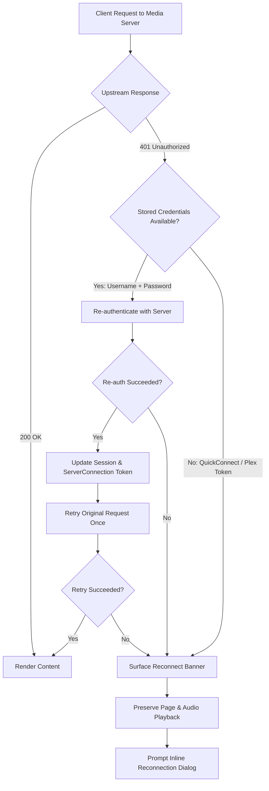
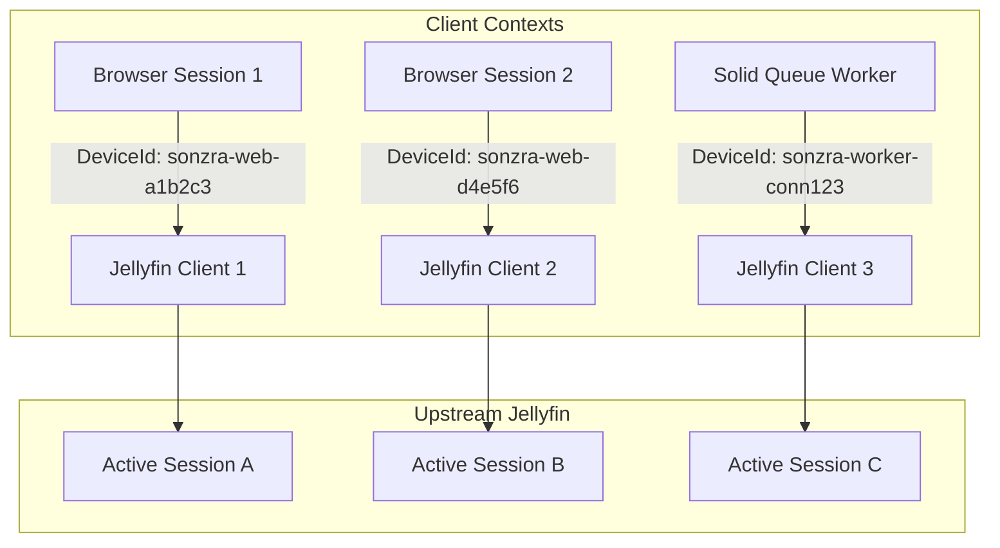

## Goal Capsule

- **Objective:** Users navigate albums, library shelves, and the dashboard without encountering "Session expired" interruptions, while media server sessions remain fresh and background jobs run without session collisions.
- **Means:** Automatic transparent re-authentication on HTTP 401 using stored server credentials, per-session/device client identifiers, dual-layer token persistence, and a non-blocking floating reconnection banner for token-only connections.
- **Product authority:** Governs session lifecycle, authentication recovery, and token management across Sonzra's web interface, API streaming proxy, and background workers. Upstream Jellyfin and Plex server configurations remain unaltered.
- **Worktree isolation:** Development and verification will be driven in a dedicated git worktree branched from `main`.

---

## Product Contract

**Product Contract preservation:** Product Contract unchanged.

### Summary

A resilient media server connection and session architecture for Sonzra. Requests encountering an upstream HTTP 401 error automatically re-authenticate using stored credentials and transparently retry without interrupting user navigation or active audio playback. Token-only connections (QuickConnect and Plex) display a subtle floating reconnection banner with an inline re-auth dialog, while uniquely scoped device identities prevent multi-tab and background worker session collisions on Jellyfin.

### Problem Frame

When browsing library items, albums, or returning to the dashboard, users frequently hit a blocking error screen reading *"We couldn't load this item. Session expired."*

Currently, upstream media server tokens lapse due to server idle timeouts, server restarts, or session invalidation. Because endpoints such as `library_item_details`, `library_collection`, and `playback_queue` fail immediately on HTTP 401 without attempting to re-authenticate, users are forced to manually refresh the page. Furthermore, Sonzra uses a static client identifier (`DeviceId="sonzra-web"`) across all requests, causing concurrent browser sessions, separate devices, and background tasks (like `BuildSonicGraphJob`) to terminate each other's Jellyfin sessions.

### Key Decisions

- **Transparent self-healing with fallback banner** `(session-settled: user-directed — chosen over failing navigation or strict background-only refreshes: avoids interrupting the user whenever credentials are available)`. Governs R1, R2, R3, R4.
- **Floating alert banner with seamless reconnect dialog** `(session-settled: user-directed — chosen over top navigation redirects or destructive inline replacements: preserves active playback, page position, and user focus)`. Governs R10, R11, R12.
- **Dual-layer token persistence with distinct Device IDs** `(session-settled: user-directed — chosen over static client IDs or session-only tokens: ensures background jobs and multi-device sessions do not invalidate active browser tokens)`. Governs R5, R6, R7, R8.
- **Worktree isolation for implementation** `(session-settled: user-directed — chosen over working in the primary checkout: keeps development cleanly isolated on a dedicated branch)`.

### Architecture & Recovery Flow



### Requirements

#### Automatic Re-authentication & Transparent Retries

- R1. When an upstream request to Jellyfin or Plex returns an HTTP 401 status and the connection has stored username and password credentials, the integration client must automatically clear the stale access token, authenticate to acquire a fresh token, and retry the failed request exactly once.
- R2. A transparent retry must be completely invisible to the user when successful, loading the requested page, album details, or library collection without error banners or page reloads.
- R3. Active audio streaming and playback progress reporting must transparently self-heal on HTTP 401 without interrupting audio playback or dropping playback tracking events.
- R4. If a transparent retry attempt also returns HTTP 401 or authentication fails (e.g. password changed on the media server), the client must raise an authentication error and cease retrying to avoid infinite authentication loops.

#### Device Identity & Session Separation

- R5. Jellyfin client requests must identify using a dynamically scoped `DeviceId` unique to the client context (e.g. per browser session / device for interactive users, and dedicated worker ID for background jobs) rather than a single static global identifier.
- R6. Background processing tasks (such as `BuildSonicGraphJob` and `RecommendationJob`) must authenticate using their dedicated worker device ID so their operations never terminate or collide with an interactive user's browser session.

#### Token Persistence & Propagation

- R7. Freshly acquired media server access tokens must be updated across both the user's active web session (`session[:server_access_tokens]`) and encrypted on the `ServerConnection` record (`access_token`).
- R8. Controllers across the entire application (including `LibraryItemsController`, `LibraryController`, `PlaybackQueuesController`, and `HomeController`) must uniformly pass and receive active tokens through `Integrations::Client.for`.
- R9. Cached home content and library tab counts must remain consistent when a token is renewed, invalidating stale cache keys only if credentials change.

#### Fallback Reconnection Experience

- R10. When an upstream 401 error occurs on a connection without password credentials (such as QuickConnect or Plex PIN connections) or when re-authentication fails, Sonzra must display a non-intrusive floating alert banner indicating the server connection needs attention.
- R11. The reconnection banner must not block navigation or abort running audio playback, allowing the user to continue listening to already-buffered tracks or exploring cached views.
- R12. The banner must provide a "Reconnect" action that launches an inline re-authorization dialog (triggering QuickConnect or credential update) and resumes normal connectivity upon completion without losing the user's current route or queue.

### Key Flows

- F1. Transparent self-healing during library item navigation
  - **Trigger:** User clicks on an album or navigates back to the dashboard while the upstream session has timed out.
  - **Actors:** User, Sonzra Web Client, Upstream Media Server.
  - **Steps:** Sonzra issues the API call to Jellyfin/Plex with the existing token; the server returns 401; the adapter identifies available credentials, calls authentication, stores the fresh token, and re-executes the item fetch; the controller renders the album view normally.
  - **Outcome:** The album view or dashboard loads seamlessly without user intervention.
  - **Covered by:** R1, R2, R7, R8.

- F2. Silent re-authentication during active audio playback & reporting
  - **Trigger:** A track is currently playing in the persistent player and the periodic playback report receives a 401 from Jellyfin.
  - **Actors:** Persistent Player Controller, Playback Reports Controller, Media Server.
  - **Steps:** The background report POST returns 401; the reporting service re-authenticates with server credentials, captures the new token, and replays the report successfully.
  - **Outcome:** Playback continues uninterrupted and playback position ticks are saved accurately upstream.
  - **Covered by:** R3, R7.

- F3. Fallback reconnection for revoked or expired token-only connections
  - **Trigger:** A QuickConnect or Plex session token is revoked on the media server and no password is saved in Sonzra.
  - **Actors:** User, Sonzra Web Client, Media Server.
  - **Steps:** The item request returns 401; auto-healing detects no password; a floating alert banner appears at the bottom or top of the viewport; user clicks "Reconnect"; an inline modal initiates a QuickConnect or Plex PIN handshake; once authorized, the banner dismisses and content refreshes.
  - **Outcome:** User reconnects without losing audio queue or page context.
  - **Covered by:** R10, R11, R12.

### Acceptance Examples

- AE1. Album detail navigation with expired Jellyfin token
  - **Covers R1, R2, R8.**
  - **Given:** A user with a password-authenticated Jellyfin server connection whose upstream session has expired.
  - **When:** The user visits `/server_connections/:id/library_items/:album_id`.
  - **Then:** Sonzra automatically re-authenticates with Jellyfin, fetches the album details, updates the session token, and renders the album page with HTTP 200 without showing "We couldn't load this item. Session expired."

- AE2. Mid-playback session expiry and reporting
  - **Covers R3, R4.**
  - **Given:** A user actively listening to a track whose media server session expires mid-stream.
  - **When:** The persistent player submits a playback report to `/server_connections/:id/playback_reports`.
  - **Then:** The reporting endpoint transparently re-authenticates and records the report with HTTP 204 without throwing bad gateway errors or pausing the audio element.

- AE3. QuickConnect token revocation
  - **Covers R10, R11, R12.**
  - **Given:** A user connected via Jellyfin QuickConnect whose token is revoked in Jellyfin dashboard.
  - **When:** The user navigates to an album.
  - **Then:** Audio playback continues uninterrupted, a floating alert informs the user that the server session expired, and clicking "Reconnect" opens the QuickConnect code flow in an overlay modal.

- AE4. Multi-device / multi-tab Jellyfin usage
  - **Covers R5, R6.**
  - **Given:** A user logged in to Sonzra on desktop and mobile simultaneously, while `BuildSonicGraphJob` runs in Solid Queue.
  - **When:** Both devices browse the catalog and the background job builds similarity nodes.
  - **Then:** Each client uses a distinct DeviceId, and none of the sessions terminate or invalidate one another on Jellyfin.

### Scope Boundaries

- **In Scope:**
  - Transparent HTTP 401 retry loop inside `Integrations::Jellyfin::Client` and `Integrations::Plex::Client`.
  - Unified token passing and updates across application controllers and background jobs.
  - Dynamic `DeviceId` generation per user session and background worker.
  - Floating reconnection banner and modal for token-only connections.
  - Automated tests covering retry behavior, session renewal, and fallback banner rendering.
- **Out of Scope (Deferred):**
  - Changes to upstream Jellyfin or Plex server-side software or API contracts.
  - Introducing third-party OAuth / SSO providers outside of existing Jellyfin / Plex providers.
  - Modifying the persistent Hotwire Native audio player architecture.

### Dependencies / Assumptions

- Rails Active Record Encryption continues to secure stored credentials (`username`, `password`, `access_token`) on `ServerConnection`.
- Upstream Jellyfin and Plex APIs accept concurrent sessions when identified with unique `DeviceId` values.
- Solid Queue workers have access to the encrypted `ServerConnection` record to authenticate under their dedicated worker identifier.

### Sources / Research

- `app/services/integrations/jellyfin/client.rb:848` — Source of `AuthenticationError, "Session expired."` on HTTP 401.
- `app/services/integrations/jellyfin/client.rb:892` — Hardcoded `DeviceId="sonzra-web"` causing session collision.
- `app/services/server_connections/fetch_library_item_details.rb` — Library item fetcher lacking retry / token refresh.
- `app/models/server_connection.rb:2` — Active Record encryption fields for credentials and access tokens.
- `docs/guidelines/architecture.md` — Section 4 (Hexagonal Integration Pattern) and Section 8 (Caching & Session-Level Access Tokens).

---

## Planning Contract

### High-Level Technical Design

The technical design addresses three failure modes in the current media server integration: premature failure on upstream 401 responses, session collision from static client device IDs, and inconsistent token passing across controllers.

```mermaid
sequenceDiagram
  autonumber
  participant App as Sonzra Service / Controller
  participant Adapter as Integrations::Jellyfin::Client
  participant Server as Jellyfin Server
  participant DB as ServerConnection (DB)

  App->>Adapter: library_item_details(item_id)
  Adapter->>Server: GET /Users/{id}/Items/{id} (Token T1)
  Server-->>Adapter: 401 Unauthorized
  Note over Adapter: 401 caught; username & password available
  Adapter->>Server: POST /Users/AuthenticateByName (Credentials)
  Server-->>Adapter: 200 OK (New Token T2)
  Adapter->>DB: Persist new token T2
  Adapter->>Server: Retry GET /Users/{id}/Items/{id} (Token T2)
  Server-->>Adapter: 200 OK (Item Payload)
  Adapter-->>App: LibraryItemDetailsResponseData (payload, token: T2)
  App->>App: Update session[:server_access_tokens] with T2
```



#### Key Components and Responsibilities

1. **Integration Client Adapters (`Integrations::Jellyfin::Client`, `Integrations::Plex::Client`)**:
   - Centralize request execution in `execute_with_retry` (or enhance `perform`/`get`/`request`).
   - On 401, check whether `@username` and `@password` are present and `@reauth_attempted` is false.
   - If present, reset `@access_token = nil`, call `authenticate`, set `@reauth_attempted = true`, trigger on-token-change callback if configured, and replay the HTTP request.
   - If 401 persists or credentials are unavailable, raise `AuthenticationError, "Session expired."`.
2. **Device ID Scoping**:
   - `Integrations::Client.for(server_connection, device_id: ...)` receives an explicit `device_id`.
   - In controllers, `ApplicationController#current_device_id` generates and caches a session-scoped identifier (`session[:sonzra_device_id] ||= "sonzra-web-#{SecureRandom.hex(6)}"`).
   - In background jobs (`BuildSonicGraphJob`, `RecommendationJob`), `device_id` defaults to `"sonzra-worker-#{server_connection.id}"`.
3. **Token Synchronization (Dual-Layer)**:
   - When the client acquires a fresh token during a request, it invokes an optional callback `on_token_refreshed: ->(token) { server_connection.update_column(:access_token, token) }`.
   - Response DTOs already carry `access_token`; controllers store this token in `session[:server_access_tokens]`.
   - Controllers uniformly pass `session.dig(:server_access_tokens, server_connection.id.to_s)` when creating clients or calling services.
4. **Non-Blocking Reconnection Shell**:
   - In `app/views/layouts/application.html.erb`, place `<div id="connection-status" data-turbo-permanent>` holding the floating banner container.
   - When a controller catches an unrecoverable `AuthenticationError` on an interactive request (or API returns 401), Turbo Stream replaces `#connection-status` with a floating banner.
   - The banner features a "Reconnect" button opening a Turbo Frame modal pointing to `reconnect_server_connection_path(@server_connection)`.

### Key Technical Decisions

- KTD1. **Adapter-level transparent 401 retry loop with single-shot guard** `(session-settled: user-directed — chosen over controller-level rescues or manual reloads: ensures all callers like library details, collections, queues, streaming, and reporting automatically self-heal)`. Governs R1, R2, R3, R4.
- KTD2. **Session-scoped client Device IDs for web clients and dedicated worker IDs for background jobs** `(session-settled: user-directed — chosen over a static global 'sonzra-web' DeviceId: prevents Jellyfin session termination across tabs, devices, and jobs)`. Governs R5, R6.
- KTD3. **Dual-layer token persistence with database write-through** `(session-settled: user-directed — chosen over session-only tokens: keeps ServerConnection.access_token fresh for background workers and subsequent web requests)`. Governs R7, R8, R9.
- KTD4. **Persistent shell reconnection banner & Turbo Frame modal** `(session-settled: user-directed — chosen over page redirects or inline frame replacement: keeps audio playing continuously via data-turbo-permanent)`. Governs R10, R11, R12.
- KTD5. **Git worktree isolation for development** `(session-settled: user-directed — chosen over primary checkout development: ensures clean isolated implementation on a dedicated branch)`.

### System-Wide Impact

- **Background Jobs:** Jobs will no longer terminate user sessions on Jellyfin because they identify under `"sonzra-worker-#{server_connection.id}"`.
- **Active Record Encryption:** Tokens written to `ServerConnection#access_token` are automatically encrypted at rest using Rails Active Record Encryption without schema changes.
- **Persistent Player & Hotwire:** Reconnection banners and modals exist outside the main content Turbo Frame and player frame, leaving playback uninterrupted during token recovery.

---

## Implementation Units

The delivery is organized into three sequential pull request groups. Each group is independently testable, safe after merge, and ordered by dependency.

### PR1: Backend Client Resilience & Dynamic Device Identification
**Waits on:** none

### U1. Adapter-Level Transparent 401 Re-authentication and Retry

- **Goal:** Implement automatic single-retry re-authentication on HTTP 401 across Jellyfin and Plex adapters when stored credentials exist.
- **Requirements:** R1, R2, R3, R4.
- **Dependencies:** none.
- **Files:**
  - `app/services/integrations/jellyfin/client.rb`
  - `app/services/integrations/plex/client.rb`
  - `test/integrations/jellyfin/client_test.rb`
  - `test/integrations/plex/client_test.rb`
- **Approach:**
  1. Add `@reauth_attempted` boolean guard in `Integrations::Jellyfin::Client` and `Integrations::Plex::Client`.
  2. In `perform` or `ensure_success!`, when `response.code == "401"`:
     - Check if `@username.present? && @password.present? && !@reauth_attempted`.
     - If true, mark `@reauth_attempted = true`, reset `@access_token = nil` and `@resolved_user = nil`, re-authenticate via `authentication`, notify `on_token_refreshed` callback if present, and retry the HTTP request.
     - If false or if retry also returns 401, raise `AuthenticationError, "Session expired."`.
  3. Ensure all 15+ caller methods (including `library_item_details`, `library_collection`, `home_content`, `playback_queue`, `report_playback`, `stream_audio`, `artwork`, etc.) benefit from the transparent retry loop.
  4. Deduplicate existing one-off retry logic in `tracks_for`, `all_track_ids`, and `similar_tracks_for`.
- **Patterns to follow:** Existing `perform` retry mechanism for network timeouts in `app/services/integrations/jellyfin/client.rb:825`.
- **Test scenarios:**
  - Happy path retry: First GET request returns 401, client re-authenticates with username/password, retries original GET, and returns 200 payload with fresh token.
  - Infinite loop prevention: Second GET request also returns 401; client raises `AuthenticationError` and does not retry again.
  - Credential absence: Request returns 401 on connection without password (token-only); client immediately raises `AuthenticationError` without calling `AuthenticateByName`.
  - Mid-stream reporting retry: `report_playback` receives 401, re-authenticates, and successfully logs progress with 204.
- **Verification:** Unit test suite passes in `test/integrations/jellyfin/client_test.rb` and `test/integrations/plex/client_test.rb`.

### U2. Dynamic Client Device Identification & Background Worker Separation

- **Goal:** Scope Jellyfin `DeviceId` per user session for web clients and assign dedicated worker identifiers for background jobs to prevent session termination collisions.
- **Requirements:** R5, R6.
- **Dependencies:** U1.
- **Files:**
  - `app/services/integrations/client.rb`
  - `app/services/integrations/jellyfin/client.rb`
  - `app/models/server_connection.rb`
  - `app/controllers/application_controller.rb`
  - `app/jobs/build_sonic_graph_job.rb`
  - `app/jobs/recommendation_job.rb`
  - `test/integrations/client_test.rb`
  - `test/models/server_connection_test.rb`
- **Approach:**
  1. Add `device_id` parameter to `Integrations::Client.for(server_connection, device_id: nil, **options)`.
  2. In `Integrations::Jellyfin::Client#initialize`, accept `device_id:` defaulting to `"sonzra-web"`. Use `@device_id` in `authorization_header`.
  3. In `ApplicationController`, add `current_device_id`:
     ```ruby
     def current_device_id
       session[:sonzra_device_id] ||= "sonzra-web-#{SecureRandom.hex(6)}"
     end
     ```
  4. Forward `device_id: current_device_id` from controllers when instantiating integration clients.
  5. In background jobs (`BuildSonicGraphJob`, `RecommendationJob`), pass `device_id: "sonzra-worker-#{connection.id}"`.
- **Patterns to follow:** `remote_user_id` forwarding pattern in `app/services/integrations/client.rb:5`.
- **Test scenarios:**
  - Web client header format: `authorization_header` contains `DeviceId="sonzra-web-xxxxxx"` when passed from session.
  - Background worker header format: `authorization_header` contains `DeviceId="sonzra-worker-123"`.
  - Default fallback: If `device_id` is nil, falls back to `"sonzra-web"`.
  - Session persistence: Successive requests within the same session maintain identical `device_id`.
- **Verification:** Model and integration tests verify distinct headers generated for background workers and controllers.

---

### PR2: Token Persistence Synchronization & Service Integration
**Waits on:** PR1 (merge order)

### U3. Database and Session Token Write-Through

- **Goal:** Ensure freshly acquired tokens are persisted to `ServerConnection#access_token` and synchronized to `session[:server_access_tokens]` across all application controllers and services.
- **Requirements:** R7, R8, R9.
- **Dependencies:** U1, U2.
- **Files:**
  - `app/models/server_connection.rb`
  - `app/services/integrations/jellyfin/client.rb`
  - `app/services/server_connections/fetch_library_item_details.rb`
  - `app/services/server_connections/fetch_library_collection.rb`
  - `app/services/server_connections/fetch_playback_queue.rb`
  - `app/controllers/library_items_controller.rb`
  - `app/controllers/library_controller.rb`
  - `app/controllers/playback_queues_controller.rb`
  - `test/services/server_connections/fetch_library_item_details_test.rb`
  - `test/controllers/library_items_controller_test.rb`
- **Approach:**
  1. Add `on_token_refreshed:` callback support in `Integrations::Client.for` and `Jellyfin::Client`.
  2. When re-authentication succeeds in `Integrations::Jellyfin::Client`, invoke `on_token_refreshed.call(token)`.
  3. In `ServerConnection#client_options`, configure `on_token_refreshed: ->(new_token) { update_column(:access_token, new_token) if persisted? }`.
  4. Update `LibraryItemsController`, `LibraryController`, and `PlaybackQueuesController` to pass `access_token: session.dig(:server_access_tokens, @server_connection.id.to_s)` and update the session upon success.
  5. Ensure `FetchLibraryItemDetails` and `FetchLibraryCollection` receive and pass `access_token` to `Integrations::Client.for`.
- **Patterns to follow:** `HomeController#store_access_token` and `current_access_token` in `app/controllers/home_controller.rb:25-31`.
- **Test scenarios:**
  - Covers AE1. Visiting `LibraryItemsController#show` with an expired token triggers client re-auth, writes the fresh token to `ServerConnection#access_token`, updates `session[:server_access_tokens]`, and renders the album.
  - Background task write-through: When `BuildSonicGraphJob` re-authenticates, the new token is encrypted and saved to the database.
  - Token reuse: Subsequent controller requests reuse the fresh token from session without making extra `AuthenticateByName` calls.
- **Verification:** Controller tests in `test/controllers/library_items_controller_test.rb` assert 200 OK and token presence in session and DB.

---

### PR3: Reconnection Banner & Inline Re-auth Modal
**Waits on:** PR2 (merge order)

### U4. Persistent Shell Reconnection Banner and Modal

- **Goal:** Provide a non-blocking floating alert banner and inline reconnection modal when media server credentials fail or token-only connections expire.
- **Requirements:** R10, R11, R12.
- **Dependencies:** U1, U3.
- **Files:**
  - `app/views/layouts/application.html.erb`
  - `app/views/shared/_reconnect_banner.html.erb`
  - `app/views/server_connections/reconnect.html.erb`
  - `app/controllers/server_connections_controller.rb`
  - `app/javascript/controllers/reconnect_controller.js`
  - `test/controllers/server_connections_controller_test.rb`
- **Approach:**
  1. In `app/views/layouts/application.html.erb`, insert `<div id="connection_alerts" data-turbo-permanent>` in the persistent layout shell.
  2. When an unrecoverable `AuthenticationError` occurs in any controller, render or Turbo Stream `shared/reconnect_banner` into `#connection_alerts`.
  3. The banner displays: *"Connection to [Server Name] expired. Audio playback will continue."* with a "Reconnect" button.
  4. Clicking "Reconnect" opens an overlay modal via Stimulus `reconnect_controller.js` targeting a Turbo Frame (`reconnect_modal`), pointing to `reconnect_server_connection_path(@server_connection)`.
  5. The reconnect view presents QuickConnect code generation for Jellyfin/Plex or password entry for credential updates.
  6. Upon successful reconnect, the modal closes, the banner disappears, and the current page/frame reloads without disrupting the `<audio>` element.
- **Patterns to follow:** Persistent audio container markup (`data-turbo-permanent`) in `app/views/layouts/application.html.erb`.
- **Test scenarios:**
  - Covers AE3. Unrecoverable 401 on token-only connection renders floating alert banner in `#connection_alerts`.
  - Audio continuity: Reconnection banner display does not pause or reset the `<audio>` element in DOM.
  - Reconnect dialog: Clicking reconnect loads `reconnect_modal` Turbo Frame with QuickConnect code or credential fields.
  - Dismissal after re-auth: Successful re-auth removes the alert banner and updates `session[:server_access_tokens]`.
- **Verification:** System and controller tests verify banner markup, non-disruption of persistent player, and successful reconnection flow.

---

## Verification Contract

### Automated Tests

| Command | Target | Scope | Done Condition |
|---|---|---|---|
| `bin/rails test test/integrations/jellyfin/client_test.rb` | U1, U2 | Adapter retry loop, single retry guard, device ID headers | All assertions pass (0 failures, 0 errors) |
| `bin/rails test test/integrations/plex/client_test.rb` | U1 | Plex client 401 handling | All assertions pass (0 failures, 0 errors) |
| `bin/rails test test/models/server_connection_test.rb` | U2, U3 | Device ID options and token write-through | All assertions pass (0 failures, 0 errors) |
| `bin/rails test test/controllers/library_items_controller_test.rb` | U3 | Album page self-healing with expired token | Renders 200 OK without "Session expired." |
| `bin/rails test test/controllers/server_connections_controller_test.rb` | U4 | Reconnect modal and banner responses | All assertions pass (0 failures, 0 errors) |
| `bin/quality` | All | RuboCop, ERB lint, security checks | Clean run with 0 violations |

### Manual Verification Scenarios

1. **Jellyfin Session Expiration During Browsing (AE1)**:
   - Log in with username/password to Jellyfin.
   - Navigate to an album. Open Jellyfin admin dashboard and manually terminate the active Sonzra session.
   - Click back to the dashboard and open another album.
   - **Expected:** The album loads immediately without error; server logs confirm transparent re-authentication and 200 OK.
2. **Mid-Playback Session Expiry (AE2)**:
   - Start playing a track.
   - In Jellyfin dashboard, terminate the session.
   - Wait 10 seconds for playback progress reporting.
   - **Expected:** Audio playback continues smoothly without pausing; playback report logs HTTP 204 after transparent self-heal.
3. **Multi-Tab / Background Worker Concurrency (AE4)**:
   - Open Sonzra in two separate browser profiles.
   - Trigger `bin/rails runner "BuildSonicGraphJob.perform_now"`.
   - Browse libraries simultaneously in both profiles.
   - **Expected:** Neither browser session is logged out or receives 401 errors.
4. **Token-Only Connection Revocation (AE3)**:
   - Connect via QuickConnect. Revoke the token on Jellyfin.
   - Navigate to an album.
   - **Expected:** Floating banner appears offering "Reconnect"; audio keeps playing; clicking "Reconnect" allows fast re-linking without leaving the page.

---

## Definition of Done

| Check | Requirement | Verification Method |
|---|---|---|
| Transparent 401 Self-Healing | Upstream 401 on password connection automatically re-authenticates and retries once | `bin/rails test test/integrations/jellyfin/client_test.rb` |
| Infinite Loop Protection | Secondary 401 halts retry and raises clean AuthenticationError | Unit test verifying single-retry guard |
| Unique Device IDs | Browsers and background jobs use distinct Device IDs | Controller and Job test asserting `DeviceId` header |
| Token Synchronization | Fresh tokens saved to both DB (encrypted) and session cookie | Controller integration test inspecting session and record |
| Non-Blocking Reconnect Banner | Floating alert rendered for revoked tokens without stopping player | View and controller test asserting `#connection_alerts` |
| Code Quality Standards | Code passes RuboCop and Sonzra architectural guidelines | `bin/quality` passes cleanly |
| Worktree Isolation | Implementation developed on isolated branch in `.worktrees/` | Git branch verified against `main` |
