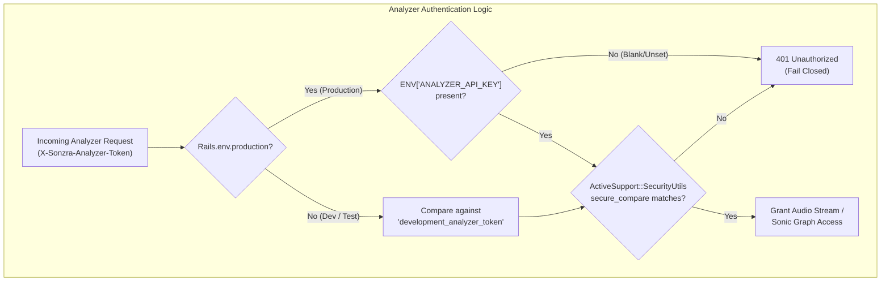
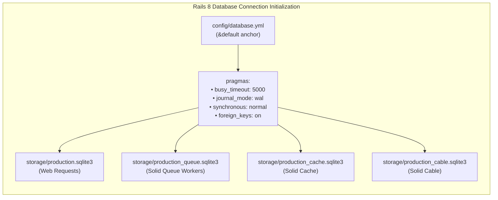

## Goal Capsule

- **Objective:** Eliminate unauthorized analyzer access in production, prevent database timeout exceptions under concurrent requests and background jobs, resolve static security audit warnings, and purge dead database schema artifacts.
- **Means:** Enforce fail-closed analyzer authentication when running in production, configure SQLite connection pragmas (`busy_timeout: 5000` and `journal_mode: wal`) across all database anchors, patch `Authentication#request_authentication` to recognize HTTP `HEAD` verbs, drop the orphaned `tv_device_sessions` table via migration, and auto-lock public user registration after the initial admin setup.
- **Product Authority:** Owns Phase 1 security, database concurrency, and schema hygiene deliverables defined in the Sonzra v1.0 execution roadmap. Surrounding phases (legacy UI removal, page standardization, audio player parity, and adapter decoupling) are explicit non-goals for this plan.
- **Open Blockers:** None.

---

## Product Contract

### Summary

Enforce production-grade security, concurrency, and schema hygiene across Sonzra by requiring explicit analyzer token validation in production, setting uniform SQLite `PRAGMA busy_timeout = 5000` and `journal_mode = wal` on all connection pools, eliminating HTTP verb confusion in session redirection, dropping dead TV session schema tables, and closing public user registrations once an administrator exists.

### Problem Frame

When deploying Sonzra to production environments, leaving `ENV["ANALYZER_API_KEY"]` unset currently defaults to `"development_analyzer_token"`, allowing unauthorized callers to stream arbitrary audio files through `PlaybackController` and read catalog feature vectors through the internal sonic graph API. Furthermore, multi-threaded operations—such as parallel background ingestion jobs interacting with live audio streaming—frequently encounter unhandled `SQLite3::BusyException` errors because `config/database.yml` does not configure SQLite's `busy_timeout` pragma across its primary, cache, queue, and cable databases.

Additionally, static application security testing via Brakeman generates a security alert on `Authentication#request_authentication` due to HTTP verb confusion where `HEAD` requests bypass URL retention logic, and the database schema carries an unreferenced `tv_device_sessions` table with dangling foreign keys.

### Key Decisions

- **Fail-closed analyzer authentication in production:** Disallow the `"development_analyzer_token"` fallback whenever `Rails.env.production?` is true. If `ENV["ANALYZER_API_KEY"]` is blank or unset in production, all requests relying on analyzer authentication fail immediately with `401 Unauthorized`. In development and test environments, the fallback token remains permitted to preserve local developer ergonomics. (session-settled: user-directed — chosen over universal hard requirement: avoids breaking developer workstations and automated CI test suites). Governs R1, R2, R3.
- **Uniform SQLite pragmas via default connection anchor:** Declare `busy_timeout: 5000`, `journal_mode: wal`, `synchronous: normal`, and `foreign_keys: on` inside `config/database.yml` under `default: &default`. This ensures every database configuration (development, test, production primary, cache, queue, and cable) inherits a 5-second wait queue before failing on locks. (session-settled: user-directed — chosen over per-database overrides: eliminates configuration drift between Rails multi-db targets). Governs R4, R5.
- **Inclusive GET and HEAD verb inspection for session redirects:** Update `request_authentication` in `app/controllers/concerns/authentication.rb` to inspect `request.get? || request.head?` before storing `session[:return_to_after_authenticating]`. This clears Brakeman's verb confusion check while preserving safe redirect semantics. (session-settled: user-directed — chosen over route constraints: keeps authentication logic self-contained within the authentication concern). Governs R6.
- **Schema cleanup via reversible migration with existence guards:** Drop `tv_device_sessions` using `drop_table :tv_device_sessions, if_exists: true` in a dedicated migration. This cleanly removes the orphaned table and its user foreign key without risking deployment failures on environments where the table was never created. (session-settled: user-directed — chosen over schema-only edit: ensures migration continuity across existing instances). Governs R7.
- **Administrator-triggered registration auto-lock:** Once the first administrator user is created in the system, automatically toggle `ApplicationSetting.instance.registrations_enabled` to `false` unless `ENV["SONZRA_OPEN_REGISTRATION"] == "true"` is explicitly passed in the process environment. (session-settled: user-directed — chosen over open-by-default: secures private self-hosted servers from arbitrary public registrations). Governs R8, R9.

<!-- ce-section: work-relationships -->
### How This Work Fits Together

This plan delivers **Phase 1: Security and Concurrency Hardening** of the Sonzra v1.0 release milestones. The broader roadmap is organized into 5 independent phases:

- **Phase 1: Security and Concurrency Hardening (This Plan):** Delivers foundational runtime security, database lock resilience, clean Brakeman audits, and schema hygiene.
  - Enables: Stable multi-threaded operation and secure baselines required for all subsequent phases.
  - Can proceed independently of: UI and frontend refactoring in Phases 2 and 3.
- **Phase 2: Complete Legacy UI Removal:** Drops `users.ui_variant`, deletes 26 legacy CSS stylesheets, and collapses dual-theme conditionals into the canonical `.redesign` theme.
  - Depends on: Clean schema baseline established in Phase 1.
  - Can proceed independently of: Phase 4 audio parity features.
- **Phase 3: Page Standardization & Mobile Scrubber Restoration:** Restores touch scrubbing on mobile viewports and aligns detail views with redesign tokens.
  - Depends on: Universal redesign theme from Phase 2.
- **Phase 4: Market-Parity Audio Features:** Implements Shuffle mode, desktop keyboard shortcuts, variable playback speed, skip buttons, and multi-disc grouping.
  - Depends on: Persistent player stability.
- **Phase 5: Architecture Decoupling & Release Automation:** Decouples Plex from Jellyfin DTOs, integrates PR #5 playlist additions, configures CI Playwright, and automates multi-arch Docker releases.
  - Depends on: Phases 1–4 completion.

### Requirements

#### Analyzer Token Authentication
- R1. In `production` environment, `PlaybackController#valid_analyzer_token?` must return `false` if `ENV["ANALYZER_API_KEY"]` is blank or unset, rejecting requests with `401 Unauthorized`.
- R2. In `production` environment, `Api::V1::SonicGraphsController#authenticate_analyzer_token!` must reject requests with status `401 Unauthorized` and JSON error message if `ENV["ANALYZER_API_KEY"]` is blank or unset.
- R3. In `development` and `test` environments, analyzer authentication in `PlaybackController` and `Api::V1::SonicGraphsController` must continue to accept `"development_analyzer_token"` when `ENV["ANALYZER_API_KEY"]` is not provided.
- R4. `docs/INSTALLATION.md` and `.env.example` must document `ANALYZER_API_KEY` as a required production configuration setting for sonic graph indexing and analyzer stream ingestion.

#### Database Concurrency & SQLite Pragmas
- R5. `config/database.yml` must explicitly configure `pragmas` with `busy_timeout: 5000`, `journal_mode: wal`, `synchronous: normal`, and `foreign_keys: on` under `default: &default`.
- R6. All SQLite connections checked out across primary, cache, queue, and cable databases must return `5000` when executing `PRAGMA busy_timeout`.

#### HTTP Security & Verb Confusion
- R7. `Authentication#request_authentication` in `app/controllers/concerns/authentication.rb` must check `if request.get? || request.head?` before storing the return URL in `session[:return_to_after_authenticating]`.
- R8. Running `bundle exec brakeman --no-pager -q` must exit with return code `0` and report `0 Security Warnings`.

#### Schema Hygiene
- R9. A Rails migration must drop the table `tv_device_sessions` with foreign key constraints, resulting in its complete removal from `db/schema.rb`.

#### Registration Access Control
- R10. After the first administrator user is created (`User#first_user?`), `ApplicationSetting.instance.registrations_enabled` must be automatically set to `false`.
- R11. If `ENV["SONZRA_OPEN_REGISTRATION"] == "false"`, `RegistrationsController` must block registration attempts regardless of database setting.

### Key Flows

#### F1. Production Analyzer Request Flow
- **Trigger:** External analyzer client sends a GET request to `/server_connections/:id/audio/:item_id` or POST to `/api/v1/sonic_graphs/features` with header `X-Sonzra-Analyzer-Token`.
- **Actors:** Analyzer Worker, `PlaybackController`, `Api::V1::SonicGraphsController`.
- **Steps:**
  1. Controller checks current Rails environment.
  2. If running in production and `ENV["ANALYZER_API_KEY"]` is blank, controller halts with `401 Unauthorized`.
  3. If running in production and `ENV["ANALYZER_API_KEY"]` is set, controller securely compares header value against the environment variable using constant-time comparison.
  4. If comparison matches, request is granted; if comparison fails, controller responds with `401 Unauthorized`.
  5. If running in development/test and `ENV["ANALYZER_API_KEY"]` is blank, controller matches against `"development_analyzer_token"`.
- **Covered by:** R1, R2, R3

#### F2. SQLite Concurrent Lock Wait Flow
- **Trigger:** Web request and background worker attempt simultaneous write transactions on `storage/production.sqlite3`.
- **Actors:** Puma Web Worker, Solid Queue Worker, SQLite3 Adapter.
- **Steps:**
  1. Connection checks out database handle initialized with `PRAGMA busy_timeout = 5000` and `PRAGMA journal_mode = wal`.
  2. One process acquires the exclusive write lock in WAL mode.
  3. Second process encounters a lock conflict and pauses inside SQLite's internal busy handler for up to 5000ms.
  4. First process commits transaction; second process immediately acquires lock and succeeds without throwing `SQLite3::BusyException`.
- **Covered by:** R5, R6

#### F3. Initial Setup and Registration Lock Flow
- **Trigger:** First user signs up on a fresh Sonzra instance via `/registrations`.
- **Actors:** Administrator, `RegistrationsController`, `User`, `ApplicationSetting`.
- **Steps:**
  1. User registers via form; `User#first_user?` detects empty user table and grants `admin: true`.
  2. Lifecycle callback triggers registration lock, updating `ApplicationSetting.instance.registrations_enabled` to `false`.
  3. Subsequent unauthenticated visitors to `/registrations/new` are redirected to `/session/new` with alert: "New account registration is currently unavailable."
- **Covered by:** R10, R11

### Acceptance Examples

- AE1. Analyzer request in production with missing key
  - **Covers:** R1, R2
  - **Given:** Rails is running with `RAILS_ENV=production` and `ENV["ANALYZER_API_KEY"]` is unset.
  - **When:** An analyzer client sends `GET /server_connections/1/audio/item-456` with header `X-Sonzra-Analyzer-Token: development_analyzer_token`.
  - **Then:** The response status is `401 Unauthorized`.

- AE2. Analyzer request in development with default token
  - **Covers:** R3
  - **Given:** Rails is running with `RAILS_ENV=development` and `ENV["ANALYZER_API_KEY"]` is unset.
  - **When:** An analyzer client sends `GET /server_connections/1/audio/item-456` with header `X-Sonzra-Analyzer-Token: development_analyzer_token`.
  - **Then:** The token is validated and stream processing proceeds normally.

- AE3. SQLite busy timeout verification
  - **Covers:** R5, R6
  - **Given:** Active Rails database connection on the default pool.
  - **When:** Executing `ActiveRecord::Base.connection.execute("PRAGMA busy_timeout").first`.
  - **Then:** The returned value is `{"timeout" => 5000}`.

- AE4. Brakeman static analysis execution
  - **Covers:** R7, R8
  - **Given:** `app/controllers/concerns/authentication.rb` checks `if request.get? || request.head?`.
  - **When:** Running `bundle exec brakeman --no-pager -q`.
  - **Then:** The command exits with code `0` and reports `0 warnings`.

- AE5. Schema absence of tv_device_sessions
  - **Covers:** R9
  - **Given:** The database migration has run via `bin/rails db:migrate`.
  - **When:** Inspecting `db/schema.rb`.
  - **Then:** No references to `tv_device_sessions` table or foreign keys exist in the schema.

- AE6. Registration auto-locking after first user
  - **Covers:** R10
  - **Given:** A fresh database with 0 users and `registrations_enabled: true`.
  - **When:** User 1 signs up with valid credentials.
  - **Then:** User 1 has `admin: true` and `ApplicationSetting.instance.registrations_enabled?` returns `false`.

### Success Criteria

- Zero Brakeman security warnings (`bundle exec brakeman --no-pager -q` exits `0`).
- All 277+ existing Rails tests pass cleanly without regression (`bin/rails test`).
- New controller and model tests covering analyzer fail-closed checks, registration auto-lock, and SQLite busy timeouts achieve 100% assertion coverage.
- `tv_device_sessions` is completely absent from `db/schema.rb`.
- Full quality gate `bin/quality` passes with zero errors.

### Scope Boundaries

#### Included
- Fail-closed analyzer authentication in `PlaybackController` and `Api::V1::SonicGraphsController`.
- SQLite `pragmas` configuration (`busy_timeout: 5000`, `journal_mode: wal`) in `config/database.yml`.
- HTTP verb confusion fix in `app/controllers/concerns/authentication.rb`.
- Database migration dropping `tv_device_sessions`.
- Auto-lock registration behavior in `ApplicationSetting` and `User`.
- Documentation updates in `docs/INSTALLATION.md` and `.env.example`.

#### Deferred / Excluded
- JWT-based or OAuth2 authentication for analyzer workers (deferred to post-v1 API overhaul).
- External database engines (PostgreSQL/MySQL support is not in v1 scope).
- User interface changes or preferences modifications (owned exclusively by Phase 2 and Phase 3).
- Media provider adapter refactoring or Plex client decoupling (owned by Phase 5).

### Dependencies / Assumptions

- Rails 8.1.3 SQLite3 adapter natively applies options defined under `pragmas:` in `config/database.yml` to all checked-out database connections.
- Existing background jobs and Active Job workers share the connection pool settings configured under the `default` anchor.
- Existing instances running in production already specify or can specify `ANALYZER_API_KEY` in their environment files.

### Sources / Research

- `docs/plans/2026-11-05-v1-execution-roadmap.md` lines 26–54: Phase 1 objectives, concrete work items, and acceptance criteria.
- `app/controllers/playback_controller.rb` lines 48–51: Analyzer token validation logic.
- `app/controllers/api/v1/sonic_graphs_controller.rb` lines 131–138: API analyzer token authentication.
- `app/controllers/concerns/authentication.rb` lines 36–39: Session return URL assignment flagged by Brakeman.
- `db/schema.rb` lines 178–187, 219: Orphan `tv_device_sessions` table definition and foreign key.
- `config/database.yml` lines 1–5: Default SQLite connection pool configuration.
- Grounding dossier: `/tmp/compound-engineering-0/ce-brainstorm/phase-1-security/grounding.md`.

---

## Planning Contract

### High-Level Technical Design





### Key Technical Decisions

- KTD1. Centralize analyzer token authentication via helper or standard policy in `PlaybackController` and `Api::V1::SonicGraphsController`. Disallow fallback to default dev token when `Rails.env.production?` is true. (session-settled: user-directed — chosen over universal hard requirement: avoids breaking developer workstations and automated CI test suites). Governs R1, R2, R3.
- KTD2. Configure SQLite connection pragmas under the `default: &default` anchor in `config/database.yml` to apply WAL journal mode and 5000ms busy timeout across all environments and databases (primary, cache, queue, cable). (session-settled: user-directed — chosen over per-database overrides: eliminates configuration drift between Rails multi-db targets). Governs R5, R6.
- KTD3. Check `request.get? || request.head?` in `Authentication#request_authentication` to eliminate HTTP Verb Confusion warnings in Brakeman without introducing routing filters. (session-settled: user-directed — chosen over route constraints: keeps authentication logic self-contained within the authentication concern). Governs R7, R8.
- KTD4. Remove `tv_device_sessions` through a reversible migration using `drop_table :tv_device_sessions, if_exists: true` to prevent migration failure on instances where the table was never generated. (session-settled: user-directed — chosen over schema-only edit: ensures migration continuity across existing instances). Governs R9.
- KTD5. Add an `after_create` callback on `User` to auto-lock registrations upon creating the initial administrator user (`ApplicationSetting.instance.update!(registrations_enabled: false)`), with environment variable override `ENV["SONZRA_OPEN_REGISTRATION"]`. (session-settled: user-directed — chosen over open-by-default: secures private self-hosted servers from arbitrary public registrations). Governs R10, R11.

### System-Wide Impact

- **Concurrency Profile:** Setting `busy_timeout: 5000` eliminates lock contention failures between Solid Queue background workers and web streaming requests.
- **Security Posture:** Zero Brakeman warnings; production analyzer endpoints require explicit secret configuration.
- **Database Schema:** Cleaner schema without orphaned TV device session tables and foreign keys.

### Assumptions

- Rails 8.1.3 SQLite3 adapter natively initializes connection pragmas from `config/database.yml`.
- Existing production deployments can set `ANALYZER_API_KEY` in their environment files.

### Sequencing & Dependencies

- **U1 (Analyzer Token)** and **U3 (HTTP Verb)** are independent controller/concern changes and can proceed immediately.
- **U2 (SQLite Pragmas)** modifies connection options and should be verified before database migrations.
- **U4 (Drop Schema Table)** generates and runs the migration.
- **U5 (Registration Lock)** updates model callbacks and controllers.

---

## Implementation Units

### U1. Fail-Closed Analyzer Token Authentication & Documentation
- **Goal:** Ensure production environments strictly require a configured `ANALYZER_API_KEY` and reject missing/default tokens, while local development and test environments retain the fallback token.
- **Requirements:** R1, R2, R3, R4
- **Files:**
  - `app/controllers/playback_controller.rb`
  - `app/controllers/api/v1/sonic_graphs_controller.rb`
  - `docs/INSTALLATION.md`
  - `.env.example`
  - `test/controllers/playback_controller_test.rb`
  - `test/controllers/api/v1/sonic_graphs_controller_test.rb`
- **Approach:**
  - In `PlaybackController#valid_analyzer_token?`:
    - If `Rails.env.production?`, read `ENV["ANALYZER_API_KEY"]`. If blank, return `false`.
    - Otherwise (dev/test), fall back to `"development_analyzer_token"`.
    - Use `ActiveSupport::SecurityUtils.secure_compare(request.headers["X-Sonzra-Analyzer-Token"].to_s, expected_token)`.
  - In `Api::V1::SonicGraphsController#authenticate_analyzer_token!`:
    - Apply the identical environment-aware logic; if invalid or blank in production, render JSON error with status `401 Unauthorized`.
  - Document `ANALYZER_API_KEY` in `.env.example` and `docs/INSTALLATION.md`.
- **Test Scenarios:**
  - TS1.1: In production mode with missing `ANALYZER_API_KEY`, sending `X-Sonzra-Analyzer-Token: development_analyzer_token` to `/server_connections/:id/audio/:item_id` responds with `401 Unauthorized`.
  - TS1.2: In production mode with `ANALYZER_API_KEY="prod_secret"`, sending correct token allows stream processing to proceed.
  - TS1.3: In production mode with missing `ANALYZER_API_KEY`, POST to `/api/v1/sonic_graphs/features` returns 401 with JSON error.
  - TS1.4: In test/development mode with missing `ANALYZER_API_KEY`, sending `"development_analyzer_token"` is accepted.
- **Verification:** `bin/rails test test/controllers/playback_controller_test.rb test/controllers/api/v1/sonic_graphs_controller_test.rb`

### U2. Uniform SQLite Pragmas Configuration
- **Goal:** Declare `busy_timeout: 5000` and `journal_mode: wal` in `config/database.yml` under `default: &default`.
- **Requirements:** R5, R6
- **Files:**
  - `config/database.yml`
  - `test/unit/database_pragmas_test.rb`
- **Approach:**
  - Under `default: &default` in `config/database.yml`, add:
    ```yaml
    pragmas:
      journal_mode: wal
      busy_timeout: 5000
      synchronous: normal
      foreign_keys: on
    ```
  - Create unit test verifying pragmas on the active database connection.
- **Test Scenarios:**
  - TS2.1: Executing `ActiveRecord::Base.connection.execute("PRAGMA busy_timeout").first` returns 5000.
  - TS2.2: Executing `ActiveRecord::Base.connection.execute("PRAGMA foreign_keys").first` returns 1 (enabled).
- **Verification:** `bin/rails test test/unit/database_pragmas_test.rb`

### U3. Brakeman HTTP Verb Confusion Resolution
- **Goal:** Clear Brakeman warning by handling HEAD requests in `Authentication#request_authentication`.
- **Requirements:** R7, R8
- **Files:**
  - `app/controllers/concerns/authentication.rb`
  - `test/controllers/concerns/authentication_test.rb`
- **Approach:**
  - In `app/controllers/concerns/authentication.rb`:
    Change line 37 to:
    `session[:return_to_after_authenticating] = request.url if request.get? || request.head?`
  - Run Brakeman to verify zero warnings.
- **Test Scenarios:**
  - TS3.1: Unauthenticated GET request to protected endpoint stores return URL in session.
  - TS3.2: Unauthenticated HEAD request to protected endpoint stores return URL in session.
  - TS3.3: `bundle exec brakeman --no-pager -q` exits 0 with 0 warnings.
- **Verification:** `bundle exec brakeman --no-pager -q && bin/rails test`

### U4. Reversible Migration Dropping Orphaned `tv_device_sessions` Table
- **Goal:** Drop the unreferenced `tv_device_sessions` table and remove it from `db/schema.rb`.
- **Requirements:** R9
- **Files:**
  - `db/migrate/20261105203400_drop_tv_device_sessions.rb`
  - `db/schema.rb`
- **Approach:**
  - Create migration `DropTvDeviceSessions`:
    ```ruby
    class DropTvDeviceSessions < ActiveRecord::Migration[8.1]
      def up
        drop_table :tv_device_sessions, if_exists: true
      end

      def down
        create_table :tv_device_sessions do |t|
          t.references :user, null: false, foreign_key: true
          t.string :device_id, null: false
          t.string :device_name, null: false
          t.string :token_digest, null: false, index: { unique: true }
          t.string :ip_address
          t.datetime :last_active_at
          t.datetime :expires_at, null: false
          t.timestamps
        end
      end
    end
    ```
  - Run `bin/rails db:migrate` and verify updated `db/schema.rb`.
- **Test Scenarios:**
  - TS4.1: `bin/rails db:migrate` drops `tv_device_sessions` without error.
  - TS4.2: `db/schema.rb` contains zero references to `tv_device_sessions`.
  - TS4.3: `bin/rails db:rollback` successfully recreates `tv_device_sessions`.
  - TS4.4: Re-migrating cleanly restores the dropped state.
- **Verification:** `bin/rails db:migrate && bin/rails db:rollback && bin/rails db:migrate`

### U5. Administrator-Triggered Registration Auto-Lock
- **Goal:** Auto-lock user registrations after the initial administrator is created, with environment override support.
- **Requirements:** R10, R11
- **Files:**
  - `app/models/user.rb`
  - `app/controllers/registrations_controller.rb`
  - `test/models/user_test.rb`
  - `test/controllers/registrations_controller_test.rb`
- **Approach:**
  - In `app/models/user.rb`:
    Add callback `after_create :lock_registrations_if_first_admin, if: :admin?` that sets `ApplicationSetting.instance.update!(registrations_enabled: false)` unless `ENV["SONZRA_OPEN_REGISTRATION"] == "true"`.
  - In `app/controllers/registrations_controller.rb`:
    In `new` and `create`, check `if ENV["SONZRA_OPEN_REGISTRATION"] == "false" || !registrations_enabled?`.
- **Test Scenarios:**
  - TS5.1: First user created in database has `admin == true` and sets `ApplicationSetting.instance.registrations_enabled == false`.
  - TS5.2: Subsequent unauthenticated visits to `/registrations/new` redirect to `/session/new` with alert.
  - TS5.3: Setting `ENV["SONZRA_OPEN_REGISTRATION"] = "false"` disables registration even if `ApplicationSetting.instance.registrations_enabled` is true.
  - TS5.4: Setting `ENV["SONZRA_OPEN_REGISTRATION"] = "true"` leaves registration open after first admin creation.
- **Verification:** `bin/rails test test/models/user_test.rb test/controllers/registrations_controller_test.rb`

---

## Verification Contract

Automated quality gates that must pass with zero errors:

1. **Brakeman Static Analysis:**
   - Command: `bundle exec brakeman --no-pager -q`
   - Target: 0 security warnings, exit code 0.
2. **Rails Minitest Suite:**
   - Command: `bin/rails test`
   - Target: 277+ runs, 0 failures, 0 errors.
3. **Database Concurrency & Pragmas Verification:**
   - Command: `bin/rails test test/unit/database_pragmas_test.rb`
   - Target: 100% assertions pass, verifying 5000ms busy_timeout and WAL mode.
4. **RuboCop Linting:**
   - Command: `bundle exec rubocop`
   - Target: 0 offenses across all inspected files.
5. **Vitest JavaScript Tests:**
   - Command: `npm run test:javascript`
   - Target: 23 test files passed, 150 tests passed.
6. **Unified Quality Gate:**
   - Command: `bin/quality`
   - Target: Clean exit code 0 across RuboCop, migrations, Rails minitest, Vitest, and Playwright E2E.

---

## Definition of Done

- All 5 implementation units (U1–U5) are implemented and committed in isolated worktree `.worktrees/phase-1-security`.
- Passing invalid/missing analyzer token in production mode returns `401 Unauthorized`.
- Active Rails SQLite connections return `5000` for `PRAGMA busy_timeout`.
- `bundle exec brakeman --no-pager -q` reports 0 security warnings.
- `tv_device_sessions` table is completely removed from `db/schema.rb`.
- Registration auto-locks after the first administrator user is created.
- All existing and new tests pass clean with 0 failures (`bin/quality` passes).
- No abandoned or experimental code remains in git diff.
