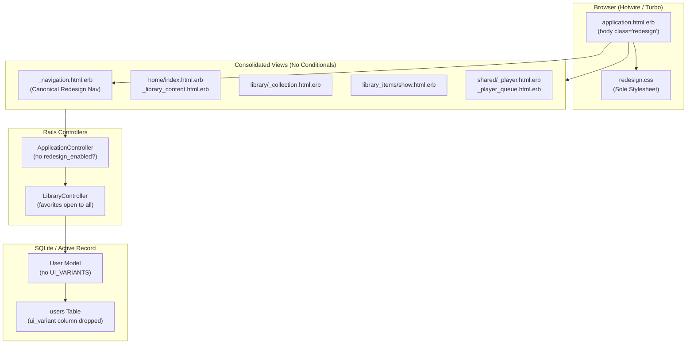

## Goal Capsule

- **Objective:** Eliminate the legacy UI variant, obsolete stylesheets, and conditional template branches so Sonzra runs on a single, maintainable frontend architecture styled universally with the canonical Redesign design system.
- **Means:** Drop `users.ui_variant`, prune 26 legacy CSS files, collapse dual ERB branches into pure Redesign markup, and apply the `.redesign` theme universally across all layouts.
- **Product authority:** Phase 2 of the Sonzra v1.0 Phased Execution Roadmap (`docs/plans/2026-11-05-v1-execution-roadmap.md`). Surrounding phases (Phase 1 security hardening and Phase 3 mobile scrubber restoration) are contextual candidates and not active scope.
- **Execution profile:** Code refactor across Rails migrations, models, controllers, view templates, assets, and automated test fixtures shipping as a single atomic pull request.
- **Open blockers:** None.

---

## Product Contract

> **Product Contract preservation:** Product Contract unchanged.

### Summary

Enforce Sonzra's `.redesign` theme universally across all web views, delete the `users.ui_variant` database column and its interface preference controller, prune all 26 legacy CSS stylesheets from the asset pipeline, and collapse dual ERB conditionals into canonical Redesign partials. All users gain universal access to the Favorites collection, and test suites are simplified to target the unified design system.

### Problem Frame

Sonzra introduced the modern `.redesign` theme as an opt-in user variant (`users.ui_variant == "redesign"`) to allow testing during the transition away from the initial prototype UI. Over time, maintaining dual UI architectures generated 26 obsolete legacy stylesheets, duplicated major partials, and introduced fragmented conditional blocks in templates and controllers. Developers must constantly maintain parallel styling and test branches, and new listeners risk entering an unmaintained legacy interface if their database column defaults to `"legacy"`.

### Key Decisions

- **KTD1. Universal Redesign Theme:** (session-settled: user-directed — chosen over maintaining dual-variant toggle: eliminates maintenance overhead and technical debt). The `.redesign` class is applied unconditionally to the document `<body>` on both authenticated and unauthenticated layouts. Governs R3, R4, R5.
- **KTD2. Complete Schema & Controller Removal:** (session-settled: user-directed — chosen over deprecation window: immediate cleanup prevents dormant regressions). The `ui_variant` column on `users` is dropped via migration, and `InterfacePreferencesController` along with its route and tests are deleted. Governs R1, R2.
- **KTD3. Single Canonical Asset Pipeline:** (session-settled: user-directed — chosen over keeping legacy CSS fallbacks: asset footprint is trimmed to canonical standards). All 26 legacy stylesheets are removed from `app/assets/stylesheets/`, leaving `redesign.css` as the sole stylesheet loaded in `application.html.erb`. Governs R6, R7.
- **KTD4. In-Place Partial Consolidation:** (session-settled: user-directed — chosen over keeping `_redesign_*` file prefixes: standardizes template naming across the app). Redesign partial contents replace legacy templates (`_library_content.html.erb`, `_collection.html.erb`, `_navigation.html.erb`), and dual ERB branching is collapsed. Governs R8, R9, R10.
- **KTD5. Open Favorites Access:** (session-settled: user-directed — chosen over keeping the guard redirect: favorites feature is fully stabilized). The guard redirect in `LibraryController#favorites` is removed, granting all authenticated listeners access to their favorited tracks. Governs R11.

<!-- ce-section: work-relationships -->
### How This Work Fits Together

This plan covers the complete frontend simplification and legacy UI elimination for Sonzra Phase 2. The surrounding roadmap context is structured as follows:

- **Phase 1: Security & Concurrency Hardening** (`docs/plans/2026-11-05-v1-execution-roadmap.md`): Can proceed independently of Phase 2. Focuses on analyzer token fail-closed enforcement in production, SQLite busy timeout configuration, Brakeman verb fixes, and dropping the orphan `tv_device_sessions` table.
- **Phase 2: Complete Legacy UI Removal** (This plan): Eliminates dual UI branches, drops `users.ui_variant`, prunes 26 legacy stylesheets, and establishes `.redesign` as universal.
- **Phase 3: Page Standardization & Mobile Scrubber Restoration**: Depends on Phase 2. Builds directly on the universal Redesign layout to restore interactive scrubbing on the mobile mini-player, align auth views with `--rz-*` design tokens, and standardize sonic graph templates.
- **Phase 4: Market-Parity Audio Features**: Enables shuffle transport, variable playback speed, podcast skip intervals, and multi-disc grouping headers on the stabilized Redesign player.
- **Phase 5: Architecture, PR #5 & Release Automation**: Prepares the decoupled Plex integration, merges playlist additions, and sets up automated release pipelines for v1.0.0.

### Requirements

#### Database & Model Schema

- R1. The database schema must drop the `ui_variant` column from the `users` table via a reversible migration.
- R2. The `User` model must remove the `UI_VARIANTS` constant, presence/inclusion validations for `ui_variant`, and any variant-specific defaults.

#### Layout & Routing Architecture

- R3. The primary application layout (`app/views/layouts/application.html.erb`) must unconditionally assign the `.redesign` class to the `<body>` element for both authenticated and unauthenticated requests.
- R4. The primary application layout must load only `redesign.css` and remove all references to legacy stylesheets.
- R5. The primary application layout must render the canonical navigation (`shared/redesign_navigation` or consolidated `shared/navigation`) and transition overlay (`shared/transition`) for authenticated sessions.
- R6. The route `resource :interface_preference, only: :update` must be removed from `config/routes.rb`.
- R7. The controller `app/controllers/interface_preferences_controller.rb` and its helper method `redesign_enabled?` in `app/controllers/application_controller.rb` must be deleted.

#### Stylesheet Pruning & Asset Pipeline

- R8. Exactly 26 legacy CSS files must be deleted from `app/assets/stylesheets/`:
  `album_details.css`, `application.css`, `auth.css`, `card_options.css`, `card_options_visibility.css`, `genre_links.css`, `interaction.css`, `lyrics.css`, `main_player_layout.css`, `media_content.css`, `minimized_player.css`, `mobile_player.css`, `mobile_queue_layout.css`, `music_shelf_pages.css`, `navigation.css`, `offline_downloads.css`, `player.css`, `queue_controls.css`, `queue.css`, `queue_details.css`, `queue_history.css`, `queue_overlay.css`, `responsive.css`, `settings.css`, `sonic_graph.css`, and `touch_cards.css`.
- R9. The `redesign.css` stylesheet must remain self-contained, importing no legacy files and acting as the sole authority for styling all components, forms, and surfaces.

#### View Template & Partial Consolidation

- R10. Duplicate partials must be consolidated by replacing the content of `app/views/home/_library_content.html.erb` with `app/views/home/_redesign_library_content.html.erb`, replacing `app/views/library/_collection.html.erb` with `app/views/library/_redesign_collection.html.erb`, and removing redundant legacy partial files.
- R11. Navigation controls must remove the "Try the redesign" and "Use classic interface" toggle buttons across desktop and mobile menus.
- R12. Conditional ERB blocks checking `redesign_enabled?` must be collapsed into unconditional Redesign markup across:
  - `app/views/home/index.html.erb` and `app/views/home/content.html.erb`
  - `app/views/library_items/show.html.erb`
  - `app/views/library/genres.html.erb`
  - `app/views/recommendation_collections/index.html.erb` and `app/views/recommendation_collections/show.html.erb`
  - `app/views/offline_downloads/index.html.erb`
  - `app/views/shared/_player.html.erb`
  - `app/views/shared/_player_queue.html.erb`
  - `app/views/shared/_recommendation_shelf.html.erb`
- R13. `LibraryController#favorites` must remove the `redesign_enabled?` guard redirect so the action is directly accessible to all authenticated users.
- R14. `LibraryController#load_redesign_library_tab_counts` must load tab counts for all authenticated users having an active server connection without checking `redesign_enabled?`.

#### Test Suite Modernization

- R15. Test suites across Rails controllers, integration tests, and Vitest specs must remove setup steps that manually assign `users(:one).update!(ui_variant: "redesign")` and remove legacy UI variant test assertions.
- R16. `test/controllers/interface_preferences_controller_test.rb` must be deleted.
- R17. All existing tests in `bin/quality` (Rails minitest, RuboCop, Vitest) must pass cleanly with 0 failures, 0 errors, and 0 lint offenses.

### Key Flows

- F1. User visits any authenticated page
  - **Trigger:** Authenticated user navigates to home, library, or settings.
  - **Actors:** Authenticated Listener, Rails Application Server
  - **Steps:** Server renders `application.html.erb` with class `redesign` on `<body>`, loads `redesign.css`, renders canonical topbar navigation, and delivers page content styled with `--rz-*` tokens.
  - **Covered by:** R3, R4, R5, R9
- F2. User navigates to Favorites
  - **Trigger:** User clicks "Favorites" in the navigation bar.
  - **Actors:** Authenticated Listener, `LibraryController`
  - **Steps:** Request hits `get "favorites", to: "library#favorites"`. Controller executes `ServerConnections::FetchLibraryCollection` without redirecting, rendering the user's favorite tracks in the Redesign collection view.
  - **Covered by:** R13, R10
- F3. Unauthenticated visitor visits sign-in or registration
  - **Trigger:** Unauthenticated visitor accesses `/session/new` or `/registration/new`.
  - **Actors:** Unauthenticated Visitor, `SessionsController` / `RegistrationsController`
  - **Steps:** Server renders `application.html.erb` with class `redesign` on `<body>` and `redesign.css`, presenting the auth form centered in a dark glassmorphic card on the deep-space canvas.
  - **Covered by:** R3, R4, R9

### Acceptance Examples

- AE1. Database schema excludes `ui_variant`
  - **Covers R1, R2.**
  - **Given:** A migrated test or development database.
  - **When:** `User.column_names` is queried.
  - **Then:** `ui_variant` is not included in the returned array, and `User.new` accepts attributes without referencing variant.
- AE2. No legacy stylesheets referenced in HTML
  - **Covers R4, R8.**
  - **Given:** A GET request to `/` or any authenticated view.
  - **When:** Inspecting `<link rel="stylesheet">` tags in the HTML `<head>`.
  - **Then:** Only `redesign.css` is present; none of the 26 legacy files (such as `application.css`, `player.css`, `queue.css`) appear.
- AE3. No legacy interface preference toggles in navigation
  - **Covers R6, R7, R11.**
  - **Given:** An authenticated user opening the desktop profile menu or mobile navigation drawer.
  - **When:** Inspecting the menu items.
  - **Then:** The "Use classic interface" button is absent, and submitting a PATCH to `/interface_preference` returns `404 Not Found` (route removed).
- AE4. Clean pass on quality gate
  - **Covers R17.**
  - **Given:** All legacy removals, migrations, and template updates applied.
  - **When:** `bundle exec rubocop`, `bin/rails test`, and `npm run test:javascript` are executed.
  - **Then:** All RuboCop checks report 0 offenses, all 277+ Rails tests pass, and all 150+ Vitest tests pass without errors.

### Scope Boundaries

- **Deferred to Phase 3:** Touch-accessible interactive scrubber restoration on the mobile mini-player and queue drawer (minimum 44x44px hitbox).
- **Deferred to Phase 3:** Complete `--rz-*` CSS variable audit and form styling standardization for auth and server connection setup forms.
- **Outside this refactor's identity:** Audio playback engine modifications, streaming buffer logic, or offline sync protocol adjustments (covered by Phase 4 and existing resilient playback engines).

### Sources / Research

- Roadmap specification: `docs/plans/2026-11-05-v1-execution-roadmap.md` (Phase 2 section)
- Design system authority: `DESIGN_SYSTEM.md` and `docs/guidelines/ui_ux.md`
- Application layout and current stylesheet includes: `app/views/layouts/application.html.erb`
- Legacy route and controller: `config/routes.rb:3` and `app/controllers/interface_preferences_controller.rb`
- Card cover encapsulation solution: `docs/solutions/ui-bugs/card-cover-encapsulation-hover-synchronization.md`

---

## Planning Contract

### Key Technical Decisions

- **KTD6. Zero-Downtime Migration Pattern:** A standard Rails migration `RemoveUiVariantFromUsers` drops the `ui_variant` column. In development and test SQLite databases, the migration executes immediately with WAL journaling (`busy_timeout: 5000`). Governs R1.
- **KTD7. Direct Replacement of Duplicate Partials:** To avoid breaking paths or creating alias wrappers, `_library_content.html.erb`, `_collection.html.erb`, and `_navigation.html.erb` will receive the contents of their `_redesign_*` counterparts, and the obsolete `_redesign_*` partial files will be deleted. Governs R10.
- **KTD8. Elimination of Body Tooltip Stimulus Controller:** In the legacy interface, `tooltip_controller.js` was attached conditionally to `<body>` (`tooltip unless redesign_enabled?`). Because Redesign uses native title attributes and explicit text/icons, the body-level tooltip controller binding is removed entirely, preserving `tooltip_controller.js` only if referenced locally. Governs R3.
- **KTD9. Universal Redesign Class Placement:** Rather than nesting `
` inside each view, the `.redesign` class is permanently attached to `<body class="redesign ...">` in `application.html.erb`. This guarantees all root CSS variables (`--rz-background`, `--rz-text`, etc.) cascade to every view including unauthenticated auth screens. Governs R3, R9.

### High-Level Technical Design

### Assumptions

- The production and test databases run on SQLite 3 with WAL mode; column drops are natively supported in modern SQLite via Rails 8 Active Record.
- Existing Stimulus controllers (`player`, `navigation`, `library-search`, `detail-menu`, `card-options`, `offline-library`) do not rely on `redesign_enabled?` on the backend; only `offline_library_controller.js` checks `document.body.classList.contains("redesign")`, which will always evaluate to `true`.
- Any external links or bookmarks to `/interface_preference` can safely return 404 once the route is deleted.

### System-Wide Impact

- **Asset Footprint:** Deleting 26 legacy CSS files reduces static stylesheet assets from 27 files to 1 (`redesign.css`), simplifying asset precompilation and caching headers.
- **Template Maintainability:** Eliminating 8 dual-branch ERB templates eliminates the risk of regressions where a fix is applied to one variant but forgotten in another.
- **Test Performance:** Test suite setup runs faster by eliminating redundant `users(:one).update!(ui_variant: "redesign")` database writes in controller tests.

---

## Implementation Units

### U1. Database Migration & User Model Simplification

- **Goal:** Drop `ui_variant` from the database and remove variant validations and constants from the `User` model.
- **Requirements:** R1, R2, AE1
- **Dependencies:** None
- **Files:**
  - `db/migrate/20261105200000_remove_ui_variant_from_users.rb`
  - `db/schema.rb`
  - `app/models/user.rb`
  - `test/models/user_test.rb`
- **Approach:**
  1. Generate migration `RemoveUiVariantFromUsers` using `remove_column :users, :ui_variant, :string, default: "legacy", null: false`.
  2. Run `bin/rails db:migrate` and check updated `db/schema.rb`.
  3. In `app/models/user.rb`, remove `UI_VARIANTS = %w[legacy redesign].freeze` and `validates :ui_variant, inclusion: { in: UI_VARIANTS }`.
  4. In `test/models/user_test.rb`, remove `test "defaults new users to the legacy interface and validates variants"`.
- **Patterns to follow:** Follow existing migrations in `db/migrate/` using standard reversible `remove_column`.
- **Test scenarios:**
  - *Covers AE1.* Creating a new user via `User.create!(email_address: "new@example.com", password: "password")` succeeds without assigning or querying `ui_variant`.
  - Verifying `User.column_names` does not include `"ui_variant"`.
- **Verification:** `bin/rails test test/models/user_test.rb` passes with 0 failures and 0 errors.

### U2. Remove Interface Preferences Controller & Route

- **Goal:** Delete the interface preference route, controller, and test, and remove the `redesign_enabled?` helper and controller checks.
- **Requirements:** R6, R7, R13, R14, R16, AE3
- **Dependencies:** U1
- **Files:**
  - `config/routes.rb`
  - `app/controllers/interface_preferences_controller.rb` (delete)
  - `test/controllers/interface_preferences_controller_test.rb` (delete)
  - `app/controllers/application_controller.rb`
  - `app/controllers/library_controller.rb`
  - `test/controllers/library_controller_test.rb`
- **Approach:**
  1. In `config/routes.rb`, delete `resource :interface_preference, only: :update`.
  2. Delete `app/controllers/interface_preferences_controller.rb` and `test/controllers/interface_preferences_controller_test.rb`.
  3. In `app/controllers/application_controller.rb`, remove `:redesign_enabled?` from `helper_method` and delete `def redesign_enabled?`.
  4. In `app/controllers/library_controller.rb`:
     - In `#favorites`, remove `return redirect_to(root_path) unless redesign_enabled?`.
     - In `#load_redesign_library_tab_counts`, remove `return unless redesign_enabled?`.
  5. In `test/controllers/library_controller_test.rb`, verify that accessing `favorites_url` works directly without requiring a variant update.
- **Patterns to follow:** Conventional Rails RESTful controller pruning.
- **Test scenarios:**
  - *Covers AE3.* Sending a PATCH to `/interface_preference` returns `404 Not Found`.
  - Authenticated GET to `favorites_path` renders successfully (200 OK) rather than redirecting to `root_path`.
  - `ApplicationController` responds without undefined method or helper error.
- **Verification:** `bin/rails test test/controllers/library_controller_test.rb` passes clean.

### U3. Prune 26 Legacy Stylesheets & Clean Application Layout

- **Goal:** Remove all 26 legacy CSS files and configure `app/views/layouts/application.html.erb` to universally load `redesign.css` with `.redesign` on `<body>`.
- **Requirements:** R3, R4, R5, R8, R9, AE2
- **Dependencies:** U2
- **Files:**
  - `app/views/layouts/application.html.erb`
  - 26 files deleted from `app/assets/stylesheets/`:
    `album_details.css`, `application.css`, `auth.css`, `card_options.css`, `card_options_visibility.css`, `genre_links.css`, `interaction.css`, `lyrics.css`, `main_player_layout.css`, `media_content.css`, `minimized_player.css`, `mobile_player.css`, `mobile_queue_layout.css`, `music_shelf_pages.css`, `navigation.css`, `offline_downloads.css`, `player.css`, `queue_controls.css`, `queue.css`, `queue_details.css`, `queue_history.css`, `queue_overlay.css`, `responsive.css`, `settings.css`, `sonic_graph.css`, `touch_cards.css`.
- **Approach:**
  1. In `app/views/layouts/application.html.erb`:
     - Replace lines 25–54 with `<%= stylesheet_link_tag "redesign", "data-turbo-track": "reload" %>`.
     - Update `<body>` tag: remove conditional `redesign if redesign_enabled?` and `tooltip unless redesign_enabled?`. Unconditionally include `redesign` class on both authenticated and unauthenticated bodies.
     - Unconditionally render `shared/redesign_navigation` and `shared/transition` for authenticated sessions.
  2. Delete all 26 legacy CSS files from `app/assets/stylesheets/`.
  3. Verify that `redesign.css` compiles properly with Propshaft.
- **Patterns to follow:** Single stylesheet architecture as documented in `DESIGN_SYSTEM.md`.
- **Test scenarios:**
  - *Covers AE2.* GET to root or `/session/new` renders `<link rel="stylesheet" href="/assets/redesign-...css">` and does not link any of the 26 legacy stylesheets.
  - Body tag contains class `redesign` for both logged-in and guest sessions.
  - No Propshaft asset resolution errors for missing stylesheets.
- **Verification:** `bin/rails test test/controllers/home_controller_test.rb` passes.

### U4. Partial Consolidation & View ERB Branch Collapse

- **Goal:** Replace legacy partials with redesign partials and collapse all `<% if redesign_enabled? %>` conditionals across application views.
- **Requirements:** R10, R11, R12, F1, F2, F3
- **Dependencies:** U3
- **Files:**
  - `app/views/home/index.html.erb`
  - `app/views/home/content.html.erb`
  - `app/views/home/_library_content.html.erb` (replace with redesign content, delete `_redesign_library_content.html.erb`)
  - `app/views/library/_collection.html.erb` (replace with redesign content, delete `_redesign_collection.html.erb`)
  - `app/views/shared/_navigation.html.erb` (replace with redesign content minus legacy toggle, delete `_media_navigation.html.erb` and `_redesign_navigation.html.erb`)
  - `app/views/layouts/application.html.erb` (point to `shared/navigation`)
  - `app/views/library_items/show.html.erb`
  - `app/views/library/genres.html.erb`
  - `app/views/recommendation_collections/index.html.erb`
  - `app/views/recommendation_collections/show.html.erb`
  - `app/views/offline_downloads/index.html.erb`
  - `app/views/shared/_player.html.erb`
  - `app/views/shared/_player_queue.html.erb`
  - `app/views/shared/_recommendation_shelf.html.erb`
- **Approach:**
  1. Consolidate partials:
     - Copy `app/views/home/_redesign_library_content.html.erb` over `app/views/home/_library_content.html.erb` and remove the redesign file.
     - Copy `app/views/library/_redesign_collection.html.erb` over `app/views/library/_collection.html.erb` and remove the redesign file.
     - Copy `app/views/shared/_redesign_navigation.html.erb` over `app/views/shared/_navigation.html.erb`, removing the "Use classic interface" buttons (lines 25 and 38), and remove `_media_navigation.html.erb` and `_redesign_navigation.html.erb`. Update `application.html.erb` to render `"shared/navigation"`.
  2. Collapse ERB conditionals:
     - `home/index.html.erb`: retain only the redesign turbo frame.
     - `home/content.html.erb`: unconditionally render `"library_content"`.
     - `library_items/show.html.erb`: collapse longform and music album views into the redesign markup, removing legacy hide artist button and legacy track list buttons.
     - `library/genres.html.erb`: retain only the redesign grid and header, removing legacy markup.
     - `recommendation_collections/index.html.erb` and `show.html.erb`: collapse into pure redesign markup.
     - `offline_downloads/index.html.erb`: retain only redesign downloads overview and list.
     - `shared/_player.html.erb`: retain only the redesign player controls (timeline scrubber, volume, skip, queue, lyrics).
     - `shared/_player_queue.html.erb`: retain redesign queue header.
     - `shared/_recommendation_shelf.html.erb`: collapse conditional so that `local_assigns[:mixes]` selects between grid and shelf.
- **Patterns to follow:** Direct server-rendered Hotwire templates matching `DESIGN_SYSTEM.md`.
- **Test scenarios:**
  - *Covers F1, F2.* Visiting `/library/albums`, `/library/genres`, `/recommendation_collections`, and `/offline_downloads` renders valid HTML containing redesign markup without ERB syntax or missing partial errors.
  - Player markup in `shared/_player.html.erb` includes `.listen-player__timeline` and does not include legacy `.listen-player__time` slash markup.
  - Navigation header does not render any "classic interface" or "Try the redesign" buttons.
- **Verification:** `bin/rails test` across all view and controller tests.

### U5. Test Suite Modernization & Quality Gate Verification

- **Goal:** Update all test suites to remove legacy UI variants and pass `bin/quality` with 0 failures, 0 errors, and 0 RuboCop offenses.
- **Requirements:** R15, R17, AE4
- **Dependencies:** U1, U2, U3, U4
- **Files:**
  - `test/controllers/hidden_genres_controller_test.rb`
  - `test/controllers/home_controller_test.rb`
  - `test/controllers/library_controller_test.rb`
  - `test/controllers/library_items_controller_test.rb`
  - `test/controllers/offline_downloads_controller_test.rb`
  - `test/controllers/recommendation_collections_controller_test.rb`
  - `test/javascript/offline_library_controller.test.js`
- **Approach:**
  1. In all controller test files, remove `users(:one).update!(ui_variant: "redesign")` setup calls.
  2. In `home_controller_test.rb`, update stylesheet assertions to test that `redesign.css` is loaded and legacy assets are absent without needing to toggle variants.
  3. In `offline_library_controller.test.js`, ensure tests reflect permanent `.redesign` presence.
  4. Run `bundle exec rubocop -a` to clean any lint offenses.
  5. Run `bin/quality` and confirm all gates pass.
- **Patterns to follow:** Existing test conventions in `test/test_helper.rb`.
- **Test scenarios:**
  - *Covers AE4.* Running `bundle exec rubocop` reports 0 offenses.
  - Running `bin/rails test` passes all 277+ tests.
  - Running `npm run test:javascript` passes all 150+ Vitest tests.
- **Verification:** `bin/quality` exits with code 0.

---

## Verification Contract

| Test Suite / Tool | Command | Scope | Acceptance Criteria |
|---|---|---|---|
| **Linter** | `bundle exec rubocop` | Entire codebase | 0 offenses reported |
| **Database Migration** | `bin/rails db:migrate:status` | Schema status | Migration `remove_ui_variant_from_users` has status `up` |
| **Rails Unit & Controller Tests** | `bin/rails test` | `test/**/*_test.rb` | 277+ runs, 0 failures, 0 errors, 0 skips |
| **JavaScript Vitest Specs** | `npm run test:javascript` | `test/javascript/**/*.test.js` | 23 files passed, 150+ tests passed |
| **Full Quality Gate** | `bin/quality` | End-to-end quality script | All stages succeed with return code 0 |

---

## Definition of Done

- [ ] Reversible migration `remove_ui_variant_from_users` created and executed against the database schema.
- [ ] `ui_variant` column completely removed from `db/schema.rb`.
- [ ] `User::UI_VARIANTS` and related validations removed from `app/models/user.rb`.
- [ ] `InterfacePreferencesController` and route `resource :interface_preference` deleted.
- [ ] `redesign_enabled?` helper and method removed from `ApplicationController` and all views.
- [ ] 26 legacy stylesheets deleted from `app/assets/stylesheets/`.
- [ ] `app/views/layouts/application.html.erb` updated to only link `redesign.css` and apply `.redesign` universally.
- [ ] Redundant partials (`_redesign_library_content`, `_redesign_collection`, `_redesign_navigation`, `_media_navigation`) removed and consolidated into canonical names.
- [ ] All dual ERB conditionals checking `redesign_enabled?` collapsed into clean Redesign templates.
- [ ] `LibraryController#favorites` accessible to all users without redirection.
- [ ] All test files updated to remove `users(:one).update!(ui_variant: "redesign")` setup hacks.
- [ ] No abandoned experimental code or unreferenced legacy CSS files left in git status.
- [ ] `bin/quality` passes clean (RuboCop, Rails minitest, Vitest).
