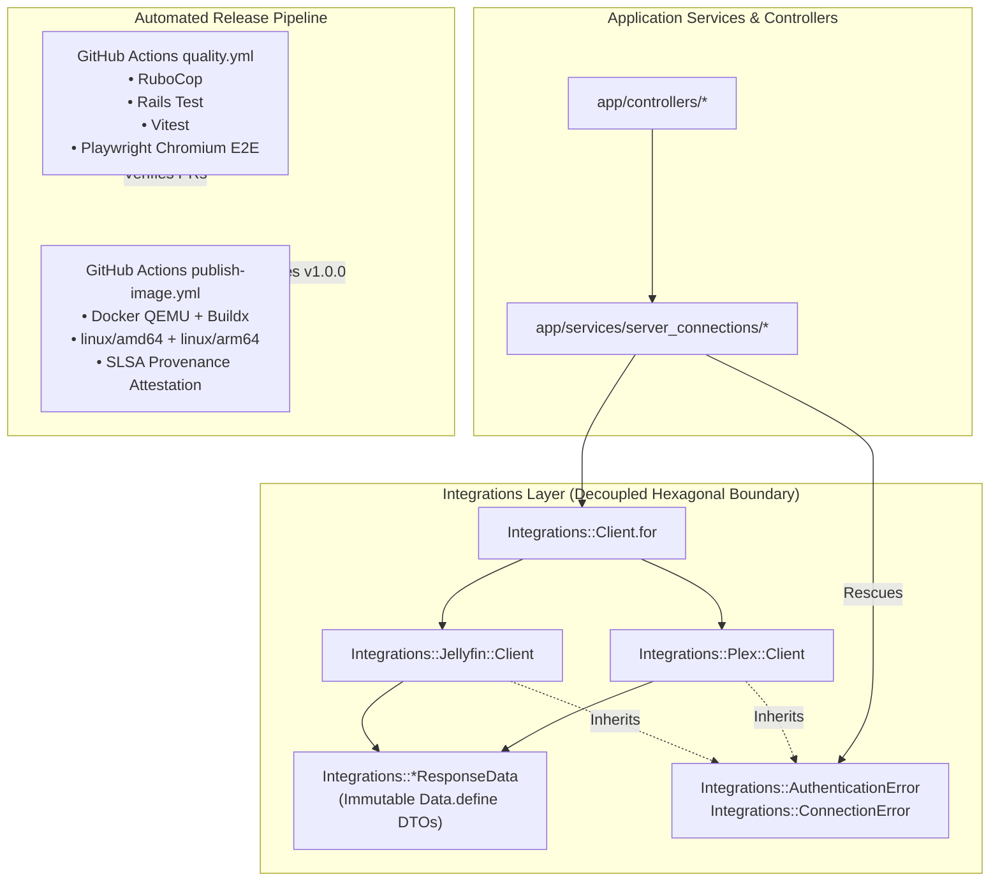
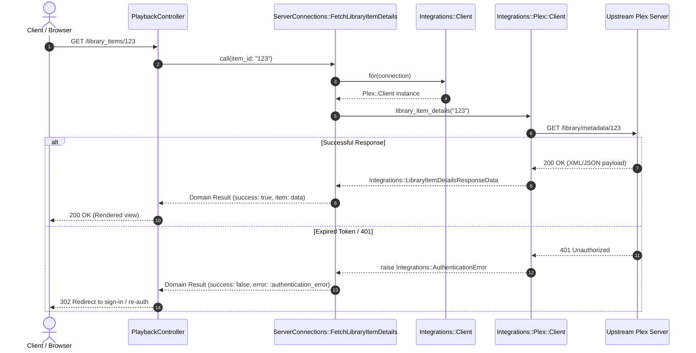

## Goal Capsule

- **Objective:** Enable a production-ready, fully automated v1.0.0 release by establishing provider-neutral hexagonal boundaries for media adapters, merging and adapting PR #5 playlist features, and automating Playwright E2E testing and multi-architecture Docker container publishing in CI.
- **Means:** Move integration response DTOs and errors to provider-neutral `Integrations::` namespaces, rebase and adapt PR #5, configure Playwright browser installation in GitHub Actions `quality.yml`, configure QEMU and Buildx in `publish-image.yml` for `linux/amd64` and `linux/arm64`, and synchronize release metadata.
- **Product Authority:** Authored per Phase 5 of the Sonzra v1.0 Release Roadmap (`docs/plans/2026-11-05-v1-execution-roadmap.md`) and confirmed via interactive brainstorming dialogue. Surrounding phases (Phase 1 Security, Phase 2 Legacy UI Removal, Phase 3 Page Standardization, Phase 4 Audio Features) represent independent roadmap streams and are not active scope for this artifact.
- **Open Blockers:** None.
- **Execution Profile:** Ships as a single comprehensive release-readiness branch `phase-5-release-automation` to be merged into `main`.

## Product Contract

> **Product Contract Preservation:** Product Contract unchanged; enriched with implementation planning.

### Summary

Phase 5 decouples Sonzra's integration adapter layer into clean, provider-neutral DTOs and standardized error classes, eliminating direct inheritance or aliasing between Plex and Jellyfin. Following architectural decoupling, PR #5 is rebased and merged to deliver playlist management for tracks, albums, mixes, and artist discographies, accompanied by its isolated Playwright E2E suite. Finally, CI and release automation are updated to enforce Playwright E2E on every PR, publish multi-arch container images (`amd64` and `arm64`) on releases, and synchronize project metadata for the `1.0.0` release.

### Problem Frame

Sonzra's integration architecture currently violates its own hexagonal boundary rule: `app/services/integrations/plex/client.rb` aliases exceptions directly from `Integrations::Jellyfin::Client` and instantiates Jellyfin-namespaced response DTOs (`Integrations::Jellyfin::*ResponseData`). Furthermore, all service objects in `app/services/server_connections/` explicitly rescue Jellyfin-specific errors even when communicating with a Plex server.

Simultaneously, valuable user functionality from PR #5 (adding tracks, albums, mixes, and full artist discographies to playlists) remains unmerged on branch `feat/issue-4-add-tracks-to-playlists`. While `bin/quality` includes Playwright E2E tests locally, the GitHub Actions `quality.yml` workflow omits browser installation and never executes `npm run test:e2e`, creating a regression risk for UI and playback flows. Lastly, container image publishing is restricted to single-architecture `linux/amd64`, preventing native deployment on modern `linux/arm64` hardware (such as Raspberry Pi 4/5, Apple Silicon hosts, and ARM cloud instances).

### Key Decisions

- **Provider-neutral DTOs:** Move all integration response data structures from `app/services/integrations/jellyfin/` to `app/services/integrations/` as `Integrations::*ResponseData` without backward-compatibility aliases, updating all service callers and controllers simultaneously.
  - **Rationale:** Internal service boundaries should not leak provider names; a clean sweep prevents legacy aliases from lingering.
  - **Governs:** R1, R3, R4

- **Top-level Integration Exception Hierarchy:** Define `Integrations::AuthenticationError` and `Integrations::ConnectionError` under `app/services/integrations/` as the canonical error contract, with provider-specific errors inheriting from them.
  - **Rationale:** Application services and controllers should rescue standard integration errors without caring whether the backing server is Jellyfin or Plex.
  - **Governs:** R2, R3

- **Decouple First, Rebase PR #5 Second:** (session-settled: user-directed — chosen over merging PR #5 first: establishing clean provider-neutral abstractions before incorporating additional endpoints prevents merge thrash and ensures PR #5 is adapted directly against canonical contracts).
  - **Rationale:** PR #5 adds client methods (`#artist_tracks`) and controllers that must adhere to the decoupled pattern rather than introducing new Jellyfin references.
  - **Governs:** R5, R6, R7, R8

- **Parallel CI Job for Playwright E2E:** Structure `.github/workflows/quality.yml` to run Playwright E2E tests with headless Chromium in a separate job alongside standard lint and unit tests.
  - **Rationale:** Prevents slow browser installation from blocking fast feedback on RuboCop, Minitest, and Vitest runs while guaranteeing E2E passes before merges.
  - **Governs:** R9, R10

- **Multi-Architecture Docker Publishing:** Utilize `docker/setup-qemu-action@v3` and `docker/setup-buildx-action@v3` in `.github/workflows/publish-image.yml` to build and publish both `linux/amd64` and `linux/arm64` container images.
  - **Rationale:** Self-hosted audio server users frequently deploy on ARM64 systems (Raspberry Pi, NAS appliances, ARM VPS).
  - **Governs:** R11, R12, R13

<!-- ce-section: work-relationships -->
### How This Work Fits Together

This plan represents Phase 5 of the 5-phase v1.0 execution roadmap. The broader breakdown reflects current project understanding:

- Phase 5: Architecture Decoupling, PR #5 Merge, and Release Automation (Current active plan)
- Phase 1: Security & Concurrency Hardening
  - Can proceed independently of Phase 5
  - Covers fail-closed analyzer token, SQLite busy_timeout, Brakeman verb confusion, and orphan table removal
- Phase 2: Complete Legacy UI Removal
  - Can proceed independently of Phase 5
  - Covers dropping `users.ui_variant`, pruning 26 legacy stylesheets, and universal `.redesign` theme
- Phase 3: Page Standardization & Mobile Scrubber Restoration
  - Can proceed independently of Phase 5
  - Covers mobile track scrubbing ergonomics and Sonic Map standardization
- Phase 4: Market-Parity Audio Features
  - Can proceed independently of Phase 5
  - Covers shuffle mode, keyboard shortcuts, playback speed, skip buttons, and sleep timer

### Requirements

#### Hexagonal Integrations Decoupling

- R1. Move all 8 integration response data DTOs (`ArtworkResponseData`, `AudioStreamResponseData`, `HomeContentResponseData`, `LibraryCollectionResponseData`, `LibraryItemDetailsResponseData`, `LyricsResponseData`, `PlaybackQueueResponseData`, `PlaybackReportResponseData`) from `Integrations::Jellyfin::*` to `Integrations::*ResponseData` in `app/services/integrations/`.
- R2. Define `Integrations::AuthenticationError` and `Integrations::ConnectionError` under `app/services/integrations/` and update `Integrations::Jellyfin::Client` and `Integrations::Plex::Client` so their errors inherit from these base classes without referencing or aliasing each other.
- R3. Update all service objects in `app/services/server_connections/`, background jobs, and controllers to rescue canonical `Integrations::AuthenticationError` and `Integrations::ConnectionError`.
- R4. Update `app/controllers/playback_controller.rb` to check `part.is_a?(Integrations::AudioStreamResponseData)` instead of referencing Jellyfin namespaces.

#### PR #5 Integration (Playlist Additions & Specs)

- R5. Rebase remote branch `origin/feat/issue-4-add-tracks-to-playlists` onto the decoupled codebase, adapting its client calls (`#artist_tracks`) and controllers to the canonical integration contracts.
- R6. Provide "Add to playlist" trigger actions on track rows in album detail pages and recommendation mix views.
- R7. Provide "Add to playlist" buttons on album detail heroes and recommendation collection heroes, and "Add discography to playlist" on artist detail heroes.
- R8. Incorporate `test/e2e/playlists.spec.js` and `test/e2e/support/helpers.js` into the repository test suite with zero external server dependencies.

#### Continuous Integration & Automated Testing

- R9. Update `.github/workflows/quality.yml` to include Playwright browser installation (`npx playwright install --with-deps chromium`) and run `npm run test:e2e` for all pull requests targeting `main`.
- R10. Ensure the full test suite (`bundle exec rubocop`, `bin/rails db:prepare`, `bin/rails test`, `npm run test:javascript`, and `npm run test:e2e`) passes with zero failures or warnings under `bin/quality`.

#### Multi-Architecture Release Pipeline

- R11. Update `.github/workflows/publish-image.yml` to configure QEMU via `docker/setup-qemu-action@v3` and Buildx via `docker/setup-buildx-action@v3`.
- R12. Configure Docker build-push step to publish images with `platforms: linux/amd64,linux/arm64`.
- R13. Maintain GitHub Actions cache (`cache-from: type=gha`, `cache-to: type=gha,mode=max`) and provenance attestation via `actions/attest-build-provenance@v2` across all generated image architectures.

#### Documentation & Release Synchronization

- R14. Bump `VERSION` to `1.0.0` and synchronize version numbers and installation instructions across `README.md`, `compose.yml`, and `docs/INSTALLATION.md`.
- R15. Update `public/manifest.json` application description to reflect multi-provider media support including Plex.
- R16. Document the security reporting contact email in `SECURITY.md`.

### Key Flows

#### Flow 1: Integration Client Request and Provider Error Handling

- **Trigger:** Controller or background job executes an operation via a service object (e.g. `ServerConnections::FetchLibraryItemDetails`).
- **Actors:** Application Controller, Domain Service, `Integrations::Client`, `Integrations::Jellyfin::Client` or `Integrations::Plex::Client`.
- **Steps:**
  1. Service invokes `Integrations::Client.for(server_connection).library_item_details(item_id)`.
  2. Adapter issues HTTP request to media server.
  3. If response is 401 or network drops, adapter raises provider-specific error inheriting from `Integrations::AuthenticationError` or `Integrations::ConnectionError`.
  4. Adapter normalizes successful payload into immutable `Integrations::LibraryItemDetailsResponseData`.
  5. Service rescues canonical `Integrations::AuthenticationError` or `Integrations::ConnectionError` and wraps result into domain result object.
- **Covered by:** R1, R2, R3

#### Flow 2: Continuous Integration Pull Request Verification

- **Trigger:** Pull request opened or updated targeting `main`.
- **Actors:** GitHub Actions, Developer.
- **Steps:**
  1. CI checks out code and sets up Ruby and Node.js environments.
  2. Runs static analysis: `bundle exec rubocop`.
  3. Prepares database and runs Rails test suite: `bin/rails db:prepare && bin/rails test`.
  4. Runs frontend unit tests: `npm run test:javascript`.
  5. Installs Chromium browser binaries and system libraries: `npx playwright install --with-deps chromium`.
  6. Executes Playwright E2E suite against test Rails server: `npm run test:e2e`.
  7. PR status check reports success only when all test suites pass clean.
- **Covered by:** R9, R10

#### Flow 3: Multi-Architecture Container Release

- **Trigger:** GitHub release published.
- **Actors:** GitHub Actions, GHCR Registry, Docker Buildx.
- **Steps:**
  1. Workflow extracts SemVer release tags and labels.
  2. Configures QEMU emulation for multi-arch build environments.
  3. Configures Docker Buildx builder instance with GitHub Actions cache.
  4. Compiles and packages binaries for `linux/amd64` and `linux/arm64`.
  5. Pushes manifest list linking both architecture digests to GHCR (`ghcr.io/sonzra/sonzra`).
  6. Attests build provenance for published image digests.
- **Covered by:** R11, R12, R13

### Visualizations



### Acceptance Examples

- AE1. Plex client returns provider-neutral item details
  - **Covers:** R1
  - **Given:** A valid Plex `ServerConnection` and an item ID `12345`.
  - **When:** `Integrations::Plex::Client#library_item_details("12345")` is executed.
  - **Then:** The returned object is an instance of `Integrations::LibraryItemDetailsResponseData` and contains no reference to `Integrations::Jellyfin`.

- AE2. Service catches Plex authentication failure via canonical exception
  - **Covers:** R2, R3
  - **Given:** A Plex `ServerConnection` whose access token has expired.
  - **When:** `ServerConnections::FetchLibraryItemDetails.new(server_connection).call` is invoked.
  - **Then:** The service rescues `Integrations::AuthenticationError` without requiring `Integrations::Plex::Client::AuthenticationError` or `Integrations::Jellyfin::Client::AuthenticationError`.

- AE3. Audio streaming controller validates DTO type
  - **Covers:** R4
  - **Given:** An active playback streaming session.
  - **When:** `PlaybackController#stream` receives chunks from the integration client.
  - **Then:** Initial chunk header is evaluated against `Integrations::AudioStreamResponseData` and streams headers accordingly.

- AE4. Playwright E2E executes in CI workflow
  - **Covers:** R9, R10
  - **Given:** A pull request is pushed to GitHub.
  - **When:** `.github/workflows/quality.yml` runs.
  - **Then:** Chromium is installed with required system dependencies and all tests in `test/e2e/*.spec.js` pass with exit code 0.

- AE5. Docker release builds multi-platform image
  - **Covers:** R11, R12
  - **Given:** A release tag `v1.0.0` is published.
  - **When:** `.github/workflows/publish-image.yml` runs.
  - **Then:** The resulting GHCR image contains manifests for both `linux/amd64` and `linux/arm64`.

### Success Criteria

- Zero references to `Integrations::Jellyfin` inside `app/services/integrations/plex/`.
- All service objects in `app/services/server_connections/` rescue top-level `Integrations::AuthenticationError` and `Integrations::ConnectionError`.
- PR #5 is merged clean with all unit and E2E tests passing.
- GitHub Actions CI executes RuboCop, Rails minitest, Vitest, and Playwright E2E on pull requests.
- Docker image publishing builds and pushes multi-arch images (`amd64` and `arm64`) to GHCR.
- `bin/quality` passes clean across all checks with zero warnings or errors.

### Scope Boundaries

- **Deferred for later:** Adding support for additional media server providers (Subsonic, Navidrome, Emby) is deferred post-v1.0.0.
- **Deferred for later:** Smart playlist dynamic rules or automated server-side playlist syncing across providers.
- **Outside this plan:** UI style adjustments or theme refactoring covered under Phase 2 or Phase 3.
- **Outside this plan:** Advanced audio player controls (shuffle, speed, sleep timer) covered under Phase 4.

### Dependencies / Assumptions

- Upstream Docker Hub / GitHub Container Registry supports multi-platform buildx workflows with QEMU.
- Playwright Chromium runs headlessly in Ubuntu runner environments without requiring full desktop display server.
- Remote branch `origin/feat/issue-4-add-tracks-to-playlists` contains the baseline code for PR #5.

### Sources / Research

- Architecture Guidelines: `docs/guidelines/architecture.md` (Hexagonal integration pattern and client error handling).
- Sonzra v1.0 Execution Roadmap: `docs/plans/2026-11-05-v1-execution-roadmap.md` (Phase 5 specifications).
- Existing Adapters: `app/services/integrations/jellyfin/client.rb` and `app/services/integrations/plex/client.rb`.
- Existing Workflows: `.github/workflows/quality.yml` and `.github/workflows/publish-image.yml`.
- Playwright Config: `playwright.config.js` and `bin/quality`.

---

## Planning Contract

### Key Technical Decisions

- **KTD1: Provider-Neutral DTO Filesystem Location:** Place all 8 `*ResponseData` classes directly in `app/services/integrations/` rather than a sub-module `Integrations::Responses::*`.
  - **Rationale:** Rails autoloading maps `Integrations::ArtworkResponseData` directly to `app/services/integrations/artwork_response_data.rb`, matching existing conventions established by `Integrations::Client` and `Integrations::Capabilities`.
  - **Governs:** R1, R4

- **KTD2: Exception Base Class Hierarchy in `app/services/integrations/errors.rb`:** Define `Integrations::AuthenticationError` and `Integrations::ConnectionError` inheriting directly from `StandardError`.
  - **Rationale:** Providers like `Integrations::Jellyfin::Client` and `Integrations::Plex::Client` can define internal subclassed errors (e.g. `Integrations::Jellyfin::Client::AuthenticationError < Integrations::AuthenticationError`) while allowing callers to rescue the base class generically.
  - **Governs:** R2, R3

- **KTD3: Sequential PR #5 Rebase with Redesign Normalization:** Rebase PR #5 commits onto the decoupled branch, adapting its client calls (`#artist_tracks`) and UI partials directly to the `.redesign` theme and provider-neutral DTOs.
  - **Rationale:** (session-settled: user-directed — chosen over merging PR #5 first: establishing clean provider-neutral abstractions before incorporating additional endpoints prevents merge thrash and ensures PR #5 is adapted directly against canonical contracts).
  - **Governs:** R5, R6, R7, R8

- **KTD4: Matrix-less Playwright E2E in CI:** Run Playwright in `quality.yml` using `npx playwright install --with-deps chromium` against a single Rails test server process with SQLite WAL mode.
  - **Rationale:** Avoids slow full-browser installs (Firefox/WebKit) while providing full coverage for Chromium and mobile emulation (Pixel 5) as defined in `playwright.config.js`.
  - **Governs:** R9, R10

- **KTD5: Multi-Arch Buildx with QEMU Emulation and GHA Cache:** Use `docker/setup-qemu-action@v3` and `docker/setup-buildx-action@v3` with `cache-from: type=gha` and `cache-to: type=gha,mode=max`.
  - **Rationale:** Enables native multi-architecture builds for both `linux/amd64` and `linux/arm64` on standard GitHub Actions runners without requiring dedicated ARM64 hosted runners.
  - **Governs:** R11, R12, R13

### High-Level Technical Design



### Assumptions & Constraints

- `app/services/integrations/jellyfin/` files for response data will be deleted after being moved to `app/services/integrations/`.
- Rails autoloading resolves top-level `Integrations::*ResponseData` from `app/services/integrations/*_response_data.rb`.
- Remote branch `feat/issue-4-add-tracks-to-playlists` has origin tracking at `origin/feat/issue-4-add-tracks-to-playlists`.
- E2E tests in `test/e2e/playlists.spec.js` mock server connections with route handlers and do not need real upstream credentials.
- Container builds use the project's existing `Dockerfile` which is already multi-arch compatible.

### Sequencing & Delivery Strategy

The implementation proceeds in six dependency-ordered units:
1. **U1:** Relocate integration response data DTOs to provider-neutral namespace.
2. **U2:** Define canonical error classes and update callers across services and controllers.
3. **U3:** Rebase PR #5 onto decoupled code, adapt `#artist_tracks`, and integrate playlist additions.
4. **U4:** Add Chromium installation and Playwright E2E execution to GitHub Actions `quality.yml`.
5. **U5:** Configure QEMU and Buildx for multi-architecture Docker container publishing.
6. **U6:** Bump `VERSION` to `1.0.0` and synchronize documentation, manifest, and security policy.

---

## Implementation Units

### U1. Relocate Integration Response DTOs to Provider-Neutral Namespace

- **Goal:** Move all 8 integration response DTOs from `Integrations::Jellyfin::*` to `Integrations::*ResponseData` under `app/services/integrations/` and update all client adapters and controllers to use them.
- **Requirements:** R1, R4, AE1, AE3
- **Dependencies:** None
- **Files:**
  - `app/services/integrations/artwork_response_data.rb`
  - `app/services/integrations/audio_stream_response_data.rb`
  - `app/services/integrations/home_content_response_data.rb`
  - `app/services/integrations/library_collection_response_data.rb`
  - `app/services/integrations/library_item_details_response_data.rb`
  - `app/services/integrations/lyrics_response_data.rb`
  - `app/services/integrations/playback_queue_response_data.rb`
  - `app/services/integrations/playback_report_response_data.rb`
  - `app/services/integrations/jellyfin/client.rb`
  - `app/services/integrations/plex/client.rb`
  - `app/controllers/playback_controller.rb`
  - `test/services/integrations/plex/client_test.rb`
  - `test/integrations/jellyfin/client_test.rb`
- **Approach:**
  1. Move the 8 files from `app/services/integrations/jellyfin/*_response_data.rb` to `app/services/integrations/`.
  2. Change their namespace from `module Integrations::Jellyfin` to `module Integrations`.
  3. Remove old files from `app/services/integrations/jellyfin/`.
  4. Update `Integrations::Jellyfin::Client` to reference `Integrations::*ResponseData`.
  5. Update `Integrations::Plex::Client` to instantiate `Integrations::*ResponseData` directly without `Integrations::Jellyfin::` prefix.
  6. Update `PlaybackController#stream` to check `part.is_a?(Integrations::AudioStreamResponseData)`.
  7. Update unit tests to assert instances of `Integrations::*ResponseData`.
- **Patterns to follow:** `Integrations::Capabilities` in `app/services/integrations/capabilities.rb`.
- **Test scenarios:**
  - Happy path: `Integrations::Plex::Client#library_item_details` returns `Integrations::LibraryItemDetailsResponseData` (Covers AE1).
  - Happy path: `Integrations::Jellyfin::Client#library_item_details` returns `Integrations::LibraryItemDetailsResponseData`.
  - Happy path: `PlaybackController#stream` recognizes `Integrations::AudioStreamResponseData` and initiates audio headers (Covers AE3).
  - Edge case: Artwork response handles nil/default content types using `Integrations::ArtworkResponseData`.
- **Verification:** `bin/rails test test/services/integrations/plex/client_test.rb test/integrations/jellyfin/client_test.rb test/controllers/playback_controller_test.rb` passes with 0 failures.

### U2. Establish Canonical Integrations Error Hierarchy

- **Goal:** Define top-level `Integrations::AuthenticationError` and `Integrations::ConnectionError` under `app/services/integrations/errors.rb` and update all adapters, application services, and controllers to raise and rescue canonical errors.
- **Requirements:** R2, R3, AE2
- **Dependencies:** U1
- **Files:**
  - `app/services/integrations/errors.rb`
  - `app/services/integrations/jellyfin/client.rb`
  - `app/services/integrations/plex/client.rb`
  - `app/services/server_connections/fetch_home_content.rb`
  - `app/services/server_connections/fetch_library_collection.rb`
  - `app/services/server_connections/fetch_library_item_details.rb`
  - `app/services/server_connections/fetch_lyrics.rb`
  - `app/services/server_connections/fetch_playback_queue.rb`
  - `app/services/server_connections/fetch_radio_tracks.rb`
  - `app/services/server_connections/report_playback.rb`
  - `app/services/server_connections/test_connection.rb`
  - `app/services/recommendation_generator.rb`
  - `app/controllers/favorites_controller.rb`
  - `app/controllers/playback_controller.rb`
  - `app/controllers/playlists_controller.rb`
  - `app/controllers/server_connections_controller.rb`
  - `app/controllers/sonic_graphs_controller.rb`
  - `test/services/server_connections/test_connection_test.rb`
  - `test/services/integrations/plex/client_test.rb`
  - `test/integrations/jellyfin/client_test.rb`
- **Approach:**
  1. Create `app/services/integrations/errors.rb` defining `AuthenticationError < StandardError` and `ConnectionError < StandardError` under `module Integrations`.
  2. In `Integrations::Jellyfin::Client`, define `class AuthenticationError < Integrations::AuthenticationError; end` and `class ConnectionError < Integrations::ConnectionError; end`.
  3. In `Integrations::Plex::Client`, define `class AuthenticationError < Integrations::AuthenticationError; end` and `class ConnectionError < Integrations::ConnectionError; end`, removing the alias pointing to Jellyfin.
  4. Replace `rescue Integrations::Jellyfin::Client::AuthenticationError, Integrations::Jellyfin::Client::ConnectionError` with `rescue Integrations::AuthenticationError, Integrations::ConnectionError` across all service objects in `app/services/server_connections/` and controllers.
  5. Verify no references to `Integrations::Jellyfin` remain in `app/services/integrations/plex/client.rb`.
- **Patterns to follow:** Rails standard error hierarchies and hexagonal port boundaries.
- **Test scenarios:**
  - Happy path: Service rescues `Integrations::AuthenticationError` when Plex raises auth failure (Covers AE2).
  - Happy path: Service rescues `Integrations::ConnectionError` when Jellyfin raises network connection failure.
  - Error path: `ServerConnectionsController` handles `Integrations::AuthenticationError` by redirecting or notifying user without referencing provider class.
  - Integration: `app/services/server_connections/test_connection.rb` accurately catches both authentication and connection errors.
- **Verification:** `bin/rails test test/services/server_connections/` and `bundle exec rubocop` pass with 0 offenses.

### U3. Rebase and Adapt PR #5 (Playlist Additions & E2E Specs)

- **Goal:** Fetch and rebase remote branch `origin/feat/issue-4-add-tracks-to-playlists` onto the decoupled architecture, ensuring client methods (`#artist_tracks`) and playlist controllers consume provider-neutral DTOs and redesign components.
- **Requirements:** R5, R6, R7, R8
- **Dependencies:** U1, U2
- **Files:**
  - `app/controllers/playlists_controller.rb`
  - `app/views/library_items/show.html.erb`
  - `app/views/recommendation_collections/show.html.erb`
  - `app/javascript/controllers/card_options_controller.js`
  - `app/services/integrations/jellyfin/client.rb`
  - `app/services/integrations/plex/client.rb`
  - `test/controllers/playlists_controller_test.rb`
  - `test/e2e/playlists.spec.js`
  - `test/e2e/support/helpers.js`
  - `test/javascript/card_options_controller.test.js`
- **Approach:**
  1. Cherry-pick or rebase commits from `origin/feat/issue-4-add-tracks-to-playlists`.
  2. Adapt `#artist_tracks` in `app/services/integrations/jellyfin/client.rb` and `app/services/integrations/plex/client.rb` to return items formatted with `Integrations::PlaybackQueueResponseData` or plain arrays per contract.
  3. Resolve any styling in `app/views/library_items/show.html.erb` to use redesign `.icon-button` and track overflow triggers rather than legacy CSS.
  4. Integrate `test/e2e/playlists.spec.js` and `test/e2e/support/helpers.js`.
  5. Verify that `bin/rails test test/controllers/playlists_controller_test.rb` and `npm run test:e2e` pass cleanly.
- **Patterns to follow:** `test/e2e/auth.spec.js` route mocking patterns.
- **Test scenarios:**
  - Happy path: Adding an individual track to a playlist via `PlaylistsController#add_track`.
  - Happy path: Adding full album, recommendation collection, or artist discography to playlist.
  - Error path: Attempting to add items when server connection raises `Integrations::ConnectionError`.
  - Integration: Run `npx playwright test test/e2e/playlists.spec.js` across desktop and mobile projects.
- **Verification:** `bin/rails test test/controllers/playlists_controller_test.rb` and `npx playwright test test/e2e/playlists.spec.js` pass with 100% success.

### U4. Add Playwright E2E Testing to GitHub Actions CI

- **Goal:** Update `.github/workflows/quality.yml` to install Chromium browser binaries and execute `npm run test:e2e` on every pull request targeting `main`.
- **Requirements:** R9, R10, AE4
- **Dependencies:** U3
- **Files:**
  - `.github/workflows/quality.yml`
  - `playwright.config.js`
- **Approach:**
  1. In `.github/workflows/quality.yml`, add a step after `npm run test:javascript`:
     ```yaml
     - name: Install Playwright Browsers
       run: npx playwright install --with-deps chromium
     - name: Run Playwright E2E tests
       run: npm run test:e2e
       env:
         CI: true
         RAILS_ENV: test
     ```
  2. Check `playwright.config.js` to ensure timeout and retry configurations are tuned for CI environments (`retries: 2`, `workers: 1`).
  3. Ensure failure artifact uploads (playwright traces or screenshots) are captured if E2E fails.
- **Patterns to follow:** Standard GitHub Actions Node.js and Playwright workflows.
- **Test scenarios:**
  - CI execution: Workflow executes `npx playwright install --with-deps chromium` and `npm run test:e2e` (Covers AE4).
  - Retries: In CI mode, failing test triggers retry up to 2 times before marking job failed.
- **Verification:** Run `npm run test:e2e` locally in CI simulation mode (`CI=true npm run test:e2e`) and verify `quality.yml` YAML syntax.

### U5. Configure Multi-Architecture Docker Publishing Pipeline

- **Goal:** Update `.github/workflows/publish-image.yml` to build and publish container images for both `linux/amd64` and `linux/arm64` using Docker Buildx and QEMU.
- **Requirements:** R11, R12, R13, AE5
- **Dependencies:** None
- **Files:**
  - `.github/workflows/publish-image.yml`
- **Approach:**
  1. In `.github/workflows/publish-image.yml`, add QEMU and Buildx setup steps before logging into GHCR:
     ```yaml
     - name: Set up QEMU
       uses: docker/setup-qemu-action@v3

     - name: Set up Docker Buildx
       uses: docker/setup-buildx-action@v3
     ```
  2. Update the `docker/build-push-action@v6` step:
     ```yaml
     with:
       context: .
       platforms: linux/amd64,linux/arm64
       push: true
       tags: ${{ steps.metadata.outputs.tags }}
       labels: ${{ steps.metadata.outputs.labels }}
       cache-from: type=gha
       cache-to: type=gha,mode=max
     ```
  3. Retain provenance attestation via `actions/attest-build-provenance@v2`.
- **Patterns to follow:** Official Docker GitHub Actions buildx guidelines.
- **Test scenarios:**
  - Workflow syntax check: Validate YAML structure of `.github/workflows/publish-image.yml`.
  - Multi-arch platform specification: `platforms: linux/amd64,linux/arm64` declared on build action (Covers AE5).
- **Verification:** Workflow schema validation with `actionlint` or YAML parser.

### U6. Synchronize Version 1.0.0 and Release Documentation

- **Goal:** Update `VERSION` to `1.0.0`, update documentation across `README.md`, `compose.yml`, and `docs/INSTALLATION.md`, update `public/manifest.json`, and provide explicit security reporting contact in `SECURITY.md`.
- **Requirements:** R14, R15, R16
- **Dependencies:** U1, U2, U3, U4, U5
- **Files:**
  - `VERSION`
  - `README.md`
  - `compose.yml`
  - `docs/INSTALLATION.md`
  - `public/manifest.json`
  - `SECURITY.md`
- **Approach:**
  1. Update `VERSION` from `0.0.21-alpha` to `1.0.0`.
  2. In `README.md`, `compose.yml`, and `docs/INSTALLATION.md`, update image tags and version references from `0.0.21-alpha` to `1.0.0`.
  3. In `public/manifest.json`, update `"description"` to: `"A self-hosted media server player for music, podcasts, and audiobooks (Jellyfin & Plex)."`.
  4. In `SECURITY.md`, add explicit contact email `security@sonzra.org` (or maintainer contact) for responsible disclosure.
- **Patterns to follow:** `docs/RELEASING.md` versioning rules.
- **Test scenarios:**
  - File validation: `cat VERSION` outputs `1.0.0`.
  - Manifest validation: `public/manifest.json` is valid JSON and describes Plex support.
  - Security validation: `SECURITY.md` contains active security email contact.
- **Verification:** `cat VERSION`, `python3 -m json.tool public/manifest.json > /dev/null`, and `bundle exec rubocop` run cleanly.

---

## Verification Contract

Run the canonical Sonzra quality suite to verify complete implementation:

```bash
# 1. Ruby lint and style enforcement
bundle exec rubocop

# 2. Database migration and schema verification
bin/rails db:prepare

# 3. Rails domain model, service, and controller minitests
bin/rails test

# 4. JavaScript Stimulus and client unit tests
npm run test:javascript

# 5. Playwright End-to-End browser test suite
npm run test:e2e

# 6. Overall project quality gate script
bin/quality
```

### Exit Criteria
- `bundle exec rubocop` reports 0 offenses.
- `bin/rails test` passes with 0 failures and 0 errors across all 216+ test runs.
- `npm run test:javascript` passes with 0 failures across all 117+ Vitest tests.
- `npm run test:e2e` passes across Desktop Chromium and Mobile Chrome (16+ tests).
- `bin/quality` exits with status code 0.

---

## Definition of Done

- [ ] All 8 response data DTOs live under `app/services/integrations/` as `Integrations::*ResponseData`.
- [ ] `Integrations::AuthenticationError` and `Integrations::ConnectionError` are defined as top-level integration errors; zero references to `Integrations::Jellyfin` remain inside `app/services/integrations/plex/`.
- [ ] PR #5 (`feat/issue-4-add-tracks-to-playlists`) is rebased and merged into `phase-5-release-automation` with passing playlist additions and E2E specs.
- [ ] GitHub Actions `.github/workflows/quality.yml` installs Chromium and executes `npm run test:e2e` on pull requests.
- [ ] GitHub Actions `.github/workflows/publish-image.yml` configures QEMU, Buildx, and multi-arch platforms (`linux/amd64,linux/arm64`).
- [ ] `VERSION` is updated to `1.0.0`, documentation is updated, `manifest.json` describes Plex support, and `SECURITY.md` has security reporting contact information.
- [ ] Full quality gate `bin/quality` passes clean with exit code 0.
