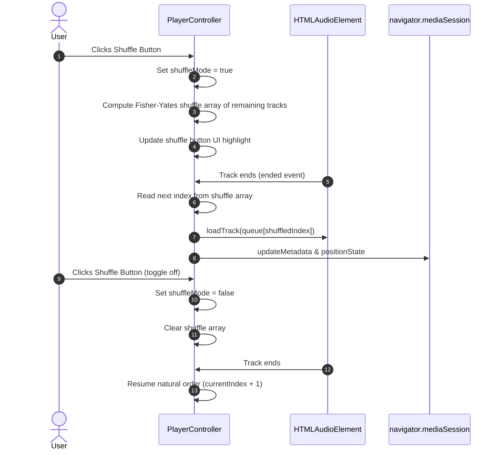

# Sonzra Phase 4: Market-Parity Audio Features

## Goal Capsule

- **Objective:** Give Sonzra listeners market-parity playback control across music and longform audio through adaptive transport controls, non-destructive shuffle, global desktop keyboard shortcuts, multi-disc album grouping, sleep timer, and volume mute toggle.
- **Means:** Extend the client-side Hotwire player controller, update server-rendered player partials, and normalize server response data across Jellyfin and Plex.
- **Product Authority:** [v1.0 Release Roadmap](file:///root/Projects/sonzra/docs/plans/2026-11-05-v1-execution-roadmap.md) Phase 4. Surrounding roadmap phases (Phase 1 Security, Phase 2 Legacy UI, Phase 3 Page Standardization, Phase 5 Architecture & Release) are separate work units and not active scope for this plan.
- **Execution Profile:** Single pull request branch `phase-4-audio-features`.
- **Open Blockers:** None.

---

<!-- ce-section: work-relationships -->
## How This Work Fits Together

Phase 4 delivers the user-facing playback feature parity needed for the v1.0 release.

- **Depends on:** Base audio streaming and playback controllers already present in `main`.
- **Can proceed independently of:** Phase 1 (security hardening), Phase 2 (legacy UI removal), Phase 3 (page standardization), and Phase 5 (Plex adapter decoupling and release automation).
- **Enables:** Complete daily-driver feature set for self-hosters switching from Feishin, Plexamp, Audiobookshelf, or Spotify.

---

## Product Contract

<!-- ce-contract-preservation: Product Contract unchanged -->

### Summary

A context-adaptive audio player and library presentation upgrade that dynamically adapts controls based on media kind. For music, it delivers non-destructive queue shuffle, multi-disc album headers ("Disc 1", "Disc 2"), and album runtime summaries. For longform spoken audio, it provides 15s back / 30s forward jump buttons, pitch-preserving speed selection (0.8x–2.0x), and MediaSession jump integration, complemented by global desktop keyboard shortcuts, a 10-second fade-out sleep timer with countdown indicators, and an interactive volume mute toggle.

### Problem Frame

Self-hosters using Sonzra across music, audiobooks, and podcasts encounter disjoint playback controls compared to modern players like Spotify, Plexamp, and Audiobookshelf. Without shuffle, albums and playlists must be listened to in fixed order. Without 15s/30s jumps and variable playback speed, spoken audio is cumbersome to navigate and digest. Without multi-disc grouping, double albums render as confusing duplicate track numbers. Without keyboard shortcuts and sleep timers, basic desktop listening and bedtime playback require manual screen interactions and workarounds.

### Key Decisions

- **Context-adaptive transport** (session-settled: user-directed — chosen over universal transport and manual mode toggle: dynamically switches controls based on media kind; longform swaps track skipping with 15s/30s jumps, shows speed selector badge, and hides shuffle; music shows track skipping and shuffle toggle). Governs R1, R5, R6.
- **Non-destructive shuffle traversal** (session-settled: user-directed — chosen over in-place queue randomization and visual preview queue: toggling shuffle plays upcoming tracks in randomized order without mutating underlying queue sequence so turning shuffle off restores album sequence; "Shuffle" on album/playlist headers loads tracks and starts in shuffled mode). Governs R1, R2, R3, R4.
- **Omnipresent sleep timer access** (session-settled: user-directed — chosen over queue sheet exclusive and overflow menu: accessible from desktop player bar utility area and expanded Now Playing sheet on mobile, showing an active countdown badge when running). Governs R10, R11, R12.
- **Global keyboard shortcut guarding**: Space, ArrowLeft/Right (seek 5s), Shift+ArrowLeft/Right (prev/next), and M (mute) are globally intercepted on desktop but strictly suppressed when keyboard focus is within input, textarea, select, or contenteditable elements. Governs R7, R8.
- **Longform playback speed persistence**: Speed adjustments (0.8x to 2.0x) persist across sessions for spoken audio in browser storage, applying `preservesPitch = true` on the `<audio>` element. Governs R5.
- **Provider-neutral multi-disc normalization**: Both Jellyfin (`ParentIndexNumber`) and Plex (`parentIndex` mapped to `ParentIndexNumber`) supply disc numbers, ensuring multi-disc grouping renders seamlessly regardless of connected server backend. Governs R13, R14.

### Requirements

#### Shuffle Mode

- R1. The player transport bar and expanded Now Playing sheet must include a Shuffle toggle button (`lucide_icon "shuffle"`) when music media is active.
- R2. Toggling shuffle on must randomize the traversal order of upcoming queued tracks using non-destructive Fisher-Yates indexing while keeping the currently playing track active.
- R3. Toggling shuffle off must restore the remaining queue sequence to its original album or playlist track order.
- R4. Album and playlist detail headers must provide a primary "Shuffle" action button that loads the full track set and immediately begins playback in shuffled mode.

#### Context-Adaptive Longform Controls (Audiobooks & Podcasts)

- R5. When playing longform media (audiobooks or podcasts), the player transport must display a playback speed selector badge supporting 0.8x, 1.0x, 1.2x, 1.5x, and 2.0x rates, setting `audioTarget.preservesPitch = true` and persisting the user's chosen speed in client storage.
- R6. When playing longform media, previous/next track buttons in the player transport and Now Playing sheet must be replaced with 15s backward (`↺ 15`) and 30s forward (`↻ 30`) skip jump buttons, and `navigator.mediaSession` must register `seekbackward` (15s) and `seekforward` (30s) action handlers.

#### Global Desktop Keyboard Shortcuts

- R7. The application must listen for desktop keyboard shortcuts: `Space` toggles play/pause (preventing default page scroll), `ArrowLeft` / `ArrowRight` seeks 5 seconds backward/forward, `Shift + ArrowLeft` / `Shift + ArrowRight` triggers previous/next track, and `M` toggles audio mute.
- R8. Keyboard shortcut handlers must immediately bail out with no action if the active focused element is an `<input>`, `<textarea>`, `<select>`, or has `contenteditable="true"`.

#### Volume & Mute Control

- R9. Clicking the volume speaker icon in the desktop player bar must toggle mute and unmute, storing and restoring the pre-muted volume level.

#### Sleep Timer

- R10. A Sleep Timer dialog must be accessible from both the desktop player bar utility area and the mobile Now Playing sheet, offering duration presets: 15 minutes, 30 minutes, 45 minutes, 60 minutes, and End of Track.
- R11. While active, the sleep timer trigger must display the remaining countdown time in minutes.
- R12. When 10 seconds remain before timer expiration, audio volume must gently fade out to 0 before pausing playback and resetting volume to the user's previous setting.

#### Multi-Disc Album Grouping & Metadata Headers

- R13. Album detail pages for multi-disc releases must group tracks under visual divider headers ("Disc 1", "Disc 2") based on `ParentIndexNumber`.
- R14. The Plex server integration client must normalize `item["parentIndex"]` into `ParentIndexNumber` on track DTOs.
- R15. Album detail headers must display total track count and aggregate runtime (`N tracks · X min`) alongside the release year.

### Key Flows

- F1. Toggling Shuffle During Album Playback
  - **Trigger:** User clicks shuffle button on player transport while listening to track 2 of a 10-track album.
  - **Actors:** Active music listener.
  - **Steps:** Player activates shuffle highlight; computes random permutation of remaining tracks; next track plays from permutation; user toggles shuffle off; next track resumes from natural album sequence.
  - **Covered by:** R1, R2, R3
- F2. Switching From Music to Audiobook
  - **Trigger:** User starts an audiobook chapter from the library.
  - **Actors:** Spoken-word listener.
  - **Steps:** Player loads audiobook track; transport detects `:audiobook` kind; hides shuffle toggle; replaces track skips with 15s back / 30s forward buttons; displays speed badge at saved rate; registers MediaSession jump handlers.
  - **Covered by:** R5, R6
- F3. Bedtime Listening with Sleep Timer
  - **Trigger:** User selects "30 min" from sleep timer modal.
  - **Actors:** Bedtime listener.
  - **Steps:** Sleep timer begins countdown; badge displays "30m"; at 29m50s audio begins volume attenuation over 10s; at 30m00s audio pauses; volume restores to initial setting; timer clears.
  - **Covered by:** R10, R11, R12

### Acceptance Examples

- AE1. Keyboard Navigation Protection
  - **Covers:** R7, R8
  - **Given:** Audio is currently playing and user is typing a query in the library search input.
  - **When:** User presses `Space` or `M`.
  - **Then:** Space adds a space character to the search query and `M` types the letter "m"; audio does not pause or mute.
- AE2. Multi-Disc Album Separation
  - **Covers:** R13, R14
  - **Given:** A 2-disc album with 8 tracks on Disc 1 and 6 tracks on Disc 2.
  - **When:** User navigates to the album detail page.
  - **Then:** "Disc 1" header precedes tracks 1-8 and "Disc 2" header precedes tracks 9-14 with their respective disc track indices.
- AE3. Non-Destructive Shuffle Off
  - **Covers:** R2, R3
  - **Given:** An album queue with tracks [A, B, C, D, E], currently playing B with Shuffle enabled.
  - **When:** User toggles Shuffle off.
  - **Then:** The next track played when B ends is C (natural order), not an unvisited track from the random set.

### Scope Boundaries

- **In Scope:** Player transport shuffle, album/playlist header shuffle, adaptive longform transport (15s/30s jumps, speed badge), desktop global keyboard shortcuts with input guard, sleep timer with 10s fade-out, volume icon mute toggle, multi-disc track grouping with Disc headers, Plex `parentIndex` normalization, album runtime and track count header.
- **Deferred for later:** User-customizable keyboard shortcut keybindings, per-track speed presets for music tracks, synced sleep timers across devices.
- **Outside this product's identity:** Video player controls, cloud streaming provider sync, complex audio DSP equalizers.

---

## Planning Contract

### Key Technical Decisions

- **KTD1. Stimulus Centralization in `PlayerController`:** Implement transport mutations, shuffle permutation math, keyboard listeners, MediaSession handlers, and sleep timer intervals directly within `app/javascript/controllers/player_controller.js`. Because Hotwire maintains persistent player DOM across Turbo navigations (`data-turbo-permanent`), keeping player state inside the existing singleton controller avoids distributed synchronization issues. Cites R1, R2, R5, R6, R7, R9, R10.
- **KTD2. Pure Fisher-Yates Index Map for Shuffle:** Shuffle is maintained as an array of unplayed indices mapped over `this.queue`. Toggling shuffle off simply clears the index map and resumes sequential index incrementation (`currentIndex + 1`), guaranteeing zero mutation to the underlying queue data structure. Cites R2, R3.
- **KTD3. Event Delegation for Desktop Global Keydown:** Global shortcut handling is mounted via `window.addEventListener("keydown", this.boundHandleKeyDown)` during `connect()` and removed on `disconnect()`. Event target verification checks `.matches("input, textarea, select, [contenteditable='true']")` before executing shortcuts. Cites R7, R8.
- **KTD4. Linear Volume Attenuation Loop:** When the sleep timer enters its final 10 seconds, volume is reduced at 200ms intervals (`volume -= originalVolume / 50`) down to 0, then playback pauses and the audio volume property is restored to `originalVolume` so subsequent playback is not muted. Cites R12.
- **KTD5. View-Layer Partitioning for Multi-Disc:** In `app/views/library_items/show.html.erb`, group tracks by `track["ParentIndexNumber"] || 1`. Only render disc headers when `grouped_tracks.keys.size > 1`, ensuring single-disc albums render without redundant headers. Cites R13.

### High-Level Technical Design

```mermaid
flowchart TD
    subgraph AudioMedia["Audio Media Classification"]
        Track[Loaded Track Payload] --> MediaKind{kind == :audiobook || :podcast}
    end

    subgraph TransportAdaptation["Context-Adaptive Transport Mode"]
        MediaKind -->|Yes: Longform| LongformMode["Longform Controls:\n• Hide Shuffle\n• Show 15s Back & 30s Forward\n• Show Playback Speed Badge (0.8x-2.0x)\n• MediaSession seekbackward/forward"]
        MediaKind -->|No: Music| MusicMode["Music Controls:\n• Show Shuffle Toggle Button\n• Show Track Skip Back/Forward\n• Hide Jump & Speed Badges"]
    end

    subgraph UserInputs["Global Interaction Channels"]
        Shortcuts["Desktop Keydown:\nSpace, Arrows, Shift+Arrows, M"] --> FocusCheck{"Target in input/textarea/editable?"}
        FocusCheck -->|Yes| PassThru[Pass through to Form Input]
        FocusCheck -->|No| AudioAction[Execute Audio Transport Action]
        VolumeClick[Click Volume Speaker Icon] --> MuteToggle[Toggle Mute & Restore Volume]
        SleepTrigger[Click Sleep Timer Button] --> SleepModal["Sleep Modal Preset:\n15m, 30m, 45m, 60m, End of Track"]
    end

    subgraph SleepLifecycle["Sleep Timer Lifecycle"]
        SleepModal --> Countdown["Active Countdown in Badge"]
        Countdown -->|10s Remaining| Fade["Linear Volume Fade (10s down to 0)"]
        Fade -->|0s| PauseAudio["Pause Audio & Reset Original Volume"]
    end
```



### Assumptions

- Client devices support `HTMLAudioElement.preservesPitch` (standard in modern Chromium, WebKit, and Gecko engines).
- Longform playback speeds and volume preferences are client-device specific and should be stored in browser storage (`localStorage` / `sessionStorage`).
- Desktop keyboard shortcuts do not conflict with browser navigation shortcuts because `Space` default scroll is prevented only when an active audio session is loaded.

---

## Implementation Units

### U1. Plex Track Disc Normalization & Multi-Disc View Grouping

- **Goal:** Group multi-disc album tracks with "Disc 1", "Disc 2" divider headers in album detail views, map Plex `parentIndex` to `ParentIndexNumber`, and render total track count and runtime in the album header.
- **Requirements:** R13, R14, R15. Covers AE2.
- **Dependencies:** None.
- **Files:**
  - `app/services/integrations/plex/client.rb`
  - `app/views/library_items/show.html.erb`
  - `app/helpers/application_helper.rb`
  - `test/services/integrations/plex/client_test.rb`
  - `test/helpers/application_helper_test.rb`
- **Approach:**
  1. In `app/services/integrations/plex/client.rb` (`normalize_track` / `normalize_item`), map `"ParentIndexNumber" => item["parentIndex"] || 1`.
  2. In `app/helpers/application_helper.rb`, add `album_runtime_summary(tracks)` to calculate aggregate runtime (`RunTimeTicks`) and format as `X hr Y min` or `X min`.
  3. In `app/views/library_items/show.html.erb`:
     - Display `pluralize(details[:tracks].size, "track") · <%= album_runtime_summary(details[:tracks]) %>` alongside the release year in the album header.
     - Group tracks by `track["ParentIndexNumber"] || 1`. If `grouped_tracks.keys.size > 1`, render a divider header `<div class="detail-tracks__disc-header"><span>Disc <%= disc_number %></span></div>` before each disc's track list.
- **Test Scenarios:**
  - Happy path: Plex client normalization includes `"ParentIndexNumber" => 2` when `item["parentIndex"] = 2`.
  - Happy path: `album_runtime_summary` returns correct formatted minutes/hours from track ticks.
  - Covers AE2: Multi-disc album with 2 discs renders "Disc 1" and "Disc 2" subheaders with respective tracks.
  - Edge case: Single-disc album renders without disc divider headers.
  - Edge case: Album with tracks having `nil` `ParentIndexNumber` defaults to Disc 1 without crashing.
- **Verification:** Rails test suite passes for Plex client normalization and view helpers.

### U2. Non-Destructive Queue Shuffle & Album/Playlist Header Action

- **Goal:** Add shuffle mode to player transport bar and Now Playing drawer with non-destructive queue semantics, and add a "Shuffle" button to album and playlist detail headers.
- **Requirements:** R1, R2, R3, R4. Covers F1, AE3.
- **Dependencies:** None.
- **Files:**
  - `app/views/shared/_player.html.erb`
  - `app/views/shared/_player_queue.html.erb`
  - `app/views/library_items/show.html.erb`
  - `app/javascript/controllers/player_controller.js`
  - `test/javascript/player_controller.test.js`
- **Approach:**
  1. In `app/views/shared/_player.html.erb` and `app/views/shared/_player_queue.html.erb`, add shuffle toggle buttons with `data-player-target="shuffle"` and `data-action="player#toggleShuffle"`.
  2. In `app/views/library_items/show.html.erb`, add a secondary or primary "Shuffle" button in `redesign-detail-actions` with `data-action="player#replaceQueue"` and `data-player-shuffle-param="true"`.
  3. In `app/javascript/controllers/player_controller.js`:
     - Add `shuffle` to `static targets`.
     - Implement `toggleShuffle()`: toggle `this.shuffleMode`, update button active styles (`is-active`, `aria-pressed`), and generate `this.shuffledOrder` containing remaining queue indices shuffled using Fisher-Yates algorithm.
     - In `playNext()`: if `this.shuffleMode` is true, take the next index from `this.shuffledOrder`; if shuffle is false, proceed sequentially (`this.currentIndex + 1`).
     - In `replaceQueue(event)`: check if `event.params?.shuffle` is true. If so, immediately activate shuffle mode after loading queue tracks.
- **Test Scenarios:**
  - Happy path: Clicking shuffle button toggles `shuffleMode` state and updates `aria-pressed`.
  - Covers F1: When shuffle is active, `playNext()` selects the next track from the randomized permutation.
  - Covers AE3: Toggling shuffle off restores subsequent playback to sequential natural queue order.
  - Happy path: Clicking header "Shuffle" replaces queue and starts playback with shuffle mode active.
  - Edge case: Enabling shuffle when only 1 track remains in the queue transitions smoothly without errors.
- **Verification:** Vitest unit tests verify shuffle toggle, random traversal, and natural order restoration.

### U3. Context-Adaptive Transport & Longform Playback Speed & Jump Buttons

- **Goal:** Dynamically adapt player transport controls for spoken audio (podcasts and audiobooks) with 15s back / 30s forward buttons, speed selection badge (0.8x-2.0x), and MediaSession jump integration.
- **Requirements:** R5, R6. Covers F2.
- **Dependencies:** None.
- **Files:**
  - `app/views/shared/_player.html.erb`
  - `app/views/shared/_player_queue.html.erb`
  - `app/javascript/controllers/player_controller.js`
  - `app/assets/stylesheets/redesign.css`
  - `test/javascript/player_controller.test.js`
- **Approach:**
  1. In `app/views/shared/_player.html.erb` and `_player_queue.html.erb`:
     - Add jump buttons: 15s backward (`↺ 15`, `data-player-target="jumpBack"`, `data-action="player#skipBackward"`) and 30s forward (`↻ 30`, `data-player-target="jumpForward"`, `data-action="player#skipForward"`), hidden by default.
     - Add speed badge button (`data-player-target="playbackRate"`, `data-action="player#cyclePlaybackRate"`), hidden by default.
  2. In `app/javascript/controllers/player_controller.js`:
     - Detect track kind on `loadTrack`: if track kind is `audiobook` or `podcast`, activate longform transport mode (hide shuffle and track skips, show jump buttons and speed badge); otherwise activate music transport mode.
     - Implement `skipBackward()` (`currentTime = Math.max(0, currentTime - 15)`) and `skipForward()` (`currentTime = Math.min(duration, currentTime + 30)`).
     - In `setupMediaSession()`, register `mediaSession.setActionHandler("seekbackward", (details) => this.skipBackward(details?.seekOffset || 15))` and `seekforward` (30s).
     - Implement `cyclePlaybackRate()` cycling through `[0.8, 1.0, 1.2, 1.5, 2.0]`. Set `this.audioTarget.playbackRate = rate; this.audioTarget.preservesPitch = true`. Persist in `localStorage.setItem("sonzra:playbackRate", rate)`.
- **Test Scenarios:**
  - Covers F2: Loading an audiobook track hides shuffle toggle, shows 15s/30s jump buttons, and displays speed badge.
  - Happy path: `skipBackward` decrements `currentTime` by 15 seconds; `skipForward` increments by 30 seconds.
  - Happy path: `cyclePlaybackRate` updates `audioTarget.playbackRate`, sets `preservesPitch = true`, and updates badge text.
  - Edge case: `skipBackward` at position 5s clamps cleanly to 0s without negative values.
  - Edge case: Switching from an audiobook to a music track restores track skip buttons and shuffle toggle.
- **Verification:** Vitest tests verify control visibility toggles, jump calculations, and pitch preservation rate changes.

### U4. Global Desktop Keyboard Shortcuts & Interactive Volume Mute Toggle

- **Goal:** Provide global desktop keyboard shortcuts with active input protection, and interactive click-to-mute on the player volume speaker icon.
- **Requirements:** R7, R8, R9. Covers AE1.
- **Dependencies:** None.
- **Files:**
  - `app/views/shared/_player.html.erb`
  - `app/javascript/controllers/player_controller.js`
  - `test/javascript/player_controller.test.js`
- **Approach:**
  1. In `app/views/shared/_player.html.erb`:
     - Wrap volume speaker icon in a `<button type="button" class="listen-player__mute" aria-label="Toggle mute" data-player-target="muteButton" data-action="player#toggleMute">` before the range slider.
  2. In `app/javascript/controllers/player_controller.js`:
     - In `connect()`, bind `window.addEventListener("keydown", this.boundHandleKeyDown)`.
     - In `handleKeyDown(event)`:
       - Bail out immediately if `event.target.matches("input, textarea, select, [contenteditable='true']")`.
       - If `event.code === "Space"`: `event.preventDefault(); this.toggle()`.
       - If `event.code === "ArrowLeft"` without shift: `event.preventDefault(); this.seekRelative(-5)`.
       - If `event.code === "ArrowRight"` without shift: `event.preventDefault(); this.seekRelative(5)`.
       - If `event.code === "ArrowLeft"` with shift: `event.preventDefault(); this.previous()`.
       - If `event.code === "ArrowRight"` with shift: `event.preventDefault(); this.next()`.
       - If `event.key.toLowerCase() === "m"`: `event.preventDefault(); this.toggleMute()`.
     - Implement `toggleMute()`: if volume > 0, store `this.unmutedVolume = this.audioTarget.volume; this.audioTarget.volume = 0`; if volume == 0, restore `this.audioTarget.volume = this.unmutedVolume || 0.8`. Update volume slider input and icon.
- **Test Scenarios:**
  - Covers AE1: Pressing Space or M while focused in an `<input>` element does NOT trigger audio play/pause or mute.
  - Happy path: Pressing Space while focused in body toggles playback and prevents default page scroll.
  - Happy path: ArrowLeft / ArrowRight seeks 5 seconds backward/forward.
  - Happy path: Shift + ArrowLeft / ArrowRight navigates to previous/next track.
  - Happy path: Pressing M or clicking volume speaker icon mutes volume; second press restores prior volume.
- **Verification:** Vitest tests verify shortcut event interception, input target suppression, and mute state restoration.

### U5. Sleep Timer with 10-Second Volume Fade-Out

- **Goal:** Implement an omnipresent Sleep Timer with presets (15m, 30m, 45m, 60m, End of Track), countdown badge, and gentle 10-second audio fade-out before pausing.
- **Requirements:** R10, R11, R12. Covers F3.
- **Dependencies:** U4.
- **Files:**
  - `app/views/shared/_player.html.erb`
  - `app/views/shared/_player_queue.html.erb`
  - `app/javascript/controllers/player_controller.js`
  - `app/assets/stylesheets/redesign.css`
  - `test/javascript/player_controller.test.js`
- **Approach:**
  1. In `app/views/shared/_player.html.erb` and `_player_queue.html.erb`:
     - Add sleep timer button `<button type="button" class="listen-player__utility" aria-label="Sleep timer" data-player-target="sleepButton" data-action="player#openSleepTimer"><%= lucide_icon "moon", aria: { hidden: true } %><span data-player-target="sleepBadge" class="listen-player__sleep-badge" hidden></span></button>`.
     - Add sleep timer dialog `<dialog class="listen-queue__sleep-dialog" data-player-target="sleepDialog">` containing duration presets (15 min, 30 min, 45 min, 60 min, End of Track) and Cancel button.
  2. In `app/javascript/controllers/player_controller.js`:
     - Implement `openSleepTimer()`, `closeSleepTimer()`, and `setSleepTimer(event)`.
     - When a preset is chosen: store target timestamp, display countdown badge (`30m`), and start 1-second interval to update remaining time.
     - When 10 seconds remain: initiate linear volume fade loop (reducing volume by `originalVolume / 50` every 200ms).
     - At 0s: call `this.audioTarget.pause()`, restore volume to `originalVolume`, clear timer, and reset badge.
     - If "End of track" is selected: attach one-time listener to `ended` event to pause and stop queue advance.
- **Test Scenarios:**
  - Covers F3: Setting a 30m sleep timer displays "30m" badge and initiates countdown.
  - Happy path: Selecting "End of Track" pauses playback when current track finishes without playing next track.
  - Happy path: When 10s remain, volume attenuates linearly to 0 before pausing.
  - Edge case: Manually stopping playback or clearing queue cancels active sleep timer interval.
  - Edge case: Canceling sleep timer dialog leaves current playback unchanged.
- **Verification:** Vitest tests verify timer countdown, 10s fade-out volume reduction, and cleanup on manual pause.

---

## Verification Contract

### Test Suite Execution

Run all quality checks in the worktree:

```bash
# 1. Run Vitest suite for Stimulus player controllers
npm test

# 2. Run Rails minitest suite for models, helpers, and integration clients
bundle exec rails test test/services/integrations/plex/client_test.rb test/helpers/application_helper_test.rb

# 3. Run RuboCop static analysis
bundle exec rubocop

# 4. Run universal quality gate
bin/quality
```

### Critical Verification Checks

1. **Input Guarding:** Typing text in the library search bar with spaces and the letter 'm' does not pause or mute playback.
2. **Pitch Preservation:** Changing playback speed on audiobooks to 1.5x or 2.0x maintains normal pitch with `preservesPitch = true`.
3. **Queue Invariant:** Toggling shuffle on and off during music playback does not alter the underlying queue sequence or drop tracks.
4. **Multi-Disc Rendering:** Double albums display "Disc 1" and "Disc 2" headers; single-disc albums display no redundant disc headers.
5. **Sleep Fade-out:** The sleep timer attenuates volume over the final 10 seconds and pauses cleanly without abruptly cutting off sound.

---

## Definition of Done

- [x] All 15 requirements (R1–R15) are fully implemented across U1–U5.
- [x] No regression on existing player features (repeat mode, lyrics sync, Wi-Fi preload, favorites).
- [x] Vitest unit tests pass with 100% green status on new player functionality.
- [x] Rails minitests pass with zero failures.
- [x] `bin/quality` passes clean with zero RuboCop offenses.
- [x] All temporary experimental code and debug logs are removed.
