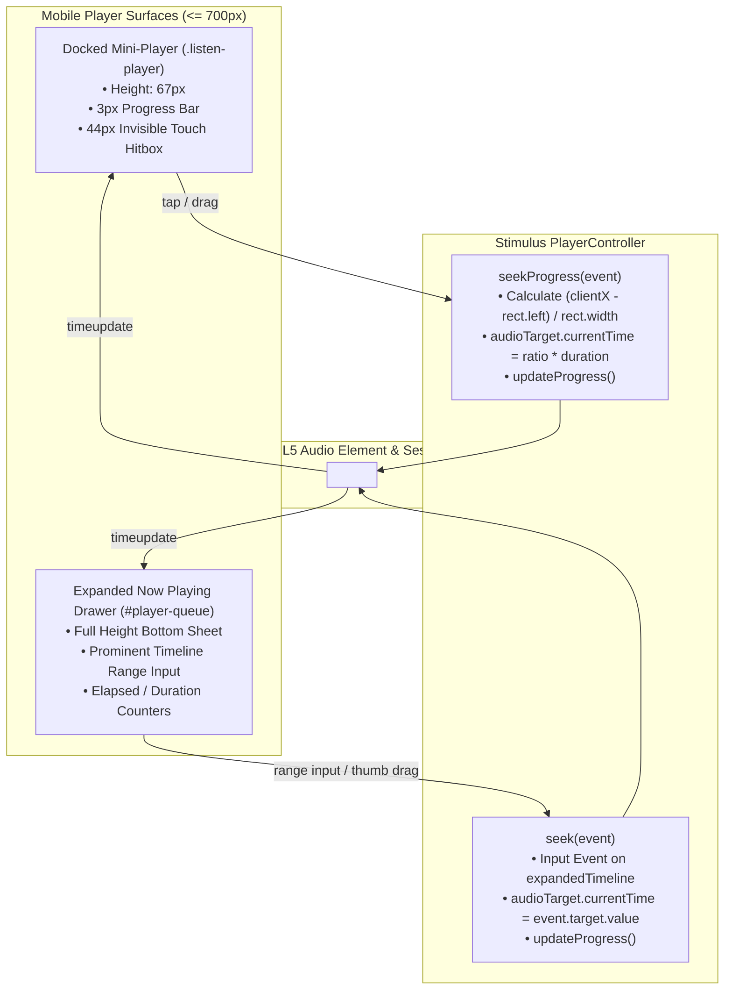
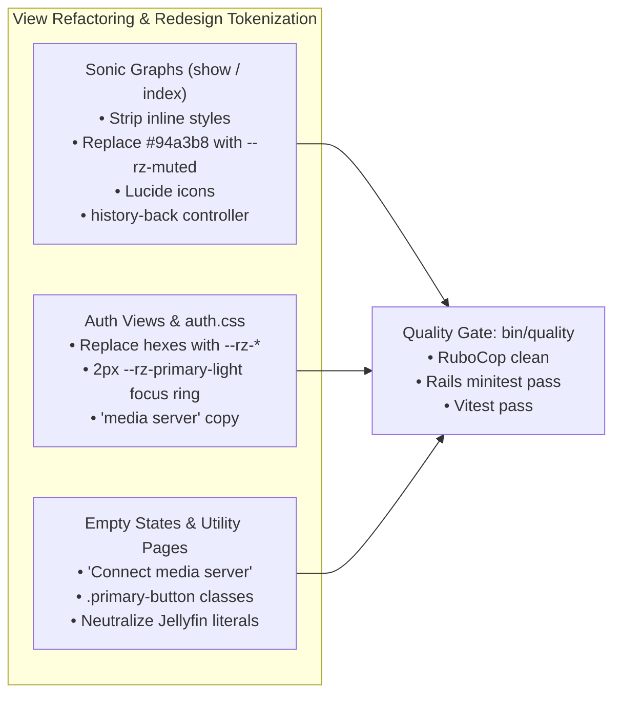

## Goal Capsule

- **Objective:** Mobile listeners on viewports 700px or narrower can scrub and seek audio tracks with touch-compliant hitboxes across both the docked mini-player and expanded Now Playing drawer, while all visual surfaces (Sonic Map, authentication screens, empty states, and secondary utility pages) strictly conform to the Redesign design system tokens with zero foreign inline styles or vendor-locked copy.
- **Means:** Dual mobile scrubbing interactions in Stimulus `PlayerController`, stylesheet tokenization in `redesign.css` and `auth.css`, view template cleanup in `sonic_graphs/` and empty states, and copy neutralization from "Jellyfin" to "media server".
- **Product Authority:** Sonzra v1.0 Phased Execution Roadmap (`docs/plans/2026-11-05-v1-execution-roadmap.md`), UI/UX Guidelines (`docs/guidelines/ui_ux.md`), Design System (`DESIGN_SYSTEM.md`). Surrounding phases (Security Hardening, Legacy UI Removal, Audio Features, Release Automation) are external scope and not active deliverables for this plan.
- **Execution Profile:** `execution: code`
- **Open Blockers:** None.

---

## Product Contract

> Product Contract preservation: Product Contract unchanged.

### Summary

Dual mobile track scrubbing providing quick tap-and-drag seeking on the docked mini-player alongside a full, touch-accessible timeline slider in the expanded Now Playing sheet, combined with a comprehensive template standardization that aligns Sonic Map and authentication views to `--rz-*` tokens, eliminates stray inline CSS, and neutralizes empty-state copy to support any media server.

### Problem Frame

Listeners using Sonzra on mobile devices (viewports <= 700px) are currently unable to navigate or scrub within audio tracks. The docked persistent mini-player hides its timeline controls with `display: none !important`, offering only a read-only 3px progress line without touch interaction listeners. Furthermore, when opening the full Now Playing bottom sheet (`#player-queue`), the progress container (`.listen-queue__progress`) is also globally hidden (`display: none`), preventing users from seeking backwards or forwards.

In parallel, visual consistency has drifted across several key application surfaces. The Sonic Map view templates (`app/views/sonic_graphs/show.html.erb` and `index.html.erb`) are heavily styled with inline `style="..."` attributes and hardcoded Tailwind slate hex values (`#94a3b8`, `#1e293b`, `#a855f7`) rather than inheriting from the canonical `.redesign` design system tokens. Authentication views rely on legacy hex codes in `auth.css` without accessible focus rings, and onboarding/empty-state copy hardcodes "Jellyfin" as the sole server provider despite Sonzra's multi-backend architecture supporting Plex. Standardizing these surfaces completes the visual polish required for Sonzra v1.0.

### Requirements

#### Mobile Scrubber Restoration

- R1. The expanded Now Playing sheet (`#player-queue`) on viewports <= 700px must display the interactive timeline slider (`.listen-queue__progress`), including current elapsed time, total duration, and seek slider handle.
- R2. All timeline slider touch targets and thumb handles in the Now Playing sheet must enforce a minimum bounding box of 44x44px to satisfy mobile ergonomics and touch accessibility standards.
- R3. The docked persistent mini-player (`.listen-player`) on mobile viewports must support direct seeking via tap and horizontal drag along its top progress bar, utilizing an expanded transparent touch hit area of at least 44px vertical height without altering the 3px visible line height.
- R4. Scrubbing via either the mini-player or the expanded sheet must immediately update the audio playback position, synchronize elapsed timestamps in both views, and dispatch media position events to the browser session.

#### Sonic Map View Standardization

- R5. All inline `style="..."` attributes in `app/views/sonic_graphs/show.html.erb` must be removed and replaced with canonical `.redesign` utility classes defined in `app/assets/stylesheets/redesign.css`.
- R6. Hardcoded slate and purple hex color literals (`#94a3b8`, `#1e293b`, `#a855f7`, `#090d16`) in `sonic_graphs/show.html.erb` and `index.html.erb` must be replaced with canonical design tokens (`--rz-surface`, `--rz-muted`, `--rz-primary`, `--rz-background`).
- R7. The navigation back link in `sonic_graphs/show.html.erb` must replace raw inline SVGs and `javascript:history.back()` with `lucide_icon "arrow-left"` and the existing Stimulus `data-controller="history-back"` action.
- R8. The search and reset controls in `sonic_graphs/index.html.erb` must replace inline SVGs and legacy `.button--subtle.button--icon` classes with standard redesign `.icon-button` or `.secondary-button` styling and `lucide_icon "search"` / `lucide_icon "rotate-ccw"`.

#### Authentication Screen Token Modernization

- R9. Stylesheet `app/assets/stylesheets/auth.css` must be refactored to consume `--rz-*` CSS custom properties (`--rz-background`, `--rz-surface`, `--rz-raised`, `--rz-primary`, `--rz-primary-light`, `--rz-text`, `--rz-muted`, `--rz-line`) for card backgrounds, atmospheric glows, typography, and borders.
- R10. All interactive inputs, buttons, and anchor links across authentication screens must provide high-contrast visible focus indicators using `outline: 2px solid var(--rz-primary-light)` with `outline-offset: 3px`.
- R11. Registration and sign-in copy in `app/views/registrations/new.html.erb` and `auth.css` must neutralize vendor-specific phrasing, replacing "keep your Jellyfin connection private" with "keep your media server connection private".

#### Empty State Copy Generalization & Page Audit

- R12. Empty states across the application (`app/views/home/no_server.html.erb`, `app/views/library/no_server.html.erb`, and `app/views/offline_downloads/index.html.erb`) must replace hardcoded "Jellyfin" references with neutral "media server" terminology.
- R13. Legacy action buttons in empty states (such as `.listen-outline-button` in `no_server.html.erb`) must be replaced with canonical `.primary-button` styling.
- R14. A comprehensive audit across secondary utility pages (settings, server connection forms, admin user management) must eliminate any stray inline styles or unaligned legacy button classes, ensuring visual parity across the entire application.

### Key Flows

- F1. Mobile Mini-Player Quick Seek
  - **Trigger:** Listener touches or drags anywhere across the top edge of the docked mini-player on a mobile device.
  - **Actors:** Mobile Listener
  - **Steps:** The 44px hit area detects the touch point; `PlayerController` computes the proportional track percentage; the audio position jumps immediately to the selected timestamp; the 3px progress bar reflects the new position.
  - **Outcome:** Listener seeks without needing to open the full queue sheet.
  - **Covered by:** R3, R4

- F2. Expanded Now Playing Full Scrubbing
  - **Trigger:** Listener taps the mini-player track info to open the Now Playing sheet, then drags the timeline slider thumb.
  - **Actors:** Mobile Listener
  - **Steps:** The sheet slides up displaying elapsed/remaining timestamps and the prominent slider; listener drags the slider thumb (with >= 44px hitbox); elapsed time updates smoothly in real time; releasing the thumb commits the seek.
  - **Outcome:** Listener achieves precise audio navigation on small screens.
  - **Covered by:** R1, R2, R4

- F3. Sonic Map Exploration
  - **Trigger:** User navigates to the Sonic Map detail view for a track.
  - **Actors:** All Users
  - **Steps:** View renders using pure `.redesign` styling with zero unstyled flashes; nearest neighbor cards display with standard hairline borders and hover elevation; clicking Back executes Turbo-compatible history navigation.
  - **Outcome:** Cohesive visual listening room experience consistent with library browsing.
  - **Covered by:** R5, R6, R7, R8

### Key Decisions

- KTD1. **Dual Scrubbing Interaction Model**: Retain quick tap/drag seeking on the docked mini-player's top progress line while providing full high-precision timeline scrubbing with timestamps inside the expanded Now Playing sheet.
  - *Rationale:* Keeps the docked mini-player compact (67px height) without overcrowding transport controls, while giving mobile users instant seek access without mandating drawer expansion.
- KTD2. **Transparent 44px Hit Target on Mini-Player**: Expand the touch bounding area of `.listen-player__progress` vertically using padding or an absolute pseudo-element while keeping the visible progress bar at 3px.
  - *Rationale:* Satisfies Apple and WCAG touch target ergonomics without compromising the sleek visual aesthetic.
- KTD3. **Sonic Map Redesign CSS Integration**: Eliminate all inline styles in `sonic_graphs/show.html.erb` and utilize the pre-existing, dormant redesign rules in `redesign.css:168`.
  - *Rationale:* Redesign styling for `.sonic-map-detail` was already authored in CSS but overridden by legacy inline ERB attributes.
- KTD4. **`session-settled:` Expanded Utility Page Audit**: Audit settings, connection forms, and admin user screens alongside the primary roadmap views.
  - *Rationale:* User confirmed expanding the standardization audit to eliminate any remaining stray inline styles across secondary utility views.

### Scope Boundaries

#### In-Scope

- Restoring interactive timeline controls in `#player-queue` on mobile viewports.
- Touch drag and tap seeking on `.listen-player__progress` in `player_controller.js`.
- Refactoring `sonic_graphs/show.html.erb` and `index.html.erb` to remove inline CSS and slate hex values.
- Modernizing `app/assets/stylesheets/auth.css` with `--rz-*` tokens and accessible focus states.
- Copy generalization across `no_server.html.erb`, `registrations/new.html.erb`, `admin/users/index.html.erb`, and `offline_downloads/index.html.erb`.
- Audit of secondary utility templates for inline styles.

#### Deferred for Later / Out of Scope

- Database schema changes and migrations (managed in Phase 1 and Phase 2).
- Audio player playback features such as shuffle, playback speed, and sleep timer (Phase 4).
- Server adapter decoupling and release packaging (Phase 5).
- WebGL canvas shader modifications inside `sonic_graph_controller.js` (out of scope; only surrounding UI chrome is standardized).

### Success Criteria

- S1. On mobile viewports (<= 700px), dragging or tapping both the mini-player progress bar and the expanded sheet timeline slider smoothly repositions audio playback.
- S2. Zero inline `style="..."` attributes exist in `app/views/sonic_graphs/show.html.erb` and `app/views/sonic_graphs/index.html.erb`.
- S3. Zero foreign slate color hex literals (`#94a3b8`, `#1e293b`, `#a855f7`) exist in `app/views/`.
- S4. All inputs and interactive elements on authentication screens display high-contrast focus visible rings using `--rz-primary-light`.
- S5. Empty state and onboarding views reference neutral "media server" rather than hardcoding "Jellyfin".
- S6. Quality gate passes cleanly via `bin/quality` (all unit, minitest, Vitest, and linter checks pass).

---

## Planning Contract

### Key Technical Decisions

- KTD1. **(session-settled: user-directed — chosen over Expanded-Sheet-Only: dual scrubbing provides instant seeking on mini-player while preserving full drawer timeline)**:
  Implement dual-surface seeking in `PlayerController`. The docked mini-player binds `pointerdown`, `pointermove`, and `pointerup` (or touch event equivalents) on `.listen-player__progress`. The expanded Now Playing drawer unhides `.listen-queue__progress` in media queries `<= 700px`, connecting standard `input->player#seek` on `data-player-target="expandedTimeline"`. (Governs R1, R3, R4)
- KTD2. **Relative Pointer Coordinate Math with Throttling**:
  Seeking on `.listen-player__progress` calculates client position relative to the element's bounding rect: `const ratio = Math.max(0, Math.min(1, (clientX - rect.left) / rect.width))`. When scrubbing via drag, updates to the visible fill and time labels are immediate, while writes to `audioTarget.currentTime` are throttled (or applied upon pointer release) to avoid audio decoder thrashing and stutter. (Governs R3, R4)
- KTD3. **44px Invisible Touch Hitbox via Pseudo-element**:
  Rather than expanding the visual height of `.listen-player__progress` (which would disrupt the compact 67px docked player layout), use a CSS pseudo-element `::before` with `height: 44px; top: -20px; bottom: -21px; width: 100%; position: absolute;` to establish an accessible 44px vertical touch target. (Governs R2, R3)
- KTD4. **(session-settled: user-directed — chosen over Bounded-Roadmap-Scope: comprehensive audit across utility templates)**:
  Include settings, connection forms, and admin user screens in the template standardization audit to guarantee no orphan inline styles or unaligned buttons remain across any view. (Governs R14)

### High-Level Technical Design





### Implementation Assumptions & Constraints

1. The player shell is `data-turbo-permanent` and persists across page navigations without re-rendering.
2. In `redesign.css`, `.redesign .listen-queue__progress` was previously hidden with `display: none;` on desktop to prevent duplicate controls alongside the bottom persistent player. On mobile viewports (`max-width: 700px`), it must be explicitly shown inside the bottom sheet drawer.
3. No database schema migrations or changes to `User` or `ServerConnection` models are required.
4. All icon replacements must use the existing `lucide_icon` helper.

---

## Implementation Units

### U1. Mobile Touch Scrubber Controller Enhancement

- **Goal:** Implement touch drag and tap seeking on the docked mini-player's progress target and ensure smooth synchronization with the expanded queue timeline.
- **Requirements:** R3, R4
- **Files:**
  - `app/javascript/controllers/player_controller.js`
  - `test/javascript/player_controller.test.js`
- **Approach:**
  - Add pointer/touch event bindings (`pointerdown`, `pointermove`, `pointerup`, `pointercancel`) to `miniProgress` container or a dedicated `progressHitbox` in `player_controller.js`.
  - Calculate seek position: `const rect = target.getBoundingClientRect(); const ratio = Math.max(0, Math.min(1, (event.clientX - rect.left) / rect.width));`.
  - While dragging (`pointermove`), update local visual progress and timestamp targets. On `pointerup`, set `this.audioTarget.currentTime = ratio * this.audioTarget.duration` and dispatch progress synchronization.
  - Ensure `seek(event)` for `expandedTimeline` continues to sync both mini-progress and timeline range values.
- **Test Scenarios:**
  - Happy path: Tap at 50% width on mini-player progress sets `audioTarget.currentTime` to half duration.
  - Dragging: Pointermove along mini-player updates progress fill smoothly before committing seek on pointerup.
  - Multi-target sync: Seeking in expanded timeline updates mini-progress bar percentage and vice versa.
  - Boundary handling: Tapping beyond left (< 0) or right (> width) clamps ratio to 0 and 1 without exceptions.
- **Verification:** `npm run test:javascript`

### U2. Persistent Player & Expanded Queue CSS Refactoring

- **Goal:** Update `redesign.css` so that mobile viewports display the interactive timeline in `#player-queue` with >= 44px touch hitboxes and equip `.listen-player__progress` with an invisible 44px vertical hit area.
- **Requirements:** R1, R2, R3
- **Files:**
  - `app/assets/stylesheets/redesign.css`
  - `app/views/shared/_player.html.erb`
  - `app/views/shared/_player_queue.html.erb`
- **Approach:**
  - In `app/assets/stylesheets/redesign.css`, inside `@media (max-width: 700px)`:
    - Target `.redesign .listen-queue__progress` and set `display: grid !important; grid-template-columns: 42px minmax(0, 1fr) 42px; align-items: center; gap: 10px; width: 100%; margin: 12px 0;`.
    - Ensure `.listen-queue__progress input[type="range"]` has a touch target of at least 44px height (`min-height: 44px; margin: 0; cursor: pointer;`).
    - Ensure thumb styling (`::-webkit-slider-thumb` and `::-moz-range-thumb`) provides a visible handle and touch area of at least 24px diameter with a 44px outer touch bounding box.
    - On `.redesign .listen-player__progress`, add `position: absolute; top: 0; left: 0; right: 0; height: 3px; cursor: pointer;` with a pseudo-element `::before { content: ""; position: absolute; top: -20px; bottom: -21px; left: 0; right: 0; height: 44px; }` to provide a 44px touch hitbox.
  - In `app/views/shared/_player.html.erb`:
    - Add `data-action="pointerdown->player#startMiniSeek pointermove->player#dragMiniSeek pointerup->player#endMiniSeek pointercancel->player#endMiniSeek"` on the progress container.
- **Test Scenarios:**
  - Responsive inspection: On screens <= 700px, `.listen-queue__progress` is computed visible (`display != none`).
  - Hitbox measurement: `.listen-player__progress` touch target bounding rect provides >= 44px vertical hit height.
  - Desktop isolation: On viewports > 700px, `.redesign .listen-queue__progress` remains hidden in the desktop right flyout to avoid redundant controls.
- **Verification:** Manual inspection across responsive viewports; `npm run test:javascript`.

### U3. Sonic Map Detail & Canvas Template Standardization

- **Goal:** Clean up `sonic_graphs/show.html.erb` and `index.html.erb`, stripping inline styles, eliminating slate colors, and adopting Lucide icons and history navigation.
- **Requirements:** R5, R6, R7, R8
- **Files:**
  - `app/views/sonic_graphs/show.html.erb`
  - `app/views/sonic_graphs/index.html.erb`
  - `app/assets/stylesheets/redesign.css`
  - `test/controllers/sonic_graphs_controller_test.rb`
- **Approach:**
  - In `app/views/sonic_graphs/show.html.erb`:
    - Remove all inline `style="..."` attributes from container, headers, canvas wrapper, viewport, tooltip, and neighbor cards.
    - Replace `javascript:history.back()` link with `<button type="button" class="back-link back-link--compact" data-controller="history-back" data-action="click->history-back#go" aria-label="Back"><%= lucide_icon "arrow-left", aria: { hidden: true } %><span>Back</span></button>`.
    - Replace raw inline SVGs with `lucide_icon`.
    - Rely on `.redesign .sonic-map-detail`, `.redesign .sonic-map-detail__canvas`, `.redesign .sonic-map-detail__neighbor`, etc., already defined in `redesign.css:168`.
  - In `app/views/sonic_graphs/index.html.erb`:
    - Replace `<svg ... stroke="#94a3b8">` with `<%= lucide_icon "search" %>`.
    - Replace reset view button SVG and inline styling with `<button class="icon-button" title="Reset View" data-action="click->sonic-graph#resetZoom"><%= lucide_icon "rotate-ccw" %></button>`.
- **Test Scenarios:**
  - Render check: Visiting `sonic_graphs/show` renders valid HTML with zero `style=` attributes.
  - Iconography: All icons render via SVG elements with `lucide` class.
  - Back navigation: Back button triggers `history-back#go`.
  - Neighbor distance: Neighbor distance displays in `var(--rz-primary)` instead of `#a855f7`.
- **Verification:** `bin/rails test test/controllers/sonic_graphs_controller_test.rb`

### U4. Authentication Screen Tokenization & Accessibility

- **Goal:** Refactor `app/assets/stylesheets/auth.css` to use `--rz-*` design tokens, add high-contrast focus rings, and neutralize registration copy.
- **Requirements:** R9, R10, R11
- **Files:**
  - `app/assets/stylesheets/auth.css`
  - `app/views/registrations/new.html.erb`
  - `test/controllers/registrations_controller_test.rb`
- **Approach:**
  - In `app/assets/stylesheets/auth.css`:
    - Replace `#0c0c16` with `var(--rz-background)`.
    - Replace `#7a5af842` and `#43d7c629` with `color-mix(in srgb, var(--rz-primary) 26%, transparent)` and `color-mix(in srgb, var(--rz-accent) 16%, transparent)`.
    - Replace `#1d1c2ee8` / `#11111be8` with `var(--rz-raised)` and `var(--rz-surface)`.
    - Replace `var(--text)` and `var(--muted)` with `var(--rz-text)` and `var(--rz-muted)`.
    - Replace `#b9a8ff` and `#c9baff` with `var(--rz-primary-light)`.
    - Add global focus outline: `.auth-form input:focus-visible, .auth-form a:focus-visible, .auth-card a:focus-visible { outline: 2px solid var(--rz-primary-light); outline-offset: 3px; }`.
  - In `app/views/registrations/new.html.erb`:
    - Update copy from "keep your Jellyfin connection and listening history private" to "keep your media server connection and listening history private".
- **Test Scenarios:**
  - Token verification: `auth.css` contains zero raw hex colors other than fallback declarations.
  - Focus accessibility: Tab navigation across sign-in and registration fields triggers visible `outline-offset` rings.
  - Registration render: Visiting `/registration/new` displays neutralized "media server" copy.
- **Verification:** `bin/rails test test/controllers/registrations_controller_test.rb`

### U5. Empty State Copy Generalization & Utility Page Audit

- **Goal:** Generalize empty state templates and audit secondary utility pages to neutralize vendor copy and eliminate stray legacy button classes.
- **Requirements:** R12, R13, R14
- **Files:**
  - `app/views/home/no_server.html.erb`
  - `app/views/library/no_server.html.erb`
  - `app/views/offline_downloads/index.html.erb`
  - `app/views/admin/users/index.html.erb`
  - `test/controllers/home_controller_test.rb`
  - `test/controllers/library_controller_test.rb`
- **Approach:**
  - In `app/views/home/no_server.html.erb` and `app/views/library/no_server.html.erb`:
    - Replace "Connect Jellyfin" with "Connect media server".
    - Replace class `listen-outline-button` with `primary-button`.
  - In `app/views/offline_downloads/index.html.erb`:
    - Replace "even when your Jellyfin server is unavailable" with "even when your media server is unavailable".
  - In `app/views/admin/users/index.html.erb`:
    - Replace "Each person connects their own Jellyfin account" with "Each person connects their own media server account".
  - Audit settings, connection forms, and admin user templates to verify no inline styles or hardcoded slate hexes exist.
- **Test Scenarios:**
  - Empty state text: No-server screens assert the presence of "Connect media server" link targeting `server_connections_path`.
  - Class alignment: No occurrences of `.listen-outline-button` remain in views.
  - Global scan: Zero occurrences of hardcoded "Jellyfin" remain in empty-state and onboarding copy.
- **Verification:** `bin/rails test test/controllers/home_controller_test.rb test/controllers/library_controller_test.rb`

---

## Verification Contract

### Test Commands

1. **JavaScript & Stimulus Tests:**
   ```bash
   npm run test:javascript
   ```
   *Proves:* Touch seeking calculation, mini-progress drag, expanded timeline seek synchronization, and boundary clamping.

2. **Rails Controller & Integration Tests:**
   ```bash
   bin/rails test
   ```
   *Proves:* Views render without errors, copy changes pass controller assertions, and navigation helpers behave correctly.

3. **RuboCop Code Style:**
   ```bash
   bundle exec rubocop
   ```
   *Proves:* Ruby code, ERB helpers, and controller changes comply with lint rules.

4. **Comprehensive Quality Gate:**
   ```bash
   bin/quality
   ```
   *Proves:* Complete end-to-end quality gate (RuboCop, database preparation, Rails minitest, Vitest JavaScript suite, and Playwright tests) runs clean.

---

## Definition of Done

- [ ] Interactive timeline slider is visible and fully functional in `#player-queue` on viewports <= 700px.
- [ ] Timeline slider and thumb hitboxes in the expanded sheet provide >= 44x44px touch bounding area.
- [ ] Docked mini-player progress bar supports tap-to-seek and horizontal drag with a 44px vertical hit target.
- [ ] All inline `style="..."` attributes are eliminated from `sonic_graphs/show.html.erb` and `index.html.erb`.
- [ ] Slate color hex literals (`#94a3b8`, `#1e293b`, `#a855f7`) are replaced with `--rz-*` tokens across all views.
- [ ] Authentication screens in `auth.css` use `--rz-*` tokens and provide high-contrast `:focus-visible` outlines.
- [ ] Onboarding and empty-state views reference "media server" instead of "Jellyfin".
- [ ] All 5 implementation units (U1–U5) have passed their respective test scenarios.
- [ ] `bin/quality` passes with zero warnings or errors.
- [ ] No temporary debugging code or dead styles are left in the repository.
