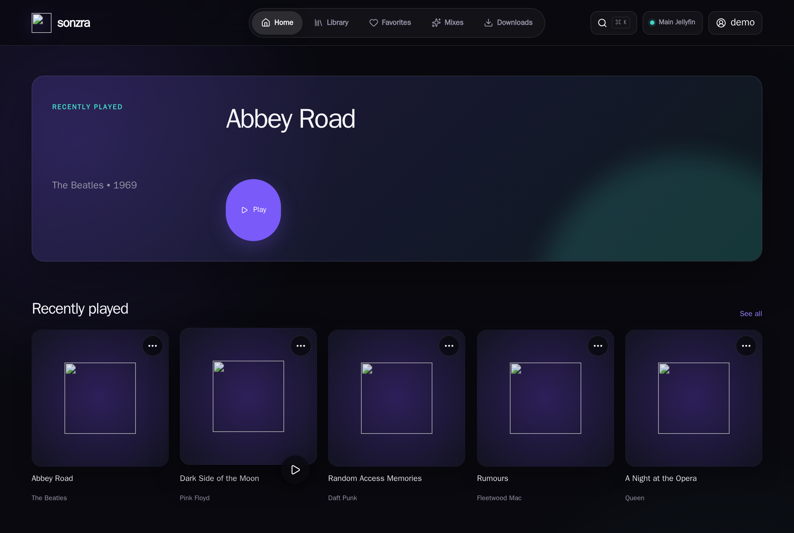
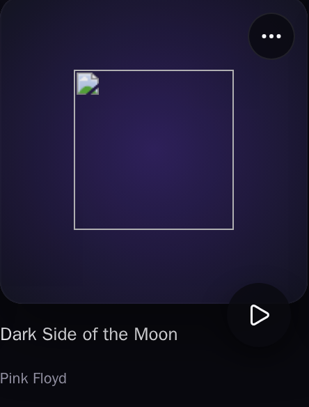
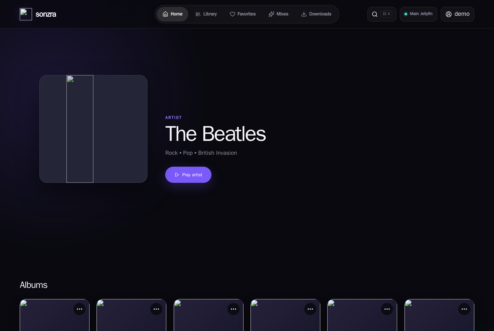
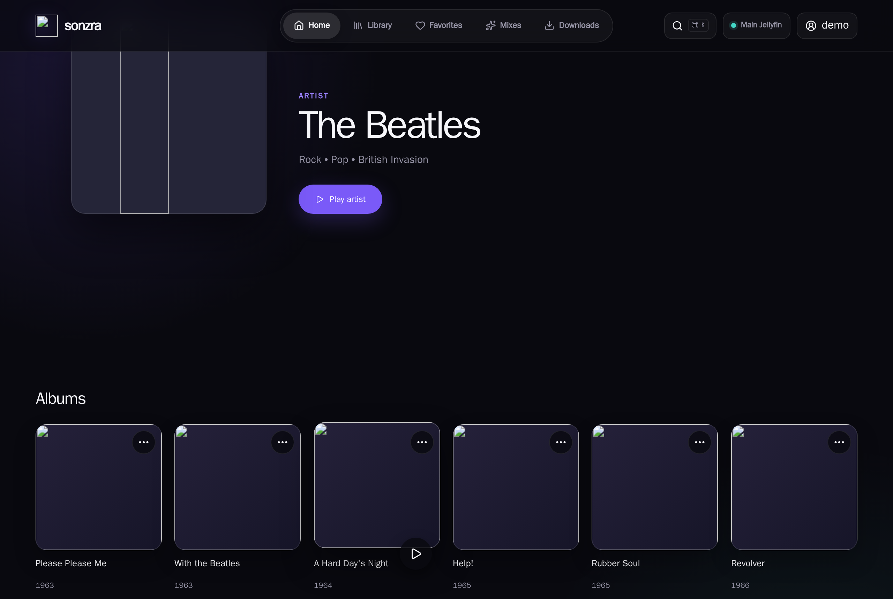
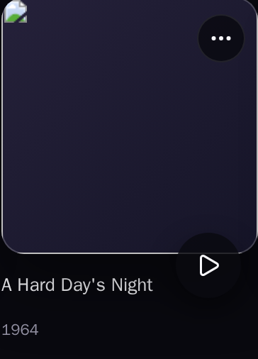
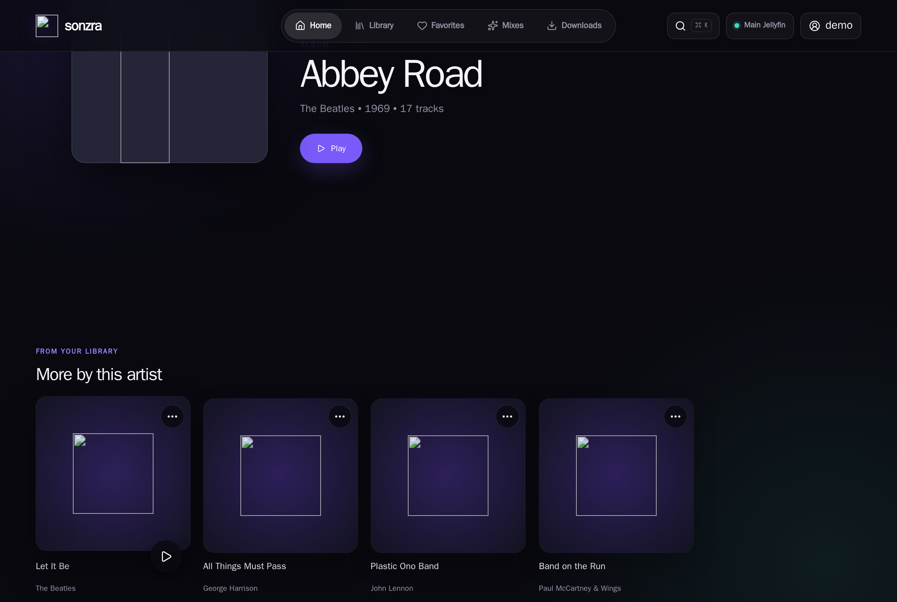
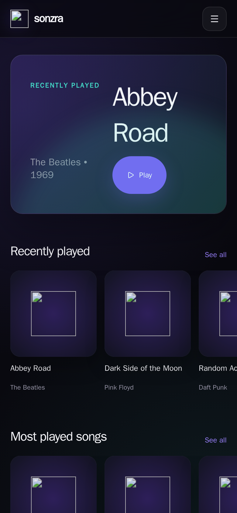
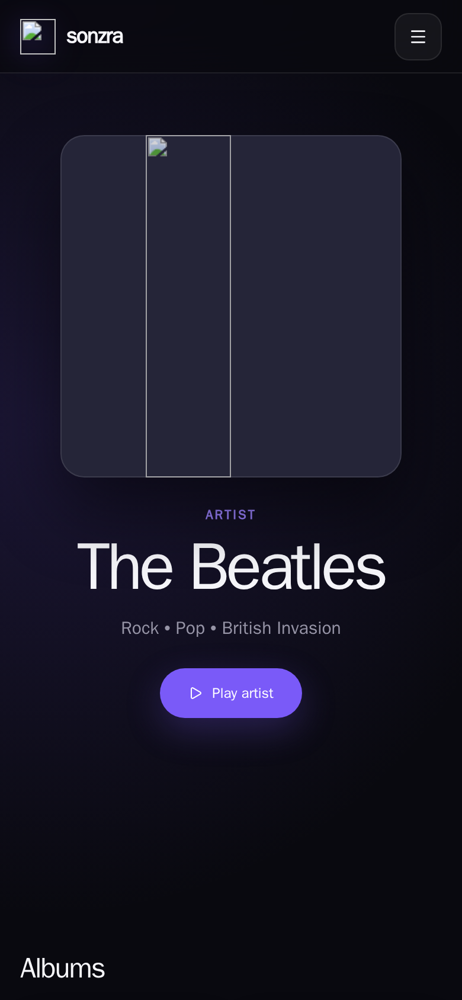

# Visual Wiki: Card Play Button Alignment Fix

This document captures visual verification across all surfaces affected by the card controls encapsulation fix (`fix/card-play-button-overlay`).

---

## 1. Dashboard — "Recently Played" Shelf

When hovering over any card in the dashboard's **"Recently played"** (or **"Most played songs"**) shelf, the play button is cleanly anchored within the bottom-right corner of the artwork cover (`right: 12px; bottom: 12px;`) and smoothly elevates with the cover (`translateY(-3px)`), with zero overlap or bleeding into the title and artist text below.

### Dashboard Overview

### Recently Played Shelf — Hover State

### Card Close-Up Detail

---

## 2. Artist Details — "Albums" Grid

When browsing an artist's discography (e.g. *The Beatles*), the album cards rendered via `shared/_media_grid` now encapsulate artwork and controls within `.listen-card__cover`. Hovering an album card displays the play button in the bottom-right corner without clipping into the release year or album title.

### Artist Albums Grid Overview

### Album Card — Hover State

### Album Card Close-Up Detail

---

## 3. Album Details Page — "More by this artist" Shelf

On an album's detail page (e.g. *Abbey Road*), the secondary shelves for related music ("More by this artist", "Similar albums") use `shared/_media_shelf`. The play button now conforms to the standard 12px bottom-right padding and synchronized lift.

### Album Details Shelf Hover

---

## 4. Mobile Responsive Layouts

On mobile viewports (<=700px), hover buttons are suppressed (`display: none;`) in favor of touch gestures (tap to open/play, 550ms long-press for context sheet), preventing overlapping floating buttons on touch devices.

### Mobile Dashboard

### Mobile Artist Albums Grid

