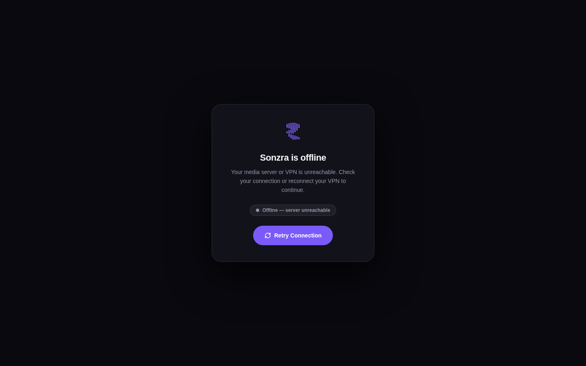
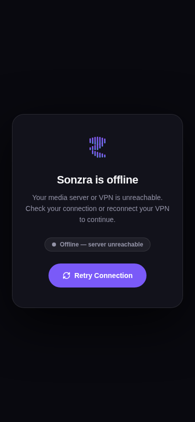
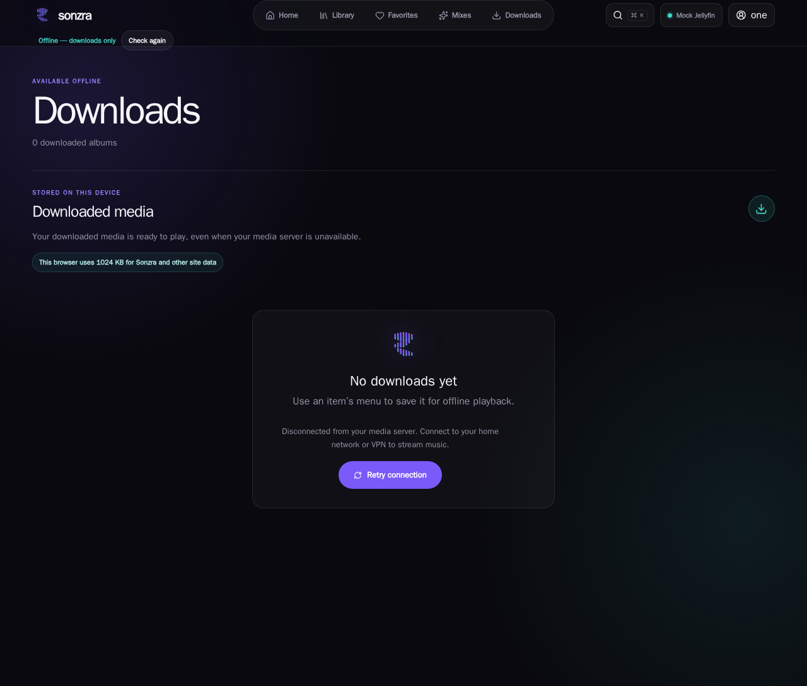
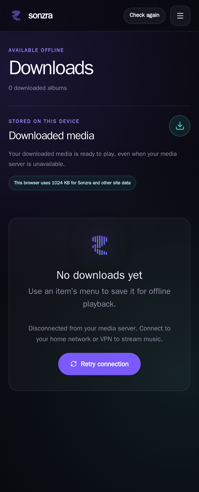

# Visual Wiki: Offline VPN Recovery and Auto-Reconnect UI

This document captures the visual interfaces and interaction design for recovering from offline states and VPN disconnections ([Issue #22](https://github.com/sonzra/sonzra/issues/22)).

---

## 1. Problem Overview

When launching the Sonzra iOS PWA while disconnected from a home network or VPN with zero offline downloaded tracks, users were previously trapped on a raw plain-text HTTP 503 response (`"Sonzra downloads are not available offline yet."`).

On standalone WebKit PWAs, receiving a `text/plain` document tears down the entire DOM runtime, terminating JavaScript, Turbo, and Stimulus controllers. Because standalone PWAs lack browser chrome, the user had no address bar, no refresh button, and no gestures to reload or reconnect once their VPN was re-enabled.

The fix introduces two resilient recovery surfaces:
1. **Service Worker Standalone HTML Recovery UI**: Fallback served directly from `public/service-worker.js` when the offline shell is not in cache.
2. **In-App Offline Downloads Recovery Banner**: Empty-state recovery card displayed in `/offline_shell` when the user has 0 downloaded tracks.

---

## 2. Service Worker Standalone HTML Recovery UI

When navigation fails and no cached shell is found, the Service Worker now returns a self-contained HTML5 page (`Content-Type: text/html; charset=utf-8`) styled with Sonzra's dark redesign theme (`#09090F` background, `#12121C` frosted surface, safe-area insets, inline SVG waveform mark, and touch-accessible retry button).

It includes embedded client scripts listening to `online`, `focus`, `visibilitychange`, and periodic polling of `/up`, automatically reloading the app once connectivity is restored.

### Desktop View (1440x900)

### Mobile View (390x844)

### UX Highlights
- **Zero External Dependencies**: All CSS and SVG marks are inlined into the Service Worker response; renders instantly without network access.
- **Touch Target Ergonomics**: The "Retry Connection" button features a minimum bounding box of 48px height and 180px width with explicit focus-visible rings and active touch feedback.
- **Safe-Area Insets**: Incorporates `env(safe-area-inset-top)` and `env(safe-area-inset-bottom)` for iPhone dynamic island and home bar clearance.

---

## 3. In-App Offline Downloads Recovery Banner (0 Downloads State)

When the offline shell `/offline_shell` is loaded from cache with zero downloaded tracks, the empty state now presents a prominent recovery card explaining that the media server is disconnected and offering an ergonomic "Retry connection" button wired to `offline-connection#check`.

### Desktop Overview (1440x900)

### Mobile Responsive Layout (390x844)

### UX Highlights
- **Multi-Target Synchronization**: The "Retry connection" button inside the central recovery card and the topbar "Check again" button are synchronized via Stimulus `retryTargets`. Both update their loading, disabled, and online states in unison.
- **Top Bar Integration**: In offline mode, the top bar displays an `Offline — downloads only` status pill on desktop and provides a dedicated header retry trigger on mobile without clipping page titles.
- **Redesign Theme Adherence**: Styled strictly with redesign custom tokens (`--rz-primary`, `--rz-muted`, `--rz-surface`, `--rz-line`).

---

## 4. App-Switch Auto-Reconnect (`visibilitychange` & `focus`)

Standalone PWAs on iOS do not fire the standard `window.online` event when a user connects to VPN because cellular/Wi-Fi interface state did not change.

`app/javascript/controllers/offline_connection_controller.js` now listens for:
- `document.addEventListener("visibilitychange")`: When `document.visibilityState === "visible"`, it immediately probes `/up`.
- `window.addEventListener("focus")`: Probes `/up` immediately when the PWA window regains focus.

When a user switches to Tailscale, WireGuard, or iOS Settings to toggle their VPN and switches back to Sonzra, the app detects server connectivity instantly without waiting for the 5-second interval timer.
