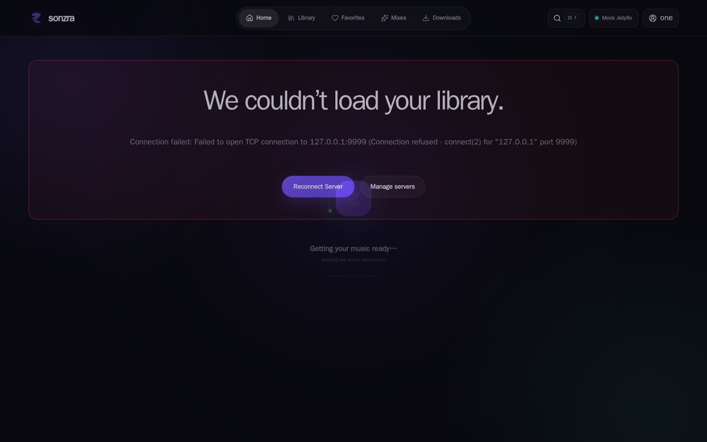
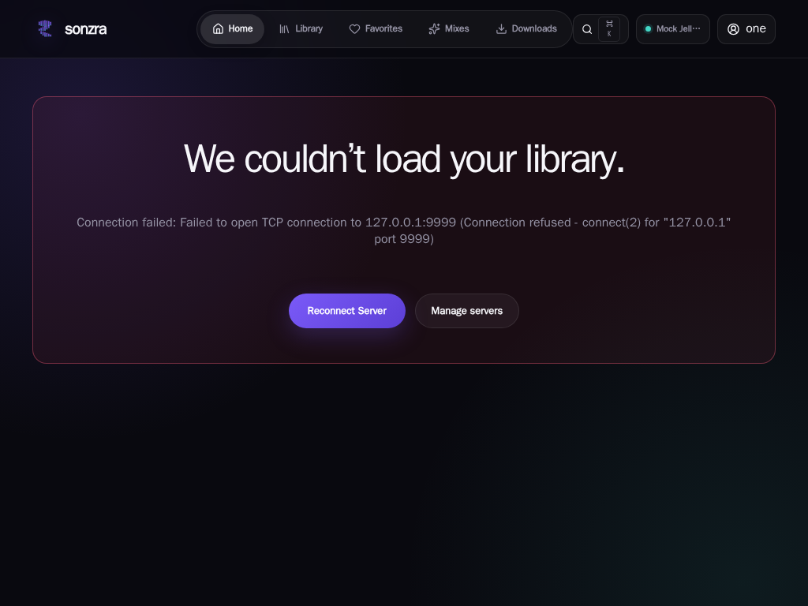
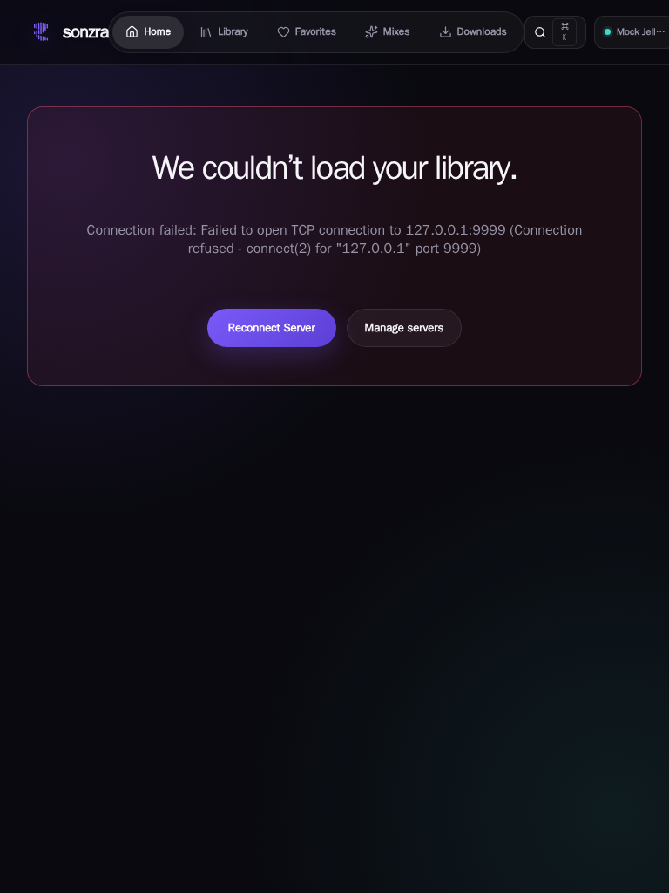

# Visual Wiki: Top Bar Sizing and Overflow on Mid-Sized Screens

This document captures visual evidence and root cause analysis for the top navigation bar sizing and clipping issues reported on smaller/mid-sized screens ([Issue #2](https://github.com/sonzra/sonzra/issues/2)).

---

## 1. Problem Overview

On mid-sized viewports between `701px` and `1024px` (such as tablets in portrait or landscape orientation, split-screen desktop windows, and smaller laptop displays), the top bar navigation suffers from severe layout crowding, element collision, and horizontal clipping:

1. **Mobile Menu Breakpoint Mismatch**: The mobile hamburger menu toggle only triggers at `@media (max-width: 700px)`. At any viewport width above `700px` (e.g. `768px`, `834px`, `1024px`), the application forces the full 3-column desktop layout (`grid-template-columns: 1fr auto 1fr`).
2. **Horizontal Grid Overflow & Element Clipping**: The minimum combined width of the three desktop top bar columns (Brand `~120px` + 5 Primary Links `~509px` + Actions cluster `~343px` + horizontal padding `44px–64px`) exceeds **1036px**. Viewports under `1036px` cause the right-aligned actions cluster (`.redesign-topbar__actions`) to be pushed off-screen.
3. **Search Trigger Squishing & Badge Wrapping**: The search shortcut `<kbd>⌘ K</kbd>` lacks `white-space: nowrap`, causing the space between `⌘` and `K` to break onto two vertical lines. The search trigger button is also pressed directly against the center navigation ("Downloads") with zero breathing room.
4. **Complete Cutoff of Profile Toggle**: At standard iPad portrait width (`768px`), the right column is clipped by `133px`, pushing the user account profile button completely off-screen and truncating the server connection pill.

---

## 2. Visual Evidence Across Viewports

### Desktop Baseline (1440x900)
At full desktop width, all components fit comfortably with ample breathing room between brand, primary navigation, search trigger, server pill, and profile menu.

---

### Mid-Sized Screen / Small Desktop (1024x768)
At 1024px, the layout begins to degrade:
- The keyboard shortcut badge `<kbd>⌘ K</kbd>` wraps vertically (`⌘` stacked over `K`).
- The server pill is forced into text truncation ("Mock Jell...").
- Spacing between primary navigation links and action controls is compressed.

---

### Tablet / Mid-Sized Viewport (768x1024 — iPad Portrait)
At 768px, the layout suffers critical breakage:
- **Profile Toggle Cut Off**: The user account menu button is pushed completely off-screen past the right viewport boundary.
- **Search Trigger Distorted**: The search button is squeezed against the primary navigation pill, and its `⌘ K` badge remains wrapped into two lines.
- **Server Pill Truncated**: Severely clipped against the screen edge.

---

### Top Bar Close-Up Detail (768px)
Close-up view demonstrating the vertical wrapping of `⌘ K`, collision with the primary nav bar, and clipping on the right edge.

---

## 3. Root Cause Analysis

| Component | File / Location | Root Cause |
|---|---|---|
| **Top Bar Grid** | `app/assets/stylesheets/redesign.css:72` | `.redesign-topbar` defines `grid-template-columns: 1fr auto 1fr` with `height: 74px` and no tablet-specific column constraints. |
| **Mobile Breakpoint** | `app/assets/stylesheets/redesign.css:182` | `@media (max-width: 700px)` only collapses the navigation on mobile phones, leaving `701px–1024px` tablets in desktop mode. |
| **Search Button `<kbd>`** | `app/assets/stylesheets/redesign.css:95` | `.redesign-icon-button kbd` lacks `white-space: nowrap` and `flex-shrink: 0`, allowing whitespace between `⌘` and `K` to wrap. |
| **Primary Nav Links** | `app/assets/stylesheets/redesign.css:88` | `.redesign-topbar__link` always displays both 15px icon and text label for all 5 links, taking ~509px minimum. |
| **Server Pill** | `app/assets/stylesheets/redesign.css:96` | `.redesign-server-pill` consumes up to 170px even on viewports where screen width is constrained. |

---

## 4. Proposed Solution Directions

1. **Badge Wrap Fix**: Add `white-space: nowrap` to `.redesign-icon-button` and its child `<kbd>` element.
2. **Adaptive Intermediate Breakpoint (`@media (max-width: 1024px)`)**:
   - Option A: Increase the mobile hamburger menu breakpoint from `700px` to `980px` or `1024px` so tablets receive the clean mobile drawer navigation.
   - Option B: Add a condensed tablet navigation mode between `701px` and `1024px` (e.g. icon-only primary links or hiding text labels, hiding `<kbd>⌘ K</kbd>` badge on touch devices, and condensing or hiding the server pill).
