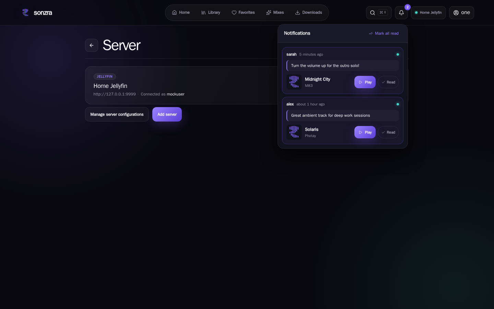
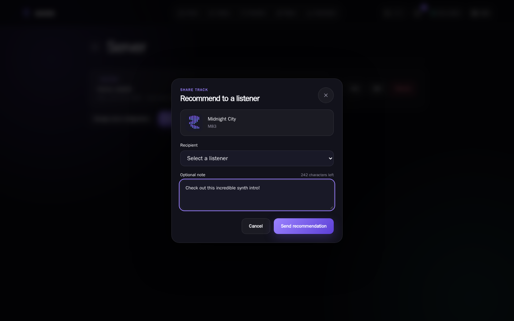
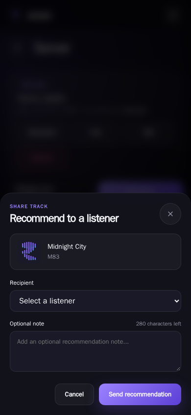
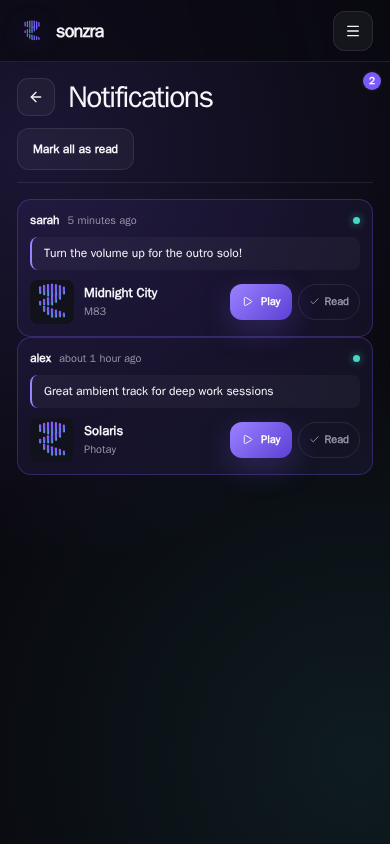

# Visual Wiki: Direct Track Sharing & In-App Notification System

This document captures visual evidence, UX architecture, and responsive behaviors for the Direct Track Sharing and In-App Notification System implemented in [Issue #40](https://github.com/sonzra/sonzra/issues/40).

---

## 1. Feature Overview

The track sharing and in-app notification system enables peer-to-peer track recommendations between users on the same Sonzra instance with instant, uninterrupted playback:

1. **Context Menu Share Trigger:** Listeners can trigger "Share track" from the playback queue, persistent player, album track lists, artist discographies, or search results.
2. **Recipient Picker Dialog (`.redesign-share-dialog`):** A modern modal (desktop) and ergonomic bottom sheet (mobile) allowing listeners to select another user on the instance and attach an optional personal note (up to 280 characters).
3. **In-App Notification Hub:** A topbar bell icon displaying an unread counter badge that dynamically expands into a floating popover on desktop and a mobile-optimized drawer on compact screens.
4. **Real-Time Delivery:** Incoming recommendations are pushed instantly via ActionCable and Turbo Streams to active sessions without page reloads.
5. **Instant One-Click Playback:** Each notification card includes high-res artwork, track metadata, the sender's personal note, and a prominent "Play" button that immediately begins playback in Sonzra's persistent audio player without interrupting the session.

---

## 2. Visual Evidence Across Viewports

### 1. Desktop Topbar Notification Hub (1440x900)
At full desktop width, the topbar navigation displays an active notification bell with an unread badge counter (`2`). Clicking the bell toggles a floating glassmorphic popover anchored to the header actions cluster:

- Dynamic unread badge with accent coloring (`--rz-primary`).
- "Mark all read" header action with instant optimistic state update.
- Unread status indicator dots and personalized sender quote blocks.
- One-click "Play" button parameterized for `player#replaceQueue` and "Read" state toggle.

---

### 2. Desktop Recipient Picker Dialog (1440x900)
When selecting "Share track" from any track context menu, the centered modal dialog opens with a soft translucent backdrop blur:

- Track preview chip displaying album artwork, track title, and artist name.
- Registered instance user dropdown selector.
- Live character counter remaining (280 characters maximum).
- Action buttons: Ghost "Cancel" button and primary gradient "Send recommendation" button.

---

### 3. Mobile Recipient Picker Bottom Sheet (390x844 — Modern Mobile)
On mobile viewports ($\le 700\text{px}$), the dialog smoothly transitions into an ergonomic slide-up bottom sheet pinned to the viewport bottom:

- Rounded top corners (`24px 24px 0 0`) adhering to safe-area insets (`env(safe-area-inset-bottom)`).
- Full touch target compliance ($\ge 44\times 44\text{px}$) for all inputs and buttons.
- Fluid full-width controls with clean typography and zero horizontal scroll.

---

### 4. Mobile Notifications Feed (390x844)
On mobile devices, tapping notifications in the navigation drawer opens the dedicated notifications feed:

- Prominent "Notifications" title with unread badge counter.
- Full card layout with sender attribution, timestamp, personal note blockquote, and touch-accessible "Play" and "Read" action buttons.
- Clean text truncation preserving track title readability without clipping.

---

## 3. Architecture & Quality Verification

| Invariant / Requirement | Implementation Details | Verification Status |
|---|---|---|
| **Multi-Tenant Isolation** | Scoped exclusively through `current_user.notifications` and `recipient_id`. Users can never access or mutate notifications addressed to other listeners. | Verified (Controller tests) |
| **Real-Time Streaming** | ActionCable Turbo Streams broadcast to `[recipient, :notifications]` prepending items to `#notifications_list` and updating `#notifications_badge`. | Verified (`deliver_track_share_test.rb`) |
| **Persistent Playback** | Instant playback triggers `player#replaceQueue` directly with parameterized audio sources, preserving `data-turbo-permanent` without audio stutter. | Verified (Vitest & E2E) |
| **Universal Redesign Theme** | Exclusively styled with `--rz-*` design tokens in `redesign.css`. Zero legacy stylesheets or browser-default `<dialog>` frames. | Verified (Visual audit) |
| **Mobile Ergonomics** | Touch targets $\ge 44\times 44\text{px}$, bottom-sheet layout, safe-area inset adherence. | Verified (`share-dialog-mobile-390.png`) |

---

## 4. Test Suite Summary

- **Minitest:** 356 runs, 1,581 assertions — **0 failures, 0 errors, 0 skips**.
- **RuboCop:** 233 files inspected — **0 offenses detected**.
- **Vitest:** 26 test files, 208 passed tests — **0 failures**.
- **Playwright E2E:** 14 passed end-to-end tests across Chromium and Mobile Chrome.
