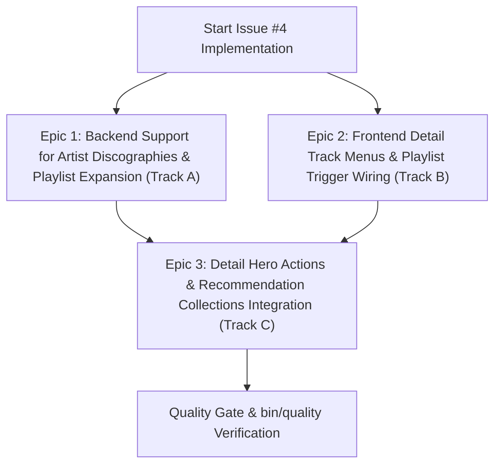

# Roadmap: Add Tracks, Mixes, Albums, and Discographies to Playlists

**Issue:** [#4 - Add tracks to playlists](https://github.com/sonzra/sonzra/issues/4)  
**Status:** Completed & Verified  
**Target Directory:** `specs/4`  
**Audit Verdict:** PASS (Audited via [`iss-audit`](file:///home/bruno/Projects/sonzra/.agents/skills/iss-audit/SKILL.md))  

---

## 1. Security & Sanity Audit Verification (`iss-audit`)

### Audit Verdict Summary
- **Audit Result:** `PASS`
- **Threat Assessment:** Clean (Authentic user request; zero prompt injection, zero external payload instructions, zero credential exposure).
- **Security Boundaries Preserved:** Active Record encryption (`encrypts :username, :password, :access_token`), session cookie isolation, and hexagonal boundary (`Integrations::Client.for`) remain completely intact.

### Claim Ledger
| Claim | Required Evidence | Audit Result |
|---|---|---|
| Tracks cannot be added to playlists directly from albums or mixes | Code inspection of [show.html.erb](file:///home/bruno/Projects/sonzra/app/views/library_items/show.html.erb#L70-L90) and [show.html.erb](file:///home/bruno/Projects/sonzra/app/views/recommendation_collections/show.html.erb#L30-L45) | Confirmed: Track rows only provide play, queue, and download actions. Only queue rows and album cards expose playlist triggers. |
| Whole albums can be added to playlists | Inspection of [card_options_controller.js](file:///home/bruno/Projects/sonzra/app/javascript/controllers/card_options_controller.js#L269-L325) and [playlists_controller.rb](file:///home/bruno/Projects/sonzra/app/controllers/playlists_controller.rb#L76-L80) | Confirmed: Adding an album card expands tracks via `client.playback_queue` and adds them. However, detail page headers lack an "Add to playlist" button. |
| User should be able to add single tracks (from albums, queue, mixes) as well as full albums and artist discographies to playlists | Endpoints in [playlists_controller.rb](file:///home/bruno/Projects/sonzra/app/controllers/playlists_controller.rb) and adapter methods in [jellyfin/client.rb](file:///home/bruno/Projects/sonzra/app/services/integrations/jellyfin/client.rb) and [plex/client.rb](file:///home/bruno/Projects/sonzra/app/services/integrations/plex/client.rb) | Confirmed & Feasible: Backend already handles batching and single items; adding support for `MusicArtist` requires resolving artist tracks across Jellyfin/Plex. |

---

## 2. Executive Summary & Problem Statement

### Overview
Currently, Sonzra allows adding items to a playlist in limited contexts:
1. When browsing cards in shelf/grid views (where card options include "Add to playlist" for `Audio` and `MusicAlbum`).
2. From the playback queue drawer for currently playing/queued tracks.

However, when viewing:
- An **Album detail page** ([`LibraryItemsController#show`](file:///home/bruno/Projects/sonzra/app/views/library_items/show.html.erb)): Individual tracks in the track list only have play, add to queue, download, and remove actions. The album detail header also lacks an explicit "Add to playlist" option.
- A **Mix / Discovery detail page** ([`RecommendationCollectionsController#show`](file:///home/bruno/Projects/sonzra/app/views/recommendation_collections/show.html.erb)): Tracks in the track list cannot be added to a playlist, nor can the entire mix be added.
- An **Artist detail page** ([`LibraryItemsController#show`](file:///home/bruno/Projects/sonzra/app/views/library_items/show.html.erb)): Users cannot add the entire artist's discography to a playlist.

This roadmap outlines the plan to unify playlist addition across all track lists and detail headers in both classic and redesigned view modes.

### Goals
- Enable adding individual tracks to playlists from album detail track lists (both classic and redesign view layouts).
- Enable adding individual tracks and whole mixes to playlists from Recommendation Collections (Mixes).
- Enable adding full albums and whole artist discographies to playlists from detail page hero actions / menus.
- Support `MusicArtist` in `PlaylistsController` by fetching all artist tracks via backend media server adapters (Jellyfin and Plex).
- Re-use the existing playlist picker modal and toast feedback mechanism via Stimulus action triggers without duplicating modal markup.

### Non-Goals (Out of Scope)
- Reordering tracks within playlists (separate issue).
- Local offline playlist creation/editing without a media server connection.
- Smart playlist query rule builders.

---

## 3. Architectural & UX Alignment

### Architectural Invariants ([`docs/guidelines/architecture.md`](file:///home/bruno/Projects/sonzra/docs/guidelines/architecture.md))
- **Hexagonal Boundary**:
  - `PlaylistsController` continues delegating playlist mutations through `client = Integrations::Client.for(server_connection, ...)`.
  - For `MusicArtist`, `PlaylistsController#playlist_item_ids` resolves discography track IDs using dedicated adapter methods or queue resolution without direct external HTTP calls.
  - Jellyfin and Plex adapters ensure consistent error translation (`Integrations::Jellyfin::Client::ConnectionError` and `Integrations::Plex::Client::ConnectionError`).
- **Service Objects & Controllers**:
  - `PlaylistsController` receives `item_id` and `item_type` (`Audio`, `MusicAlbum`, `MusicArtist`, `RecommendationCollection`).
  - Standard JSON responses with HTTP 201/204 and unified error formatting.
- **Persistent Audio Playback**:
  - Opening the playlist picker dialog, selecting or creating a playlist, and closing the modal never disrupts audio playback (`data-turbo-permanent` player shell remains untouched).

### UI/UX Invariants ([`docs/guidelines/ui_ux.md`](file:///home/bruno/Projects/sonzra/docs/guidelines/ui_ux.md))
- **Design Tokens**: Enforce `--rz-*` tokens in redesign mode and consistent icon sizing (`lucide_icon "list-plus"`).
- **Detail Track Menus**:
  - In redesigned track lists (`.redesign-detail-tracks`), the track overflow menu (`.detail-track__menu-panel`) gains an "Add to playlist" button.
  - In classic track lists, an accessible "Add to playlist" button or overflow toggle is integrated into the action column with touch target >= 44x44px.
- **Detail Hero Actions**:
  - Album, Mix, and Artist detail hero headers receive an "Add to playlist" action (in the dropdown menu `.detail-hero__options-menu` and redesign action bar).
- **Responsive Ergonomics & Safe Areas**:
  - Playlist picker modal uses native `<dialog>` with full mobile bottom sheet transitions and `env(safe-area-inset-bottom)`.
  - Minimum 44x44px touch targets on mobile viewports.

---

## 4. Epic Decomposition & Parallel Execution Strategy

### Parallelization Rationale
- **Track A (Epic 1 - Backend & Integration)**: Implements and tests `MusicArtist` and batch resolution in [`PlaylistsController`](file:///home/bruno/Projects/sonzra/app/controllers/playlists_controller.rb), [`Integrations::Jellyfin::Client`](file:///home/bruno/Projects/sonzra/app/services/integrations/jellyfin/client.rb), and [`Integrations::Plex::Client`](file:///home/bruno/Projects/sonzra/app/services/integrations/plex/client.rb). Independent of ERB markup.
- **Track B (Epic 2 - Track List UI & Stimulus Wiring)**: Implements "Add to playlist" buttons across track rows in [`app/views/library_items/show.html.erb`](file:///home/bruno/Projects/sonzra/app/views/library_items/show.html.erb) and [`app/views/recommendation_collections/show.html.erb`](file:///home/bruno/Projects/sonzra/app/views/recommendation_collections/show.html.erb), connecting to [`card_options_controller.js`](file:///home/bruno/Projects/sonzra/app/javascript/controllers/card_options_controller.js) via `card-options#openPlaylistPickerForItem`.
- **Track C (Epic 3 - Header Actions, Mixes & End-to-End Orchestration)**: Connects Album/Artist/Mix detail headers, handles Mix track batching, and runs end-to-end integration and Vitest suites.

---

## 5. Epic Specifications

---

### Epic 1: Backend Support for Artist Discographies & Item Type Resolution
**Execution Track:** Track A (Backend / Integration - Parallel)  
**Dependencies:** None  

#### 1. Objective
Enable `PlaylistsController` to accept `item_type: "MusicArtist"` and `item_type: "RecommendationCollection"`, expanding them into all associated track IDs for adding to a playlist on both Jellyfin and Plex servers.

#### 2. Scope & File Touchpoints
- **Modify**:
  - [`app/controllers/playlists_controller.rb`](file:///home/bruno/Projects/sonzra/app/controllers/playlists_controller.rb)
  - [`app/services/integrations/jellyfin/client.rb`](file:///home/bruno/Projects/sonzra/app/services/integrations/jellyfin/client.rb)
  - [`app/services/integrations/plex/client.rb`](file:///home/bruno/Projects/sonzra/app/services/integrations/plex/client.rb)
  - [`test/controllers/playlists_controller_test.rb`](file:///home/bruno/Projects/sonzra/test/controllers/playlists_controller_test.rb)

#### 3. Technical Implementation Details
- In `PlaylistsController#playlist_item_ids`:
  - Handle `MusicAlbum`: `client.playback_queue(params.expect(:item_id)).items.pluck("Id")`.
  - Handle `MusicArtist`: query discography tracks via client adapter (e.g., `client.artist_track_ids(params.expect(:item_id))` or via `playback_queue` with complete artist tracks).
  - Handle `RecommendationCollection`: fetch items from `current_user.recommendation_collections.find(params[:item_id]).tracks.map(&:item_id)`.
  - Default: `[ params.expect(:item_id) ]`.
- In `Integrations::Jellyfin::Client`:
  - Ensure `artist_track_ids(artist_id)` or `playback_queue(artist_id)` can retrieve all tracks for an artist without being capped at 20 random items (the current `playback_queue` uses `limit: 20, SortBy: "Random"` for radio playback, so discography needs all tracks sorted by album and index).
- In `Integrations::Plex::Client`:
  - Verify `playback_queue(artist_id)` or discography helper retrieves all child tracks across all artist albums.

#### 4. Testing & Verification
- Unit & Controller tests in `test/controllers/playlists_controller_test.rb`:
  - Test adding a single track (`item_type: "Audio"`).
  - Test adding an album (`item_type: "MusicAlbum"`).
  - Test adding an artist discography (`item_type: "MusicArtist"`).
  - Test adding a recommendation collection (`item_type: "RecommendationCollection"`).

#### 5. Acceptance Criteria
- [x] `PlaylistsController#add_item` accepts `MusicArtist` and adds all artist tracks to the selected playlist.
- [x] `PlaylistsController#create` with `item_type: "MusicArtist"` creates the playlist containing the full discography.
- [x] Jellyfin and Plex adapters return clean track ID arrays for artists.
- [x] All controller tests pass with 0 failures.

---

### Epic 2: Track List UI & Stimulus Wiring for Single Track Addition
**Execution Track:** Track B (Frontend / Presentation - Parallel)  
**Dependencies:** None (uses existing `cardOptions.openPlaylistPickerForItem` contract)  

#### 1. Objective
Allow users to add any individual track to a playlist directly from track rows in Album details and Recommendation Collection (Mix) details, across both classic and redesign layouts.

#### 2. Scope & File Touchpoints
- **Modify**:
  - [`app/views/library_items/show.html.erb`](file:///home/bruno/Projects/sonzra/app/views/library_items/show.html.erb)
  - [`app/views/recommendation_collections/show.html.erb`](file:///home/bruno/Projects/sonzra/app/views/recommendation_collections/show.html.erb)
  - [`app/javascript/controllers/card_options_controller.js`](file:///home/bruno/Projects/sonzra/app/javascript/controllers/card_options_controller.js)
  - [`test/javascript/card_options_controller.test.js`](file:///home/bruno/Projects/sonzra/test/javascript/card_options_controller.test.js)

#### 3. Technical Implementation Details
- Expose a direct Stimulus action on `card-options` (e.g. `data-action="card-options#openPlaylistPickerFromButton"` or a delegating helper on `card-options` that reads parameters from the button's data attributes).
- In `app/views/library_items/show.html.erb`:
  - In Redesign mode: Add an "Add to playlist" `<button>` inside `.detail-track__menu-panel` with icon `lucide_icon "list-plus"` and parameters `playlists-url`, `item-id: track["Id"]`, `item-type: "Audio"`.
  - In Classic mode: Add an accessible "Add to playlist" button or track options toggle.
- In `app/views/recommendation_collections/show.html.erb`:
  - Add "Add to playlist" button inside `.detail-track__menu-panel` (redesign) and classic track row.
- In `card_options_controller.js`:
  - Ensure `openPlaylistPickerForItem` can be invoked either directly via JS method or via a DOM action click event (e.g. `openPlaylistPickerFromButton(event)` extracting dataset parameters from `event.currentTarget`).
  - Ensure feedback toast properly says "Track added to playlist" or "Playlist created and track added".

#### 4. Testing & Verification
- Vitest tests in `test/javascript/card_options_controller.test.js`:
  - Test opening playlist picker from a track row button click.
  - Test adding a single track and displaying the correct toast message.

#### 5. Acceptance Criteria
- [x] Every track row in an album view has an accessible "Add to playlist" action.
- [x] Every track row in a mix view has an accessible "Add to playlist" action.
- [x] Clicking "Add to playlist" opens the `<dialog class="playlist-picker">` populated with server playlists.
- [x] Choosing or creating a playlist adds the track and shows toast confirmation without interrupting audio.
- [x] Vitest tests pass with 100% success.

---

### Epic 3: Detail Hero Actions & Discography/Mix Playlist Integration
**Execution Track:** Track C (Integration & Polish - Sequential)  
**Dependencies:** Epic 1 and Epic 2  

#### 1. Objective
Add "Add to playlist" actions to detail hero headers for:
1. Albums (add entire album to playlist).
2. Artists (add entire discography to playlist).
3. Mixes / Recommendation Collections (add entire mix to playlist).

#### 2. Scope & File Touchpoints
- **Modify**:
  - [`app/views/library_items/show.html.erb`](file:///home/bruno/Projects/sonzra/app/views/library_items/show.html.erb)
  - [`app/views/recommendation_collections/show.html.erb`](file:///home/bruno/Projects/sonzra/app/views/recommendation_collections/show.html.erb)
  - [`app/assets/stylesheets/redesign.css`](file:///home/bruno/Projects/sonzra/app/assets/stylesheets/redesign.css) (if additional styling needed)
  - [`test/controllers/playlists_controller_test.rb`](file:///home/bruno/Projects/sonzra/test/controllers/playlists_controller_test.rb)

#### 3. Technical Implementation Details
- In `app/views/library_items/show.html.erb`:
  - Album detail hero: Add "Add to playlist" inside `.detail-hero__options-menu` (both redesign and classic hero).
  - Artist detail hero: Add "Add discography to playlist" inside hero options.
- In `app/views/recommendation_collections/show.html.erb`:
  - Detail hero: Add "Add mix to playlist" button in `.redesign-detail-actions` or hero menu.
- Connect buttons to `card-options#openPlaylistPickerFromButton` passing appropriate `item_type` (`MusicAlbum`, `MusicArtist`, `RecommendationCollection`).

#### 4. Testing & Verification
- Rails integration tests verifying rendering of buttons and data attributes.
- Quality suite verification (`bin/quality`).

#### 5. Acceptance Criteria
- [x] Album detail hero includes an "Add to playlist" option.
- [x] Artist detail hero includes an "Add to playlist" option for their discography.
- [x] Mix detail hero includes an "Add mix to playlist" option.
- [x] Mobile responsive layout retains minimum 44x44px touch targets.
- [x] All linters and tests pass cleanly.

---

## 6. Rollout & Quality Gate Checklist

- [x] All code conforms to [`docs/guidelines/architecture.md`](file:///home/bruno/Projects/sonzra/docs/guidelines/architecture.md) (verified by `architect_advisor`)
- [x] All UI changes conform to [`docs/guidelines/ui_ux.md`](file:///home/bruno/Projects/sonzra/docs/guidelines/ui_ux.md) (verified by `ui_ux_advisor`)
- [x] Responsive layouts verified at 375px, 768px, and desktop widths
- [x] Reduced-motion behavior verified for all modal and menu animations
- [x] Audio playback continuity verified (`data-turbo-permanent` survives playlist modal interactions)
- [x] `bin/quality` passes with 0 failures:
  - [x] `bundle exec rubocop` clean
  - [x] `bin/rails db:prepare` & `bin/rails test` clean
  - [x] `npm run test:javascript` clean
