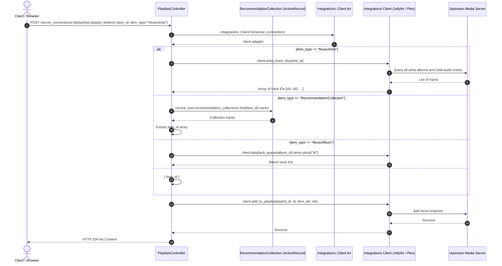
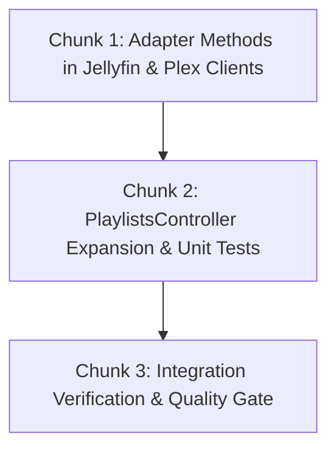

# Technical Specification: Backend Support for Discographies & Mix Bulk Playlists

**Issue:** [#4 - Add tracks to playlists](https://github.com/sonzra/sonzra/issues/4)  
**PRD Reference:** [`specs/4/epic-3-detail-hero-playlist-integration.md`](file:///home/bruno/Projects/sonzra/specs/4/epic-3-detail-hero-playlist-integration.md)  
**Roadmap Reference:** [`specs/4/roadmap.md`](file:///home/bruno/Projects/sonzra/specs/4/roadmap.md)  
**Status:** Completed & Verified  
**Target Output File:** `specs/4/tech-spec-epic-1-backend-artist-discography-playlists.md`  
**Last Updated:** 2026-10-10  

---

## 1. Technical Architecture & Component Interaction

### System Topology & Interaction Flow
This epic enables the backend ([`PlaylistsController`](file:///home/bruno/Projects/sonzra/app/controllers/playlists_controller.rb) and media server integration adapters) to accept `item_type: "MusicArtist"` and `item_type: "RecommendationCollection"`, expanding them into their complete array of track IDs.



### Architectural Invariant Mapping ([Architectural Guidelines](file:///home/bruno/Projects/sonzra/docs/guidelines/architecture.md))
- **Hexagonal Boundary:** All media server API interactions for Jellyfin and Plex remain isolated inside [`Integrations::Jellyfin::Client`](file:///home/bruno/Projects/sonzra/app/services/integrations/jellyfin/client.rb) and [`Integrations::Plex::Client`](file:///home/bruno/Projects/sonzra/app/services/integrations/plex/client.rb).
- **Clean Adapter Method Contract:** Introduce `#artist_track_ids(artist_id)` on both Jellyfin and Plex adapters.
- **Active Record Scope Boundary:** `RecommendationCollection` expansion safely checks `current_user.recommendation_collections.find(params[:item_id])` to prevent IDOR access across users.

---

## 2. Technical Decisions & Open Questions

*(All technical design questions have been evaluated and resolved against the approved PRD.)*

---

## 3. Resolved Technical Decisions Log

### Decision 1: Artist Discography Track ID Resolution Method
- **Resolved Date:** 2026-10-10
- **Selected Option:** Add a dedicated `#artist_track_ids(artist_id)` method to `Integrations::Jellyfin::Client` and `Integrations::Plex::Client`.
- **Rationale:** The existing `playback_queue` method for artists in Jellyfin caps results at 20 random items (designed for radio playback, not discography). A dedicated `#artist_track_ids` method queries all tracks ordered by album release and track number without limit caps.

---

## 4. Implementation Chunking (Bite-Sized Slices)



---

### Chunk 1: Adapter Methods in Jellyfin & Plex Clients
**Goal:** Implement `#artist_track_ids(artist_id)` across Jellyfin and Plex adapters.  
**Files to Touch:**
- Modify: [`app/services/integrations/jellyfin/client.rb`](file:///home/bruno/Projects/sonzra/app/services/integrations/jellyfin/client.rb)
- Modify: [`app/services/integrations/plex/client.rb`](file:///home/bruno/Projects/sonzra/app/services/integrations/plex/client.rb)
- Modify: [`test/services/integrations/jellyfin/client_test.rb`](file:///home/bruno/Projects/sonzra/test/services/integrations/jellyfin/client_test.rb) (or adapter tests)

#### Implementation Details:
1. In `Integrations::Jellyfin::Client`:
   ```ruby
   def artist_track_ids(artist_id)
     session = authentication
     user_id = session.fetch("User").fetch("Id")
     token = session.fetch("AccessToken")
     all_items(user_id, token, sort_order: "Ascending", IncludeItemTypes: "Audio", ArtistIds: artist_id).map { |t| t["Id"] }
   end
   ```
2. In `Integrations::Plex::Client`:
   ```ruby
   def artist_track_ids(artist_id)
     artist_albums(artist_id).flat_map { |album| children(album.fetch("Id"), type: 10) }.map { |t| t["Id"] }
   end
   ```

---

### Chunk 2: PlaylistsController Expansion & Unit Tests
**Goal:** Expand `PlaylistsController#playlist_item_ids` to handle `MusicArtist` and `RecommendationCollection`.  
**Files to Touch:**
- Modify: [`app/controllers/playlists_controller.rb`](file:///home/bruno/Projects/sonzra/app/controllers/playlists_controller.rb)
- Modify: [`test/controllers/playlists_controller_test.rb`](file:///home/bruno/Projects/sonzra/test/controllers/playlists_controller_test.rb)

#### Implementation Details:
1. In `PlaylistsController#playlist_item_ids`:
   ```ruby
   def playlist_item_ids
     case params[:item_type]
     when "MusicAlbum"
       client.playback_queue(params.expect(:item_id)).items.pluck("Id")
     when "MusicArtist"
       client.artist_track_ids(params.expect(:item_id))
     when "RecommendationCollection"
       current_user.recommendation_collections.find(params.expect(:item_id)).tracks.map(&:item_id)
     else
       [ params.expect(:item_id) ]
     end
   end
   ```
2. In `test/controllers/playlists_controller_test.rb`:
   - Test adding artist discography tracks (`item_type: "MusicArtist"`).
   - Test adding recommendation collection tracks (`item_type: "RecommendationCollection"`).
   - Test creating playlist with artist discography on Plex.

---

### Chunk 3: Integration Verification & Quality Gate
**Goal:** Verify Rails test suite and lint standards.  
**Verification Steps:**
- [ ] Run `bin/rails test test/controllers/playlists_controller_test.rb` (all tests pass).
- [ ] Run `bundle exec rubocop app/controllers/playlists_controller.rb app/services/integrations/`.
- [ ] Run `bin/quality`.
