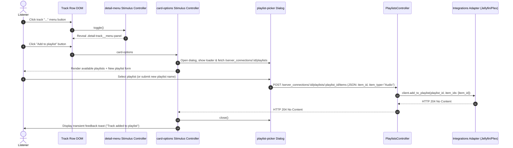
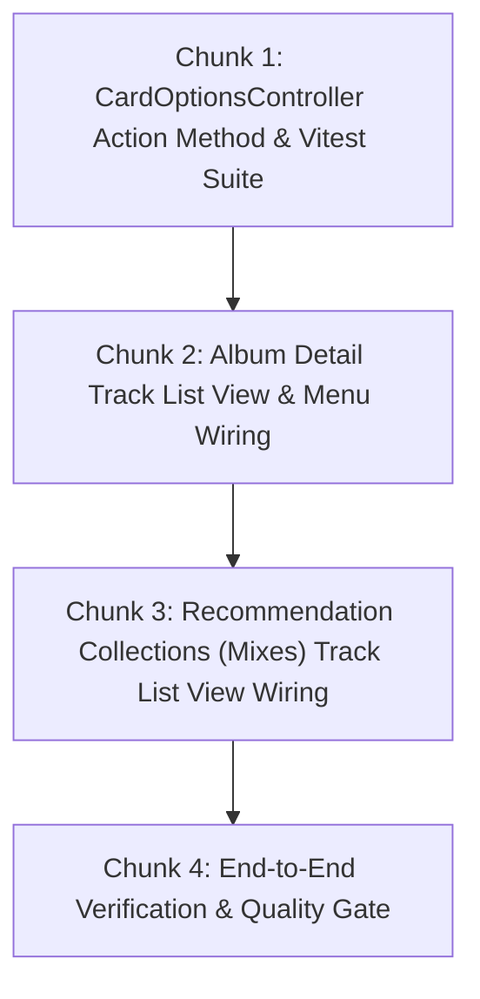

# Technical Specification: Detail Track Menus & Playlist Trigger Wiring

**Issue:** [#4 - Add tracks to playlists](https://github.com/sonzra/sonzra/issues/4)  
**PRD Reference:** [`specs/4/epic-2-track-list-playlist-triggers.md`](file:///home/bruno/Projects/sonzra/specs/4/epic-2-track-list-playlist-triggers.md)  
**Roadmap Reference:** [`specs/4/roadmap.md`](file:///home/bruno/Projects/sonzra/specs/4/roadmap.md)  
**Status:** Completed & Verified  
**Target Output File:** `specs/4/tech-spec-epic-2-track-list-playlist-triggers.md`  
**Last Updated:** 2026-10-10  

---

## 1. Technical Architecture & Component Interaction

### System Topology & Interaction Flow
This epic enables adding single tracks to playlists directly from track rows in Album details and Recommendation Collection (Mix) details, across both Redesign and Classic layouts.



### Architectural Invariant Mapping ([Architectural Guidelines](file:///home/bruno/Projects/sonzra/docs/guidelines/architecture.md))
- **Hexagonal Boundary:** Preserved via existing `PlaylistsController#add_item` and `PlaylistsController#create` endpoints invoking `Integrations::Client.for`.
- **Stimulus Controller Delegation:** `card_options_controller.js` is already mounted at `document.body`. A new action `openPlaylistPickerFromButton(event)` reads dataset attributes (`playlistsUrl`, `itemId`, `itemType`) from `event.currentTarget`, closing any open track menu and opening the central `<dialog class="playlist-picker">`.
- **Hotwire & Persistent Audio Playback:** The playlist modal lives in `app/views/shared/_card_options_sheet.html.erb` outside any navigation frame. Triggering it causes zero page reloads and leaves `#player` intact.
- **UI/UX Tokens & Ergonomics:**
  - Redesign: `.detail-track__menu-panel` button styled with `--rz-*` tokens, 36px/44px touch ergonomics, and `lucide_icon "list-plus"`.
  - Classic: Dedicated `.detail-track__menu` wrapper matching the redesign pattern so classic view also gets a clean, non-overflowing overflow toggle.

---

## 2. Technical Decisions & Open Questions

*(All technical design questions have been evaluated and resolved against the approved PRD.)*

---

## 3. Resolved Technical Decisions Log

### Decision 1: Stimulus Event Wiring Pattern
- **Resolved Date:** 2026-10-10
- **Selected Option:** Add `openPlaylistPickerFromButton(event)` to `card_options_controller.js` which extracts `data-card-options-playlists-url-param`, `data-card-options-item-id-param`, and `data-card-options-item-type-param` directly from `event.currentTarget` (or button datasets), then calls the internal `this.openPlaylistPickerForItem(...)`.
- **Rationale:** Keeps HTML markup declarative using standard Hotwire Stimulus action syntax (`data-action="card-options#openPlaylistPickerFromButton"`) while avoiding global window event dispatchers.
- **Impact on Architecture:** Updates `app/javascript/controllers/card_options_controller.js` without altering other existing callers like `player_controller.js`.

### Decision 2: Classic Track Row Overflow Menu
- **Resolved Date:** 2026-10-10
- **Selected Option:** Use `data-controller="detail-menu"` for Classic mode track rows, rendering a clean `...` button and dropdown containing "Download" and "Add to playlist".
- **Rationale:** Avoids horizontal row clipping on 375px mobile screens where having 4 inline buttons breaks layout alignment.

---

## 4. Implementation Chunking (Bite-Sized Slices)



---

### Chunk 1: CardOptionsController Action Method & Vitest Suite
**Goal:** Add `openPlaylistPickerFromButton(event)` to `card_options_controller.js` and verify with unit tests.  
**Files to Touch:**
- Modify: [`app/javascript/controllers/card_options_controller.js`](file:///home/bruno/Projects/sonzra/app/javascript/controllers/card_options_controller.js)
- Modify: [`test/javascript/card_options_controller.test.js`](file:///home/bruno/Projects/sonzra/test/javascript/card_options_controller.test.js)

#### Implementation Steps:
1. In `card_options_controller.js`:
   ```javascript
   openPlaylistPickerFromButton(event) {
     event.preventDefault()
     event.stopPropagation()
     const button = event.currentTarget
     const playlistsUrl = button.dataset.cardOptionsPlaylistsUrlParam || button.dataset.cardOptionsPlaylistsUrl
     const itemId = button.dataset.cardOptionsItemIdParam || button.dataset.cardOptionsItemId
     const itemType = button.dataset.cardOptionsItemTypeParam || button.dataset.cardOptionsItemType || "Audio"
     const defaultName = button.dataset.cardOptionsDefaultNameParam || button.dataset.cardOptionsDefaultName || ""

     this.openPlaylistPickerForItem({ playlistsUrl, itemId, itemType, defaultName })
   }
   ```
   Enhance `openPlaylistPickerForItem` to accept optional `defaultName` and pre-fill `this.playlistNameTarget.value = defaultName`.
2. In `test/javascript/card_options_controller.test.js`:
   - Add test case: `it("opens the playlist modal when triggered via openPlaylistPickerFromButton action")`.
   - Add test case: `it("pre-fills playlist name if defaultName is provided")`.
3. Verify test execution: `npx vitest run test/javascript/card_options_controller.test.js`.

---

### Chunk 2: Album Detail Track List View & Menu Wiring
**Goal:** Expose "Add to playlist" across track rows in [`app/views/library_items/show.html.erb`](file:///home/bruno/Projects/sonzra/app/views/library_items/show.html.erb).  
**Files to Touch:**
- Modify: [`app/views/library_items/show.html.erb`](file:///home/bruno/Projects/sonzra/app/views/library_items/show.html.erb)

#### Implementation Steps:
1. In `app/views/library_items/show.html.erb` within the redesign block:
   - Inside `.detail-track__menu-panel`:
     ```erb
     <button type="button"
             data-action="card-options#openPlaylistPickerFromButton"
             data-card-options-playlists-url-param="<%= playlists_server_connection_path(@server_connection) %>"
             data-card-options-item-id-param="<%= track["Id"] %>"
             data-card-options-item-type-param="Audio">
       <%= lucide_icon "list-plus", aria: { hidden: true } %>
       <span>Add to playlist</span>
     </button>
     ```
2. In classic mode block of `app/views/library_items/show.html.erb`:
   - Replace direct download button with a compact `detail-menu` dropdown containing both "Download" and "Add to playlist".

---

### Chunk 3: Recommendation Collections (Mixes) Track List View Wiring
**Goal:** Expose "Add to playlist" across track rows in [`app/views/recommendation_collections/show.html.erb`](file:///home/bruno/Projects/sonzra/app/views/recommendation_collections/show.html.erb).  
**Files to Touch:**
- Modify: [`app/views/recommendation_collections/show.html.erb`](file:///home/bruno/Projects/sonzra/app/views/recommendation_collections/show.html.erb)

#### Implementation Steps:
1. In `app/views/recommendation_collections/show.html.erb`:
   - Inside `.detail-track__menu-panel` (redesign):
     ```erb
     <button type="button"
             data-action="card-options#openPlaylistPickerFromButton"
             data-card-options-playlists-url-param="<%= playlists_server_connection_path(@collection.server_connection) %>"
             data-card-options-item-id-param="<%= track.item_id %>"
             data-card-options-item-type-param="Audio">
       <%= lucide_icon "list-plus", aria: { hidden: true } %>
       <span>Add to playlist</span>
     </button>
     ```
   - In classic mode: wrap actions in `detail-menu` containing "Download" and "Add to playlist".

---

### Chunk 4: End-to-End Verification & Quality Gate
**Goal:** Verify entire flow and test coverage.  
**Verification Steps:**
- [ ] Run `npx vitest run test/javascript/card_options_controller.test.js` (passes with 0 errors).
- [ ] Run `bin/rails test` (passes with 0 errors).
- [ ] Run `bundle exec rubocop` (passes with 0 offenses).
- [ ] Responsive inspection on 375px mobile and desktop views.
