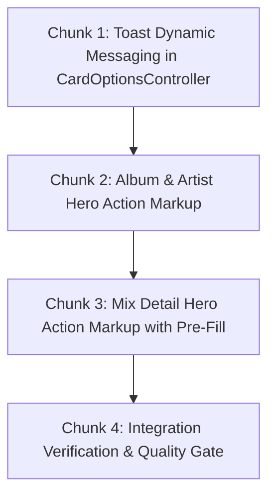

# Technical Specification: Detail Hero Actions & Bulk Playlist Integration

**Issue:** [#4 - Add tracks to playlists](https://github.com/sonzra/sonzra/issues/4)  
**PRD Reference:** [`specs/4/epic-3-detail-hero-playlist-integration.md`](file:///home/bruno/Projects/sonzra/specs/4/epic-3-detail-hero-playlist-integration.md)  
**Roadmap Reference:** [`specs/4/roadmap.md`](file:///home/bruno/Projects/sonzra/specs/4/roadmap.md)  
**Status:** Completed & Verified  
**Target Output File:** `specs/4/tech-spec-epic-3-detail-hero-playlist-integration.md`  
**Last Updated:** 2026-10-10  

---

## 1. Technical Architecture & Component Interaction

### System Topology & Interaction Flow
This epic connects detail hero action headers (Album, Artist, and Mix) to the playlist picker modal with batch expansion and pre-populated playlist naming.

```mermaid
sequenceDiagram
    autonumber
    actor User as Listener
    participant Hero as Detail Hero Action Bar / Menu
    participant CardOptions as card-options Controller
    participant PickerModal as playlist-picker Dialog
    participant Controller as PlaylistsController
    participant Adapter as Integrations Adapter

    User->>Hero: Click "Add to playlist" / "Add discography to playlist"
    Hero->>CardOptions: card-options#openPlaylistPickerFromButton(event)
    CardOptions->>PickerModal: Open dialog; if defaultNameParam exists, pre-fill playlistNameTarget.value
    User->>PickerModal: Submit new playlist or click existing playlist
    PickerModal->>Controller: POST /server_connections/:id/playlists/:id/items (item_id, item_type)
    Controller->>Adapter: Expand items & add to playlist
    Adapter-->>Controller: HTTP 204 No Content
    Controller-->>CardOptions: HTTP 204 No Content
    CardOptions->>PickerModal: close()
    CardOptions->>User: Toast confirmation ("Album added to playlist" / "Mix added to playlist" / "Discography added to playlist")
```

### Architectural Invariant Mapping ([Architectural Guidelines](file:///home/bruno/Projects/sonzra/docs/guidelines/architecture.md))
- **Hexagonal Boundary:** Preserved via backend `PlaylistsController` delegation.
- **Client Toast Consistency:** Toast messages dynamically reflect `item_type`:
  - `MusicAlbum`: "Album added to playlist" / "Playlist created and album added"
  - `MusicArtist`: "Artist discography added to playlist" / "Playlist created and discography added"
  - `RecommendationCollection`: "Mix added to playlist" / "Playlist created and mix added"
  - Default: "Track added to playlist" / "Playlist created and track added"
- **Hotwire & Persistent Audio Playback:** Preserved completely.

---

## 2. Technical Decisions & Open Questions

*(All technical design questions have been evaluated and resolved against the approved PRD.)*

---

## 3. Resolved Technical Decisions Log

### Decision 1: Detail Hero Menu Placement
- **Resolved Date:** 2026-10-10
- **Selected Option:** 
  - On **Album details**: Add "Add to playlist" inside `.detail-hero__options-menu` (in redesign and classic hero).
  - On **Artist details**: In redesign mode, add an overflow menu `.detail-hero__options` containing "Add discography to playlist" next to the "Hide artist" button. In classic mode, add next to "Hide artist".
  - On **Mix details**: Add "Add mix to playlist" button in `.redesign-detail-actions` (with `lucide_icon "list-plus"` and pre-populated `defaultNameParam`).

---

## 4. Implementation Chunking (Bite-Sized Slices)



---

### Chunk 1: Toast Dynamic Messaging in CardOptionsController
**Goal:** Enhance `card_options_controller.js` to display appropriate feedback messages based on `itemType`.  
**Files to Touch:**
- Modify: [`app/javascript/controllers/card_options_controller.js`](file:///home/bruno/Projects/sonzra/app/javascript/controllers/card_options_controller.js)
- Modify: [`test/javascript/card_options_controller.test.js`](file:///home/bruno/Projects/sonzra/test/javascript/card_options_controller.test.js)

#### Implementation Steps:
1. In `card_options_controller.js`:
   ```javascript
   playlistAddedMessage(itemType) {
     switch (itemType) {
       case "MusicAlbum": return "Album added to playlist"
       case "MusicArtist": return "Artist discography added to playlist"
       case "RecommendationCollection": return "Mix added to playlist"
       default: return "Track added to playlist"
     }
   }

   playlistCreatedMessage(itemType) {
     switch (itemType) {
       case "MusicAlbum": return "Playlist created and album added"
       case "MusicArtist": return "Playlist created and discography added"
       case "RecommendationCollection": return "Playlist created and mix added"
       default: return "Playlist created and track added"
     }
   }
   ```
2. Update `createPlaylist` and `addToPlaylist` to use these helpers.

---

### Chunk 2: Album & Artist Hero Action Markup
**Goal:** Add playlist triggers to Album and Artist headers in [`app/views/library_items/show.html.erb`](file:///home/bruno/Projects/sonzra/app/views/library_items/show.html.erb).  
**Files to Touch:**
- Modify: [`app/views/library_items/show.html.erb`](file:///home/bruno/Projects/sonzra/app/views/library_items/show.html.erb)

#### Implementation Steps:
1. In Album hero `.detail-hero__options-menu`:
   ```erb
   <button type="button"
           data-action="card-options#openPlaylistPickerFromButton"
           data-card-options-playlists-url-param="<%= playlists_server_connection_path(@server_connection) %>"
           data-card-options-item-id-param="<%= album["Id"] %>"
           data-card-options-item-type-param="MusicAlbum">
     <%= lucide_icon "list-plus", aria: { hidden: true } %> Add to playlist
   </button>
   ```
2. In Artist hero:
   Add options dropdown toggle containing "Add discography to playlist":
   ```erb
   <button type="button"
           data-action="card-options#openPlaylistPickerFromButton"
           data-card-options-playlists-url-param="<%= playlists_server_connection_path(@server_connection) %>"
           data-card-options-item-id-param="<%= item["Id"] %>"
           data-card-options-item-type-param="MusicArtist">
     <%= lucide_icon "list-plus", aria: { hidden: true } %> Add discography to playlist
   </button>
   ```

---

### Chunk 3: Mix Detail Hero Action Markup with Pre-Fill
**Goal:** Add "Save mix to playlist" button in [`app/views/recommendation_collections/show.html.erb`](file:///home/bruno/Projects/sonzra/app/views/recommendation_collections/show.html.erb).  
**Files to Touch:**
- Modify: [`app/views/recommendation_collections/show.html.erb`](file:///home/bruno/Projects/sonzra/app/views/recommendation_collections/show.html.erb)

#### Implementation Steps:
1. In `.redesign-detail-actions`:
   ```erb
   <button type="button"
           class="secondary-button redesign-detail-action--playlist"
           aria-label="Add <%= @collection.title %> to playlist"
           data-action="card-options#openPlaylistPickerFromButton"
           data-card-options-playlists-url-param="<%= playlists_server_connection_path(@collection.server_connection) %>"
           data-card-options-item-id-param="<%= @collection.id %>"
           data-card-options-item-type-param="RecommendationCollection"
           data-card-options-default-name-param="<%= @collection.title %>">
     <%= lucide_icon "list-plus", aria: { hidden: true } %><span>Add to playlist</span>
   </button>
   ```

---

### Chunk 4: Integration Verification & Quality Gate
**Goal:** Verify entire flow and test coverage.  
**Verification Steps:**
- [ ] Run `bin/rails test` (passes with 0 errors).
- [ ] Run `npm run test:javascript` (passes with 0 errors).
- [ ] Run `bundle exec rubocop` (passes with 0 offenses).
- [ ] Run `bin/quality`.
