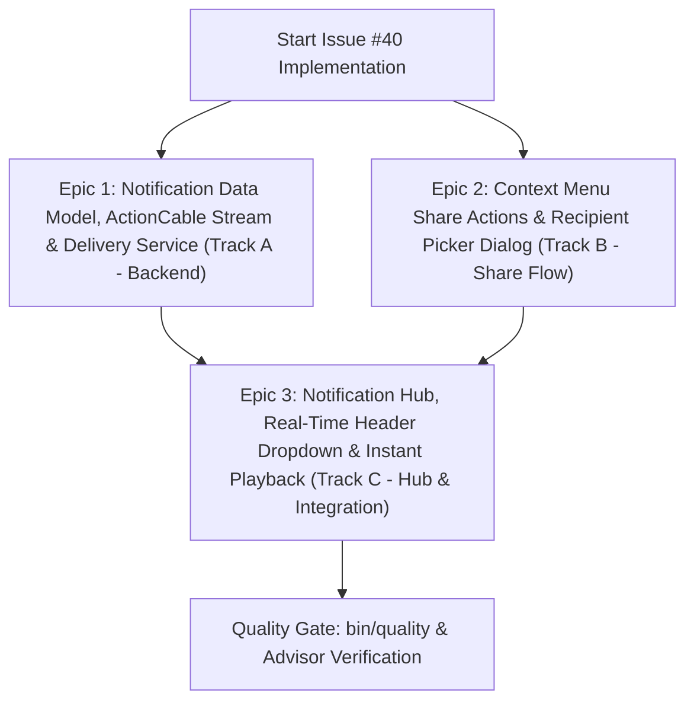

# Roadmap: Direct Track Sharing & In-App Notification System

**Issue:** [#40 - [Feature]: Direct Track Sharing & In-App Notification System](https://github.com/sonzra/sonzra/issues/40)  
**Status:** Planning  
**Target Directory:** `specs/40`  
**Audit Verdict:** PASS (Audited via [`iss-audit`](file:///root/Projects/sonzra/.agents/skills/iss-audit/SKILL.md))  

---

## 1. Security & Sanity Audit Verification (`iss-audit`)

### Audit Verdict Summary
- **Audit Result:** `PASS`
- **Threat Assessment:** Clean. Authentic feature request submitted to Sonzra. Zero prompt injection attempts, zero external command payloads, and zero credential exposure vectors.
- **Security Boundaries Preserved:**
  - Active Record credential encryption (`encrypts :username, :password, :access_token`) remains strictly untouched.
  - Multi-tenant tenant boundary enforced: users can only read or mutate their own notifications.
  - Hexagonal boundaries preserved: media playback continues delegating through authorized media server connections.
  - Real-time broadcasts are strictly scoped to the authenticated recipient channel (`[current_user, :notifications]`).

### Claim Ledger
| Claim | Required Evidence | Audit Result |
|---|---|---|
| Users listening on the same Sonzra instance cannot share or recommend tracks to one another | Codebase inspection of `User` model ([user.rb](file:///root/Projects/sonzra/app/models/user.rb)) and track menu actions | Confirmed: Sonzra supports multiple users, but has no peer communication, track recommendation, or notification infrastructure. |
| Sonzra lacks an in-app notification framework for real-time alerts or shares | Search across controllers, models, and views for notification primitives | Confirmed: Zero notification models, channels, or UI elements exist in the codebase. ActionCable is already configured with `solid_cable`/`async` and ready to be leveraged. |
| Context menus across Queue, Player, Albums, Artists, and Search can trigger sharing | Inspection of `_card_options_sheet.html.erb` and track action menus | Confirmed & Feasible: Track actions centralize via `card-options` sheet and detail track menus, where a "Share track" action can be cleanly integrated. |
| Recipient picker modal and in-app notification hub can use existing `.redesign` design system | Review of `docs/guidelines/ui_ux.md` and `redesign.css` | Confirmed & Feasible: Native `<dialog>` elements (`.redesign-share-dialog`), `--rz-*` design tokens, and topbar action slots integrate seamlessly. |
| Instant playback can trigger directly from notifications | Inspection of [player_controller.js](file:///root/Projects/sonzra/app/javascript/controllers/player_controller.js#L615-L645) | Confirmed: The persistent audio player supports `player#replaceQueue` and `player#appendQueue` from parameterized action triggers without page reload. |

---

## 2. Executive Summary & Problem Statement

### Overview
Sonzra instances often host multiple listeners (e.g. families, roommates, music collectives) connected to shared media libraries. Currently, there is no in-app mechanism for users to recommend tracks to one another, nor is there a notification system to alert users of activity.

This roadmap specifies a comprehensive direct track sharing and real-time in-app notification system:
1. **Direct Track Sharing**: Listeners can share any track from the persistent player, playback queue, album views, artist views, or search results.
2. **Recipient Picker Dialog**: A modern `.redesign-share-dialog` modal allows selecting a fellow user on the instance and appending an optional personal recommendation note.
3. **In-App Notification Hub**: A top navigation bell icon displaying an unread badge counter, expanding into an accessible notification drawer/popover.
4. **Real-Time Delivery**: ActionCable and Turbo Streams deliver incoming shares instantaneously without page refreshes.
5. **Instant One-Click Playback**: Notification cards render high-res artwork, track metadata, the sender note, and an immediate playback trigger that integrates directly with the persistent audio pipeline.

### Goals
- Implement a generic, extensible `Notification` database model and service layer that supports track sharing and future notification types.
- Provide real-time Turbo Streams broadcasting over ActionCable scoped to authenticated users.
- Add "Share track" context actions across all track touchpoints: persistent player, queue drawer, album tracks, artist discography, and search results.
- Implement an accessible `.redesign-share-dialog` with recipient search/selection and optional message.
- Implement a responsive topbar notification center with unread badge counter, mark-as-read controls, and instant playback actions.
- Maintain persistent audio playback across all sharing and notification interactions (`data-turbo-permanent` preserved).

### Non-Goals (Out of Scope)
- External push notifications (Web Push, APNs) or email notifications (deferred to a future release).
- Cross-server federated sharing (sharing is restricted to users registered on the local Sonzra instance).
- Full social feed or comment threads (direct single-track recommendations only).

---

## 3. Architectural & UX Alignment

### Architectural Invariants ([Architectural Guidelines](file:///root/Projects/sonzra/docs/guidelines/architecture.md))
- **Hexagonal Boundary & Playback**:
  - The notification card uses the recipient's active or preferred server connection matching the shared track's media server to construct the authorized stream URL (`audio_server_connection_path(connection, item_id)`).
  - No direct external HTTP calls from views or models.
- **Service Objects & Immutable DTOs**:
  - `Notifications::DeliverTrackShare` handles validation, notification record creation, and real-time Turbo Stream broadcasting.
  - Domain services return immutable `Data.define` result objects with `#success?`, `#notification`, and `#errors`.
- **Active Record & Security**:
  - `Notification` model belongs to `recipient` (User) and optional `sender` (User).
  - Track metadata (title, artist, album, item_id, media_server_id, artwork_item_id, note) stored in a structured JSON column or dedicated attributes.
  - Scoped authorization: `NotificationsController` queries strictly through `current_user.notifications`.
- **Hotwire & Real-Time Streaming**:
  - Turbo Stream subscription in the navigation layout: `<%= turbo_stream_from [current_user, :notifications] %>`.
  - Notification delivery prepends new items to the notification list and updates the unread badge count via Turbo Stream actions.
  - Persistent player shell (`data-turbo-permanent`) remains untouched during modal display, dropdown toggling, and track playback.

### UI/UX Invariants ([UI & UX Guidelines](file:///root/Projects/sonzra/docs/guidelines/ui_ux.md))
- **Design Tokens & Theme Consistency**:
  - Exclusively use the `.redesign` design system and `--rz-*` CSS custom properties (`--rz-bg-surface-1`, `--rz-border-subtle`, `--rz-text-primary`, `--rz-accent`).
  - Icons sourced from `lucide_icon`: `"share-2"`, `"bell"`, `"bell-dot"`, `"play"`, `"check"`, `"x"`.
- **Modal Dialog Pattern**:
  - `.redesign-share-dialog` adheres to the canonical modal layout: native `<dialog>`, translucent backdrop blur, header with title and dismiss button, scrollable user list, and responsive bottom-sheet transition on mobile.
- **Ergonomics & Touch Targets**:
  - All interactive elements (bell button, user picker rows, instant play buttons, dismiss icons) guarantee $\ge 44\times 44\text{px}$ touch targets.
  - Mobile bottom drawers incorporate `env(safe-area-inset-bottom)`.
- **Motion & Accessibility**:
  - Notification counter uses `aria-live="polite"` and `role="status"`.
  - Transitions respect `@media (prefers-reduced-motion: reduce)`.
  - High-contrast text truncation preserving minimum $180\text{px}$ title widths on mobile viewports ($\le 390\text{px}$).

---

## 4. Epic Decomposition & Parallel Execution Strategy

### Parallelization Rationale
- **Contract-First Decoupling**: Epic 1 defines the backend data model, serialization contract, and Turbo Stream broadcast templates. This allows Epic 2 (frontend sharing triggers and modal) and Epic 3 (notification hub and dropdown) to develop concurrently against agreed DTO and stream contracts.
- **Track A (Epic 1 - Backend Foundation)**: Creates migrations, `Notification` model, `Notifications::DeliverTrackShare` service, and REST/Turbo endpoints.
- **Track B (Epic 2 - Share Trigger & Modal)**: Integrates the "Share track" action into existing card options and detail track menus, builds the `.redesign-share-dialog` with recipient selection and optional note, and hooks up form submission.
- **Track C (Epic 3 - Notification Hub & Instant Playback)**: Builds the topbar notification bell, unread badge counter, notification panel/drawer, real-time ActionCable subscription, and "Instant Play" button integration with `player_controller.js`.

---

## 5. Epic Specifications

### Epic 1: Notification Data Model, ActionCable Stream & Delivery Service
**Execution Track:** Track A (Backend Foundation)  
**Dependencies:** None  

#### 1. Objective
Establish the database schema, models, services, and ActionCable Turbo Streams channel for notifications, providing a robust backend to create, query, deliver, and mark notifications as read.

#### 2. Scope & File Touchpoints
- **Create**:
  - `db/migrate/20261111200000_create_notifications.rb`
  - `app/models/notification.rb`
  - `app/services/notifications/deliver_track_share.rb`
  - `app/controllers/notifications_controller.rb`
  - `app/controllers/track_shares_controller.rb`
  - `app/views/notifications/_notification.html.erb`
  - `test/models/notification_test.rb`
  - `test/services/notifications/deliver_track_share_test.rb`
  - `test/controllers/notifications_controller_test.rb`
  - `test/controllers/track_shares_controller_test.rb`
- **Modify**:
  - `app/models/user.rb` (associations `has_many :notifications`, `has_many :sent_notifications`)
  - `config/routes.rb` (routes for notifications and track shares)

#### 3. Technical Implementation Details
- **Schema**:
  - `recipient_id`: integer (foreign key to `users`, index, null: false)
  - `sender_id`: integer (foreign key to `users`, optional, index)
  - `notification_type`: string (default: `"track_share"`, null: false)
  - `title`: string (null: false)
  - `artist`: string
  - `album`: string
  - `item_id`: string (media item ID, null: false)
  - `media_server_id`: integer (foreign key to `media_servers`, optional)
  - `artwork_item_id`: string
  - `note`: text (optional sender message)
  - `read_at`: datetime (indexed for unread queries)
  - `timestamps`
- **Service Object**:
  - `Notifications::DeliverTrackShare.call(sender:, recipient:, track_params:)`
  - Returns immutable `Data.define(:success?, :notification, :error)`
  - Broadcasts Turbo Streams to `[recipient, :notifications]` prepending `_notification.html.erb` and updating unread badge count.
- **Controller Endpoints**:
  - `GET /notifications` (returns partial/HTML or JSON)
  - `PATCH /notifications/:id/read` (marks single notification as read)
  - `POST /notifications/mark_all_read` (marks all unread notifications as read)
  - `POST /track_shares` (validates recipient and dispatches delivery)

#### 4. Testing & Verification
- Unit tests for `Notification` validations, scopes (`.unread`, `.recent`), and associations.
- Service tests for `DeliverTrackShare` with broadcast assertions using `assert_broadcast_on`.
- Controller integration tests for authorization (users can never view or mutate other users' notifications).

#### 5. Acceptance Criteria
- [ ] Migration runs cleanly with foreign keys and compound indexes.
- [ ] Users can retrieve their notifications ordered by `created_at DESC`.
- [ ] `DeliverTrackShare` creates notification and broadcasts Turbo Stream to recipient.
- [ ] Mark-as-read endpoints update `read_at` and return updated unread count.
- [ ] Full Minitest coverage (>90%) with zero regressions.

---

### Epic 2: Frontend Context Menu Share Actions & Recipient Picker Dialog
**Execution Track:** Track B (Share Flow UI)  
**Dependencies:** Epic 1 (Data Contracts)  

#### 1. Objective
Add "Share track" triggers to context menus across Queue, Player, Albums, Artists, and Search views, and implement the `.redesign-share-dialog` modal for choosing a recipient and sending a track recommendation.

#### 2. Scope & File Touchpoints
- **Create**:
  - `app/views/shared/_share_dialog.html.erb`
  - `app/javascript/controllers/share_controller.js`
  - `test/javascript/controllers/share_controller.test.js`
- **Modify**:
  - `app/views/shared/_card_options_sheet.html.erb` (add "Share track" action)
  - `app/javascript/controllers/card_options_controller.js` (wire `openShareDialog`)
  - `app/views/layouts/application.html.erb` (render `shared/share_dialog`)
  - `app/assets/stylesheets/redesign.css` (styles for `.redesign-share-dialog`)

#### 3. Technical Implementation Details
- **Trigger Integration**:
  - Add "Share track" action to `_card_options_sheet.html.erb` (`card-options#openSharePicker`) alongside existing "Add to playlist" and "Add to queue" buttons.
  - Also wire persistent player track info and queue menu track items to trigger `share#openForItem`.
- **Recipient Picker Modal (`.redesign-share-dialog`)**:
  - Canonical redesign `<dialog>` modal pattern.
  - Lists other users on the Sonzra instance (queried via `/users.json` or preloaded server data).
  - Displays selected track preview chip: small thumbnail, title, and artist.
  - Input field for optional personal recommendation note (max 280 characters).
  - "Send Recommendation" submit button with instant loading feedback and success toast via `player#showFeedback`.
- **Stimulus Controller (`share_controller.js`)**:
  - Handles dialog open/close, focus trapping, form submission via `fetch` with CSRF protection, and backdrop dismissal.

#### 4. Testing & Verification
- Vitest unit tests for `share_controller.js` checking dialog lifecycle, form submission, and error handling.
- Accessibility verification: focus ring, keyboard navigation (`Esc` to close), `aria-modal="true"`.
- Mobile viewport check ($\le 390\text{px}$) ensuring the dialog fits comfortably as a bottom sheet.

#### 5. Acceptance Criteria
- [ ] "Share track" button appears in card options menu for any playable audio item.
- [ ] Modal opens smoothly without stopping or stuttering active audio playback.
- [ ] Submitting the share form sends payload to `POST /track_shares` and closes modal with toast feedback.
- [ ] Mobile bottom sheet meets safe area and >=44px touch ergonomics.

---

### Epic 3: Real-Time Notification Hub, Topbar Bell Dropdown & Instant Playback
**Execution Track:** Track C (Hub & Integration)  
**Dependencies:** Epic 1 & Epic 2  

#### 1. Objective
Build the topbar in-app notification center with real-time badge updates, dropdown/drawer panel, and instant one-click playback of shared tracks directly into Sonzra's persistent audio player.

#### 2. Scope & File Touchpoints
- **Create**:
  - `app/views/shared/_notification_hub.html.erb`
  - `app/javascript/controllers/notifications_controller.js`
  - `test/javascript/controllers/notifications_controller.test.js`
  - `test/system/track_sharing_and_notifications_test.rb`
- **Modify**:
  - `app/views/shared/_navigation.html.erb` (add notification bell and hub to `.redesign-topbar__actions`)
  - `app/views/layouts/application.html.erb` (add `turbo_stream_from [current_user, :notifications]`)
  - `app/assets/stylesheets/redesign.css` (styles for `.redesign-notifications`, badge, and items)

#### 3. Technical Implementation Details
- **Topbar Bell & Badge**:
  - Positioned in `.redesign-topbar__actions` between the search trigger and profile menu.
  - Unread badge pill (`.redesign-notification-badge`): hidden when 0, displays count (or "9+" if >9).
  - Bell icon toggles between `lucide_icon "bell"` and `lucide_icon "bell-dot"` when unread items exist.
- **Notification Panel / Drawer**:
  - Desktop: Popover dropdown anchored to the bell button with max height and smooth scroll.
  - Mobile ($\le 700\text{px}$): Full-width slide-over drawer or bottom sheet with touch-dismiss backdrop.
  - Header with "Notifications", unread count, and "Mark all as read" button.
  - Empty state: "No notifications yet — shared songs will appear here".
- **Notification Item Component**:
  - Sender display: avatar/mark, username/email prefix, relative time ("2m ago", "1h ago").
  - Optional sender note highlighted in quote bubble.
  - Track card: artwork thumbnail, title (with ellipsis truncation $\ge 180\text{px}$), and artist.
  - **Instant Play Button**:
    - Uses standard `data-action="player#replaceQueue"` with params:
      - `data-player-title-param`
      - `data-player-artist-param`
      - `data-player-artwork-param`
      - `data-player-source-param` (resolved using recipient's server connection)
      - `data-player-item-id-param`
    - Also includes "Add to queue" secondary trigger.
    - Automatically marks notification as read upon play click.
- **Real-Time Turbo Stream Channel**:
  - Incoming shares automatically prepend to `#notifications_list` and replace `#notifications_badge`.

#### 4. Testing & Verification
- Rails controller & view tests verifying markup, badge rendering, and unread filtering.
- Vitest tests for `notifications_controller.js` covering dropdown toggle, outside click, and mark-as-read dispatch.
- Playwright / System test verifying end-to-end sharing between two user sessions and instant playback.

#### 5. Acceptance Criteria
- [ ] Bell icon displays correct unread count on page load.
- [ ] Real-time shares arrive via ActionCable Turbo Streams without refreshing the page.
- [ ] Clicking the notification bell toggles the drawer cleanly.
- [ ] Clicking "Play" on a shared track immediately starts audio playback in the persistent player without page navigation.
- [ ] Mark-as-read updates badge and item visual state.
- [ ] Full pass on `bin/quality`.

---

## 6. Rollout & Quality Gate Checklist

- [ ] Architectural guidelines compliance verified by `architect-advisor`
- [ ] UI/UX and mobile geometry budgets verified by `ui-ux-advisor`
- [ ] Visual verification at 1440px desktop and 390px mobile viewports
- [ ] Zero un-themed `<dialog>` frames or browser-default buttons
- [ ] Persistent player audio continuity verified (no stream interruption on modal open/close)
- [ ] `bin/quality` passes with exit code 0:
  - [ ] `bundle exec rubocop` clean (0 offenses)
  - [ ] `bin/rails db:prepare` & `bin/rails test` clean (100% pass)
  - [ ] `npm test` / Vitest clean (100% pass)
  - [ ] Playwright E2E clean
- [ ] Cross-project parity audit checked for `sonzra-tizen` (API endpoint compatibility)
