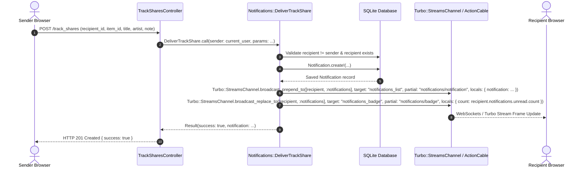
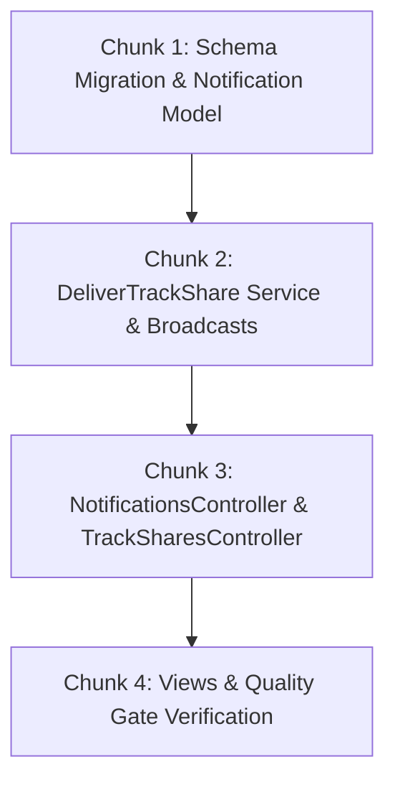

# Technical Specification: Notification Data Model, ActionCable Stream & Delivery Service

**Issue:** [#40 - Direct Track Sharing & In-App Notification System](https://github.com/sonzra/sonzra/issues/40)  
**PRD Reference:** [`specs/40/epic-1-notification-data-model-and-delivery.md`](file:///root/Projects/sonzra/.worktrees/feat-40-track-sharing-notifications/specs/40/epic-1-notification-data-model-and-delivery.md)  
**Roadmap Reference:** [`specs/40/roadmap.md`](file:///root/Projects/sonzra/.worktrees/feat-40-track-sharing-notifications/specs/40/roadmap.md)  
**Status:** Approved  
**Target Output File:** `specs/40/tech-spec-epic-1-notification-data-model-and-delivery.md`  
**Last Updated:** 2026-11-11  

---

## 1. Technical Architecture & Component Interaction

### System Topology & Interaction Flow



### Architectural Invariant Mapping ([Architectural Guidelines](file:///root/Projects/sonzra/docs/guidelines/architecture.md))
- **Service Objects & Immutable DTOs:**
  - `Notifications::DeliverTrackShare` encapsulates creation and delivery logic, returning an immutable `Data.define(:success?, :notification, :error)` result object.
- **Tenant Isolation & Security:**
  - `NotificationsController` queries exclusively through `current_user.notifications` to eliminate any insecure direct object reference (IDOR) vulnerability.
  - Active Record attributes validate `recipient_id` existence and disallow self-sharing.
- **Hotwire & Turbo Streaming:**
  - Employs Rails standard `Turbo::StreamsChannel.broadcast_*_to([recipient, :notifications], ...)` scoped strictly to the recipient's secure channel.

---

## 2. Database Schema & Models

### Schema Migration: `create_notifications`
```ruby
class CreateNotifications < ActiveRecord::Migration[8.1]
  def change
    create_table :notifications do |t|
      t.references :recipient, null: false, foreign_key: { to_table: :users }
      t.references :sender, foreign_key: { to_table: :users }
      t.references :media_server, foreign_key: true
      t.string :notification_type, null: false, default: "track_share"
      t.string :title, null: false
      t.string :artist
      t.string :album
      t.string :item_id, null: false
      t.string :artwork_item_id
      t.text :note
      t.datetime :read_at

      t.timestamps
    end

    add_index :notifications, [:recipient_id, :read_at]
    add_index :notifications, [:recipient_id, :created_at]
  end
end
```

### Model: `Notification` (`app/models/notification.rb`)
```ruby
class Notification < ApplicationRecord
  belongs_to :recipient, class_name: "User"
  belongs_to :sender, class_name: "User", optional: true
  belongs_to :media_server, optional: true

  scope :unread, -> { where(read_at: nil) }
  scope :read, -> { where.not(read_at: nil) }
  scope :recent, -> { order(created_at: :desc) }

  validates :title, :item_id, :notification_type, presence: true
  validates :note, length: { maximum: 280 }, allow_blank: true
  validate :sender_cannot_be_recipient

  def read?
    read_at.present?
  end

  def unread?
    !read?
  end

  def mark_as_read!
    update!(read_at: Time.current) if unread?
  end

  private

  def sender_cannot_be_recipient
    errors.add(:recipient, "cannot share with yourself") if sender_id.present? && sender_id == recipient_id
  end
end
```

### Model Updates: `User` (`app/models/user.rb`)
```ruby
has_many :notifications, foreign_key: :recipient_id, dependent: :destroy, inverse_of: :recipient
has_many :sent_notifications, class_name: "Notification", foreign_key: :sender_id, dependent: :nullify, inverse_of: :sender
```

---

## 3. Implementation Chunking (Bite-Sized Slices)



### Chunk 1: Schema Migration & Notification Model
- **Files to create/touch:**
  - Create: `db/migrate/20261111200000_create_notifications.rb`
  - Create: `app/models/notification.rb`
  - Modify: `app/models/user.rb`
  - Create: `test/models/notification_test.rb`
- **Verification:** `bin/rails db:prepare && bin/rails test test/models/notification_test.rb`

### Chunk 2: DeliverTrackShare Domain Service
- **Files to create/touch:**
  - Create: `app/services/notifications/deliver_track_share.rb`
  - Create: `test/services/notifications/deliver_track_share_test.rb`
- **Implementation:**
  ```ruby
  module Notifications
    class DeliverTrackShare
      Result = Data.define(:success?, :notification, :error)

      def self.call(sender:, recipient_id:, params:)
        new(sender:, recipient_id:, params:).call
      end

      def initialize(sender:, recipient_id:, params:)
        @sender = sender
        @recipient_id = recipient_id
        @params = params
      end

      def call
        recipient = User.find_by(id: @recipient_id)
        return Result.new(success?: false, notification: nil, error: "Recipient not found") unless recipient
        return Result.new(success?: false, notification: nil, error: "Cannot share with yourself") if recipient == @sender

        notification = Notification.create!(
          recipient: recipient,
          sender: @sender,
          media_server_id: @params[:media_server_id],
          notification_type: "track_share",
          title: @params[:title],
          artist: @params[:artist],
          album: @params[:album],
          item_id: @params[:item_id],
          artwork_item_id: @params[:artwork_item_id],
          note: @params[:note]
        )

        broadcast_delivery(notification, recipient)
        Result.new(success?: true, notification: notification, error: nil)
      rescue ActiveRecord::RecordInvalid => e
        Result.new(success?: false, notification: nil, error: e.record.errors.full_messages.to_sentence)
      end

      private

      def broadcast_delivery(notification, recipient)
        # Broadcast prepended notification item
        Turbo::StreamsChannel.broadcast_prepend_to(
          [recipient, :notifications],
          target: "notifications_list",
          partial: "notifications/notification",
          locals: { notification: notification, current_user: recipient }
        )

        # Broadcast updated unread badge
        Turbo::StreamsChannel.broadcast_replace_to(
          [recipient, :notifications],
          target: "notifications_badge",
          partial: "notifications/badge",
          locals: { count: recipient.notifications.unread.count }
        )
      end
    end
  end
  ```

### Chunk 3: Controllers & Routing
- **Files to create/touch:**
  - Modify: `config/routes.rb`
  - Create: `app/controllers/notifications_controller.rb`
  - Create: `app/controllers/track_shares_controller.rb`
  - Create: `test/controllers/notifications_controller_test.rb`
  - Create: `test/controllers/track_shares_controller_test.rb`
- **Routes:**
  ```ruby
  resources :notifications, only: %i[index update] do
    post :mark_all_read, on: :collection
  end
  resources :track_shares, only: %i[create]
  ```

### Chunk 4: Views & Quality Gate Verification
- **Files to create:**
  - `app/views/notifications/_notification.html.erb`
  - `app/views/notifications/_badge.html.erb`
  - `app/views/notifications/index.html.erb`
- **Verification:**
  - RuboCop: `bundle exec rubocop`
  - Tests: `bin/rails test`
