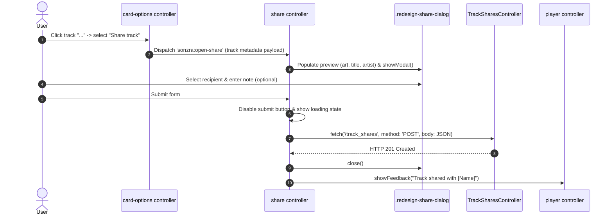
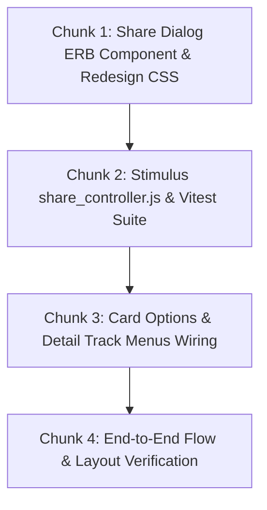

# Technical Specification: Frontend Context Menu Share Actions & Recipient Picker Dialog

**Issue:** [#40 - Direct Track Sharing & In-App Notification System](https://github.com/sonzra/sonzra/issues/40)  
**PRD Reference:** [`specs/40/epic-2-context-menu-share-actions-and-picker-dialog.md`](file:///root/Projects/sonzra/.worktrees/feat-40-track-sharing-notifications/specs/40/epic-2-context-menu-share-actions-and-picker-dialog.md)  
**Roadmap Reference:** [`specs/40/roadmap.md`](file:///root/Projects/sonzra/.worktrees/feat-40-track-sharing-notifications/specs/40/roadmap.md)  
**Status:** Approved  
**Target Output File:** `specs/40/tech-spec-epic-2-context-menu-share-actions-and-picker-dialog.md`  
**Last Updated:** 2026-11-11  

---

## 1. Technical Architecture & Component Interaction

### System Topology & Interaction Flow



### Architectural & UI/UX Guidelines Alignment
- **Canonical Dialog Pattern:** Employs standard HTML5 `<dialog>` styled strictly through `redesign.css` with zero legacy stylesheet dependencies.
- **Persistent Playback Continuity:** All dialog interactions are isolated from the `<audio>` pipeline; opening/closing never reloads or pauses the player.
- **Ergonomics & Safe Areas:** Supports mobile bottom-sheet animations, backdrop click dismiss, `env(safe-area-inset-bottom)`, and $\ge 44\times 44\text{px}$ touch targets.

---

## 2. Stimulus Controllers & Client Architecture

### Stimulus Controller: `share_controller.js` (`app/javascript/controllers/share_controller.js`)
```javascript
import { Controller } from "@hotwired/stimulus"

export default class extends Controller {
  static targets = [
    "dialog", "form", "recipientSelect", "noteInput",
    "charCount", "previewTitle", "previewArtist", "previewArt",
    "submitButton", "errorFeedback"
  ]
  static values = {
    usersUrl: { type: String, default: "/admin/users.json" }
  }

  connect() {
    this.boundHandleOpen = this.handleOpenEvent.bind(this)
    window.addEventListener("sonzra:open-share", this.boundHandleOpen)
  }

  disconnect() {
    window.removeEventListener("sonzra:open-share", this.boundHandleOpen)
  }

  handleOpenEvent(event) {
    this.openForTrack(event.detail)
  }

  openForTrack({ itemId, title, artist, album, artworkUrl, mediaServerId }) {
    this.trackData = { itemId, title, artist, album, artworkUrl, mediaServerId }
    this.previewTitleTarget.textContent = title || "Unknown Title"
    this.previewArtistTarget.textContent = artist || "Unknown Artist"
    if (this.hasPreviewArtTarget && artworkUrl) {
      this.previewArtTarget.src = artworkUrl
      this.previewArtTarget.hidden = false
    }
    this.noteInputTarget.value = ""
    this.updateCharCount()
    this.errorFeedbackTarget.textContent = ""
    this.errorFeedbackTarget.hidden = true
    this.submitButtonTarget.disabled = false
    this.dialogTarget.showModal()
  }

  updateCharCount() {
    const remaining = 280 - (this.noteInputTarget.value?.length || 0)
    this.charCountTarget.textContent = remaining
  }

  async submit(event) {
    event.preventDefault()
    const recipientId = this.recipientSelectTarget.value
    if (!recipientId) return

    this.submitButtonTarget.disabled = true
    this.errorFeedbackTarget.hidden = true

    try {
      const response = await fetch("/track_shares", {
        method: "POST",
        headers: {
          "Content-Type": "application/json",
          "Accept": "application/json",
          "X-CSRF-Token": document.querySelector("meta[name='csrf-token']")?.content
        },
        body: JSON.stringify({
          recipient_id: recipientId,
          item_id: this.trackData.itemId,
          title: this.trackData.title,
          artist: this.trackData.artist,
          album: this.trackData.album,
          media_server_id: this.trackData.mediaServerId,
          artwork_item_id: this.trackData.artworkUrl,
          note: this.noteInputTarget.value
        })
      })

      if (!response.ok) {
        const errorData = await response.json().catch(() => ({}))
        throw new Error(errorData.error || "Failed to share track")
      }

      const recipientName = this.recipientSelectTarget.selectedOptions[0]?.text || "listener"
      this.dialogTarget.close()
      this.showToast(`Track shared with ${recipientName}`)
    } catch (err) {
      this.errorFeedbackTarget.textContent = err.message
      this.errorFeedbackTarget.hidden = false
      this.submitButtonTarget.disabled = false
    }
  }

  showToast(message) {
    const playerEl = document.querySelector("[data-controller~='player']")
    if (playerEl) {
      const player = this.application.getControllerForElementAndIdentifier(playerEl, "player")
      if (player?.showFeedback) {
        player.showFeedback(message)
        return
      }
    }
  }

  close() {
    this.dialogTarget.close()
  }

  closeOnBackdrop(event) {
    if (event.target === this.dialogTarget) {
      this.dialogTarget.close()
    }
  }
}
```

---

## 3. Implementation Chunking (Bite-Sized Slices)



### Chunk 1: Share Dialog Markup & CSS
- **Create:** `app/views/shared/_share_dialog.html.erb`
- **Modify:** `app/views/layouts/application.html.erb` (render `shared/share_dialog`)
- **Modify:** `app/assets/stylesheets/redesign.css` (add `.redesign-share-dialog` styles matching `--rz-*` tokens)

### Chunk 2: Stimulus Controller & Frontend Tests
- **Create:** `app/javascript/controllers/share_controller.js`
- **Create:** `test/javascript/controllers/share_controller.test.js`
- **Verification:** `npm test` / Vitest passing with 100% coverage.

### Chunk 3: Card Options & Detail Track Menu Integration
- **Modify:** `app/views/shared/_card_options_sheet.html.erb`
  - Add `<button type="button" data-card-options-target="shareAction" data-action="click->card-options#openShareDialog"><%= lucide_icon "share-2" %> Share track</button>`
- **Modify:** `app/javascript/controllers/card_options_controller.js`
  - Add `openShareDialog()` dispatching custom event `sonzra:open-share` with active item metadata.

### Chunk 4: Multi-Device Geometry & Quality Check
- Test mobile sheet transitions on $390\text{px}$ viewport.
- Run `bin/quality`.
