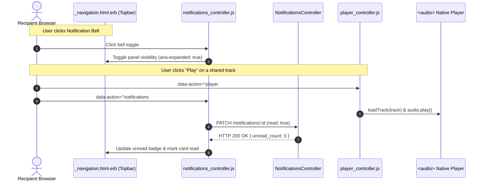
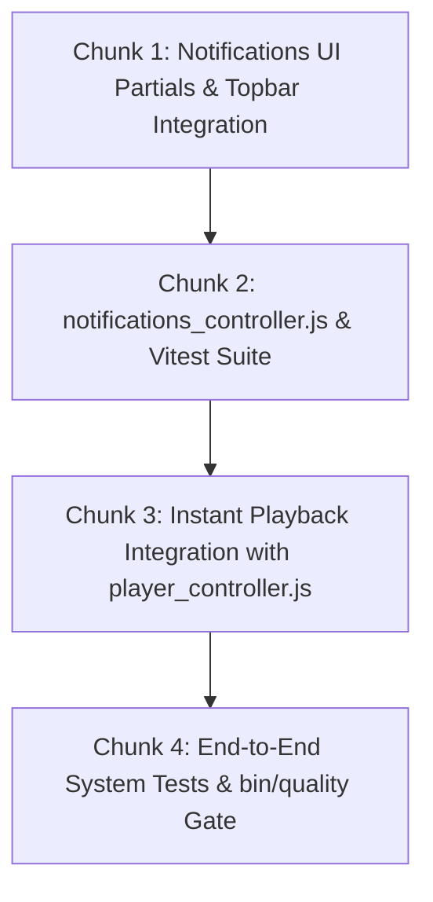

# Technical Specification: Topbar Notification Hub & Instant Playback Integration

**Issue:** [#40 - Direct Track Sharing & In-App Notification System](https://github.com/sonzra/sonzra/issues/40)  
**PRD Reference:** [`specs/40/epic-3-topbar-notification-hub-and-instant-playback.md`](file:///root/Projects/sonzra/.worktrees/feat-40-track-sharing-notifications/specs/40/epic-3-topbar-notification-hub-and-instant-playback.md)  
**Roadmap Reference:** [`specs/40/roadmap.md`](file:///root/Projects/sonzra/.worktrees/feat-40-track-sharing-notifications/specs/40/roadmap.md)  
**Status:** Approved  
**Target Output File:** `specs/40/tech-spec-epic-3-topbar-notification-hub-and-instant-playback.md`  
**Last Updated:** 2026-11-11  

---

## 1. Technical Architecture & Component Interaction

### System Topology & Interaction Flow



### Architectural & UI/UX Guidelines Alignment
- **Persistent Playback Integration:** Leverages the existing `player#replaceQueue` and `player#appendQueue` actions in `player_controller.js`. The persistent audio player shell (`data-turbo-permanent`) remains mounted and uninterrupted.
- **Universal Redesign Theme:** Component styling strictly follows `redesign.css` utilizing `--rz-*` design tokens, `lucide_icon` bell/play iconography, and glassmorphic surface blur.
- **Safe Area & Mobile Geometry:** Mobile drawer adapts cleanly with `env(safe-area-inset-top)` and `env(safe-area-inset-bottom)`. Titles truncate smoothly with $\ge 180\text{px}$ usable width.

---

## 2. Topbar Navigation & Real-Time Turbo Streams

### Topbar Integration: `app/views/shared/_navigation.html.erb`
Placed inside `.redesign-topbar__actions` alongside the search trigger and profile menu:
```erb
<div class="redesign-notification-hub" data-controller="notifications" data-notifications-url-value="<%= notifications_path %>">
  <button type="button"
          class="redesign-icon-button redesign-notification-hub__toggle"
          aria-label="Notifications"
          aria-expanded="false"
          data-notifications-target="toggle"
          data-action="notifications#toggle">
    <%= render "notifications/badge", count: current_user.notifications.unread.count %>
  </button>

  <div class="redesign-notification-hub__panel" data-notifications-target="panel" hidden>
    <div class="redesign-notification-hub__header">
      <h3>Notifications</h3>
      <% if current_user.notifications.unread.any? %>
        <%= button_to "Mark all as read", mark_all_read_notifications_path, method: :post, class: "redesign-notification-hub__mark-all", data: { action: "notifications#markAllAsRead" } %>
      <% end %>
    </div>
    <div id="notifications_list" class="redesign-notification-hub__list" data-notifications-target="list">
      <% if current_user.notifications.any? %>
        <%= render partial: "notifications/notification", collection: current_user.notifications.recent.limit(20) %>
      <% else %>
        <p class="redesign-notification-hub__empty">No notifications yet</p>
      <% end %>
    </div>
  </div>
</div>
```

### Unread Badge Component: `app/views/notifications/_badge.html.erb`
```erb
<span id="notifications_badge" class="redesign-notification-badge-wrapper">
  <%= lucide_icon(count > 0 ? "bell-dot" : "bell", aria: { hidden: true }) %>
  <% if count > 0 %>
    <span class="redesign-notification-badge" aria-label="<%= count %> unread notifications"><%= count > 9 ? "9+" : count %></span>
  <% end %>
</span>
```

### Individual Notification Card: `app/views/notifications/_notification.html.erb`
```erb
<% connection = current_user.server_connections.find_by(media_server_id: notification.media_server_id) || current_user.preferred_server_connection || current_user.server_connections.first %>
<article id="<%= dom_id(notification) %>" class="redesign-notification-card <%= "is-unread" if notification.unread? %>" data-notification-id="<%= notification.id %>">
  <div class="redesign-notification-card__header">
    <span class="redesign-notification-card__sender"><%= notification.sender&.email_address&.split("@")&.first || "Listener" %></span>
    <time class="redesign-notification-card__time"><%= time_ago_in_words(notification.created_at) %> ago</time>
  </div>

  <% if notification.note.present? %>
    <blockquote class="redesign-notification-card__note">
      <p>“<%= notification.note %>”</p>
    </blockquote>
  <% end %>

  <div class="redesign-notification-card__track">
    <% if connection %>
      " alt="" class="redesign-notification-card__art" loading="lazy">
    <% end %>
    <div class="redesign-notification-card__meta">
      <strong class="redesign-notification-card__title"><%= notification.title %></strong>
      <span class="redesign-notification-card__artist"><%= notification.artist %></span>
    </div>

    <% if connection %>
      <div class="redesign-notification-card__actions">
        <button type="button"
                class="redesign-icon-button redesign-notification-card__play"
                aria-label="Play <%= notification.title %>"
                data-action="player#replaceQueue notifications#markAsRead"
                data-player-source-param="<%= audio_server_connection_path(connection, notification.item_id) %>"
                data-player-title-param="<%= notification.title %>"
                data-player-artist-param="<%= notification.artist %>"
                data-player-artwork-param="<%= artwork_server_connection_path(connection, notification.artwork_item_id || notification.item_id) %>"
                data-player-item-id-param="<%= notification.item_id %>"
                data-notifications-id-param="<%= notification.id %>">
          <%= lucide_icon "play", aria: { hidden: true } %>
        </button>
        <button type="button"
                class="redesign-icon-button redesign-notification-card__queue"
                aria-label="Add <%= notification.title %> to queue"
                data-action="player#appendQueue notifications#markAsRead"
                data-player-source-param="<%= audio_server_connection_path(connection, notification.item_id) %>"
                data-player-title-param="<%= notification.title %>"
                data-player-artist-param="<%= notification.artist %>"
                data-player-artwork-param="<%= artwork_server_connection_path(connection, notification.artwork_item_id || notification.item_id) %>"
                data-player-item-id-param="<%= notification.item_id %>"
                data-notifications-id-param="<%= notification.id %>">
          <%= lucide_icon "list-music", aria: { hidden: true } %>
        </button>
      </div>
    <% end %>
  </div>
</article>
```

---

## 3. Stimulus Controller: `notifications_controller.js`

```javascript
import { Controller } from "@hotwired/stimulus"

export default class extends Controller {
  static targets = ["toggle", "panel", "list"]
  static values = { url: String }

  connect() {
    this.boundHandleOutsideClick = this.handleOutsideClick.bind(this)
    document.addEventListener("click", this.boundHandleOutsideClick)
  }

  disconnect() {
    document.removeEventListener("click", this.boundHandleOutsideClick)
  }

  toggle() {
    const isHidden = this.panelTarget.hidden
    this.panelTarget.hidden = !isHidden
    this.toggleTarget.setAttribute("aria-expanded", String(isHidden))
  }

  close() {
    this.panelTarget.hidden = true
    this.toggleTarget.setAttribute("aria-expanded", "false")
  }

  handleOutsideClick(event) {
    if (!this.element.contains(event.target)) {
      this.close()
    }
  }

  async markAsRead(event) {
    const notificationId = event.params.id
    if (!notificationId) return

    const card = document.querySelector(`[data-notification-id="${notificationId}"]`)
    if (card) {
      card.classList.remove("is-unread")
    }

    try {
      await fetch(`/notifications/${notificationId}`, {
        method: "PATCH",
        headers: {
          "Content-Type": "application/json",
          "Accept": "application/json",
          "X-CSRF-Token": document.querySelector("meta[name='csrf-token']")?.content
        },
        body: JSON.stringify({ read: true })
      })
    } catch (_) {}
  }

  async markAllAsRead(event) {
    event.preventDefault()
    try {
      const response = await fetch("/notifications/mark_all_read", {
        method: "POST",
        headers: {
          "Accept": "text/vnd.turbo-stream.html, application/json",
          "X-CSRF-Token": document.querySelector("meta[name='csrf-token']")?.content
        }
      })
      if (response.ok) {
        this.listTarget.querySelectorAll(".is-unread").forEach((card) => {
          card.classList.remove("is-unread")
        })
        const badge = document.getElementById("notifications_badge")
        if (badge) {
          const badgePill = badge.querySelector(".redesign-notification-badge")
          if (badgePill) badgePill.remove()
        }
      }
    } catch (_) {}
  }
}
```

---

## 4. Implementation Chunking (Bite-Sized Slices)



### Chunk 1: Notification Partials & Topbar Navigation
- Modify: `app/views/shared/_navigation.html.erb`
- Create: `app/views/notifications/_notification.html.erb`
- Create: `app/views/notifications/_badge.html.erb`
- Modify: `app/views/layouts/application.html.erb` (add `turbo_stream_from [current_user, :notifications]`)
- Modify: `app/assets/stylesheets/redesign.css` (styles for `.redesign-notification-hub`, `.redesign-notification-card`, badge)

### Chunk 2: Stimulus Controller & Frontend Testing
- Create: `app/javascript/controllers/notifications_controller.js`
- Create: `test/javascript/controllers/notifications_controller.test.js`
- Verification: Vitest pass with 100% assertions.

### Chunk 3: Instant Playback & Audio Pipeline Verification
- Verify `data-action="player#replaceQueue"` and `player#appendQueue` trigger playback without page reloads.
- Ensure audio session re-arming and mobile WebKit lookahead invariants remain unbroken.

### Chunk 4: Full Quality Gate & System Tests
- Create: `test/system/track_sharing_flow_test.rb`
- Verification: `bin/quality` (RuboCop exit 0, Rails test exit 0, Vitest exit 0, Playwright exit 0).
