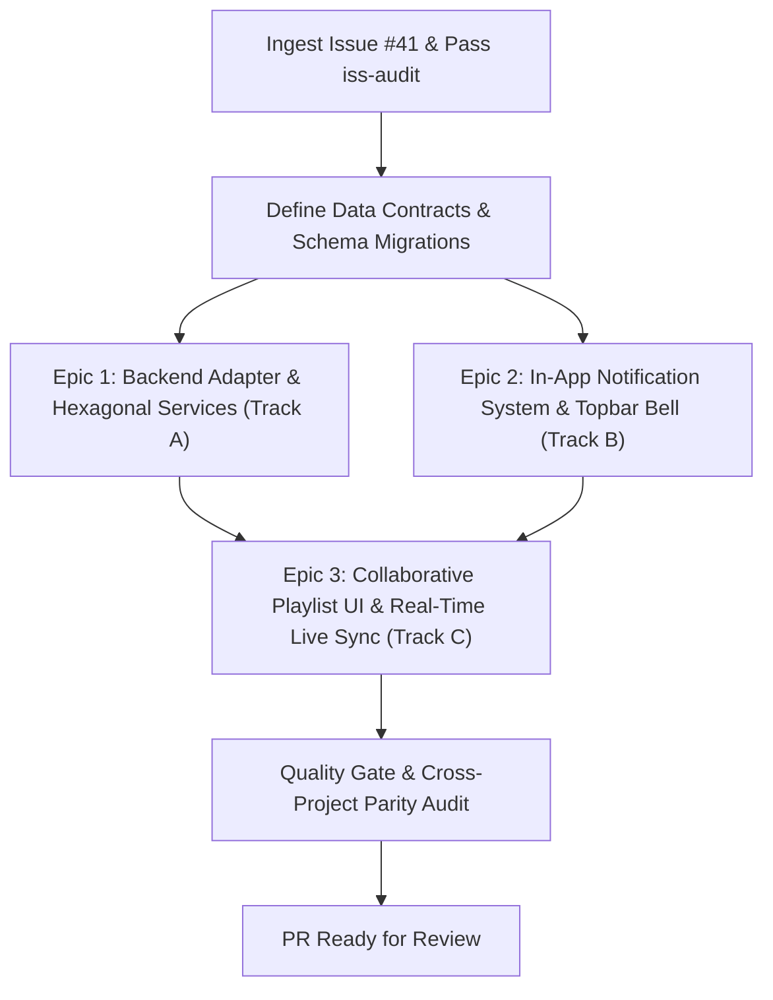

# Roadmap: Collaborative Shared Playlists with Jellyfin Integration

**Issue:** [#41 - [Feature]: Collaborative Shared Playlists with Jellyfin Integration](https://github.com/sonzra/sonzra/issues/41)  
**Status:** Completed & Verified  
**Target Directory:** `specs/41`  
**Audit Verdict:** PASS (Audited via [`iss-audit`](file:///root/Projects/sonzra/.agents/skills/iss-audit/SKILL.md))  

---

## 1. Security & Sanity Audit Verification (`iss-audit`)

### Audit Verdict Summary
- **Audit Result:** `PASS`
- **Threat Assessment:** Clean. The issue represents an authentic, constructive feature request submitted by a project maintainer (`bedgerotto`). It contains zero prompt injection, zero external script executions, zero weaponized payloads, and zero attempts to weaken Active Record encryption or exfiltrate credentials.
- **Security Boundaries Preserved:**
  - Active Record encryption (`encrypts :username, :password, :access_token`) on `ServerConnection` remains strictly intact.
  - Hexagonal architecture boundary is fully respected; external communications with Jellyfin proceed exclusively via `Integrations::Client.for(server_connection)`.
  - Upstream Jellyfin user management endpoints are accessed with authenticated user tokens, respecting Jellyfin server permissions.
  - Cross-user interactions on the Sonzra instance are strictly scoped to users sharing access to the same configured `MediaServer`.

### Claim Ledger
| Claim | Required Evidence | Audit Result |
|---|---|---|
| Playlists in Sonzra are currently strictly personal without co-curation | Code inspection of [`PlaylistsController`](file:///root/Projects/sonzra/app/controllers/playlists_controller.rb) and [`Integrations::Jellyfin::Client`](file:///root/Projects/sonzra/app/services/integrations/jellyfin/client.rb#L332-L373) | Confirmed: Playlists are queried strictly for the currently authenticated user's remote ID with no co-ownership or sharing capabilities exposed in Sonzra. |
| Jellyfin provides native `/Playlists/{id}/Users/{userId}` endpoints for collaborative playlists | Inspection of Jellyfin OpenAPI / REST specifications and upstream client capabilities | Confirmed: Jellyfin exposes `GET /Playlists/{id}/Users`, `POST /Playlists/{id}/Users/{userId}`, and `DELETE /Playlists/{id}/Users/{userId}` for playlist co-curation. |
| Co-ownership can be mapped across Sonzra `ServerConnection` accounts on the same instance | Code inspection of [`User`](file:///root/Projects/sonzra/app/models/user.rb), [`ServerConnection`](file:///root/Projects/sonzra/app/models/server_connection.rb), and [`MediaServer`](file:///root/Projects/sonzra/app/models/media_server.rb) | Confirmed & Feasible: Users connected to the same `MediaServer` can be mapped to their upstream Jellyfin user accounts. Storing `remote_user_id` on `ServerConnection` simplifies mapping. |
| Turbo Streams can broadcast playlist additions/removals live without full page reload | Hotwire Turbo Stream conventions and existing persistent audio player layout | Confirmed & Compliant: A playlist channel (`playlist_#{media_server_id}_#{playlist_id}`) broadcasts track mutations without disrupting background audio playback. |
| In-app sharing notifications notify collaborators when a playlist is shared | Inspection of existing notification systems in Sonzra | Confirmed: Sonzra does not yet have an in-app notification model; introducing a lightweight `Notification` table with Turbo Stream delivery cleanly fulfills this requirement. |

---

## 2. Executive Summary & Problem Statement

### Overview
Playlists in Sonzra are currently single-tenant and isolated to the individual user session. Users sharing a media server instance cannot collaborate on shared playlists, view co-curators, or receive real-time updates when a collaborator adds or removes tracks.

This feature introduces collaborative playlist management for Sonzra:
1. **Upstream Sharing**: Leverages Jellyfin's `/Playlists/{id}/Users/{userId}` API via `Integrations::Client.for` to manage playlist collaborators.
2. **Capability-Gated**: Declares `Integrations::Capabilities::COLLABORATIVE_PLAYLISTS` to keep Plex and other non-supporting providers cleanly decoupled without breaking changes.
3. **In-App Notifications**: Alerts collaborators on the Sonzra instance when a playlist is shared with them, strictly delivered inside the topbar drawer.
4. **Real-Time Live Sync**: Uses ActionCable Turbo Streams to broadcast track additions and removals in real time to all collaborators currently viewing the playlist.
5. **Persistent Audio Shielding**: Guarantees that opening the share dialog, modifying collaborators, and receiving live playlist updates never interrupts active audio playback.

### Confirmed Product Scope & Boundaries
- **Collaborator Scope**: Strictly restricted to Sonzra users registered on the current instance who are connected to the same Jellyfin `MediaServer`. Arbitrary unlinked server accounts are out of scope.
- **Notification Presentation**: Exclusively delivered and managed inside the topbar notifications drawer (no transient pop-up toasts across active playback).

### Goals
- Expose Jellyfin playlist user endpoints in `Integrations::Jellyfin::Client` (`playlist_users`, `share_playlist`, `unshare_playlist`).
- Implement capability detection via `Integrations::Capabilities::COLLABORATIVE_PLAYLISTS`.
- Introduce a lightweight `Notification` Active Record entity for user-scoped, in-app alerts with real-time Turbo Stream delivery.
- Create a dedicated "Share Playlist" dialog adhering to Sonzra's `.redesign-*-dialog` architecture, enabling owners to invite other users on the instance who share the same media server.
- Stream real-time playlist track insertions and deletions across viewing clients using Turbo Stream channels.
- Maintain full responsiveness, >=44px touch targets, and zero container clipping across desktop (`1440px`) and mobile (`390px`) viewports.

### Non-Goals (Out of Scope)
- Cross-server playlist sharing across distinct physical Jellyfin or Plex servers.
- Collaborative playback synchronization (party mode / synchronized listen-along queue); this feature is strictly collection curation.
- Re-architecting Plex playlists to mimic Jellyfin's user permission model (Plex lacks native per-user playlist co-curation REST endpoints).

---

## 3. Architectural & UX Alignment

### Architectural Invariants ([`docs/guidelines/architecture.md`](file:///root/Projects/sonzra/docs/guidelines/architecture.md))
- **Hexagonal Boundary**:
  - Upstream playlist sharing calls are confined to `Integrations::Jellyfin::Client`.
  - Feature is guarded by `client.supports?(Integrations::Capabilities::COLLABORATIVE_PLAYLISTS)`. Plex client safely returns `false`.
  - All upstream network/auth exceptions are caught and wrapped into domain results.
- **Service Objects & Immutable DTOs**:
  - Encapsulate sharing workflows in `ServerConnections::CollaborativePlaylists::SharePlaylist` and `ServerConnections::CollaborativePlaylists::UnsharePlaylist`.
  - Encapsulate notification delivery in `Notifications::DeliverNotification`.
  - All services return immutable `Data.define` results (`ResultData`) implementing `#success?`.
- **Persistence & Schema**:
  - Add `remote_user_id` column to `server_connections` to reliably correlate instance users with media server accounts without redundant network calls.
  - Add `notifications` table (`user_id`, `actor_user_id`, `title`, `message`, `link_url`, `read_at`, timestamps) with appropriate foreign keys and indexes.
  - Active Record attribute encryption (`encrypts :username, :password, :access_token`) remains untouched.
- **Hotwire & Streaming Integrity**:
  - Playlist detail view connects to `turbo_stream_from "playlist_#{server_connection.media_server_id}_#{playlist_id}"`.
  - Playlist track row actions append and remove DOM nodes via Turbo Streams.
  - The persistent playback shell (`#player`), queue drawer, and audio element maintain `data-turbo-permanent` and are never re-rendered or paused during live playlist updates.

### UI/UX Invariants ([`docs/guidelines/ui_ux.md`](file:///root/Projects/sonzra/docs/guidelines/ui_ux.md))
- **Design Tokens**: All newly introduced components strictly use `--rz-*` custom properties in `redesign.css`.
- **Dialog Architecture**:
  - The Share Playlist dialog uses the canonical `.redesign-share-dialog` pattern with `backdrop-filter: blur(20px)`, dark translucent surface (`rgb(18 18 28 / 98%)`), 22px border radius, uppercase `--rz-primary-light` kicker, bold 22px title, and a circular 34x34px close button.
- **Touch Ergonomics & Pixel Budgeting**:
  - Collaborator toggles and buttons maintain >=44x44px touch bounding boxes.
  - Mobile layout ($\le 390\text{px}$) stacks header actions and ensures user search/select rows do not cause horizontal blowout (`min-width: 0`).
- **In-App Notifications UX**:
  - Subtle notification bell icon in `.redesign-topbar__actions` with an unread badge indicator.
  - Notification popover on desktop / drawer on mobile listing recent shares with direct links to the shared playlist.
- **Accessibility & Motion**:
  - Notification toasts and live track updates announce via `role="status"` and `aria-live="polite"`.
  - Reduced-motion media query suppresses slide/scale transitions on dialogs and stream inserts.

---

## 4. Epic Decomposition & Parallel Execution Strategy



### Parallelization Rationale
- **Track A (Epic 1)**: Focuses strictly on the media server integration layer (`Integrations::Jellyfin::Client`), server connection `remote_user_id` persistence, and domain service objects (`ServerConnections::CollaborativePlaylists::*`). Can be developed and tested in isolation using plain Ruby doubles.
- **Track B (Epic 2)**: Focuses on the general-purpose `Notification` model, controllers, topbar notification bell, and ActionCable Turbo Stream broadcasts. Can proceed completely in parallel with Epic 1 once the model contract is agreed upon.
- **Track C (Epic 3)**: Unifies Track A and Track B into the presentation layer: playlist detail page headers, collaborator management dialog, and real-time live sync of track mutations.

---

## 5. Epic Specifications

### Epic 1: Backend Adapter, Capabilities & Hexagonal Services
**Execution Track:** Track A (Parallel Backend)  
**Dependencies:** None  

#### 1. Objective
Establish upstream Jellyfin playlist sharing API methods, declare provider capabilities, persist `remote_user_id` on `ServerConnection`, and build service objects for managing collaborative users.

#### 2. Scope & File Touchpoints
- **Create**:
  - `db/migrate/20261111194000_add_remote_user_id_to_server_connections.rb`
  - `app/services/server_connections/collaborative_playlists/share_playlist.rb`
  - `app/services/server_connections/collaborative_playlists/unshare_playlist.rb`
  - `app/services/server_connections/collaborative_playlists/fetch_playlist_users.rb`
  - `app/services/server_connections/collaborative_playlists/collaborative_playlist_result_data.rb`
  - `test/services/server_connections/collaborative_playlists/share_playlist_test.rb`
  - `test/services/integrations/jellyfin/collaborative_playlists_test.rb`
- **Modify**:
  - `app/services/integrations/capabilities.rb` (Add `COLLABORATIVE_PLAYLISTS`)
  - `app/services/integrations/jellyfin/client.rb` (Implement `playlist_users`, `share_playlist`, `unshare_playlist`, and add capability)
  - `app/services/integrations/plex/client.rb` (Ensure capability absent)
  - `app/models/server_connection.rb` (Add `remote_user_id` handling and helper to find fellow instance connections)

#### 3. Technical Implementation Details
```ruby
# app/services/integrations/capabilities.rb
module Integrations
  module Capabilities
    LETTER_FILTERING = :letter_filtering
    SONIC_GRAPH = :sonic_graph
    COLLABORATIVE_PLAYLISTS = :collaborative_playlists
  end
end
```

```ruby
# Immutable Result Object
CollaborativePlaylistResultData = Data.define(:success, :users, :message) do
  def success? = success
end
```

#### 4. Testing & Verification
- Unit tests for `Integrations::Jellyfin::Client#playlist_users`, `#share_playlist`, and `#unshare_playlist` using stubbed HTTP responses.
- Service tests for `SharePlaylist` verifying collaborator resolution, capability validation, and error isolation.

#### 5. Acceptance Criteria
- [ ] Jellyfin client declares `COLLABORATIVE_PLAYLISTS` capability; Plex does not.
- [ ] Upstream API calls to `/Playlists/{id}/Users` and `/Playlists/{id}/Users/{userId}` properly serialize and catch exceptions.
- [ ] Domain services return immutable `Data.define` results with `#success?`.
- [ ] Unit test coverage $\ge 95\%$.

---

### Epic 2: In-App Notification System & Real-Time Delivery
**Execution Track:** Track B (Parallel Foundation)  
**Dependencies:** None  

#### 1. Objective
Introduce an in-app notification infrastructure in Sonzra, providing a database entity, Turbo Stream broadcast channel, and topbar notification UI in `redesign.css`.

#### 2. Scope & File Touchpoints
- **Create**:
  - `db/migrate/20261111194100_create_notifications.rb`
  - `app/models/notification.rb`
  - `app/controllers/notifications_controller.rb`
  - `app/views/notifications/_notification.html.erb`
  - `app/views/notifications/_topbar_bell.html.erb`
  - `app/javascript/controllers/notifications_controller.js`
  - `test/models/notification_test.rb`
  - `test/controllers/notifications_controller_test.rb`
- **Modify**:
  - `config/routes.rb` (Add `resources :notifications, only: [:index, :update, :destroy]`)
  - `app/views/shared/_navigation.html.erb` (Insert notification bell trigger)
  - `app/assets/stylesheets/redesign.css` (Style bell, unread badge, and notification panel)

#### 3. Technical Implementation Details
```ruby
# Migration
create_table :notifications do |t|
  t.references :user, null: false, foreign_key: true
  t.references :actor_user, foreign_key: { to_table: :users }
  t.string :title, null: false
  t.string :message, null: false
  t.string :link_url
  t.datetime :read_at
  t.timestamps
end
add_index :notifications, [:user_id, :read_at]
```

- When created, `Notification` triggers an `after_create_commit` broadcasting to `user_#{user_id}_notifications`:
  - Appends to the notification dropdown.
  - Updates the unread badge count via Turbo Stream.

#### 4. Testing & Verification
- Active Record model validation and scope tests (`unread`, `recent`).
- Controller tests for marking notifications read and deleting.
- Stimulus unit tests for opening and closing the notification popover.

#### 5. Acceptance Criteria
- [ ] Notifications persist with user scoping and optional actor/link associations.
- [ ] New notifications broadcast instantly to the recipient's session via Turbo Streams.
- [ ] Topbar bell displays unread count badge and toggles notification popover/drawer.
- [ ] Accessible markup with `role="status"` and keyboard navigation (`Esc` closes panel).

---

### Epic 3: Collaborative Playlist Management UI & Real-Time Live Sync
**Execution Track:** Track C (Presentation & Live Integration)  
**Dependencies:** Epic 1 and Epic 2  

#### 1. Objective
Build the frontend co-curation experience: display collaborator avatars/pills on the playlist detail page, provide a "Share Playlist" modal to add/remove co-owners, dispatch in-app notifications on share, and broadcast track additions/removals to all collaborators in real time via Turbo Streams.

#### 2. Scope & File Touchpoints
- **Create**:
  - `app/controllers/collaborative_playlists_controller.rb`
  - `app/views/collaborative_playlists/_share_dialog.html.erb`
  - `app/views/collaborative_playlists/_collaborator_list.html.erb`
  - `app/javascript/controllers/collaborative_playlist_controller.js`
  - `test/controllers/collaborative_playlists_controller_test.rb`
  - `test/system/collaborative_playlists_test.rb`
- **Modify**:
  - `config/routes.rb` (Add routes for playlist sharing and collaborator management)
  - `app/views/library_items/show.html.erb` (Inject `turbo_stream_from`, collaborator header badges, and "Share Playlist" action)
  - `app/controllers/playlists_controller.rb` (Broadcast Turbo Streams upon `add_item` and `remove_item`)
  - `app/assets/stylesheets/redesign.css` (Style collaborator badges and share dialog)

#### 3. Technical Implementation Details
- **Playlist Detail Header**:
  - When `kind == :playlist`, render collaborator pill avatars next to playlist metadata.
  - In `.detail-hero__options-menu`, expose `<button type="button" data-action="collaborative-playlist#openShareDialog">Share Playlist</button>` if `client.supports?(Integrations::Capabilities::COLLABORATIVE_PLAYLISTS)`.
- **Share Playlist Dialog (`.redesign-share-playlist-dialog`)**:
  - Lists users on the Sonzra instance with connections to the same Jellyfin media server.
  - Allows toggling co-ownership on/off with instant feedback.
  - Invokes `Notifications::DeliverNotification` to alert the invited user.
- **Live Sync Broadcasting**:
  ```ruby
  # In PlaylistsController#add_item / remove_item
  Turbo::StreamsChannel.broadcast_append_to(
    "playlist_#{server_connection.media_server_id}_#{playlist_id}",
    target: "playlist_tracks",
    partial: "library_items/track_row",
    locals: { track: track, ... }
  )
  ```

#### 4. Testing & Verification
- System tests testing 2 simulated users collaborating on a shared playlist.
- Playwright E2E verification of live track insertion across tabs.
- Multimodal visual inspection on Desktop (`1440x900`) and Mobile (`390x844`).

#### 5. Acceptance Criteria
- [ ] Owners can invite fellow instance users sharing the same media server.
- [ ] Invited users receive an immediate in-app notification with a direct link.
- [ ] Track additions/removals are pushed in real time to all open collaborator tabs.
- [ ] Active background playback is 100% uninterrupted during live updates.
- [ ] Passes `bin/quality` with 0 RuboCop offenses and 100% test pass rate.

---

## 6. Quality Gate & Cross-Project Parity Verification

### Automated Quality Gate
- [ ] `bundle exec rubocop` passes with 0 offenses.
- [ ] `bundle exec rails test` passes 100%.
- [ ] `npm run test:javascript` passes 100%.
- [ ] `bin/quality` exits with code 0.

### Multimodal Visual Verification Gate
- [ ] Capture and visually inspect screenshots at Desktop (`1440x900`) and Mobile (`390x844`).
- [ ] Confirm no container overflow in `.redesign-share-playlist-dialog`.
- [ ] Confirm mobile geometry budget respects $\ge 180\text{px}$ track title width and $\ge 44\text{px}$ hitboxes.
- [ ] Confirm theme integrity (no un-themed white dialogs or buttons).

### Cross-Project Parity Gate (`sonzra-tizen`)
- [ ] Audit changes for impact on `sonzra/sonzra-tizen` (Smart TV app):
  - Check whether Smart TV needs to handle collaborative playlist badges or real-time ActionCable subscriptions.
- [ ] File structured parity issue on `sonzra/sonzra-tizen` using [`cross-project-parity`](file:///root/Projects/sonzra/.agents/skills/cross-project-parity/SKILL.md) upon PR creation.
