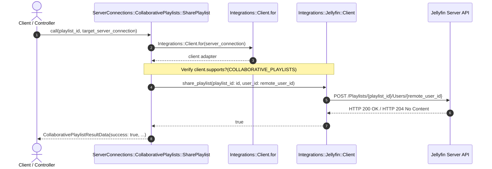
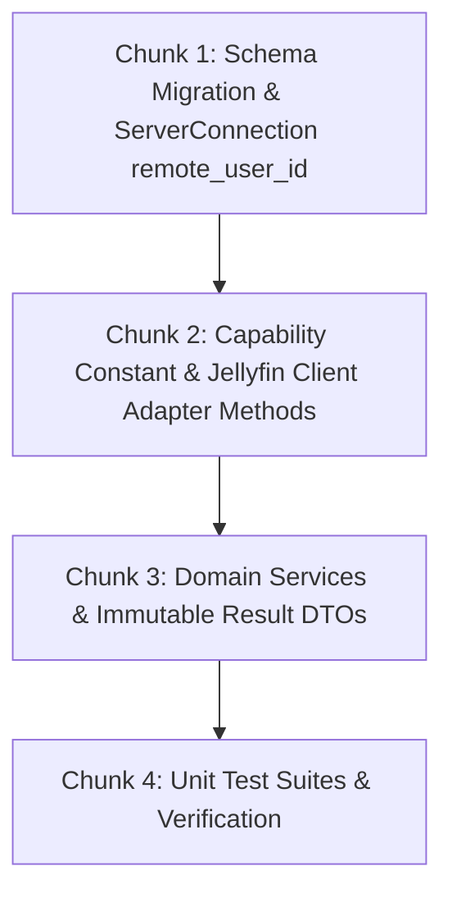

# Technical Specification: Backend Adapter, Capabilities & Hexagonal Services

**Issue:** [#41 - [Feature]: Collaborative Shared Playlists with Jellyfin Integration](https://github.com/sonzra/sonzra/issues/41)  
**Roadmap Reference:** [`specs/41/roadmap.md`](file:///root/Projects/sonzra/.worktrees/feat-41-collaborative-playlists/specs/41/roadmap.md)  
**Status:** Approved - Ready to Build  
**Target Output File:** `specs/41/tech-spec-epic-1-backend-collaborative-playlists.md`  
**Last Updated:** 2026-11-11  

---

## 1. Technical Architecture & Component Interaction

### System Topology & Interaction Flow
This epic builds the backend infrastructure to communicate with Jellyfin's collaborative playlist REST endpoints while isolating external boundaries via the Hexagonal pattern.



### Architectural Invariant Mapping ([Architectural Guidelines](file:///root/Projects/sonzra/docs/guidelines/architecture.md))
- **Hexagonal Boundary:** All upstream HTTP requests remain strictly confined to `Integrations::Jellyfin::Client`. No controllers or domain services make external HTTP calls.
- **Capability Checking:** Introduce `Integrations::Capabilities::COLLABORATIVE_PLAYLISTS`. The Jellyfin client adapter explicitly declares support; Plex client does not.
- **Service Objects & Immutable DTOs:** All operations live in `ServerConnections::CollaborativePlaylists::*`, returning immutable `Data.define` result objects implementing `#success?`.
- **Database Schema & Encryption:** Add a `remote_user_id` string column to `server_connections` to cache resolved upstream user IDs. Existing Active Record attribute encryption (`encrypts :username, :password, :access_token`) remains untouched.

---

## 2. Technical Decisions & Open Questions

### Tech Decision 1: Mapping Collaborators on the Same Instance
- **Resolved Date:** 2026-11-11
- **Selected Option:** Map collaborators exclusively across `ServerConnection` records belonging to the same `MediaServer` instance.
- **Rationale:** Guarantees privacy, eliminates cross-tenant leakage, and ensures every collaborator has a valid authenticated account on that physical Jellyfin server.

---

## 3. Data Contracts & Interfaces

### 3.1 Capability Declaration
```ruby
# app/services/integrations/capabilities.rb
module Integrations
  module Capabilities
    LETTER_FILTERING = :letter_filtering
    SONIC_GRAPH = :sonic_graph
    COLLABORATIVE_PLAYLISTS = :collaborative_playlists
  end
end
```

### 3.2 Jellyfin Client Methods
```ruby
# In app/services/integrations/jellyfin/client.rb
CAPABILITIES = [
  Integrations::Capabilities::LETTER_FILTERING,
  Integrations::Capabilities::SONIC_GRAPH,
  Integrations::Capabilities::COLLABORATIVE_PLAYLISTS
].freeze

def playlist_users(playlist_id)
  session = authentication
  token = session.fetch("AccessToken")
  get("Playlists/#{playlist_id}/Users", token).fetch("Users", [])
rescue Integrations::AuthenticationError, Integrations::ConnectionError => error
  raise
end

def share_playlist(playlist_id:, user_id:, can_edit: true)
  session = authentication
  token = session.fetch("AccessToken")
  uri = URI.parse("#{base_url}/Playlists/#{playlist_id}/Users/#{user_id}")
  uri.query = URI.encode_www_form(CanEdit: can_edit)
  request = Net::HTTP::Post.new(uri, authorization_headers(token))
  ensure_success!(perform(request))
  true
end

def unshare_playlist(playlist_id:, user_id:)
  session = authentication
  token = session.fetch("AccessToken")
  uri = URI.parse("#{base_url}/Playlists/#{playlist_id}/Users/#{user_id}")
  request = Net::HTTP::Delete.new(uri, authorization_headers(token))
  ensure_success!(perform(request))
  true
end
```

### 3.3 Domain Result Objects
```ruby
# app/services/server_connections/collaborative_playlists/collaborative_playlist_result_data.rb
module ServerConnections
  module CollaborativePlaylists
    CollaborativePlaylistResultData = Data.define(:success, :users, :message) do
      def success? = success
    end
  end
end
```

### 3.4 Service Implementation: `SharePlaylist`
```ruby
# app/services/server_connections/collaborative_playlists/share_playlist.rb
module ServerConnections
  module CollaborativePlaylists
    class SharePlaylist
      def initialize(server_connection, target_connection, playlist_id:, client: nil)
        @server_connection = server_connection
        @target_connection = target_connection
        @playlist_id = playlist_id
        @client = client
      end

      def call
        return failure("Provider does not support collaborative playlists") unless client.supports?(Integrations::Capabilities::COLLABORATIVE_PLAYLISTS)
        return failure("Target connection is not on the same media server") unless @target_connection.media_server_id == @server_connection.media_server_id

        remote_target_id = @target_connection.remote_user_id.presence || resolve_remote_user_id(@target_connection)
        return failure("Unable to resolve remote user account") if remote_target_id.blank?

        client.share_playlist(playlist_id: @playlist_id, user_id: remote_target_id)
        CollaborativePlaylistResultData.new(success: true, users: nil, message: nil)
      rescue Integrations::Error => error
        failure(error.message)
      end

      private

      def client
        @client ||= Integrations::Client.for(@server_connection)
      end

      def failure(message)
        CollaborativePlaylistResultData.new(success: false, users: nil, message: message)
      end
    end
  end
end
```

---

## 4. Implementation Chunking (Bite-Sized Slices)



### Chunk 1: Schema Migration & `ServerConnection`
- Migration: `add_remote_user_id_to_server_connections` (`t.string :remote_user_id, index: true`).
- Update `ServerConnection#client_options` to auto-cache `remote_user_id` when available.
- Add scope/helper `ServerConnection#fellow_instance_connections`.

### Chunk 2: Capabilities & Adapter Methods
- Declare `Integrations::Capabilities::COLLABORATIVE_PLAYLISTS`.
- Add `playlist_users`, `share_playlist`, and `unshare_playlist` to `Integrations::Jellyfin::Client`.
- Verify `Integrations::Plex::Client` does not declare capability.

### Chunk 3: Domain Services
- Create `FetchPlaylistUsers`, `SharePlaylist`, `UnsharePlaylist` in `ServerConnections::CollaborativePlaylists`.
- Implement `CollaborativePlaylistResultData` DTO.

### Chunk 4: Unit Tests & Quality
- Write tests in `test/services/integrations/jellyfin/collaborative_playlists_test.rb`.
- Write tests in `test/services/server_connections/collaborative_playlists/share_playlist_test.rb`.
- Run `bundle exec rubocop` and Rails test suite.
