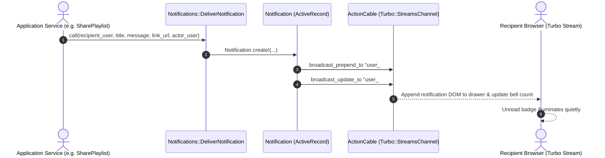
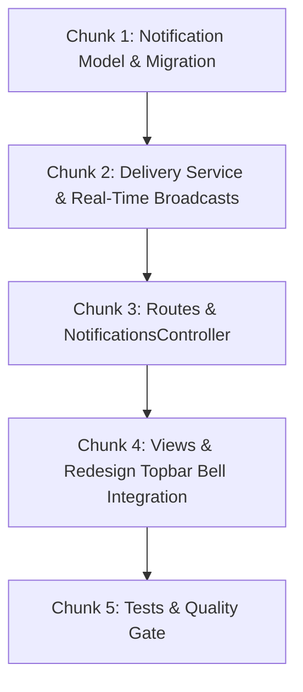

# Technical Specification: In-App Notification System & Real-Time Delivery

**Issue:** [#41 - [Feature]: Collaborative Shared Playlists with Jellyfin Integration](https://github.com/sonzra/sonzra/issues/41)  
**PRD Reference:** [`specs/41/epic-2-notification-system.md`](file:///root/Projects/sonzra/.worktrees/feat-41-collaborative-playlists/specs/41/epic-2-notification-system.md)  
**Roadmap Reference:** [`specs/41/roadmap.md`](file:///root/Projects/sonzra/.worktrees/feat-41-collaborative-playlists/specs/41/roadmap.md)  
**Status:** Approved - Ready to Build  
**Target Output File:** `specs/41/tech-spec-epic-2-notification-system.md`  
**Last Updated:** 2026-11-11  

---

## 1. Technical Architecture & Component Interaction

### System Topology & Interaction Flow
This epic establishes Sonzra's first in-app notification pipeline: an Active Record `Notification` model, a delivery service, an ActionCable Turbo Stream channel delivering live broadcasts to active user sessions, and a topbar drawer styled under the `.redesign` theme.



### Architectural Invariant Mapping ([Architectural Guidelines](file:///root/Projects/sonzra/docs/guidelines/architecture.md))
- **Active Record & Isolation:** Thin `Notification` model with user scoping, validations, and query scopes (`unread`, `recent`).
- **Service Objects:** `Notifications::DeliverNotification` encapsulates notification generation and error safety.
- **Hotwire & Streaming:** ActionCable broadcasts update the notification drawer and badge without altering the persistent audio player (`#player` with `data-turbo-permanent`).
- **UI & UX Tokens:** Topbar bell trigger and drawer components styled in `app/assets/stylesheets/redesign.css` using `--rz-*` design tokens, `lucide_icon "bell"`, and minimum 44x44px touch targets.

---

## 2. Technical Decisions & Open Questions

### Tech Decision 1: Notification Channel Scope
- **Resolved Date:** 2026-11-11
- **Selected Option:** Notifications are scoped strictly to the topbar drawer (no transient pop-up toasts across audio playback).
- **Rationale:** Preserves the "quiet listening room" philosophy and ensures no UI elements obstruct player controls or artwork.

---

## 3. Data Contracts, Schemas & Routes

### 3.1 Database Migration
```ruby
# db/migrate/20261111194100_create_notifications.rb
class CreateNotifications < ActiveRecord::Migration[8.1]
  def change
    create_table :notifications do |t|
      t.references :user, null: false, foreign_key: true
      t.references :actor_user, foreign_key: { to_table: :users }
      t.string :title, null: false
      t.string :message, null: false
      t.string :link_url
      t.datetime :read_at

      t.timestamps
    end

    add_index :notifications, [ :user_id, :read_at ]
    add_index :notifications, [ :user_id, :created_at ]
  end
end
```

### 3.2 Active Record Model: `Notification`
```ruby
# app/models/notification.rb
class Notification < ApplicationRecord
  belongs_to :user
  belongs_to :actor_user, class_name: "User", optional: true

  validates :title, :message, presence: true

  scope :unread, -> { where(read_at: nil) }
  scope :recent, -> { order(created_at: :desc).limit(30) }

  def read?
    read_at.present?
  end

  def mark_as_read!
    update!(read_at: Time.current)
  end
end
```

### 3.3 Routing
```ruby
# In config/routes.rb
resources :notifications, only: [ :index, :update, :destroy ] do
  collection do
    post :mark_all_read
  end
end
```

### 3.4 Controller: `NotificationsController`
- `index`: Renders the notification list inside the drawer Turbo Frame.
- `update`: Marks a single notification as read and redirects/streams the updated row.
- `mark_all_read`: Marks all unread notifications for `current_user` as read.
- `destroy`: Removes a notification.

### 3.5 Delivery Service: `Notifications::DeliverNotification`
```ruby
# app/services/notifications/deliver_notification.rb
module Notifications
  class DeliverNotification
    def initialize(user, title:, message:, link_url: nil, actor_user: nil)
      @user = user
      @title = title
      @message = message
      @link_url = link_url
      @actor_user = actor_user
    end

    def call
      notification = @user.notifications.create!(
        title: @title,
        message: @message,
        link_url: @link_url,
        actor_user: @actor_user
      )

      broadcast_realtime(notification)
      notification
    end

    private

    def broadcast_realtime(notification)
      # Turbo Streams broadcast to user's private stream
      Turbo::StreamsChannel.broadcast_prepend_to(
        "user_#{@user.id}_notifications",
        target: "notifications_list",
        partial: "notifications/notification",
        locals: { notification: notification }
      )

      Turbo::StreamsChannel.broadcast_update_to(
        "user_#{@user.id}_notifications",
        target: "notifications_unread_count",
        partial: "notifications/badge",
        locals: { count: @user.notifications.unread.count }
      )
    end
  end
end
```

---

## 4. Implementation Chunking (Bite-Sized Slices)



### Chunk 1: Database Migration & Model
- Create migration `20261111194100_create_notifications.rb`.
- Define `app/models/notification.rb` with associations, scopes, and validations.
- Add `has_many :notifications, dependent: :destroy` to `User`.

### Chunk 2: Delivery Service & Streams
- Build `Notifications::DeliverNotification`.
- Set up Turbo Stream partials (`notifications/notification` and `notifications/badge`).

### Chunk 3: Routes & Controller
- Define RESTful routes in `config/routes.rb`.
- Build `NotificationsController` handling Turbo Stream format and HTML fallbacks.

### Chunk 4: Views & Redesign UI
- Update `app/views/shared/_navigation.html.erb` with the bell trigger and drawer popover.
- Style drawer in `app/assets/stylesheets/redesign.css` adhering to `.redesign-*-dialog` and popover conventions.
- Implement `notifications_controller.js` for toggling the drawer, handling clicks outside, and auto-dismissing on navigation.

### Chunk 5: Tests & Quality Verification
- Model unit tests (`test/models/notification_test.rb`).
- Controller tests (`test/controllers/notifications_controller_test.rb`).
- RuboCop check (`bundle exec rubocop`).
