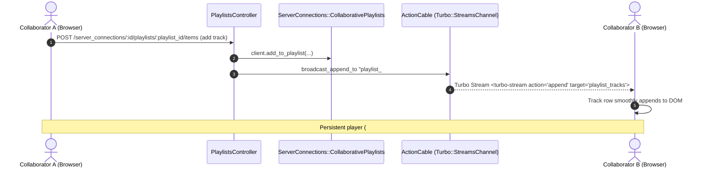
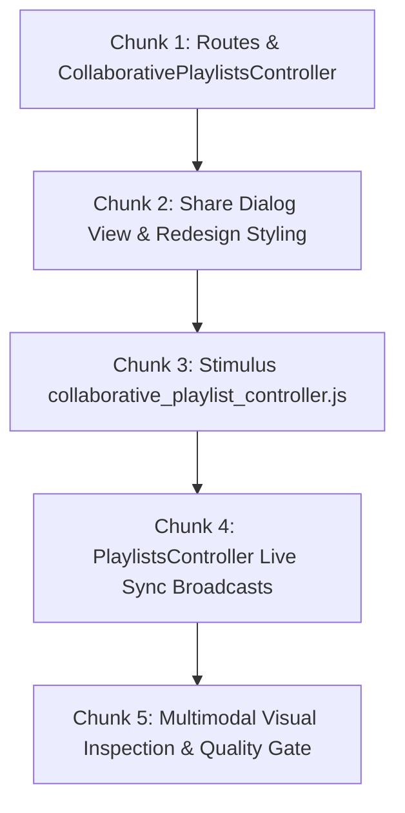

# Technical Specification: Collaborative Playlist Management UI & Real-Time Live Sync

**Issue:** [#41 - [Feature]: Collaborative Shared Playlists with Jellyfin Integration](https://github.com/sonzra/sonzra/issues/41)  
**PRD Reference:** [`specs/41/epic-3-collaborative-playlist-ui-sync.md`](file:///root/Projects/sonzra/.worktrees/feat-41-collaborative-playlists/specs/41/epic-3-collaborative-playlist-ui-sync.md)  
**Roadmap Reference:** [`specs/41/roadmap.md`](file:///root/Projects/sonzra/.worktrees/feat-41-collaborative-playlists/specs/41/roadmap.md)  
**Status:** Approved - Ready to Build  
**Target Output File:** `specs/41/tech-spec-epic-3-collaborative-playlist-ui-sync.md`  
**Last Updated:** 2026-11-11  

---

## 1. Technical Architecture & Component Interaction

### System Topology & Interaction Flow
This epic connects the backend collaborative playlist services and notification pipeline to the user interface. It provides collaborator badge indicators in the playlist hero, a canonical `.redesign-share-playlist-dialog` for managing co-owners, and ActionCable Turbo Streams that broadcast track mutations live across all active collaborator sessions.



### Architectural Invariant Mapping ([Architectural Guidelines](file:///root/Projects/sonzra/docs/guidelines/architecture.md))
- **Hexagonal Integrity:** Controller actions query collaborator state through domain services and client capability checks (`client.supports?(Integrations::Capabilities::COLLABORATIVE_PLAYLISTS)`).
- **Hotwire & Streaming:** Live sync uses Turbo Stream channels identified by media server and playlist ID (`playlist_#{server_connection.media_server_id}_#{playlist_id}`). The persistent player container (`#player` with `data-turbo-permanent`) remains completely untouched.
- **UI & UX Tokens:** Share dialog follows the canonical `.redesign-*-dialog` specification with `backdrop-filter: blur(20px)`, `--rz-raised` surface, circular close button, and $\ge 44\text{px}$ touch targets.

---

## 2. Technical Decisions & Implementation Contracts

### 2.1 Route Definitions
```ruby
# config/routes.rb
resources :server_connections do
  # Collaborative playlist management
  resources :playlists, only: [] do
    member do
      get :collaborators, to: "collaborative_playlists#index"
      post :collaborators, to: "collaborative_playlists#create"
      delete "collaborators/:target_connection_id", to: "collaborative_playlists#destroy", as: :collaborator
    end
  end
end
```

### 2.2 Controller: `CollaborativePlaylistsController`
```ruby
# app/controllers/collaborative_playlists_controller.rb
class CollaborativePlaylistsController < ApplicationController
  before_action :set_server_connection
  before_action :verify_collaborative_capability

  def index
    @playlist_id = params.expect(:id)
    @eligible_connections = @server_connection.fellow_instance_connections
    @existing_collaborator_ids = fetch_collaborator_remote_ids(@playlist_id)
    render layout: false
  end

  def create
    target_connection = @server_connection.fellow_instance_connections.find(params.expect(:target_connection_id))
    result = ServerConnections::CollaborativePlaylists::SharePlaylist.new(
      @server_connection, target_connection, playlist_id: params.expect(:id)
    ).call

    if result.success?
      Notifications::DeliverNotification.new(
        target_connection.user,
        title: "Playlist Shared",
        message: "#{current_user.email_address.split('@').first} shared a playlist with you.",
        link_url: library_item_server_connection_path(target_connection, params.expect(:id)),
        actor_user: current_user
      ).call

      render json: { success: true }, status: :ok
    else
      render json: { error: result.message }, status: :unprocessable_entity
    end
  end

  def destroy
    target_connection = @server_connection.fellow_instance_connections.find(params.expect(:target_connection_id))
    result = ServerConnections::CollaborativePlaylists::UnsharePlaylist.new(
      @server_connection, target_connection, playlist_id: params.expect(:id)
    ).call

    if result.success?
      render json: { success: true }, status: :ok
    else
      render json: { error: result.message }, status: :unprocessable_entity
    end
  end

  private

  def set_server_connection
    @server_connection = current_user.server_connections.find(params.expect(:server_connection_id))
  end

  def verify_collaborative_capability
    client = Integrations::Client.for(@server_connection)
    head :forbidden unless client.supports?(Integrations::Capabilities::COLLABORATIVE_PLAYLISTS)
  end
end
```

### 2.3 Live Sync Integration in `PlaylistsController`
When tracks are added or removed, `PlaylistsController` broadcasts to the shared playlist stream:

```ruby
# app/controllers/playlists_controller.rb
def add_item
  client.add_to_playlist(playlist_id: params.expect(:playlist_id), item_ids: playlist_item_ids)
  cache_remote_user_id
  broadcast_track_addition(params[:playlist_id], playlist_item_ids)
  head :no_content
end

def remove_item
  client.remove_from_playlist(playlist_id: params.expect(:playlist_id), entry_id: params.expect(:entry_id))
  cache_remote_user_id
  broadcast_track_removal(params[:playlist_id], params[:entry_id])
  head :no_content
end

private

def broadcast_track_addition(playlist_id, item_ids)
  # Broadcast to playlist channel
  stream_name = "playlist_#{server_connection.media_server_id}_#{playlist_id}"
  # Append track partial via Turbo::StreamsChannel
end

def broadcast_track_removal(playlist_id, entry_id)
  stream_name = "playlist_#{server_connection.media_server_id}_#{playlist_id}"
  Turbo::StreamsChannel.broadcast_remove_to(
    stream_name,
    target: "playlist_entry_#{entry_id}"
  )
end
```

### 2.4 Views & Stimulus Controller
- In `app/views/library_items/show.html.erb`:
  ```erb
  <% if kind == :playlist %>
    <%= turbo_stream_from "playlist_#{@server_connection.media_server_id}_#{item["Id"]}" %>
  <% end %>
  ```
- Stimulus controller `collaborative_playlist_controller.js`:
  - Opens the share modal.
  - Submits collaborator share/unshare toggles via `fetch`.
  - Animates state transitions with loading feedback.

---

## 3. Implementation Chunking (Bite-Sized Slices)



### Chunk 1: Routes & Controller
- Define collaborator routes in `config/routes.rb`.
- Implement `CollaborativePlaylistsController` with `#index`, `#create`, `#destroy`.

### Chunk 2: Views & Dialog Styling
- Build `app/views/collaborative_playlists/_dialog.html.erb` using `.redesign-*-dialog` patterns.
- Add collaborator pill badges to the playlist hero header in `app/views/library_items/show.html.erb`.
- Add "Share Playlist" button in `.detail-hero__options-menu`.
- Update `app/assets/stylesheets/redesign.css`.

### Chunk 3: Stimulus Controller
- Create `app/javascript/controllers/collaborative_playlist_controller.js`.
- Handle dialog opening, closing, keyboard `Esc`, and optimistic toggle updates.

### Chunk 4: Real-Time Live Sync
- Add Turbo Stream subscription to playlist detail page.
- Connect `PlaylistsController#add_item` and `#remove_item` to `Turbo::StreamsChannel`.

### Chunk 5: Verification & Quality Gate
- Run `bundle exec rubocop` (0 offenses).
- Run Rails test suite and Vitest.
- Multimodal visual verification on Desktop (`1440x900`) and Mobile (`390x844`).
- Check `sonzra-tizen` parity implications.
